# Метод и пайплайн автоматического обнаружения сейсмических событий (форк EQTransformer) — полное описание

## 0. Назначение документа

Документ описывает конвейер автоматической обработки непрерывных записей региональной сейсмической сети Северного Кавказа целиком — от исходных данных до бюллетеня событий, сравнимого по форме с официальными бюллетенями ФИЦ ЕГС РАН. Для каждого этапа объединены физическое объяснение и технические подробности: что измеряется или оценивается, при каких предположениях, каким алгоритмом и как это реализовано в коде — модули, функции, параметры, команды, форматы данных и особенности эксплуатации.

Обнаружение на одной станции, сетевое событие, его магнитуда и гипоцентр — разные результаты обработки. Нейросеть определяет моменты вступлений на записи; ассоциация связывает вступления разных станций с общим источником; амплитуды и расстояния используются для оценки локальной магнитуды ML; совместное решение по временам прихода даёт координаты и глубину очага.

В работе подготовлены и проверены решения для применения EQTransformer к длительным региональным записям: продолжение обработки после разрывов, расчёт в оперативной памяти с MC Dropout, двухпоисковая ассоциация, отбор станций для ML, региональное уточнение гипоцентров и статистическое сокращение выдачи. Для каждого решения прослеживается связь между исходной проблемой, способом её устранения, физическим и алгоритмическим обоснованием, реализацией и результатом проверки.

Документ самодостаточен: объяснения метода и его реализации изложены внутри соответствующих разделов; ссылки на код и научные первоисточники позволяют проследить их основания. Основной внешний эталон — бюллетени ФИЦ ЕГС РАН. Результаты приводятся вместе с выборками и конфигурациями; полнота относительно эталона, ошибки положения очага, согласованность магнитуд и сокращение выдачи рассматриваются раздельно. Проверки отдельных компонентов не объявляются единым сквозным замером.

Описывается выбранный конвейер. Его рабочие настройки могут отличаться от значений CLI по умолчанию; альтернативные и исторические режимы выделяются отдельно. Рабочие компоненты представлены под согласованными целевыми именами `core`, включая компоненты, чьи реализации ещё находятся в `context/scratch`. Техническая готовность интерфейсов указывается отдельно от выбранного метода.

---

## 1. Общая схема конвейера

Землетрясение излучает продольные **P** и поперечные **S** объёмные волны; P распространяются быстрее S. Станция регистрирует колебания грунта, обычно по вертикальной Z и двум горизонтальным N/E компонентам. Разность времён вступлений P и S позволяет приближённо оценить расстояние до очага, а амплитуда несёт информацию о силе события с учётом затухания и условий регистрации. Для ассоциации и локации используются также таблицы времён пробега — годографы, учитывающие распространение волн в принятой модели среды.

Выбранная последовательность включает девять этапов. На схеме показаны модули, основные результаты и вспомогательные входы:

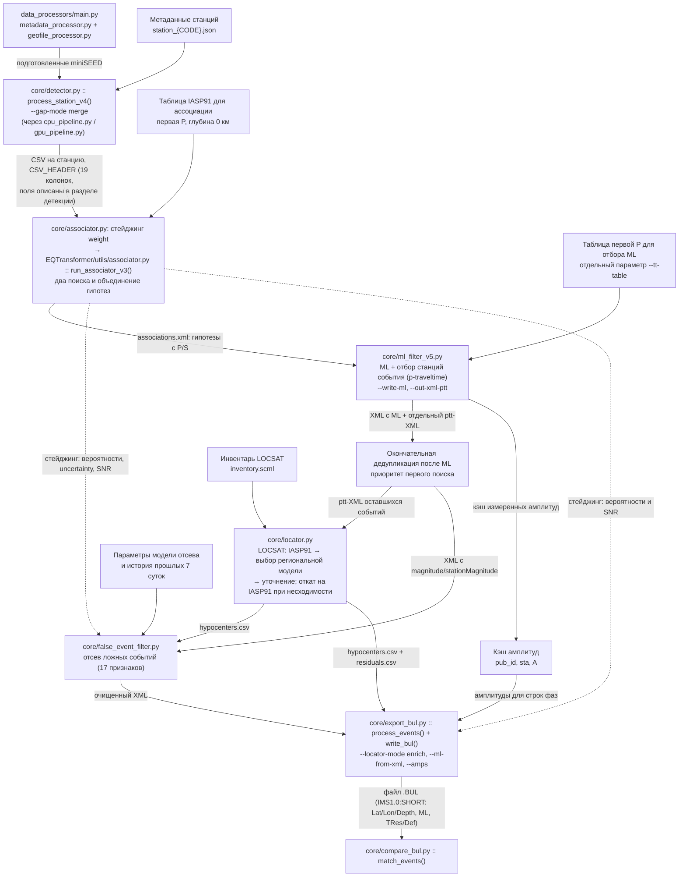

| Этап и модуль | Основные входные данные | Что определяется или отбирается |
|---|---|---|
| Подготовка: `data_processors/` | непрерывные записи и StationXML | файлы выбранного периода, агрегированные сведения о сети, каналах и координатах |
| Детекция: `detector.py`, CPU/GPU-обёртки | записи и станционные JSON | границы детекций, времена P/S, вероятности, uncertainty и SNR; CSV на станцию |
| Ассоциация: `associator.py` | staging станционных обнаружений, координаты и годограф первой P | гипотезы сетевых событий двух поисков с P/S разных станций; QuakeML |
| ML: `ml_filter_v5.py` | вступления, амплитуды, координаты, отдельный годограф первой P | группа станций для ML, магнитуды события и станций, прохождение ML ≥ 1.5; отдельная группа вступлений для LOCSAT |
| Окончательная дедупликация | прошедшие ML гипотезы обоих поисков и их происхождение | оставленные event ID с приоритетом первичного поиска; обе XML-ветки ограничиваются этими ID |
| Локация: `locator.py` | дедуплицированный ptt-XML, инвентарь и таблицы LOCSAT | широта, долгота, глубина, собственное время очага и невязки; выбранное решение IASP91 или региональной модели |
| Отсев: `false_event_filter.py` | основной XML со станционными ML, гипоцентры, staging, история и параметры модели | события, проходящие порог статистического балла по 17 признакам |
| Экспорт: `export_bul.py` | XML после отсева, гипоцентры, невязки, кэш амплитуд и staging | автоматический бюллетень IMS1.0:SHORT с S–P-временем, ML из XML и доступными параметрами LOCSAT |
| Сравнение: `compare_bul.py` | автоматический и эталонный BUL | сопоставленные и пропущенные события эталона, расхождения времени и диагностика координат; сопоставление магнитуд — отдельная проверка §13 |

Ассоциатор объединяет два независимых поиска, удаляя до ML только полностью одинаковые наборы станция/P/S. После расчёта ML окончательная дедупликация сохраняет первичные гипотезы и последовательно добавляет альтернативы, если среди оставленных нет совпадения одновременно по не менее чем четырём точным парам «станция, время P» и по отдельному S–P-времени очага с допуском 10 с. Исходные event publicID и принадлежность поиску сохраняются через ML; правила расчёта времени и обработки альтернатив раскрываются в разделе дедупликации.

После ML данные идут двумя ветками. Основной XML содержит пики и `magnitude/stationMagnitude` для отсева и экспорта. Отдельный ptt-XML содержит выбранные P, согласные S и начальное приближение для LOCSAT; он может включать только часть событий основного XML. Группы вступлений для магнитуды и локации выбираются отдельно и могут различаться. Окончательная дедупликация ограничивает обе ветки оставленными event ID без пересчёта пиков и магнитуд. Гипоцентры связываются с основным XML по event publicID, невязки — также по идентичности вступления.

В итоговом бюллетене сохраняется отдельная оценка времени очага по S–P; координаты и глубина добавляются из выбранного решения LOCSAT. Невязки относятся к этому решению, включая его собственное время очага, и не пересчитываются от S–P-времени заголовка. Магнитуда берётся из основного ML-XML, а амплитуды — из кэша того же запуска. Staging сохраняется как источник вероятностей, uncertainty и SNR для последующих вычислений и станционной истории.

`main.py` подготавливает miniSEED и агрегированный JSON. Файлы `station_{CODE}.json` для детектора и инвентарь LOCSAT подготавливаются отдельно. Согласованный список станций используется в детекторе и staging; NEUR исключена из выбранного набора из-за известных сдвигов времени записи.

Таблицы ассоциации, отбора станций ML и LOCSAT задаются каждому потребителю отдельно. Для ассоциации принят IASP91 при глубине 0 км; LOCSAT сначала получает решение IASP91, затем уточняет его по региональной модели, выбранной по исходному эпицентру. `fit_traveltime.py` строит дополнительный эмпирический вариант таблицы первой P; это не обязательный подготовительный этап выбранного конвейера.

`core/validate_associator_v2.py` используется как диагностическая утилита и библиотека функций S–P для экспорта. Его самостоятельный запуск и сравнение с `catalog.xlsx` не являются обязательными стадиями основной цепочки.

Эталонный бюллетень нужен для проверки и обучения статистического отсева. Применение обученного отсева и остальные этапы обработки новых записей выполняются без обращения к эталону. Основная проверка — MPVA эталона ≥ 1.5, не менее четырёх общих станций и окно ±60 с; отдельно повторяется окно ±10 с. Это сопоставление событий, а не проверка правильности всех отдельных фаз.

---

## 2. Подготовка входных данных (`data_processors/`)

### Физический смысл исходных данных

Исходные записи хранятся в miniSEED и содержат отсчёты регистрирующего прибора. Фактический набор компонент и непрерывность зависят от доступных данных. Для измерения амплитуды в единицах смещения грунта требуется снять инструментальный отклик; список каналов и координаты станции его не заменяют.

Метаданные в формате **StationXML** (стандарт FDSN) описывают координаты станций, каналы, инструментальные отклики и периоды их действия. Координаты сопровождают обнаружения и используются при расчёте расстояний и положения очага. Отклики нужны позднее для ML. Для LOCSAT отдельно подготавливается инвентарь на период обработки; наличие станции и локации проверяется на время вступления.

Подготовка копирует и переименовывает файлы выбранного периода, сохраняя исходные отсчёты и времена в заголовках. Правая граница периода не включается: например, диапазон с 1 января до 1 апреля охватывает январь–март. Год архива должен соответствовать настройке подготовки; фактическое время записи определяется её заголовками.

### Оркестрация: `main.py`

`data_processors/main.py` координирует подготовку метаданных и волновых файлов. Запуск — `python data_processors/main.py`; настроенные пути вычисляются от корня репозитория через `_ROOT` и не зависят от текущей рабочей директории. CLI у скрипта нет: пути заданы в начале `main.py`. Схема текущих путей:

```text
metadata_xml_folder_path     = workspace/data_processors/input/metadata
json_stationlist_output_path = workspace/data_processors/output/station_list_RU.json
geofile_input_directory      = workspace/data_processors/input/raw
geofile_output_directory     = workspace/data_processors/output/geofiles
```

**Шаг 1 (метаданные)** запускается, если существует `metadata_xml_folder_path`. Существование выходного JSON не является условием запуска: переменная `json_stationlist_exist` вычисляется, но в проверке не используется. `combine_inventories_to_json()` открывает выходной файл в режиме `'w'`: создаёт его или перезаписывает существующий. Родительскую директорию эта функция не создаёт.

**Агрегированный и станционные JSON.** Этот шаг пишет один файл `{STA1: {...}, STA2: {...}, ...}`. Детектор через `_build_stations()` формирует путь `--json-dir/station_{CODE}.json` для каждой выбранной станции; такие файлы подготавливаются отдельно, `main.py` их не создаёт. Внутри JSON должен присутствовать ключ станции из заголовка miniSEED. Текущая предобработка читает по этому ключу `network` и `coords`; наличие других станций в том же словаре само по себе не мешает чтению, но агрегированный файл не подставляется автоматически вместо ожидаемых имён файлов.

`core/associator.py` JSON метаданных не открывает и флага `--json-dir` не имеет: координаты станций поступают в ассоциацию через CSV детектора.

**Шаг 2 (сейсмические файлы)** запускается, если существуют входная и выходная директории. `get_directories()` передаёт в `geofile_processor()` все подпапки первого уровня входной директории как станции. Поэтому вход должен указывать на уровень, непосредственно содержащий каталоги станций, например `<SDS>/2024/RU/`; корень многолетнего SDS-архива этому условию не соответствует. Внутри каталогов станций обход рекурсивный.

Если условие запуска не выполнено, скрипт печатает соответствующие булевы признаки (`XML`, `JSON`, `INPUT`, `OUTPUT`) и пропускает шаг. Это не общий перехват ошибок: исключения при чтении XML или копировании файлов могут прервать выполнение.

### Формат хранения и копирование записей: `geofile_processor.py`

Архив организован по схеме **SDS** (SeisComP Data Structure):

```text
<SDS>/ГОД/СЕТЬ/СТАНЦИЯ/КАНАЛ.ТИП/СЕТЬ.СТАНЦИЯ.ЛОКАЦИЯ.КАНАЛ.ТИП.ГОД.ДЕНЬ_ГОДА
```

Один файл соответствует станции, каналу и суткам, но может содержать несколько фрагментов, разделённых разрывами.

Для стандартного имени SDS удаляются две последние точечные части (`YEAR.DAY`) и добавляются вычисленные границы суток:

```text
NET.STA.LOC.CHAN.TYPE.YEAR.DAY
→ NET.STA.LOC.CHAN.TYPE__start__end

RU.SOC.U4.BHE.D.2024.092
→ RU.SOC.U4.BHE.D__20240401T000000Z__20240402T000000Z
```

В високосном 2024 году день 092 — 1 апреля. Поле типа `D` сохраняется. Полученное имя соответствует regex обоих режимов детектора; код локации в нём может быть пустым или содержать до двух букв/цифр верхнего регистра.

Фильтр применяется к вычисленной дате начала суток:

$$
\text{дата\_начала} \le t < \text{дата\_конца}
$$

Диапазон дат — константы вверху файла, не параметр функции:

```python
date_from = datetime(2024, 4, 1)
date_to   = datetime(2024, 6, 1)   # не включается
```

Для каждой станции создаётся выходной каталог (`os.makedirs(..., exist_ok=True)`), а исходный каталог обходится рекурсивно через `os.walk`. Номер дня берётся из последней точечной части имени (`file_name.split('.')[-1]`). Полная структура SDS-имени, его год и тип данных отдельно не проверяются: для первичного отбора достаточно числового суффикса в диапазоне `1–365`.

Дата вычисляется как 1 января `date_from.year` плюс `DAY−1` суток. Затем проверяется попадание в `[date_from, date_to)`. Отсюда два ограничения:

- День 366 пропускается даже в високосном году: 31 декабря 2024 года этот код не копирует.
- Год исходного файла игнорируется. Например, суффикс `2025.092` при текущем `date_from.year=2024` также даст дату 1 апреля 2024 года. При этом времена внутри miniSEED останутся прежними. Поэтому год входного архива необходимо согласовать с `date_from.year`; изменение одного `date_to` не делает обработку многолетней.

Прошедшие отбор файлы копируются через `shutil.copy2` в плоскую папку станции. Вложенная структура не сохраняется; совпадающие выходные имена могут перезаписывать друг друга. Даты в имени обозначают вычисленные границы суток, а фактический диапазон записи детектор получает из заголовков трасс.

Для станций сети `N0` следует отдельно проверить согласованность кодов: в имеющихся метаданных используется `N0` с цифрой ноль, а в части SDS-архива — `NO` с буквой O. Этот модуль сохраняет префикс исходного имени и сетевой код в miniSEED, автоматического преобразования `NO` ↔ `N0` здесь нет.

### Метаданные станций: `metadata_processor.py`

Выходной JSON объединяет станции из просмотренных XML-файлов; ключ — код станции. Пример записи:

```json
{
  "SOC": {
    "network": "RU",
    "channels": ["BHE", "BHN", "BHZ"],
    "coords": [43.57, 39.763, 54.0]
  }
}
```

`coords` содержит широту и долготу в градусах и высоту станции в метрах. `channels` содержит коды каналов. В текущем `preprocessorV7_mem` компоненты выбираются по каналам фактически прочитанных трасс, а не по этому списку JSON.

`read_inventory_file(file_path)` строит `{station_code: {...}}` из одного XML со следующими особенностями, важными для эксплуатации:

- код станции берётся как `network.stations[0].code` — то есть ключ определяется **первой** станцией сети в этом XML, даже если в сети (в этом конкретном файле) их несколько;
- `coords` перезаписываются на каждой итерации внутреннего цикла по станциям сети — в результат попадают координаты **последней** станции цикла, не обязательно той, чей код стал ключом;
- список каналов фильтруется условием `channel.start_date >= last_date`, где `last_date` — start_date **последнего по порядку в XML** канала (а не максимум по всем каналам, цикл просто перезаписывает переменную) — при непредсказуемом порядке каналов в файле результат зависит от их фактического порядка.

Из-за этих трёх особенностей модуль рассчитан на XML с ровно одной станцией на сеть (типичный экспорт FDSN station-service по станции) — на многостанционных XML координаты и каналы разных станций могут перемешаться под одним ключом.

`combine_inventories_to_json(xml_folder_path, json_output_path)` обходит имена с окончанием `.xml` в одной папке (`os.listdir`, без рекурсии и сортировки). Для новой станции данные добавляются целиком; для уже встреченной `channels` дополняется через `extend` без дедупликации, а `coords` и `network` остаются от первого встреченного файла. При нескольких версиях метаданных результат поэтому зависит от порядка обхода. Станции разных сетей с одинаковым кодом также получают один ключ.

Результат пишется через `json.dump(..., indent=4)`. При `FileNotFoundError` во время открытия выходного файла печатается сообщение об ошибке, но следом всё равно выводится «Данные успешно сохранены». Эта строка сама по себе не подтверждает создание JSON.

Связь с последующими стадиями: станционный JSON → `preprocessorV7_mem` → атрибуты сети и координат → CSV детектора → ассоциация. Для снятия инструментального отклика и построения инвентаря LOCSAT нужны исходные StationXML: JSON со списком каналов и координатами их не заменяет.

---

## 3. Нейросетевая модель EQTransformer

### Архитектура

Модель принимает окно записи длиной 60 с — 6000 отсчётов при 100 Гц по трём компонентам:

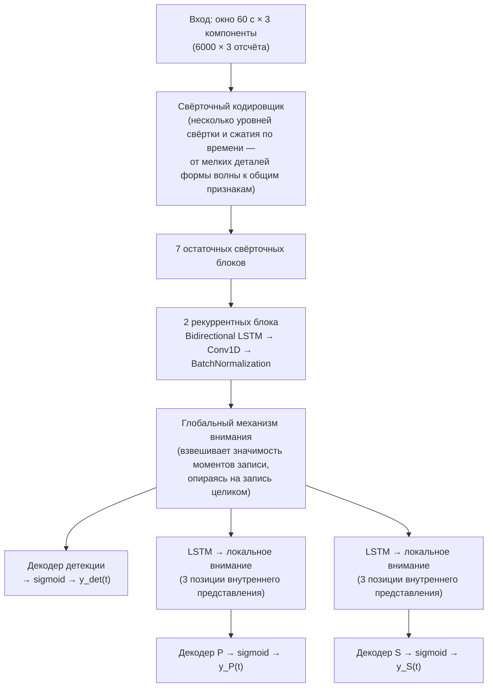

Модель формирует три вероятностные кривые той же длины, что и входное окно: $y_{\mathrm{det}}(t)$ выделяет интервал сигнала события, $y_P(t)$ и $y_S(t)$ — положения вступлений соответствующих фаз. Каждый выход принимает значения от 0 до 1. Это три связанные задачи, использующие общее представление записи. Двунаправленные рекуррентные блоки учитывают контекст до и после рассматриваемой позиции.

В рабочем запуске модель загружается из `ModelsAndSampleData/EqT_original_model.h5` (переопределяется через `--model-path`), а не создаётся вызовом `cred2()`. Поэтому число блоков проверяется по сохранённой конфигурации H5:

| Часть модели | Конфигурация рабочего H5 |
|---|---|
| Вход | `(batch, 6000, 3)` |
| Кодировщик | 7 пар Conv1D + MaxPooling1D; длина временного представления уменьшается до 47 позиций |
| Свёрточная часть | 7 остаточных блоков, по 2 Conv1D в каждом |
| Рекуррентная часть | 2 блока Bidirectional LSTM с 16 units в каждом направлении, затем Conv1D с ядром 1 и BatchNormalization |
| Глобальное внимание | `attentionD0` → `attentionD`, оба с `attention_width=None` |
| Ветви P и S | по одному LSTM с 16 units и `SeqSelfAttention(attention_width=3)` |
| Три декодера | по 7 ступеней увеличения разрешения со свёртками; Cropping1D согласует длину |
| Выходы | `detector`, `picker_P`, `picker_S`, каждый `(batch, 6000, 1)`, sigmoid |

`cred2` и его помощники описывают способ построения этой архитектуры, но текущие значения конструктора не тождественны сохранённой модели. В частности, `cnn_blocks=5` задаёт число итераций цикла, который дополнительно создаёт блоки при `cb>2`, а `BiLSTM_blocks=3` не соответствует двум блокам рабочего H5.

Глобальное внимание связывает признаки разных частей окна. При `attention_width=3` и `history_only=False` локальное внимание использует позиции `i−1`, `i`, `i+1` с обрезкой на краях. Это позиции сжатого представления перед декодером, а не ±3 исходных отсчёта и не окно, предварительно вырезанное вокруг найденного P/S. Ветви получают контекст общего кодировщика и глобального внимания.

Исходная модель EQTransformer обучалась на STEAD — глобальном наборе сейсмических и шумовых записей ([Mousavi et al., 2020](https://doi.org/10.1038/s41467-020-17591-w)). В данном конвейере локальное дообучение не выполняется. Изменение параметров LSTM при загрузке описано в разделе 4, в подразделе о загрузке модели и cuDNN-патче.

Основные файлы: `EQTransformer/core/EqT_utils.py` — конструктор `cred2`, пользовательские слои и `picker`; `EQTransformer/core/predictor.py` — `predictor_mem_non_hdf_load_model_v6` и writer результатов; `EQTransformer/utils/hdf5_maker.py` — `preprocessorV7_mem`. `core/detector.py::worker_v4` связывает предобработку и предиктор.

### Предобработка окна перед подачей в модель

`preprocessorV7_mem` сначала обрабатывает поступивший сегмент, затем нарезает его на окна модели:

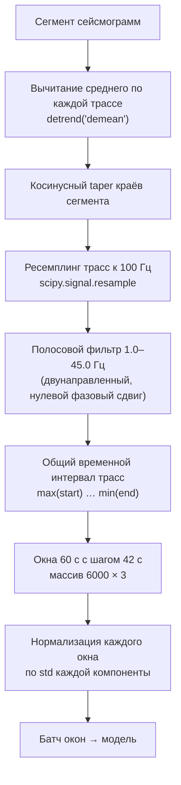

Из каждой трассы сегмента вычитается её среднее. Сглаживание краёв уменьшает влияние резкого обрыва записи при последующих преобразованиях.

Taper задаётся как `max_percentage=0.001`, `max_length=2` с. Для трасс с частотой, отличной от 100 Гц, вычисляется `new_npts=round(npts·100/fs)`, вызывается FFT-ресемплинг `scipy.signal.resample`, затем `sampling_rate` устанавливается в `100.0`. В текущем теле функции `st.resample()` не вызывается, несмотря на старое описание в докстринге.

Фильтр применяется уже при 100 Гц: `bandpass`, 1–45 Гц, `corners=2`, `zerophase=True`. Его верхняя граница ниже нового Найквиста 50 Гц; повышение частоты исходной записи при этом не восстанавливает отсутствовавшие в ней высокочастотные данные.

После фильтрации трассы обрезаются к общему интервалу. Окна строятся только пока в этом интервале помещаются 60 с; `overlap=0.3` из `worker_v4` даёт шаг 42 с. Данные каждой компоненты приводятся к 6000 отсчётам: лишние отбрасываются, недостающие дополняются нулями.

Колонки входа соответствуют E, N, Z. Код также сопоставляет каналы с окончаниями `1`/`2` колонкам E/N, но последующая проверка наличия буквенных E/N может обнулить эти колонки. Поэтому поддержку набора `1/2/Z` нельзя считать эквивалентной E/N/Z.

Предиктор собирает массив `X` формы `(N,6000,3)` и нормализует каждое окно по временной оси независимо для каждой компоненты:

$$
s_{n,c}=\operatorname{std}_{t}(X_{n,t,c}),\qquad
\widetilde{s}_{n,c}=
\begin{cases}
1,&s_{n,c}=0,\\
s_{n,c},&s_{n,c}\ne0,
\end{cases}
\qquad
X^{\text{норм}}_{n,t,c}=\frac{X_{n,t,c}}{\widetilde{s}_{n,c}}.
$$

Деление на собственное стандартное отклонение уменьшает различия физического масштаба записей разных станций и событий. Абсолютная амплитуда для ML измеряется позднее по исходной записи с учётом инструментального отклика, а не по нормализованному входу модели.

Здесь `std` вычисляется как `X.std(axis=1, keepdims=True)`. Среднее по каждому 60-секундному окну дополнительно не вычитается. Это отличается от `DataGeneratorPrediction.normalize(mode='std')`, где перед делением вычитается среднее окна. Предварительный `demean` всего сегмента не делает эти операции тождественными.

### Оценка неопределённости (Monte Carlo Dropout)

Для оценки устойчивости предсказания одно и то же окно обрабатывается с разными случайными масками отключённых связей. В выбранной конфигурации формируются пять стохастических реализаций каждого из трёх выходов. Пусть M — число входных окон, N — число стохастических реализаций:

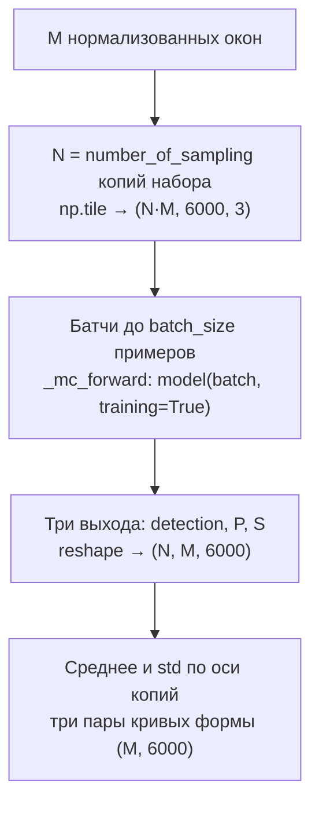

$$
\hat{y}(t) = \frac{1}{N}\sum_{i=1}^{N} y_i(t)
\qquad\qquad
\sigma(t) = \sqrt{\frac{1}{N}\sum_{i=1}^{N} \big(y_i(t) - \hat{y}(t)\big)^2}
$$

Рабочая настройка конвейера — `--estimate-uncertainty --number-of-sampling 5`. Параметры передаются через обработку станции до предиктора; в режиме merge используется `process_station_v4`.

`_mc_forward` обёрнута в `tf.function` и вызывает `model(batch, training=True)`. Все копии сначала объединяются, затем обрабатываются батчами: при 13 окнах, 5 копиях и `batch_size=32` это 65 примеров и три вызова — 32, 32 и 1 пример. Затем отдельно для detection, P и S вычисляются среднее и стандартное отклонение по оси копий.

`training=True` действует на всю модель, включая незамороженные BatchNormalization-слои. В рабочем H5 они имеют `trainable=True`, а загрузчик их не замораживает: используются статистики текущего батча и обновляются скользящие статистики. Поэтому такую реализацию нельзя описывать как изменение только dropout или гарантированно эквивалентный перенос последовательных проходов в батчи. Влияние этой особенности на качество здесь не измерялось ([Keras 2.10, BatchNormalization](https://github.com/keras-team/keras/blob/v2.10.0/keras/layers/normalization/batch_normalization.py)).

При `estimate_uncertainty=False` выполняется `model.predict()`, а массивы std заполняются нулями; в CSV отсутствие оценки записывается как NaN. Это не гарантия детерминированности: у SpatialDropout1D в сохранённом графе H5 явно задан `training=True`, поэтому эти слои активны и без общего training-режима.

Среднее $\hat{y}(t)$ используется как итоговая выходная вероятность, а стандартное отклонение $\sigma(t)$ — как показатель её разброса между реализациями. Малый разброс означает устойчивость выхода к принятой стохастической процедуре, но сам по себе не устанавливает правильность фазы. Uncertainty безразмерна и не является погрешностью времени вступления в секундах. Неопределённости P/S учитываются при подготовке обнаружений и статистическом отсеве; весами голосования двухпоискового ассоциатора они не являются.

### Извлечение пиков (`EqT_utils.py::picker`)

`picker()` получает три средние вероятностные кривые и соответствующие std. Он ищет максимумы вероятности вступления, а не амплитуды сейсмограммы:

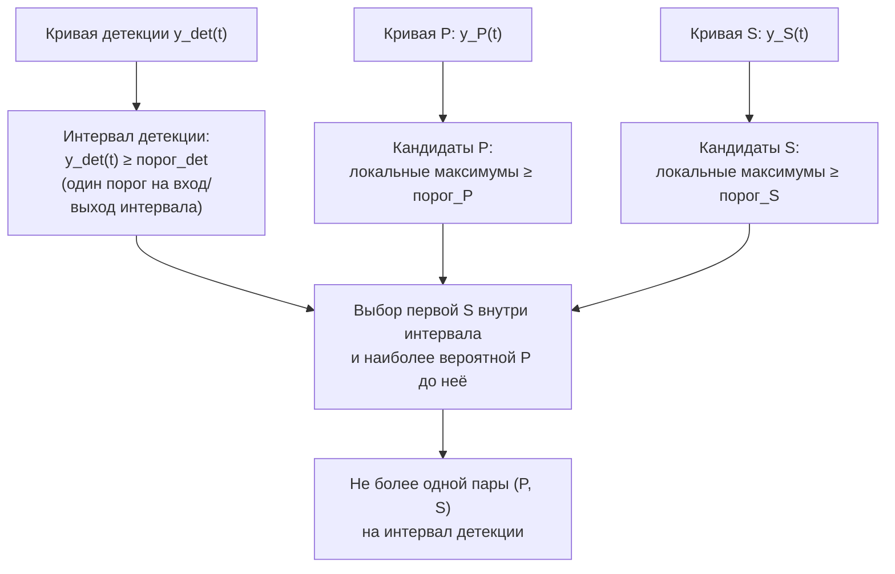

1. `trigger_onset(yh1, detection_threshold, detection_threshold)` выделяет интервалы детекции с одинаковым порогом включения и выключения. Обрабатываются интервалы с `end−begin≥10` отсчётов.
2. `_detect_peaks(..., mph=порог, mpd=1)` находит локальные максимумы P/S с вероятностью не ниже порога. Первый и последний отсчёты не считаются пиками; у плоского максимума используется восходящий край.
3. Для каждого интервала выбирается первая S строго внутри его границ.
4. При наличии S кандидаты P должны удовлетворять `P>begin−100` и `P<S−10`; без S — `P>begin−100` и `P<end`. При 100 Гц это допускает P менее чем за 1 с до начала детекции и требует разрыва P–S более 0.1 с. Из кандидатов выбирается P с наибольшей вероятностью; при равенстве остаётся первый.

`picker()` может вернуть несколько интервалов на окно, не более одной P и одной S на интервал. Но вызываемый `_gen_writer_mem_non_hdf_v10` рассматривает только первый элемент `matches`. Если он не проходит дальнейшие условия, остальные интервалы этого окна не проверяются.

В рабочем режиме `keepPS=True` writer требует обе фазы и строгий интервал `S−P<45` с. При `keepPS=False` достаточно одной фазы; `allowonlyS=False` дополнительно исключает S без P. Writer также подавляет результат, если начало детекции отличается менее чем на 2 с от уже сохранённого начала; эта память общая для окон одного вызова предиктора на сегмент.

Вероятность и uncertainty детекции усредняются по её интервалу, а для P/S берутся в отсчёте выбранного пика. `picker` округляет их до трёх знаков, writer — до двух перед записью CSV.

**Ключевое уточнение о физическом смысле найденного момента.** Момент, извлечённый на этом шаге, — это положение локального максимума **вероятностной кривой**, а не положение максимума амплитуды колебания на исходной записи. Метки обучающей выборки строятся вокруг **момента вступления фазы** — первого заметного отклонения записи от фонового шума при приходе P или S волны, а не вокруг момента наибольшей амплитуды колебания внутри самой фазы. Соответственно найденный моделью пик физически ближе к «моменту начала вступления», чем к «максимальному значению колебания». Это принципиально иной момент, чем тот, что используется позже, отдельно, для оценки магнитуды (разд. 7) — там намеренно измеряется именно максимум амплитуды в фиксированном окне после S-вступления, а не момент вступления. Оба момента лежат на одной и той же записи, но не совпадают друг с другом и решают разные задачи.

### Пороги: рабочие значения и официальные рекомендации

В [официальном README](https://github.com/smousavi05/EQTransformer#tutorials) рекомендации различаются для original и conservative:

| Модель | Рекомендуемые пороги (README оригинала) |
|---|---|
| `EqT_original_model.h5` («original») | детекция ≈ 0.5, P/S ≈ 0.3 |
| «conservative» | P/S ≈ 0.03; отдельное значение детекции в этой рекомендации не указано |

Рабочие значения проекта — `detection_threshold=0.75`, `P_threshold=0.3`, `S_threshold=0.2`. Они являются дефолтами CLI детектора и обеих обёрток и передаются аргументами до `worker_v4` и предиктора; изменить их можно через `--detection-threshold`, `--p-threshold`, `--s-threshold`.

Относительно рекомендации original порог детекции выше, P совпадает, S ниже. Поэтому весь набор нельзя назвать просто «более строгим».

---

## 4. Модуль детекции: `core/detector.py`, `core/cpu_pipeline.py`, `core/gpu_pipeline.py`

### Нарезка на сегменты и окна

Записи станции обрабатываются сегментами длиной 10 минут с шагом 5 минут. Перекрытие уменьшает влияние границ на распознавание вступлений. После последнего полного шага дополнительно рассматривается хвостовой сегмент, заканчивающийся на конце доступной записи:


Сплиттер просматривает файлы непосредственно в каталоге станции. Ожидаемое имя — `NET.STA.LOC.CHAN.TYPE__start__end` (разд. 2). Группировка выполняется по `{STA}_{start}` из имени: сеть, локация и канал в ключ не входят. Все файлы группы читаются в один `Stream`; один файл может дать несколько объектов `Trace`, например отдельные куски одного канала.

Первичная проверка `len(st_all)≥2` считает трассы, а не разные компоненты. То же относится к проверке выдаваемого сегмента: требуется не менее двух трасс с непустыми данными. Наличие именно E/N/Z этими условиями не гарантируется.

Диапазон `[date_from,date_to)` проверяется по `st_all[0].stats.starttime`, до merge. Запись не обрезается по границам запрошенного периода: принятая группа может продолжаться после `date_to`, а группа с началом до `date_from` пропускается целиком. Для штатных суточных файлов поэтому задаются границы целых суток.

Полные сегменты имеют длительность 600 с и шаг 300 с. После цикла при `t<end_time` дополнительно берётся `[end_time−600,end_time]`. Эта проверка не исключает повтор последнего полного сегмента: на непрерывной записи длительностью ровно 1200 с получаются начала 0, 300, 600 и повторно 600 с. Для короткой группы хвостовой запрос может начинаться раньше доступных данных; `slice()` вернёт только имеющуюся запись.

Внутри каждого сегмента после предобработки формируются окна модели по 60 с с шагом 42 с — перекрытие 18 с (разд. 3). Два масштаба перекрытия уменьшают влияние границ сегментов и окон; короткий остаток, в который не помещается полное окно модели, отдельно не анализируется. Окна сегмента и их стохастические реализации обрабатываются батчами, а не отдельным вызовом на каждое окно.

Повторная обработка хвоста прежде всего увеличивает объём вычислений. Возникшие повторные детекции далее проходят отбор и дедупликацию при ассоциации, а повторные гипотезы событий — окончательную дедупликацию после ML. Поэтому повтор окна не означает появления второго события в бюллетене. Полная неизменность результата при повторной обработке с MC Dropout не гарантируется.

### Разрывы записи: `--gap-mode {first-trace, merge}`

Суточный файл станции не всегда непрерывен: запись может прерываться на секунды или часы. У сплиттера два режима обработки таких файлов:

| `--gap-mode` | Реализация | Поведение |
|---|---|---|
| `first-trace` | `process_station_v3` → `geofile_splitter_multi_chanels_v3` | границы нарезки берутся только из первой трассы; запись за её концом не попадает в сегменты |
| `merge` (по умолчанию) | `process_station_v4` → `geofile_splitter_multi_chanels_v4` | куски склеиваются, границы нарезки берутся по объединённому Stream; пропуски заполняются интерполяцией |

В рабочем режиме вызывается `st_all.merge(method=1, fill_value='interpolate')`: склейка идёт по идентификатору трассы, включающему сеть, станцию, локацию и канал. После успешного merge начало равно минимальному starttime, конец — максимальному endtime среди оставшихся трасс.


Интерполяция обеспечивает техническую непрерывность массива для фильтрации и обработки записи после пропуска. Она не восстанавливает сейсмические колебания: наличие или отсутствие события внутри пропуска по такому заполнению определить нельзя. Ограничения на длительность интерполируемого разрыва нет; сегменты могут включать синтетически заполненные участки, а непрерывные куски не обрабатываются независимо.

Если merge выбрасывает исключение, границы берутся из сохранённой перед вызовом ссылки `tr0`. Копия исходного Stream не создаётся и не восстанавливается, поэтому эту ветку нельзя описывать как гарантированный возврат к неизменённым исходным данным.

После нарезки `preprocessorV7_mem` снова ограничивает каждый сегмент общим пересечением времён его трасс (разд. 3). Таким образом, широкий диапазон `min(start)…max(end)` у сплиттера не гарантирует, что весь он дойдёт до модели.

Пограничные случаи:

| Случай | Следствие |
|---|---|
| Две компоненты вместо трёх | сегмент может пройти сплиттер; отсутствующая компонента модели заполняется нулями |
| Один канал, разбитый на несколько кусков | первичная проверка числа Trace может пройти; после успешной склейки останется одна трасса и сегменты не пройдут проверку `len(segment)≥2` |
| Общий интервал короче 60 с | предобработка не сформирует ни одного окна модели |
| Длинный пропуск между кусками одного канала | при успешном merge заполняется интерполяцией без отдельного ограничения длины |
| Несовместимые частоты кусков одного идентификатора | merge может завершиться исключением; используется описанная выше ветка с `tr0` |
| Разные начала/концы компонент | предобработка сокращает сегмент до общего пересечения |

Обе версии сплиттера — генераторы: они читают одну группу файлов и отдают её сегменты последовательно. `slice()` может разделять массивы с исходными трассами, поэтому `st_all` остаётся жив до завершения обработки группы; `del segment` не освобождает всю связанную память. Дополнительно RAM занимают модель, подготовленные окна, MC-копии и результаты, поэтому «одна группа + один сегмент» не является полным пределом памяти процесса.

Проверка на мае 2024 выявила конкретную причину потери наблюдений: ограничение нарезки концом первого фрагмента. В старом режиме затронуты 214 станцие-суток из примерно 1510; оценка около 10% относится к объёму необработанной записи, а не к доле затронутых станцие-суток. По отдельным станциям доля потерянной записи достигала PXTR 70%, URKR 59%, UNCR 49%, DBC 37%, DRN 31%. Переход к merge устраняет эту причину ограничения охвата и позволяет анализировать наблюдённую запись после разрыва. Эти числа не являются долей пропущенных землетрясений.

### Пороги на выходе модели

| Порог | Действующее значение | Смысл |
|---|---|---|
| порог детекции | $0.75$ | ниже этого значения интервал детекции не формируется |
| порог P | $0.30$ | минимальная вероятность для кандидата P |
| порог S | $0.20$ | минимальная вероятность для кандидата S |

Порог детекции ограничивает число кандидатов, а более низкий порог S допускает менее выраженные S-вступления. Это рабочие настройки сети, а не универсальные физические границы. Сравнение с рекомендациями original и conservative приведено в разд. 3.

$$
0<\Delta T=T_S-T_P<45\text{ с},\qquad
R \approx k\Delta T,\qquad
k=\frac{V_PV_S}{V_P-V_S}\approx8.33\text{ км/с}.
$$

При постоянных скоростях $V_P=6.0$ и $V_S=3.4883$ км/с 45 с соответствуют примерно 375 км. Это ориентир для ограничения пары, а не жёсткий географический радиус детектора: времена пробега зависят от глубины, строения среды и фаз. `--sp-limit` измеряется в секундах: writer сравнивает разность индексов S/P с `spLimit·100`. Подпись «км» в help прямого `detector.py` не соответствует реализации.

Все перечисленные параметры передаются аргументами по цепочке CLI → обработка станции → `preproc_sequential_v5` → `worker_v4` → предиктор:

| CLI-флаг | Параметр предиктора | По умолчанию |
|---|---|---|
| `--detection-threshold` | `detection_threshold` | 0.75 |
| `--p-threshold` | `P_threshold` | 0.30 |
| `--s-threshold` | `S_threshold` | 0.20 |
| `--keep-ps` / `--no-keep-ps` | `keepPS` | True |
| `--allow-only-s` | `allowonlyS` | False |
| `--sp-limit` | `spLimit` | 45 с |
| `--batch-size` | `batch_size` | 32 |

Эти флаги доступны и при прямом запуске, и в обеих обёртках. Условия выбора и записи пиков описаны в разд. 3.

### Точка входа по станции: `process_station_v4`

Рабочая цепочка: `process_station_v4` → `geofile_splitter_multi_chanels_v4` → `preproc_sequential_v5` → `worker_v4` → `preprocessorV7_mem` и `predictor_mem_non_hdf_load_model_v6`. Режим `first-trace` выбирает `process_station_v3` и splitter v3; последующая обработка общая. Выбор функции выполняется в точке запуска, а не внутри `process_station_v3`.

При прямом запуске `python core/detector.py --stations ...` станции обрабатываются последовательно одной загруженной моделью. `--gap-mode` одинаково действует здесь и в CPU/GPU-обёртках.

Рабочая настройка неопределённости — `--estimate-uncertainty --number-of-sampling 5`. У прямого детектора и CPU-обёртки CLI по умолчанию выключает оценку uncertainty и задаёт 10 копий; у GPU-обёртки она включена и задано 5 копий. Поэтому рабочие параметры следует указывать явно.

### Загрузка модели и cuDNN-патч

`load_model_cudnn_v2` выполняет `load_model(..., compile=False)` с пользовательскими слоями → `_patch_lstm_inplace` → `compile()`. Патч проходит по LSTM, включая оба направления Bidirectional, и присваивает `lstm.cell.recurrent_dropout=0.0`, `lstm.cell.implementation=2`. Обученные матрицы весов этим кодом не заменяются, но режим recurrent dropout меняется.

В рабочей GPU-конфигурации LSTM выполняются через ускоренные cuDNN-ядра. Рекуррентная часть рабочей модели содержит шесть LSTM-ячеек: по две в каждом из двух Bidirectional-блоков и по одной в ветвях P и S. CPU-обёртка скрывает GPU и использует тот же загрузчик для CPU-выполнения. Предупреждение о несовместимости LSTM с cuDNN при загрузке возникает до применения патча и само по себе не описывает режим последующего инференса.

### Отношение сигнал/шум

Для P и S оценивается изменение уровня записи после найденного вступления относительно участка перед ним. Используемый показатель SNR выражен в децибелах:

$$
\mathrm{SNR}=10\lg\!\left[
\left(\frac{Q_{95,\text{после}}}{Q_{95,\text{до}}}\right)^2
\right],
$$

В реализации показатель рассчитывает `_get_snr`. Здесь $Q_{95}$ — 95-й процентиль отсчётов, собранных по трём компонентам соответствующего участка. Номинальная длительность участков до и после пика — по 100 отсчётов (1 с при 100 Гц); у края окна она сокращается. Это принятая мера контраста записи, а не отношение полной энергии сигнала к энергии шума.

SNR сохраняется вместе с обнаружением и используется при оценке времени очага и статистическом отсеве. Его пороговая проверка на подготовке ассоциации доступна, но в выбранных настройках выключена. Вес вероятность × SNR в дальнейшей оценке времени использует непосредственно значение в дБ.


В модели отсева логарифмируется медиана сохранённых SNR после ограничения снизу величиной 0.1; это эмпирическое преобразование значения в дБ, а не перевод в линейное отношение.

### Результат: CSV на станцию

Для каждой станции сохраняется список обнаружений: границы интервалов, времена P/S и показатели качества. В выбранном режиме требуются обе фазы; одна строка CSV соответствует станционному обнаружению, а не сетевому событию.

Полный `CSV_HEADER` (19 колонок):

```
file_name, network, station, instrument_type,
station_lat, station_lon, station_elv,
event_start_time, event_end_time,
detection_probability, detection_uncertainty,
p_arrival_time, p_probability, p_uncertainty, p_snr,
s_arrival_time, s_probability, s_uncertainty, s_snr
```

`preproc_sequential_v5` открывает `output_csv` в режиме `'w'`, сразу пишет этот заголовок, затем на каждый сегмент вызывает `worker_v4`, сразу пишет вернувшиеся строки и делает `flush()` — детекции появляются в файле по ходу обработки, не только в конце. Каждые 50 сегментов — `gc.collect()`.

`worker_v4` перехватывает ошибки сегмента и возвращает статус вместе с пустым результатом; сплиттер также перехватывает ошибки отдельных чтений и групп. Поэтому итоговый статус станции `success` означает отсутствие исключения, дошедшего до внешней обёртки, и не доказывает успешную обработку каждого сегмента.

Лог сегментов пишется в конце обработки станции в режиме `'w'`, по умолчанию в общий `workspace/detector/output/processing_log.csv`. Последовательный запуск перезаписывает его для каждой станции; параллельные воркеры пишут конкурентно без синхронизации. Этот файл нельзя использовать как полный журнал всех станций. `--log-file` есть у прямого `detector.py`; CPU/GPU-обёртки отдельного флага для него не предоставляют. Основные CSV разделены по станциям.

### `cpu_pipeline.py` / `gpu_pipeline.py`: пул процессов

Сегменты последовательно передаются через оперативную память, без промежуточного сохранения подготовленных окон на диск и без загрузки всего архива. Модель загружается один раз на рабочий процесс и используется повторно; несколько станций могут рассчитываться параллельно на CPU или GPU. Сохранение точности детекции при переходе к обработке в памяти подтверждено пользователем на исторических данных, отсутствующих сейчас в репозитории.

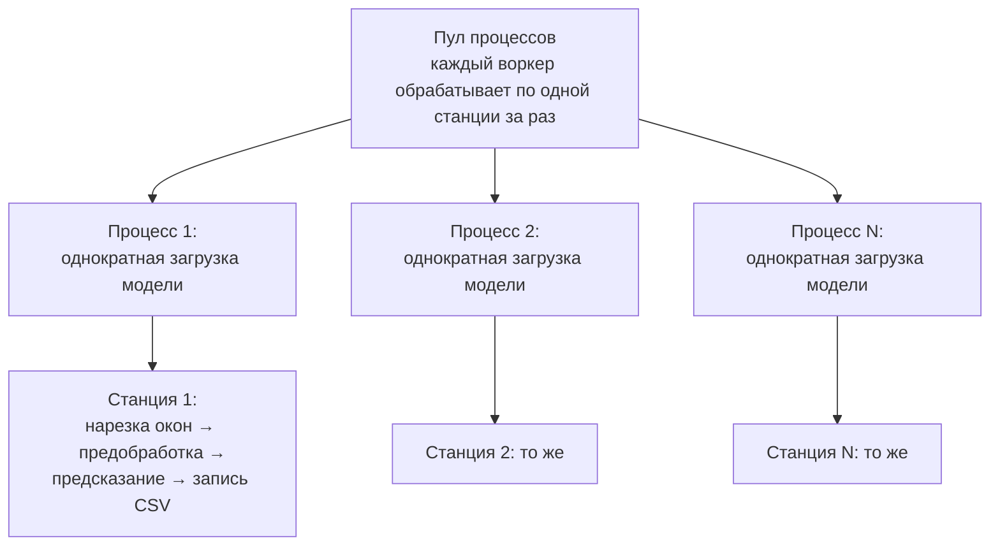

Обе обёртки используют `ProcessPoolExecutor`. Инициализатор каждого воркера настраивает устройство, загружает `core/detector.py` через `importlib` и один раз создаёт модель в глобальной `_model`. Задача `run_station` выбирает v4/v3 по `gap_mode` и обрабатывает одну станцию этой моделью. После завершения воркер может получить следующую станцию; модель между процессами не сериализуется.

Исключения вызова обработки станции возвращаются как `(station_name, "error", traceback)`. Ошибки инициализации процесса или самого пула этим обработчиком не покрываются.

Различия и текущие значения по умолчанию:

| | `cpu_pipeline.py` | `gpu_pipeline.py` |
|---|---|---|
| Устройство | GPU скрыт через `set_visible_devices([], 'GPU')` | при наличии GPU запрашивается `memory_growth` |
| `--max-workers` | 4 | 6 |
| TF-параллелизм | `--tf-threads-per-worker`, default 3; значение задаётся и inter-op, и intra-op | явных ограничений TF-потоков в обёртке нет |
| Оценка uncertainty | выключена, 10 копий | включена, 5 копий |
| Основные ресурсы для выбора числа воркеров | CPU и RAM | VRAM, CPU и RAM |

Число процессов автоматически под ресурсы не подбирается. В CPU-версии только `--tf-threads-per-worker 0` включает расчёт `max(1, os.cpu_count() // max_workers)`. Он использует все логические CPU и не учитывает процент из `threads.py`.

Для ручного расчёта используется `core/threads.py`:

$$
B=\left\lceil C\frac{p}{100}\right\rceil,
$$

где C — `os.cpu_count()` (логические CPU), p — выбранная доля, B — ориентировочный бюджет. Скрипт сейчас вызывает функцию с 80%; он не импортируется обёртками и не передаёт им параметры автоматически.

Для сервера с двумя Xeon, суммарно 40 физическими/80 логическими CPU и RAM 128 ГБ бюджет 75% равен 60. Пример настройки — `--max-workers 30 --tf-threads-per-worker 2`. Текущие 80% калькулятора дали бы 64, а не 60.

Произведение 30×2 — ориентир распределения вычислений, а не строгий предел всех потоков: inter-op и intra-op управляют разными видами параллелизма TensorFlow, дополнительно существуют потоки предобработки и библиотек. Число воркеров ограничивается также памятью на отдельные модели и MC-массивы.

В GPU-версии каждый процесс хранит собственную модель и рабочие массивы. `memory_growth` разрешает постепенное выделение VRAM, но не делит её поровну и не задаёт лимит на воркер; увеличение числа процессов не гарантирует ускорения.

---

## 5. Модуль ассоциации (`core/associator.py`)

Ассоциация объединяет обнаружения разных станций в гипотезы сетевых событий. Близости времён регистрации недостаточно: волны одного землетрясения приходят на станции с разными задержками. Метод ищет пробную точку источника и время очага, с которыми согласуются наблюдённые вступления после учёта времени распространения волн.

По принципу ассоциации подход близок к [REAL — Rapid Earthquake Association and Location (Zhang, Ellsworth, Beroza, 2019)](https://doi.org/10.1785/0220190052): перебираются пробные положения источника и подсчитываются вступления, совместимые с расчётными временами пробега. В нашей схеме эта идея реализована через согласованность оценок времени очага и поддержку P/S; два независимых поиска сохраняют альтернативные группы, а окончательное определение гипоцентра выполняется отдельно в LOCSAT.

### Шаг 1 — стейджинг: фильтрация и (опционально) взвешивание детекций

$$
H_\phi =
(T_\phi\text{ задано})\;\wedge\;
(q_\phi\ge q_{\phi,\min})\;\wedge\;
(SNR_\phi\ge SNR_{\phi,\min}\text{, если порог}>0),
\qquad \phi\in\{P,S\}.
$$

$$
q_D\ge q_{D,\min}\;\wedge\;
\begin{cases}
H_P\wedge H_S,&\texttt{keep\_ps=True},\\
H_P\vee H_S,&\texttt{keep\_ps=False}.
\end{cases}
$$

В рабочем режиме `weight` после проверки порогов применяется поправка

$$
p_{\text{эфф}}=p(1-u),
$$

где $u$ — безразмерный разброс выхода MC Dropout, а $p$ — исходная вероятность. Она уменьшает эффективную вероятность менее устойчивого выхода, но не задаёт погрешность времени вступления.

Здесь q — вероятность, используемая для проверки порога. `_passes` использует исходные значения, `_passes_v2` — эффективные `p·(1−u)` для detection, P и S. `_eff_prob` применяет поправку только при числовом u в диапазоне [0,1]; при отсутствующей или недопустимой uncertainty возвращается исходная вероятность.

Текущие пороги стейджинга: detection 0.75, P 0.35, S 0.20; проверки SNR выключены (`--p-snr-thr 0`, `--s-snr-thr 0`). По умолчанию достаточно одной прошедшей фазы (`--no-keep-ps`). Это отдельные пороги ассоциации: P=0.35 здесь отличается от P=0.30 на выходе детектора.

Режим задаётся `--uncertainty-mode`; рабочий сценарий использует `weight`:

| `UNCERTAINTY_MODE` | Какой фильтр (`prepare_station`) | Что записывается в `X_prediction_results.csv` |
|---|---|---|
| `'none'` | `_passes` (сырая вероятность) | вероятности как есть |
| `'filter'` | `_passes_v2` (эффективная вероятность) | вероятности как есть |
| `'weight'` | `_passes` (сырая вероятность — порог не меняется) | вероятности **переписываются** `_apply_weight()` на эффективные ($p \to p\cdot(1-u)$ для `detection_probability`, `p_probability`, `s_probability`, округление до 4 знаков) |

`prepare_station` читает `{source_dir}/{ST}/{st.lower()}.csv` и пишет `{input_dir}/{ST}/X_prediction_results.csv`, сохраняя набор колонок. Отбор выполняется по строке целиком: если строка прошла, отдельная P или S, не прошедшая свой порог, из неё не удаляется. В режиме `weight` времена и uncertainty сохраняются. Например, если строка прошла по S, её имеющаяся P с вероятностью ниже 0.35 из строки отдельно не удаляется.

Перед подготовкой удаляются каталоги станций, отсутствующих в текущем `--stations`. Но если станция остаётся в списке, а её исходный CSV отсутствует, выводится предупреждение; старый staging этой станции не удаляется. Поэтому повторное использование каталога требует проверки фактического состава входов.

### Шаг 2 — общий источник по годографу (`run_associator_v3`)

Функция `run_associator_v3` выполняет два независимых поиска по одному staging. Входы — времена P/S, координаты станций из CSV и таблица первой P; эталонный бюллетень при сборке не используется.

Перебираются точки $g$ в области 39–47° с.ш. и 36–50° в.д. с шагом 0.1° — 81×141=11 421 узел. Для станции $i$ по её координатам определяется эпицентральное расстояние $d_i(g)$ от пробной точки в километрах. Годограф $t_P(d)$ задаёт расчётное время пробега первой P-волны до станции. Тогда каждое наблюдённое вступление даёт оценку времени очага:

$$
T_{0P,i}(g)=T_{P,i}-t_P(d_i(g)).
$$

Здесь $T_{P,i}$ — измеренное время вступления, $t_P$ — время распространения в секундах. Если точка и принятая модель среды подходят группе наблюдений, полученные $T_{0P,i}$ близки между собой. Таким образом сравниваются оценки общего времени излучения, а не сами времена прихода.

Рабочая таблица ассоциации — IASP91 при глубине источника 0 км (`tt_p_iasp91_z0.csv`); она задаётся отдельно от таблицы отбора ML и таблиц LOCSAT. Глубина здесь фиксирована как расчётное приближение; на этом этапе она не определяется. Табличное время интерполируется по расстоянию, а за последней точкой таблицы продолжается с принятой скоростью 8 км/с.

Поддержка по S оценивается приближённо через тот же годограф:

$$
t_S(d)\approx\frac{V_P}{V_S}t_P(d),\qquad
\frac{V_P}{V_S}\approx1.72,
$$

$$
T_{0S,i}(g)=T_{S,i}-\frac{V_P}{V_S}t_P(d_i(g)).
$$

Отдельная таблица времён S в этой проверке не используется. Оценки времени по P и S помогают выбирать согласованную группу; окончательное определение гипоцентра выполняется позднее в LOCSAT.

Загрузчик staging оставляет строки с разбираемым временем P; строки только с S в поиск не входят. В голосовании используются времена и число разных станций. Вероятности detection/P/S не являются весами этого счёта: `weight` меняет содержимое CSV для последующих оценок времени и отсева, но не превращает голосование в сумму вероятностей.

### Выбор согласованной группы

1. Ось T0 делится на корзины шириной `2·tol=7` с; расчёт повторяется со сдвигом корзин 3.5 с. Станция даёт не более одного голоса P и одного голоса S в каждой корзине, даже если имеет несколько пиков.
2. Из допустимых корзин выбирается максимум балла $B$, определённого ниже.
3. В выбранном узле от каждой станции берётся P с оценкой T0, ближайшей к центру корзины, в пределах ±3.5 с. Это выбор по времени, а не по максимальной вероятности.
4. До двух раз уточняется узел: выбирается минимум дисперсии T0 по собранным P, центр заменяется их средним, пики собираются повторно. Уточнение принимается, если число станций не уменьшается и условия поддержки сохраняются.
5. Принятая гипотеза исключает часть детекций из дальнейшего поиска. Затем процедура повторяется на оставшихся.

Для принятия гипотезы необходимы не менее шести разных P-станций. Среди допустимых гипотез выбирается наибольшая суммарная поддержка:

$$
n_P\ge6,\qquad B=n_P+n_S\longrightarrow\max,
$$

где $n_P$ и $n_S$ — числа станций, поддерживающих пробную точку и интервал времени соответствующей фазой. S повышает балл, но не заменяет требование шести P-станций.

Допуск ±3.5 с учитывает ошибки определения вступлений и отклонения реальных времён пробега от принятого годографа. Более широкий допуск облегчает объединение случайных или принадлежащих разным событиям вступлений; слишком узкий может разделить наблюдения одного источника на недостаточные группы.

Способ исключения обнаружений после принятия гипотезы влияет на то, какие следующие события удастся собрать.

Обработка идёт кусками T0 по 300 с. При начале куска c пики P рассматриваются от `c−1` до `c+300+260` с; голосование T0 продолжается до `c+300+130` с с ограничением концом периода. Входной стейджинг также читается с запасом 130 с после конца периода. Эти запасы уменьшают влияние границ кусков, но не являются доказательством отсутствия любых граничных потерь.

### Зачем нужны два поиска

Первичный поиск после принятия события исключает все обнаружения, чьи P согласуются с его точкой и временем в пределах допуска. Вместе с повторами одного вступления так может исчезнуть другая полезная P той же станции.

Альтернативный поиск сохраняет больше вариантов и строже проверяет использование S:

| Действие | Первичный поиск | Альтернативный поиск |
|---|---|---|
| Исключение обнаружений после принятия гипотезы | все P, согласные с её точкой и временем | выбранная P и близкие копии той же станции с разностью времён не более 0.15 с |
| Поддержка по S | согласие S с пробной точкой и общим интервалом времени | дополнительно требуется согласие S со своей P из того же обнаружения |
| Исходные данные | полный подготовленный набор | тот же полный набор, независимо от результата первичного поиска |

Дополнительное условие второго поиска:

$$
\left|T_{0S,i}(g)-T_{0P,i}(g)\right|\le7\text{ с}.
$$

Оно проверяет, может ли данная пара P/S указывать на общее время излучения в пробной точке. При этом S по-прежнему должна поддерживать рассматриваемый интервал времени. Второй поиск не является обработкой остатка первого: он заново рассматривает исходные обнаружения, используя другой способ их исключения.

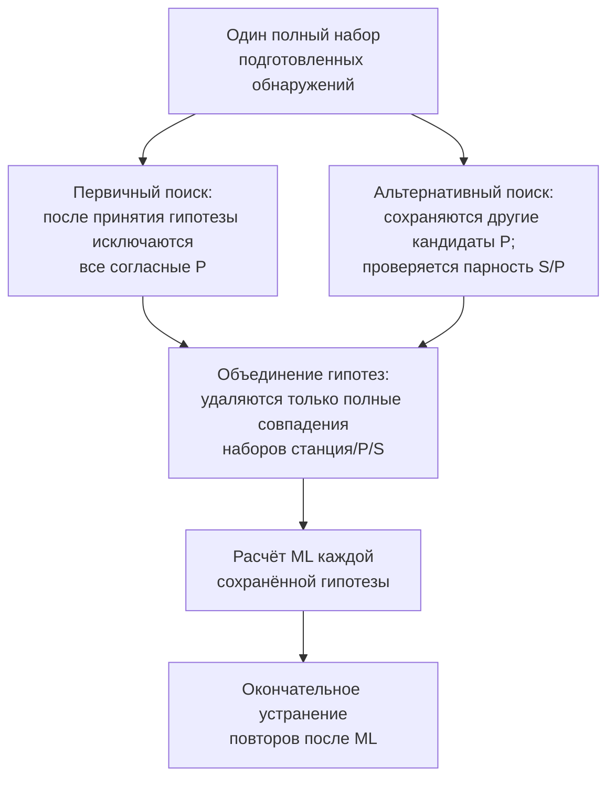

Проверка S влияет на поддержку узла. Она не очищает автоматически S в выходной гипотезе: writer сохраняет имеющуюся S выбранной строки, даже если она не участвовала в поддержке. Последующий отбор S для LOCSAT выполняется отдельно при подготовке ptt-XML.

### Объединение гипотез до ML

Сначала сохраняются гипотезы первого поиска. Из второго добавляются гипотезы, у которых полный отсортированный набор `(станция, время P, время S)` не совпадает с уже сохранённым. Новые добавленные наборы сразу учитываются при сравнении следующих альтернатив. Приблизительно похожие гипотезы сохраняются: различие P/S может изменить состав станций, расстояния и итоговую ML, поэтому одна гипотеза может пройти порог 1.5, а другая — нет.

Для окончательной дедупликации должна сохраняться принадлежность каждой гипотезы первому или второму поиску, связанная с её event publicID. Эта связь передаётся через ML-фильтрацию и определяет приоритет при удалении дублей.

Окончательное устранение похожих гипотез выполняется после ML с приоритетом первичного поиска. В нём сравниваются точные пары «станция, время P» и отдельно рассчитанные S–P-времена; это другая операция, чем удаление полных совпадений станция/P/S. Полный критерий и согласование двух XML-веток раскрываются в разделе окончательной дедупликации.

### Действующий альтернативный вариант: скользящее окно (`run_associator_v2`)

`run_associator_v2` сохранён и работоспособен, но в выбранный основной конвейер не входит. Он использует окно 50 с по времени P с шагом 25 с; внутри окна на станцию остаётся детекция с максимальной detection probability, затем объединяются соседние кандидаты и применяется `_coherent_subset`.

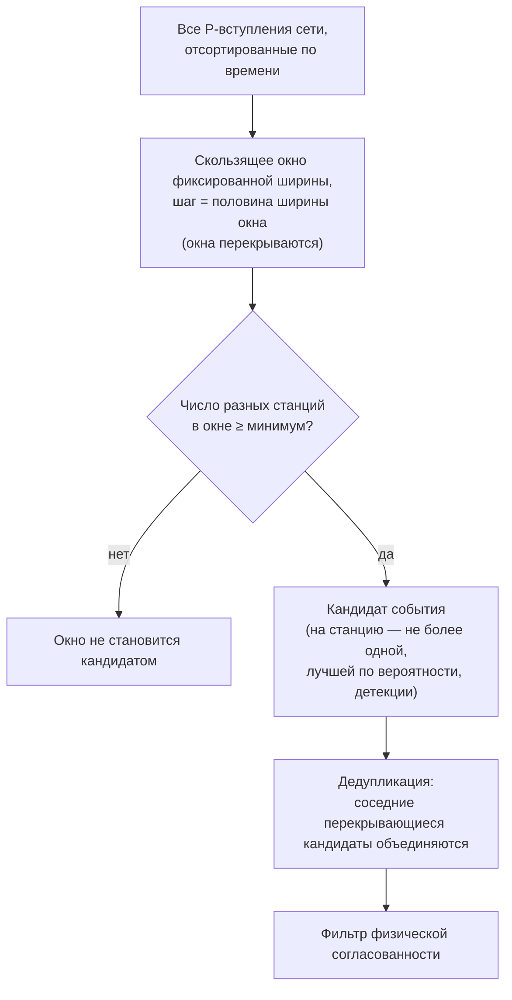

Перекрытие уменьшает зависимость результата от границ окон; соседние положения могут породить несколько кандидатов одного события. Они объединяются, если

$$
|t_1-t_2|\le\text{шаг}\quad\wedge\quad
|S_1\cap S_2|\ge\max(2,\texttt{pair\_n}-1),
$$

где $S_1$ и $S_2$ — множества станций, а `pair_n` — минимум станций этого альтернативного алгоритма. Внутри окна используется `np.searchsorted` для поиска границ по отсортированным временам; это отдельный механизм от сеточного голосования v3.

Проверка физической согласованности требует для каждой пары станций:

$$
|T_P(A)-T_P(B)|\le\frac{d(A,B)}{6.0}+\tau,
$$

где $d(A,B)$ — расстояние между станциями в километрах, 6.0 км/с — принятая скорость P, $\tau$ — временной допуск. В этом приближении допустимая разность приходов ограничивается временем пробега между станциями с запасом на ошибки вступлений и модели.

При нарушениях последовательно удаляется станция с наибольшим числом нарушений, при равенстве — с меньшей detection probability, пока набор не станет согласованным или станций не станет меньше требуемого минимума. На каждой итерации перебираются все пары. Более широкий допуск облегчает смешение разных событий, а слишком узкий может отвергнуть наблюдения одного источника; этот допуск не следует подменять параметром ±3.5 с поиска v3.

Только к v2 относятся параметры `moving_window`/`coherence_tolerance`, ограничение `consider_combination=False` и временная SQLite-база `phase_dataset` в текущей рабочей директории. База удаляется перед запуском, поэтому два v2-прогона из одной директории конфликтуют. Эти особенности не описывают поиск v3 по годографу.

Дополнительные выходы v2 — `Y2000.phs` (фазы hypoInverse, строка с координатами первой станции как заглушкой, `depth=5.0` и `mag=0.0`) и `traceNmae_dic.json` (словарь `{event_id: [имена_трасс]}` для извлечения исходных записей). Они не требуются основной цепочке QuakeML → ML → LOCSAT → BUL и не создаются основным writer v3.

### Выходные файлы

- **`associations.xml`** — основной вход ML: QuakeML с Event/publicID и Pick для выбранной P и имеющейся S каждой станции. Времена вступлений копируются из детекций.
- **Origin исходного XML** содержит время первой P и координаты соответствующей первой станции как плейсхолдеры. Найденная при голосовании точка не записывается этим writer как физическое решение локации. Стартовый origin ptt-XML формируется позднее в ML; гипоцентр определяется LOCSAT.

### Связь со следующими стадиями

Стейджинг сохраняется как отдельный источник вероятностей, uncertainty и SNR для оценки T0, отсева ложных событий и экспорта. QuakeML хранит времена и принадлежность пиков событию; он не заменяет staging CSV. После объединения гипотез выполняются ML, окончательная дедупликация и согласование набора ID основного XML и ptt-XML. Отдельные команды будущего интерфейса объединения здесь не задаются.

### Результат проверки

Рабочий результат двухпоисковой схемы после ML и экспорта для I квартала 2025 года — **86 из 112** событий эталона при окне ±60 с и **82 из 112** при ±10 с. Критерий — MPVA эталона ≥1.5 и не менее четырёх общих станций; совпадение времён отдельных фаз этим критерием не требуется. Для мая 2024 найдено **41 из 46** событий.

Проверка двухпоискового варианта выполнена в контрольных окнах около всех эталонных событий. Аналогичный результат полного прогона ожидается; эти числа не задают размер полной автоматической выдачи.

---

## 6. Расстояние и время очага по S–P (`core/validate_associator_v2.py`, библиотека для `export_bul.py`)

### Роль оценки в конвейере

Разность времён P- и S-вступлений позволяет оценить расстояние от станции до очага без предварительного знания его координат. В выбранном конвейере такая оценка используется при расчёте ML и проверке согласованности станций. Отдельная S–P-оценка времени очага применяется при окончательном устранении повторов и формировании бюллетеня. LOCSAT совместно определяет положение, глубину и собственное время очага по сети.

Функции расчёта находятся в `core/validate_associator_v2.py`. Его самостоятельный запуск сравнивает оценки с `catalog.xlsx` и остаётся диагностикой; основной результат проверяется по итоговому BUL через `export_bul.py` → `compare_bul.py`.

### Формула расстояния и времени очага

Для пары P/S одного источника в приближении однородной среды с постоянными скоростями $V_P>V_S$:

$$
T_P=T_0+\frac{R}{V_P},\qquad
T_S=T_0+\frac{R}{V_S}.
$$

Вычитая времена прихода, исключаем неизвестное время очага:

$$
\Delta T=T_S-T_P
=R\left(\frac{1}{V_S}-\frac{1}{V_P}\right),
$$

откуда

$$
R=\frac{V_PV_S}{V_P-V_S}\,\Delta T.
$$

Здесь $\Delta T$ измеряется в секундах, скорости — в км/с, расстояние $R$ — в километрах. Это приближённое расстояние «очаг—станция», гипоцентральное по смыслу, а не эпицентральное расстояние по поверхности. В реальной неоднородной среде времена пробега зависят от глубины и траекторий волн; постоянные скорости заменяют это строение расчётным приближением.

Время очага восстанавливается двумя эквивалентными способами:

$$
T_0=T_P-\frac{R}{V_P}=T_S-\frac{R}{V_S}.
$$

Оба выражения совпадают по построению: $R$ выведено из той же пары $(T_P,T_S)$. Это тождество, а не независимая проверка правильности вступлений.

### Скоростные приближения для ML и экспортного времени

Для исходного S–P-расстояния в расчёте ML используется одна пара скоростей:

$$
V_P=6.0\text{ км/с},\qquad
V_S=3.4883\text{ км/с},\qquad
k_{Pg}=\frac{V_PV_S}{V_P-V_S}\approx8.33\text{ км/с}.
$$

`estimate_origin_times` использует одну пару скоростей. Экспорт вызывает `estimate_origin_times_v2` и рассчитывает время по двухскоростной схеме. Сначала для каждой станции определяется предварительное расстояние $R_{Pg}=k_{Pg}\Delta T$, по которому выбирается режим:

| Условие | Принятый режим | Скорости P/S, км/с | Расстояние и время очага |
|---|---|---|---|
| $R_{Pg}<150$ км | Pg/Sg | 6.0 / 3.4883 | $R=R_{Pg}$, $T_0=T_P-R/6.0$ |
| $R_{Pg}\ge150$ км | Pn/Sn | 8.0 / 4.6 | $R=k_{Pn}\Delta T$, $k_{Pn}\approx10.82$ км/с; $T_0=T_P-R/8.0$ |

Первый режим использует скорости коровых волн, второй — более быстрых волн верхней мантии. Это условное разделение для расчёта: порог проверяется по предварительному $R_{Pg}$, до пересчёта расстояния. Схема не определяет траекторию луча или реальную границу смены фаз для конкретного очага.

В самостоятельном валидаторе двухскоростная схема включается `--dual-vel`; по умолчанию работает односкоростная. Скорости 6.0/3.4883 км/с получены отдельно от научного консультанта Р. А. Дягилева (ФИЦ ЕГС РАН), а не из статьи-источника формулы ML; открытая публикация этой пары скоростей здесь не приводится.

Поэтому расстояние, рассчитанное для экспортного времени, может отличаться от исходного расстояния ML. Годограф ассоциации и модели LOCSAT задаются отдельно и используют другие способы учёта распространения волн.

### Чувствительность к ошибкам вступлений

Для фиксированной пары скоростей, без переключения режима,

$$
T_0=\frac{V_PT_P-V_ST_S}{V_P-V_S},
$$

поэтому вклад ошибок времени P и S составляет

$$
\delta T_0=
\frac{V_P}{V_P-V_S}\,\delta T_P-
\frac{V_S}{V_P-V_S}\,\delta T_S.
$$

Для коровой пары коэффициенты приблизительно равны $2.4$ и $1.4$: ошибка P и ошибка S могут усиливаться при восстановлении времени очага и влияют на него с разными знаками. Ошибка расстояния при тех же скоростях равна

$$
\delta R=k_{Pg}(\delta T_S-\delta T_P).
$$

Если S ошибочно поставлена слишком близко к P, разность времён и расстояние занижаются; это влияет и на магнитуду. Приведённые выражения описывают вклад ошибок вступлений при заданных скоростях. Отклонение реальной среды от принятой модели — дополнительный источник расхождений между станциями.

### Отбор станционных оценок и σ-фильтр

В оценке времени участвуют только станции с обеими фазами, положительным S–P и допустимым расчётным расстоянием. Границы задают `--r-min`/`--r-max`: нижняя рабочая граница — $R\ge20$ км, верхняя для экспортного времени не задана. При малой разности S–P одна и та же ошибка вступлений составляет большую долю вычисленного расстояния; нижняя отсечка ограничивает использование таких оценок.

Обозначим исходную группу пригодных станций через $A$. Индивидуальные времена расходятся из-за ошибок вступлений, неверного объединения фаз и различий реальных скоростей. Для ограничения выбросов используется `sigma_filter`:

$$
m=\operatorname{median}_{i\in A}(T_{0,i}),\qquad
\sigma=\operatorname{std}_{pop}\{T_{0,i}:i\in A\},\qquad
I=\{i\in A:|T_{0,i}-m|\le\lambda\sigma\}.
$$

λ — значение `--sigma`, рабочий множитель экспортного времени равен 1.0; этот множитель не связан с коэффициентом k перевода S-P в расстояние. `sigma_filter` использует стандартное отклонение всей совокупности (`statistics.pstdev`), с делением дисперсии на число её элементов; центром отсечения служит медиана. При менее чем двух исходных станциях или σ=0 набор сохраняется. Если после отсечения осталось менее трёх станций, фильтр отменяется: I=A, список выбросов пуст.

Флаг `[!N]` ставится по размеру возвращённого набора I. Поэтому отмена отсечения сама по себе не создаёт флаг: например, возврат четырёх исходных станций даёт `n_flag=False`. Если исходных пригодных станций меньше трёх, `ot`, `ot_mean`, `ot_wmean`, `ot_probw`, `ot_probsnr` остаются None; диагностическое `ot_raw` всё ещё вычисляется.

Отмена отсечения сохраняет возможность расчёта, но не означает устранения расхождений. Отбор влияет на оценку времени: он сам по себе не удаляет строки фаз из бюллетеня и не меняет вступления, ранее использованные LOCSAT.

### Шесть оценок времени очага

`validate()` рассчитывает шесть оценок. Ниже J — станции из I с положительной `p_probability`, K — станции из I с положительными `p_probability` и `p_snr`. Здесь $p_i$ — вероятность P, $SNR_i$ — SNR этой фазы:

$$
T_0^{\min}=T_{0,j},\quad j=\arg\min_{i\in I}\Delta T_i
\qquad\texttt{ot}
$$

$$
T_0^{raw}=\frac{1}{|A|}\sum_{i\in A}T_{0,i}
\qquad\texttt{ot\_raw}
$$

$$
T_0^{mean}=\frac{1}{|I|}\sum_{i\in I}T_{0,i}
\qquad\texttt{ot\_mean}
$$

$$
T_0^{wmean}=
\frac{\sum_{i\in I}T_{0,i}/\Delta T_i^2}{\sum_{i\in I}1/\Delta T_i^2}
\qquad\texttt{ot\_wmean}
$$

$$
T_0^{probw}=
\frac{\sum_{i\in J}p_iT_{0,i}}{\sum_{i\in J}p_i}
\qquad\texttt{ot\_probw}
$$

$$
T_0^{probsnr}=
\frac{\sum_{i\in K}p_i\,SNR_i\,T_{0,i}}{\sum_{i\in K}p_i\,SNR_i}
\qquad\texttt{ot\_probsnr}
$$

`ot` выбирает станцию с минимальным S-P, а не минимальное значение T0. Хотя эта резервная оценка берётся по одной станции, для её доступности требуется группа как минимум из трёх пригодных станционных оценок. `event_origin_time()` реализует тот же принцип. `ot_raw` усредняет пригодные S-P-станции до σ-фильтра, а не все станции исходного XML.

Для `ot_probw` требуется |J|≥3, для `ot_probsnr` — |K|≥3. Станции с отсутствующим весом не подменяются нулевыми или равными весами: они исключаются из соответствующей взвешиваемой подвыборки. Поэтому эти две оценки могут использовать разные станции.

В коде средние вычисляются через временные смещения относительно опорного T0. Для веса `1/ΔT²` используется сохранённое ΔT, округлённое до 0.01 с; сама станционная оценка T0 вычисляется до этого округления.

`ot_raw` — среднее до отсечения, `ot_mean` — после него; `ot_wmean` усиливает вклад малых S–P, `ot_probw` учитывает вероятность P, `ot_probsnr` — произведение вероятности P и SNR P. Близость станции сама по себе не гарантирует точности вступления.

Назначение веса $p_i\,SNR_i$ — уменьшить вклад станций с менее выраженным P-вступлением и меньшей выходной вероятностью модели. Это эмпирическое правило, а не вес, выведенный из измеренной дисперсии ошибок времени. Само его использование не задаёт погрешность итогового $T_0$.

### Вероятности, SNR и правила выбора времени

`load_pick_probabilities` читает `--prob-dir/{STA}/X_prediction_results.csv`. Ключ — код станции и timestamp времени P, округлённый до миллисекунд. Из строки берутся `p_probability` и `p_snr`; при повторении ключа остаётся последняя прочитанная запись.

При staging в режиме `weight` $p_i$ уже содержит поправку на неопределённость; повторно она не применяется. SNR используется непосредственно в децибелах, без перевода в линейное отношение.

Отдельный вес `1/p_uncertainty²` не используется. Без `--prob-dir` или достаточного числа совпавших записей взвешенная оценка остаётся None.

`export_bul.py` импортирует модуль как `v2` и переиспользует `load_associations`, `load_amplitudes`, `load_pick_probabilities`, `estimate_origin_times_v2`, `sigma_filter` и `compute_ml`. Сам `validate()` при экспорте не вызывается.

В `process_events` после предварительного отбора станций всегда применяется двухскоростная S-P-схема. Итоговый T0 — `ot_probsnr`, если есть не менее трёх пригодных положительных весов, иначе `ot` станции с минимальным S-P. Fallback на среднее здесь отсутствует; без доступного T0 событие в экспортный processed не попадает.

Действующие CLI-дефолты — `--sigma 1.0`, `--match-by min`, `--window 60`. Старые подписи default в help для sigma/window им не соответствуют. Вариант `--sigma 2.0 --match-by psnr` сохраняется для диагностики, но не является универсальной настройкой всех потребителей: экспорт и окончательная дедупликация используют свои переданные параметры, а экспорт по умолчанию также берёт sigma=1.0.

Повышение sigma смягчает отсечение; веса вероятности/SNR меняют вклад станций.

Для диагностического матчинга доступны `--match-by min|mean|psnr`: выбираются `ot`, `ot_mean`, `ot_probsnr` соответственно; fallback — выбранная оценка → `ot_mean` → `ot`. `ot_raw`, `ot_wmean` и `ot_probw` выводятся для сравнения, но отдельными вариантами `--match-by` не являются.

Время ассоциации служит группировке вступлений. S–P-время используется в окончательной дедупликации и экспорте; ограничения отбора станций у этих двух потребителей задаются отдельно, поэтому их времена также могут различаться. LOCSAT определяет своё T0 совместно с координатами и глубиной.

В выбранном экспорте `--locator-mode enrich` добавляет координаты, сохраняя S–P-время. Наличие гипоцентра не отменяет пропуск события без пригодного экспортного T0. Невязки вступлений относятся к собственному времени выбранного решения LOCSAT, а не к S–P-времени заголовка.

### Источник расстояния для ML: `--distance-source {sp,locator}`

Это действующий альтернативный режим диагностического расчёта ML. По умолчанию `sp` расстояние берётся из S-P. При `locator` читается готовый `hypocenters.csv`; координаты самим валидатором не определяются.

Если у события нет сошедшегося решения, для него используется S-P. Если решение есть, расстояния строятся по координатам станций: `epicentral` — расстояние по поверхности, `hypocentral` — `sqrt(epicentral²+depth²)`; при отсутствующей глубине код использует epicentral. Станция без координат в словарь расстояний не попадает, отдельного fallback на S-P для неё нет.

Этот флаг меняет только расстояние в расчёте ML. Все описанные оценки T0, σ-фильтр и матчинг остаются основанными на S-P. Событие без пригодных S-P-пар не попадает в processed даже при наличии решения LOCSAT. T0 локатора хранится отдельно и этим режимом не подставляется вместо S-P T0.

### Очищенный вход для локатора: `--out-xml-inliers`

`--out-xml-inliers` — сохранённый альтернативный диагностический способ подготовки входа LOCSAT. В выбранном основном конвейере используется `ml_filter_v5.py --out-xml-ptt` после окончательной дедупликации.

`write_quakeml_inliers` берёт набор I, возвращённый σ-фильтром, и пишет P/S этих станций при их числе не менее `--inliers-min-stations` (default 4). После отмены σ-отсечения I может быть всем исходным набором — слово inliers не гарантирует, что выбросы действительно удалены.

Event publicID сохраняется. Стартовые координаты — координаты станции с минимальным S-P, время — `ot_mean` с fallback на `ot`; это не гипоцентр. При отсутствии T0 или координат выбранной станции событие в этот дополнительный файл не пишется. Основной XML от этого не меняется.

Файл формируется из processed независимо от совпадения с каталогом; `--year`/`--month` и `--min-stations` не ограничивают этот writer. Его собственный порог задаёт `--inliers-min-stations`. CLI при этом всё равно читает каталог и выполняет диагностику.

### Матчинг с эталонным каталогом и режимы вывода

Для каждого события `catalog.xlsx` выбирается ближайшая по времени ассоциация среди тех, у которых доступен T0, разность времени не превышает `--window` и выполнен `--min-stations`. Недостаточная ближайшая ассоциация не мешает выбрать другую, более далёкую по времени, но подходящую.

`--min-stations-mode xml` считает все станции исходного события, включая станции без пригодной пары P/S; `sigma` — размер возвращённого набора I с учётом fallback фильтра. Сопоставление не эксклюзивно: одна ассоциация может совпасть с несколькими каталожными событиями. При пропуске отдельно сохраняется ближайший кандидат для диагностики.

`--min-mag` фильтрует поле Ms каталога и не задаёт порог ML нашей выдачи. Эти результаты не заменяют сравнение с ГС РАН по времени и общим станциям.

Полный список CLI-флагов самостоятельного валидатора:

| Флаг | По умолчанию | Назначение |
|---|---|---|
| `--assoc` | `workspace/magnitude/output/associations_ml.xml` | входной XML |
| `--catalog` | `catalog.xlsx` | эталонный каталог |
| `--window` | `60` с | допуск сравнения T0 |
| `--vp` / `--vs` | `6.0` / `3.4883` км/с | скорости коровой модели |
| `--sigma` | `1.0` | множитель σ для отброса станций-выбросов |
| `--year` / `--month` / `--min-mag` | нет | фильтры каталога |
| `--r-min` / `--r-max` | `20.0` / нет | границы R для включения станции |
| `--dual-vel` | выкл. | включить двухскоростную оценку T0 вместо односкоростной |
| `--amps` | `workspace/magnitude/output/amps_filter_cache.csv` | CSV амплитуд для ML |
| `--no-amps` | выкл. | не считать ML |
| `--sta-corrections` | нет | CSV станционных поправок `station,S` |
| `--prob-dir` | нет | папка `assoc_input` для `ot_probw`/`ot_probsnr` |
| `--match-by` | `min` | `min` / `mean` / `psnr` — оценка T0 для сравнения |
| `--min-stations` / `--min-stations-mode` | `1` / `xml` | минимум станций и способ подсчёта (`xml`/`sigma`) |
| `--show-picks` / `--show-all-picks` / `--show-flagged` / `--show-all` | выкл. | разбор пиков найденных событий / всех ассоциаций / событий с флагом недостатка станций / сводная таблица |
| `--out-csv` / `--out-xml` | нет | экспорт результата |
| `--distance-source` | `sp` | `sp`/`locator` — источник $R$ для ML (см. выше) |
| `--hypocenters` | `workspace/locator/output/hypocenters.csv` | выход `core/locator.py`, только при `locator` |
| `--metadata-dir` | `workspace/data_processors/input/metadata` | StationXML для расстояний locator и стартовых координат out-xml-inliers |
| `--locator-distance-metric` | `hypocentral` | `hypocentral`/`epicentral` — какая дистанция считается за $R$ |
| `--out-xml-inliers` / `--inliers-min-stations` | выкл. / `4` | очищенный XML (σ-инлайеры) — вход для локатора |

`--out-xml` пересобирает диагностический QuakeML из processed с ограничениями по периоду и числу станций, независимо от совпадения с каталогом. Выбор времени фиксирован: `ot_probsnr` → `ot` → `ot_mean`, независимо от `--match-by`. Origin содержит только время, без координат; записываются исходные P/S события, а не только σ-inliers.

Event publicID сохраняется, идентификаторы Origin/Pick создаются заново. При рассчитанной диагностической ML записывается Magnitude; исходные stationMagnitude этим writer не переносятся. Поэтому этот экспорт не заменяет основной XML с ML события и станций.

---

## 7. Локальная магнитуда и отбор станций (`core/ml_filter_v5.py`)

### Формула и область исходной калибровки

Используется региональная формула локальной магнитуды $ML$ для Терско-Каспийского прогиба ([Дягилев, Габсатарова, Селиванова, 2023](https://doi.org/10.35540/2686-7907.2023.2.02)). Исходная выборка включала 64 землетрясения 2020–2022 гг., записанные 58 станциями на расстояниях 25–526 км. В конвейере принят вариант (5б), полученный по 749 измерениям амплитуд и расстояний:

$$
ML_i=\lg A_i+a\lg R_i+bR_i+c+S_i,
$$

$$
a=1.024,\qquad b=0.001648\text{ км}^{-1},\qquad c=-1.889.
$$

Для станции $i$ амплитуда $A_i$ выражается в нанометрах, расстояние $R_i$ — в километрах, поправка $S_i$ — в единицах магнитуды. В выбранном расчёте $S_i=0$.

Физический смысл членов формулы:

| Член | Физический смысл |
|---|---|
| $\lg A_i$ | логарифмическая мера амплитуды: при неизменных остальных условиях её десятикратный рост даёт увеличение ML на единицу |
| $a\lg R_i$ | поправка на геометрическое расхождение волн |
| $bR_i$ | поправка на неупругое поглощение при распространении |
| $c$ | свободный член калибровки, задающий привязку шкалы |
| $S_i$ | локальная станционная поправка |

Альтернативный вариант (4б) по 571 измерению имеет коэффициенты `0.964`/`0.001847`/`−1.791`. Приведённое авторами расхождение до 0.04 ML относится к диапазону исходной выборки 25–526 км.

Коэффициенты поправки на расстояние определены по региональным наблюдениям и отражают условия распространения в исходной выборке. При переносе на другие части сети следует учитывать различия строения среды.

В статье использовались амплитуды симулированных записей Wood–Anderson и гипоцентральные расстояния из локации. В нашем расчёте применяются описанная ниже процедура измерения смещения и приближённые расстояния S–P с возможным уточнением по точке перебора. Использование коэффициентов статьи не означает полного воспроизведения её измерительной процедуры. Скорости $V_P=6.0$ и $V_S=3.4883$ км/с получены отдельно от научного консультанта Р. А. Дягилева; статья не задаёт эту скоростную модель.

### Измерение амплитуды

Амплитуда измеряется по исходной записи, с сохранением её физического масштаба. Нормализованные окна, поданные нейросети, для этого не используются.

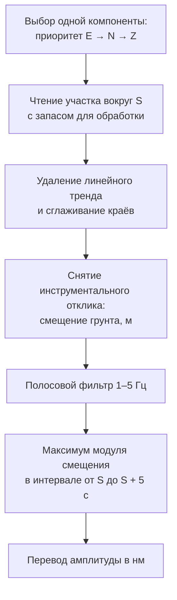

`build_waveform_index` выбирает компоненту по наличию файлов станции в порядке E, затем N, затем Z. Приоритет задаётся для станции целиком: если выбрана E, отсутствие её записи для отдельного события не вызывает автоматического перехода к N или Z. Измеряется амплитуда одной компоненты.

Перед чтением события группируются по файлу и кластеризуются по времени (`_split_triples_by_time`, `MAX_GROUP_SPAN_SEC=300` с): события в пределах 5 минут читаются одним вызовом `obspy_read()`. Участок чтения — `[min(S) − READ_MARGIN_SEC, max(S) + WIN_SEC + READ_MARGIN_SEC]`, где `READ_MARGIN_SEC=60` с, `WIN_SEC=5` с. Запас по краям нужен для снятия отклика, удаления тренда и taper без переноса краевых артефактов в измерительный интервал. После удаления линейного тренда, сглаживания краёв, перевода в смещение и фильтрации выделяется интервал $[T_S,T_S+5\text{ с}]$:

$$
A_i=10^9\max_{T_S\le t\le T_S+5\text{ с}}|u_i(t)|,
$$

где $u_i(t)$ — обработанное смещение в метрах, $A_i$ — амплитуда в нанометрах. Момент S задаёт начало измерительного интервала; внутри него ищется максимум колебания, а не вступление фазы.

Обработка включает `detrend('linear')`, `taper(max_percentage=0.05, type='cosine')` и `remove_response(inventory=inventory, output='DISP', pre_filt=(0.5, 1.0, nyq·0.85, nyq·0.95), water_level=60)`. Здесь `nyq` — частота Найквиста по принятой частоте трассы. Затем применяется фильтр 1–5 Гц четвёртого порядка с нулевой фазой; он отключается `--no-bandpass`.

Полосовая фильтрация 1–5 Гц задаёт используемую полосу измерения. Отдельная симуляция отклика Wood–Anderson не выполняется, поэтому этот фильтр не следует называть её эквивалентом.

Если указанная в записи частота дискретизации отличается от 50, 80, 100 и 200 Гц, перед обработкой она эвристически заменяется на 100 Гц при значении выше 75 Гц, иначе — на 50 Гц. Отсчёты при этом не пересэмплируются. Корректность временной шкалы, снятия отклика и полосы измерения требует, чтобы принятое значение соответствовало реальной дискретизации записи.

Используется первая трасса прочитанного Stream (`st[0]`); объединения всех его частей в измерителе нет. При отсутствии StationXML амплитуда не вычисляется. Ошибка снятия отклика или полосовой фильтрации даёт `None` для всех событий кластера, не прерывая общий прогон; отсутствие подходящего файла или измерительного среза также оставляет станцию без амплитуды. Измерения должны соответствовать тем же событиям и вступлениям, для которых рассчитывается ML.

### Кэширование амплитуд

CSV `pub_id,sta,A` хранит амплитуды в метрах; default — `workspace/magnitude/output/amps_filter_cache.csv`. Ключ — `(pub_id, sta)`. Существующий кэш загружается целиком без перечитывания MSEED: повторный расчёт ML и фильтрация XML занимают секунды. Недостающие пары автоматически не досчитываются и дают `A=None`. После новой ассоциации с другими UUID нужен новый файл кэша либо `--rebuild-cache`.

Пересборка нужна также при изменении форм волн, StationXML, приоритета компонент, измерительного окна, запаса/группировки чтения или параметров полосового фильтра, включая `--no-bandpass`. Эти параметры в CSV не сохраняются и при загрузке не проверяются: смена параметра сама по себе не форсирует пересборку. Изменение `--ml-threshold`, `--sta-corrections` или `--exclude-stations` пересборки не требует — это постобработка уже закэшированных амплитуд.

При построении кэша измеряются только станции, попавшие в исходный словарь расстояний `r_dict` и имеющие S. Последующая замена расстояния в p-traveltime не добавляет измерений для станций, которых в этом словаре не было.

### Станционная поправка $S$

Механизм поправки на локальные грунтовые условия реализован (одна и та же по силе волна на разных станциях записывается по-разному из-за характеристик грунта под сейсмометром — мягкие осадочные породы способны усиливать колебания сильнее, чем скальное основание). Механизм остаётся доступным и может быть подключён при появлении актуальной калибровки, но сейчас сознательно не используется.

Поправка задаётся `--sta-corrections` через CSV `station,S` или `station,correction` и прибавляется к станционной ML до σ-фильтра. Старые поправки из статьи автоматически не подключаются. `core/sta_correction_estimator.py` позволяет калибровать их по подтверждённым событиям каталога, но в выбранную последовательность не входит.

### Зачем нужен отбор станций

Даже после ассоциации в гипотезе могут оставаться вступления другого события или ошибочная S сразу за P. В диагностических разборах такие S приводили к занижению S–P-расстояния в 10–30 раз и станционной ML, вплоть до отсечения реальных событий M3–4.5 порогом. Согласие нескольких ошибочных S–P-оценок также может создать ложное большинство при отборе только по времени очага.

**Три режима:**

| `--ml-stations` | Что считается | Когда |
|---|---|---|
| `all` | ML по всем станциям события | дефолт; историческое поведение |
| `consistent` | ML по станциям с согласованным S-P T0; если по ним не удалось получить ML, расчёт по всем допустимым станциям | доступная альтернатива и fallback внутри p-traveltime |
| `p-traveltime` | отбор «своих» станций перебором по годографу P, с подтверждением очага S-волнами | рабочий режим конвейера |

Поэтому в выбранном режиме, называемом p-traveltime, начальная группа для ML определяется по P-вступлениям и годографу первой P. S участвует в уточнении точки и последующей проверке расстояний. Это позволяет сначала искать согласованный источник по P, а затем проверять, поддерживается ли он S-наблюдениями.

Предварительно из отбора исключаются станции с известными координатами дальше 800 км от опорной точки региона в районе Сочи. Это расстояние до опорной точки сети, а не до оцениваемого очага. Управляют отсечкой `--max-station-dist-km 800` и `--ref-lat/--ref-lon`; координаты берутся из `--station-coords-json`, недостающие — из StationXML `--metadata-dir`. Станции без координат не исключаются вслепую и печатаются списком. Эта предварительная отсечка отличается от необязательного удаления пиков по расстоянию до найденной точки.

### Группа по P и подтверждение по S–P

Используются вступления рассматриваемого события, координаты станций и отдельно заданный годограф первой P. Координаты события из эталона не нужны. Таблица годографа для этого отбора и постоянные скорости для исходного расстояния S–P выполняют разные задачи.

1. Функция `locate()` в области 39–47° с.ш. × 36–50° в.д. с шагом 0.1° для каждой точки вычисляет оценки $T_{0P,i}=T_{P,i}-t_P(d_i)$. Выбираются точка и опорная станция, около оценки времени которой в пределах ±2.5 с находится наибольшее число станций. Требуется не менее четырёх станций; при равенстве их числа выбирается меньшая сумма отклонений от опорного времени.
2. `_refine()` при фиксированном составе группы уточняет точку с учётом P и согласных S. Время пробега S приближённо принимается равным $1.72t_P$. S включается в уточнение, если её оценка времени очага близка к среднему по P: допуск составляет 8 с на первом проходе и 3 с на втором.
3. Для проверки расстояний принимается фиксированная глубина $h_0=15$ км и рассчитывается

   $$
   R_{\text{точки},i}=\sqrt{d_i^2+h_0^2},
   $$

   где $d_i$ — эпицентральное расстояние до уточнённой точки. Эта глубина — параметр приближения, а не результат определения глубины события.
4. На станциях выбранной группы проверяется согласие исходного расстояния $R_{SP,i}$ с расстоянием от точки:

   $$
   |R_{SP,i}-R_{\text{точки},i}|
   \le\max(30\text{ км},\,0.3R_{\text{точки},i}).
   $$

   Подтверждение требует не менее двух таких станций. Оно проверяется до наличия пригодной амплитуды и окончательных отсечек ML.

Если группа подтверждена, согласные $R_{SP}$ сохраняются. Для остальных станций группы расстояние может заменяться на $R_{\text{точки}}$, если оно не превышает 600 км. Таким образом, отбор по годографу не означает замены всех S–P-расстояний расстояниями от найденной точки.

Исходный словарь расстояний `r_dict` строится по положительным S–P с $R_{SP}\le600$ км. Проверка и замены расстояний используют станции этой группы; правила построения амплитудного кэша приведены выше.

### Резервные способы расчёта

Если группу найти не удалось или двух подтверждающих станций нет, ML рассчитывается по станциям с согласованными односкоростными S–P-временами очага. Если по ним ML получить нельзя, используются все допустимые станции события.

Если точка подтверждена, но по выбранной группе ML не вычисляется, выполняется непосредственный переход ко всем допустимым станциям. Минимальное число амплитудных измерений и остальные ограничения сохраняются при каждом таком расчёте.

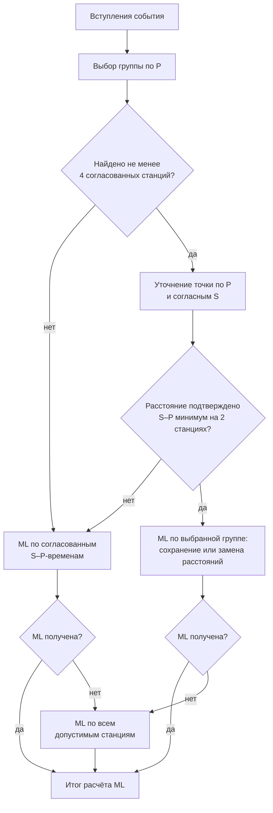

Итоговая оценка поэтому может быть получена по резервному набору, даже если включён отбор по P. Если ни один допустимый набор не даёт ML, оценка отсутствует.

Подтверждение S обязательно в выбранной конфигурации (`--ptt-n-confirm 2`): эксперименты без него резко увеличивали выдачу. CLI позволяет менять это число; код не запрещает поставить ноль.

В основной последовательности ML предшествует LOCSAT, поэтому исходные расстояния берутся по S-P (`--distance-source sp`). Доступный альтернативный режим `locator` читает заранее рассчитанные гипоцентры с теми же event ID; при отсутствии сошедшегося решения событие возвращается к S-P. При сошедшемся решении пустой словарь расстояний не вызывает дополнительного fallback. Совмещение `locator` с p-traveltime передаёт в его проверку уже расстояния локатора, поэтому такую проверку нельзя называть независимым подтверждением по S-P.

### Рабочие ограничения и агрегация

Для станционных оценок используются расстояния не меньше 20 км, доступные положительные амплитуды в пределах $0.005\le A_i\le10^6$ нм и описанная выше верхняя граница расстояний 600 км. Это рабочие отсечки расчёта: амплитуда за их пределами не объявляется физически невозможной, а диапазон 20–600 км не следует отождествлять с фактическим диапазоном исходной калибровочной выборки.

До агрегации также исключаются явно заданные `--exclude-stations` станции и отсутствующие или неположительные амплитуды. Граничные значения расстояний и амплитуд допускаются. Если осталось меньше четырёх допустимых измерений (`N_MIN_STA=4`), ML по данному набору не определяется. Далее применяется статистический отбор:

$$
M_{\text{med}}=\operatorname{median}(ML_1,\dots,ML_N),\qquad
\sigma=\operatorname{std}(ML_1,\dots,ML_N),
$$

$$
|ML_i-M_{\text{med}}|\le1.5\sigma.
$$

Стандартное отклонение рассчитывается по всей исходной группе (`np.std`, `ddof=0`), множитель `ML_OUTLIER_SIGMA=1.5`. Медиана задаёт устойчивый к единичным выбросам центр отсечения. Если после него осталось меньше четырёх измерений, статистическое отсечение отменяется: используются все измерения, прошедшие предыдущие ограничения.

Итоговая ML — арифметическое среднее учтённых станционных оценок:

$$
ML_{\text{события}}=\frac{1}{M}\sum_{i\in\text{учтённые}}ML_i,
$$

где $M$ — число измерений в среднем. Отбор уменьшает влияние отдельных расхождений, но не предполагает автоматически симметричного распределения оставшихся оценок. Это отдельная процедура от статистического отбора S–P-времён: здесь сравниваются магнитуды и применяется множитель 1.5.

Для дальнейшей обработки сохраняются события с $ML\ge1.5$. В выбранном конвейере события без рассчитанной ML этот этап не проходят. Станционные оценки, вошедшие в среднее, сохраняются вместе с ML события; при экспорте используется эта же магнитуда.

Параллелизация: станции (не события) делятся round-robin на `--workers` (по умолчанию 4) потоков (`ThreadPoolExecutor`) — каждый поток работает только со своим набором станций, нет конкуренции за файлы; внутри потока события уже сгруппированы по файлу и кластеризованы по времени. После каждой группы станций — `gc.collect()`.

### Три независимые реализации одной формулы

Формула реализована независимо в трёх модулях. У `core/ml_filter_v5.py` множитель σ равен 1.5, у `core/validate_associator_v2.py::compute_ml` — 1.0, у `core/sta_correction_estimator.py` — 2.0. Различаются и другие условия: например, у инструмента калибровки нижние границы по умолчанию составляют 30 км и 0.01 нм, а поведение при малом числе станций отличается от основного ML-фильтра. Поэтому одинаковые исходные события не гарантируют одинаковой ML. В выбранном конвейере магнитуда берётся из основного ML-XML; альтернативные реализации сохраняются для своих диагностических и калибровочных задач.

### Основной XML и отдельный набор вступлений для LOCSAT

Основной XML при `--write-ml` сохраняет `<magnitude>` события и `<stationMagnitude>` станций, вошедших в среднее и оставшихся среди пиков события; значения записываются с тремя знаками после запятой. Экспорт с `--ml-from-xml` использует эту ML, а `--amps` дополнительно даёт амплитуды из кэша.

Для локации `--out-xml-ptt <путь>` выбирает группу отдельно среди прошедших ML событий. По умолчанию `--ptt-locsat-select ps` вызывает `locate_ps()` с выбором узла и опорной станции по сумме числа согласных P и поддерживающих S этих же станций; допуск S — 4 с (`--ptt-select-s-tol`) относительно опорного времени P. Состав группы задаётся P, затем выполняется общее уточнение `_refine()`. Режим `--ptt-locsat-select p` выбирает начальную группу как для ML. Поэтому группа для LOCSAT может отличаться от группы, по которой рассчитана ML.

В локацию передаются P выбранной группы и только те S, чьи S–P-расстояния согласуются с расстояниями от точки по критерию 30 км/30%. При подготовке этого набора отдельного требования двух подтверждающих S нет. Начальные координаты — точка перебора, T0 — среднее `P − tP(d)` по группе. Event publicID сохраняется, магнитуды в ptt-XML не переносятся. После ML окончательная дедупликация ограничивает обе XML-ветки оставленными ID. Если группу сформировать не удалось, событие может остаться в основном наборе с ML, но не получить входных данных для локации.

`--drop-far-from-origin-km N` — убрать из выходного XML пики станций дальше N км от очага перебора (ML уже посчитана, не меняется). По умолчанию выключено. В майской проверке при N=400 км доля станций эталонного бюллетеня среди станций найденных событий выросла примерно с 73 до 87%; число найденных эталонных событий сохранилось. Автоматическая выдача сократилась: после удаления дальних станций часть событий перестала иметь достаточно станций для экспортной оценки T0.

### Интерпретация ML

Расстояние S–P и расстояние из локации оценивают одну по физическому смыслу величину «очаг—станция», но с разными предположениями и ошибками. В выбранной последовательности ML рассчитывается до LOCSAT; последующее уточнение гипоцентра не меняет уже принятую магнитуду.

Результат зависит от измерительного окна, компоненты, инструментального отклика, выбранного расстояния и состава станций. При проверке согласованности с магнитудами бюллетеня необходимо учитывать также различия шкал и способов их определения.

### Дополнительный эмпирический годограф (`core/fit_traveltime.py`)

Эмпирический годограф — дополнительный вариант таблицы первой P для ассоциации и отбора станций p-traveltime. Построение этой таблицы не является обязательным шагом выбранного конвейера. Таблицы ассоциатора, ML-отбора и LOCSAT задаются своим потребителям отдельно: выбор IASP91 для одного шага не переключает остальные.

`core/fit_traveltime.py` извлекает из бюллетеня первую P-фазу станции, вычисляет `tP = P − T0` и эпицентральное расстояние по координатам события и станции. По умолчанию используются пары с `0 < d <= 900` км и `0 < tP < 150` с; май исключается из построения (`--exclude-months 5`).

В бинах шириной 10 км вычисляются медиана, 16-й и 84-й процентили tP. Бин записывается при наличии не менее пяти пар (`--min-n 5`). Выходной CSV: `dist_km,tp_s,n,p16,p84`; расстояние — середина бина, км, времена — секунды.

Поставляемая `core/data/tt_p_ncau2024.csv` построена по NCAU 2024 без мая и остаётся штатным default `ml_filter_v5.py`. Потребитель дополнительно оставляет бины с `n >= --tt-min-n` (20), линейно интерполирует tP, ближе первого бина продолжает таблицу к `(0,0)`, дальше последнего — со скоростью 8 км/с. Это поведение загрузчика таблицы; оно не определяет источник R в формуле ML.

### Запуск, диагностика и CLI

Выбранный режим задаётся явно: `--ml-threshold 1.5 --ml-stations p-traveltime --distance-source sp --max-station-dist-km 800 --write-ml --out-xml-ptt <путь> --ptt-locsat-select ps`. Таблица `--tt-table` задаётся отдельно: для выбранной настройки IASP91 нужен совместимый с загрузчиком ML CSV. Его точный файл остаётся отложенным и не подменяется эмпирическим CLI-default автоматически. Для каждого нового запуска ассоциатора нужен новый кэш амплитуд либо явная пересборка.

Следующие примеры показывают диагностику и доступные альтернативные настройки; порог 1.0 в них не является рабочим порогом выбранной цепочки:

```bash
python core/ml_filter_v5.py --info
python core/ml_filter_v5.py --ml-threshold 1.0
python core/ml_filter_v5.py --ml-threshold 1.0 --sta-corrections sta_corrections_dyagilev2023.csv
python core/ml_filter_v5.py --rebuild-cache
python core/ml_filter_v5.py --diag-pubid smi:local/abc123
```

| Флаг | По умолчанию | Назначение |
|---|---|---|
| `--assoc-in` | `workspace/associator/output/associations.xml` | входной XML |
| `--assoc-out` | рядом с `--assoc-in`, `associations_ml<tag>.xml` | выходной XML |
| `--waveforms` | `workspace/data_processors/output/geofiles` | папка с переименованными формами волн |
| `--cache-amp` | `workspace/magnitude/output/amps_filter_cache.csv` | CSV-кэш амплитуд |
| `--metadata-dir` | `workspace/data_processors/input/metadata` | StationXML для `remove_response` |
| `--win-sec` / `--read-margin-sec` | `5` / `60` | измерительное окно после S и запас чтения, с |
| `--max-group-span-sec` | `300` | максимальный разброс S-времён внутри кластера чтения, с |
| `--bp-freqmin` / `--bp-freqmax` | `1` / `5` | полоса фильтра, Гц |
| `--comp-priority` | `E,N,Z` | приоритет компоненты при построении индекса |
| `--r-min-km` / `--r-max-km` | `20` / `600` | границы расстояний, км |
| `--a-nm-min` / `--a-max-nm` | `0.005` / `1e6` | границы амплитуды, нм |
| `--n-min-sta` / `--ml-outlier-sigma` | `4` / `1.5` | минимум измерений и множитель σ для ML |
| `--tt-min-n` | `20` | минимум пар в используемом бине таблицы |
| `--ptt-select-s-tol` | `4` | допуск S к T0 якоря при выборе группы ptt-XML, с |
| `--no-bandpass` | выкл. | отключить фильтр 1–5 Гц |
| `--sta-corrections` | нет | CSV поправок |
| `--ml-threshold` | `1.0` | оставить события с ML ≥ порога |
| `--keep-no-ml` | выкл. | не удалять события без оценки ML |
| `--info` | выкл. | только статистика, XML не пишется |
| `--rebuild-cache` | выкл. | пересчитать амплитуды заново |
| `--workers` | `4` | потоков извлечения амплитуд |
| `--vp` / `--vs` | `6.0` / `3.4883` | скорости S-P |
| `--distance-source` | `sp` | `sp`/`locator` — источник $R$ для ML (реальная дистанция из `--hypocenters`, с fallback на S-P по событию) |
| `--hypocenters` | `workspace/locator/output/hypocenters.csv` | выход `core/locator.py`, только при `locator` |
| `--locator-distance-metric` | `hypocentral` | `hypocentral`/`epicentral` — какая дистанция считается за $R$ |
| `--exclude-stations` | нет | исключить станции из агрегации (видны в диагностике) |
| `--ml-stations` | `all` | `all` / `consistent` / `p-traveltime` — отбор станций события для ML (см. подраздел выше) |
| `--consistency-sigma` | `1.0` | с `consistent`: множитель σ T0-фильтра |
| `--max-station-dist-km` | выкл. | исключить станции дальше N км от опорной точки из ML и T0-фильтра (кавказская сеть — `800`) |
| `--ref-lat` / `--ref-lon` | `43.6` / `40.0` (Сочи) | опорная точка для `--max-station-dist-km` |
| `--station-coords-json` | `workspace/data_processors/output/json2/station_list_2.json` | координаты станций для отбора; недостающие — из `--metadata-dir` |
| `--tt-table` | `core/data/tt_p_ncau2024.csv` | годограф первой P (`core/fit_traveltime.py`) для `p-traveltime` |
| `--ptt-grid` | `39,47,36,50,0.1` | сетка перебора: lat_min, lat_max, lon_min, lon_max, шаг (°) |
| `--ptt-p-tol` / `--ptt-min-stations` | `2.5` / `4` | допуск T0 по P для «своих», с / минимум своих станций |
| `--ptt-s-tol` | `8,3` | допуски T0 по S при уточнении точки, с (проходы) |
| `--ptt-n-confirm` | `2` | минимум своих станций с подтверждающим S−P |
| `--ptt-r-tol-km` / `--ptt-r-tol-frac` | `30` / `0.3` | согласие R_sp с R от точки: \|ΔR\| ≤ max(км, доля·R) |
| `--ptt-depth-km` | `15` | фиксированная глубина для R от точки |
| `--out-xml-ptt` | нет | дополнительно записать вход для `core/locator.py` по «своим» станциям |
| `--ptt-locsat-select` | `ps` | выбор точки для ptt-XML: `ps` — по P + согласным S, `p` — только по P |
| `--write-ml` | выкл. | записать ML события и станций (`<magnitude>`/`<stationMagnitude>`) в выходной XML — для `export_bul --ml-from-xml` |
| `--drop-far-from-origin-km` | выкл. | убрать из выходного XML пики станций дальше N км от очага перебора |
| `--diag-pubid` | нет | построчная диагностика по одному событию |

`filter_xml` (копия дерева через `copy.deepcopy`): событие без оценки ML удаляется, если не передан `--keep-no-ml`; `ML >= --ml-threshold` — остаётся, иначе удаляется. Имя выходного файла без `--assoc-out`: `associations_ml<tag>.xml`, `tag = f"{thr:.1f}"` с заменой `-`→`m`, `.`→`p` (порог `1.5` → `associations_ml1p5.xml`, порог `-0.5` → `associations_mlm0p5.xml`).

Встроенного флага `--validate` нет. Самостоятельный запуск `core/validate_associator_v2.py` доступен для диагностики S-P-оценок, но не является обязательным шагом конвейера. Итоговая проверка качества выполняется после экспорта через `core/compare_bul.py` по бюллетеню ГС РАН.

---

## 8. Окончательное устранение повторных гипотез

### Почему после расчёта магнитуды

Два поиска могут собрать разные группы вступлений одного события. До ML удаляются только гипотезы с полностью одинаковыми наборами станций и времён P/S. Приблизительно похожие варианты сохраняются, поскольку различия вступлений меняют расстояния, выбор станций и итоговую магнитуду: одна гипотеза может пройти порог ML, а другая — нет.

Окончательное устранение повторов выполняется среди гипотез, уже прошедших ML. Правило использует принадлежность гипотезы первичному или альтернативному поиску; она должна сохраняться при отборе по магнитуде.

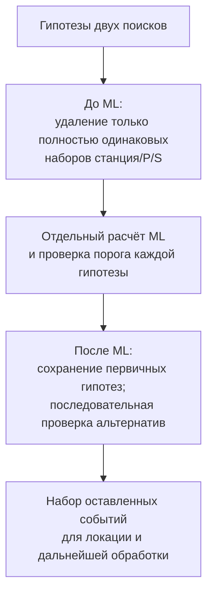

### Критерий совпадения

Для каждой гипотезы составляется набор наблюдений

$$
Q=\{(\text{код станции},T_P)\}.
$$

Альтернатива $A$ считается повтором уже сохранённой гипотезы $B$, только если одновременно выполняются условия

$$
|Q_A\cap Q_B|\ge4,\qquad
|T_{0,A}^{SP}-T_{0,B}^{SP}|\le10\text{ с}.
$$

Первое условие требует не менее четырёх одинаковых P-вступлений: совпадают и коды станций, и точные времена P. Четырёх общих названий станций недостаточно. Второе условие проверяет близость оценок времени очага. S непосредственно в наборе $Q$ не сравнивается, но влияет на S–P-оценку времени.

Для этой проверки $T_0^{SP}$ отдельно вычисляется через `core/export_bul.py::process_events` по двухскоростной схеме Pg/Sg–Pn/Sn из раздела 6:

| Параметр расчёта T0 для дедупликации | Настройка |
|---|---|
| Скорости Pg/Sg | 6.0 / 3.4883 км/с |
| Скорости Pn/Sn | 8.0 / 4.6 км/с; переход при предварительном $R_{Pg}\ge150$ км |
| Нижняя граница расстояния | 20 км |
| Верхняя граница расстояния | не задана |
| Дополнительный географический отсев станций | выключен |
| Множитель σ-фильтра | $\lambda=1$ |
| Вероятность P | из staging текущего запуска, уже с поправкой `weight` на uncertainty |
| SNR P | из того же staging, непосредственно в дБ |

Выбор времени — `ot_probsnr` при наличии не менее трёх положительных весов «вероятность P × SNR P», иначе `ot` станции с минимальным S–P при наличии не менее трёх пригодных станционных оценок. Перехода к обычному среднему нет. Формулы, отмена σ-отсечения при недостатке станций и правила сопоставления staging изложены в разделе 6.

Это время для сравнения гипотез. Оно не заменяется временем ассоциации или LOCSAT и может отличаться от итогового экспортного времени при других ограничениях отбора станций. Если хотя бы для одной гипотезы время вычислить не удалось, условие близости времени не выполняется и альтернатива по этому правилу не удаляется.

### Приоритет первичного поиска и порядок проверки

1. Сохраняются все гипотезы первичного поиска, прошедшие ML.
2. Каждая альтернатива сравнивается со всем текущим списком сохранённых. Если найдена гипотеза, удовлетворяющая обоим условиям совпадения, альтернатива пропускается.
3. Если совпадения нет, альтернатива добавляется в список и сама участвует в проверке следующих альтернатив.

Таким образом, приоритет заранее отдан первичному поиску. Между совпадающими вариантами не выбирается большая ML, меньшая невязка или большая близость к эталонному событию. Эталонный бюллетень при устранении повторов не используется.

Правило предназначено для добавления неповторяющихся альтернатив к первичному результату. Первичные гипотезы между собой на этом этапе попарно не очищаются; одного совпадения по времени также недостаточно, чтобы удалить близкое событие.

### Что сохраняется для следующих этапов

Оставленные события сохраняют исходные event publicID, принадлежность первичному или альтернативному поиску, вступления и рассчитанные `magnitude/stationMagnitude`. Состав вступлений совпавших гипотез не объединяется, ML оставленного события не пересчитывается.

Основной набор событий и отдельный набор вступлений для LOCSAT ограничиваются списком оставленных идентификаторов. Вход локатора может содержать только часть этих событий, для которых ранее удалось сформировать подходящую группу наблюдений. Это сохраняет связь результатов локации с магнитудами и вступлениями того же события. Совпадение event ID не требует тождества всех пиков двух веток: основной XML остаётся входом отсева и экспорта, ptt-XML — входом LOCSAT.

Для сквозного запуска необходим согласованный интерфейс сохранения принадлежности поиску и ограничения обеих XML-веток. Здесь фиксируются алгоритм и контракт данных; команда с неподтверждёнными CLI-флагами не задаётся.

---

## 9. Определение гипоцентра и региональное уточнение (`core/locator.py`)

### Что определяется по временам прихода

Локатор **LOCSAT** в составе SeisComP совместно определяет широту, долготу, глубину и время очага. Он использует выбранные P- и S-вступления, координаты станций и таблицы времён пробега для принятой скоростной модели.

Для фазы $q$ на станции $i$ связь наблюдения с параметрами очага можно записать как

$$
T_{q,i}^{\text{набл}}=
T_0+\tau_{q,i}(\varphi,\lambda,H;\mathcal M)+r_{q,i},
\qquad q\in\{P,S\},
$$

где $\varphi$, $\lambda$ — широта и долгота очага, $H$ — глубина в километрах, $\mathcal M$ — модель среды, $\tau_{q,i}$ — расчётное время пробега в секундах, $r_{q,i}$ — невязка «наблюдённое минус расчётное». Координаты станций известны; искомые параметры очага меняются совместно, чтобы согласовать расчётные времена с наблюдениями.

В отличие от отдельной S–P-пары, сеть ограничивает положение источника по различиям времён прихода на станциях. Таблицы годографов учитывают зависимость времени пробега от положения и глубины источника в принятом разрезе. Точка перебора, полученная при отборе станций, и среднее время по P задают начальное приближение. Начальная глубина исходного расчёта — 5 км; она является стартовым значением и уточняется в ходе локации.

Вход содержит P выбранной для локации группы и согласные S. Используется подготовленный для периода набор станционных метаданных. Вступления станций, для которых на их время нет действующей записи в подготовленных метаданных, пропускаются. Предварительно требуется не менее четырёх входных вступлений P+S — это число фаз, а не разных станций. После проверки метаданных наблюдений может остаться меньше.

### Среда выполнения и станционные метаданные

Вход — ptt-XML после ML и окончательной дедупликации, описанных в разделах 7–8. Связь с основным XML сохраняется по event publicID. Локатор строит объекты Origin, Pick и Arrival, затем передаёт их LOCSAT.

Для расчёта нужен отдельный интерпретатор SeisComP в WSL: `seiscomp exec seiscomp-python core/locator.py ...`. Модуль `seiscomp` недоступен в conda `eqt3`; его импорты отложены внутрь функций, поэтому `--help` и разбор XML доступны под обычным Python. Имя `core/locator.py` — согласованное целевое имя компонента; наличие рабочей реализации в `context/scratch` не меняет выбранный алгоритм.

Инвентарь готовится отдельно: слияние per-station StationXML через `merge_stationxml.py --at-date <начало периода>`, затем преобразование в SC3ML через `seiscomp exec fdsnxml2inv`. Для каждого канала сохраняется последняя эпоха с началом не позже указанной даты, её endDate снимается. Если такой эпохи нет, берётся первая последующая и её начало сдвигается на начало периода. Это упрощённый инвентарь координат для локатора, а не точная история инструментальных откликов. Снятие endDate у всех ревизий создаёт пересекающиеся эпохи и может привести к потере каналов при преобразовании; такой случай наблюдался для TRKR.

Для каждого пика проверяется действующая на его время локация станции: интервал `[start, end)`. Если действуют несколько location codes, предпочитается пустой, иначе — первый непустой в сортировке. Пики без действующей локации пропускаются со счётчиком; расчёт выполняется по оставшимся пикам. Это предотвращает потерю всего события из-за одной отсутствующей станции или неверного пустого location code.

Порог `--min-arrivals` по умолчанию равен 4. Он проверяет число входных P+S **до** пропуска пиков по инвентарю. Событие с меньшим числом вступлений получает `converged=False` без вызова LOCSAT. Этот порог не проверяет число разных станций, геометрию сети или качество результата.

События без читаемого origin (время, широта, долгота) или без читаемых пиков пропускаются уже при загрузке XML. Поэтому одна строка выходного CSV на событие гарантируется для загруженного списка, а не для произвольного повреждённого XML.

Несходимость сохраняется как результат попытки локации. Fallback с фиксированной глубиной проверялся и был отвергнут: он почти всегда давал сходимость, но мог сопровождаться ошибками 100–600 км при малых RMS. Вариант `--engine nonlinloc` не реализован до конца: в используемой установке SeisComP плагин не подключён, `Create()` возвращает `None`, ни одно событие не сходится.

### Зачем уточнять исходное решение

Реальная среда неоднородна: скорости и глубины границ различаются между частями региона. Если расчётное время распространения систематически отличается от наблюдённого, локатор может частично компенсировать это изменением положения, глубины или времени очага.

Для каждого события, переданного в локатор, сначала рассчитывается исходное решение по IASP91 — глобальной модели, задающей скорости как функции глубины. Затем по его эпицентру выбирается региональный разрез, и локация повторяется с теми же входными вступлениями и метаданными станций. Так сравнение двух решений отражает смену модели распространения при сохранённых наблюдениях.

В выбранной конфигурации используются 16 горизонтально-слоистых региональных моделей НИИ. Этот набор не следует смешивать с ранее проверенной единой эффективной моделью коры. Каждая задаёт вертикальное распределение скоростей; в региональной части для расчёта S принято $V_P/V_S=1.72$. Для LOCSAT строятся отдельные таблицы P и S, учитывающие глубину источника; это другой набор годографов, чем таблицы первой P для ассоциации и отбора станций ML. Схематически разрез устроен так:

| Интервал глубин | Используемая модель |
|---|---|
| От поверхности до нижней границы заданного регионального разреза | региональная зависимость $V_P(H)$; $V_S(H)=V_P(H)/1.72$ |
| Глубже последнего уровня региональной модели | продолжение по IASP91 |

Конкретные глубины границ и скорости различаются между моделями. Назначение разреза событию выбирает одну модель для расчёта его времён пробега; переключение между разрезами вдоль каждого луча не выполняется. Поэтому географический выбор региональной модели остаётся приближением к боковой неоднородности среды.

### Выбор модели по исходному эпицентру

Модель назначается только по широте и долготе полученного решения IASP91. Для перекрывающихся областей действует заранее установленный приоритет: локальные области проверяются раньше охватывающих их широких. В проверенной конфигурации порядок следующий:

MDL8 → MDLkra → MDLDOM → MDLSPIT → MDLelis → MDLNVN → MDLkasp → MDLAZ → MDLGRO → MDLDAG → MDLck → MDL7 → MDL6 → MDL1 → MDL3 → MDL5.

Используется первая подходящая область. MDLgni и MDLTIF не включены, поскольку области их применения не установлены. Если ни одна область не подходит, сохраняется IASP91. Координаты станций, ошибка относительно эталона и величина невязки не используются для выбора разреза.

Географическая схема представляет рабочее приближение по исходным картам и описаниям. Границы и приоритеты были зафиксированы до проверки на Q1. Они относятся к конкретному региону и конфигурации; единой обязательной карты для всех применений метода нет.

Для LOCSAT каждой модели используется свой каталог таблиц, задаваемый `SEISCOMP_LOCSAT_TABLE_DIR`, с региональными `iasp91.P` и `iasp91.S` под именами штатного профиля. Расчёты разных моделей разделены по процессам. Таблицы находятся в файловой системе WSL; это отдельный механизм от CSV-годографов ассоциатора и ML-отбора.

### Уточнение и сохранение исходного решения

Региональная локация начинается с широты, долготы, глубины и времени исходного решения IASP91. Если исходное решение не получено, региональный этап не запускается. Если региональное уточнение не даёт решения, сохраняется исходное решение IASP91 целиком.

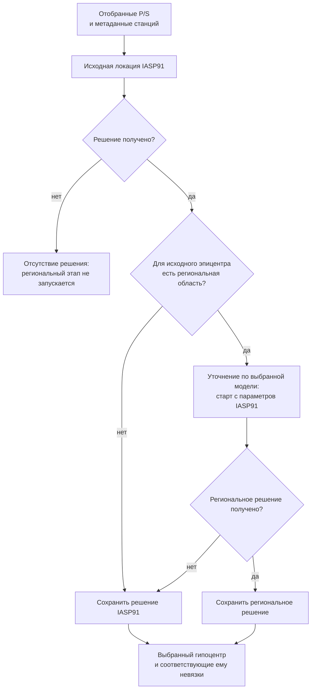

При успешном уточнении сохраняется региональное решение. Если его эпицентр оказался за границей первоначально назначенной области, модель повторно не выбирается. Это фиксированная двухступенчатая процедура, а не последовательность переключений до получения наиболее выгодного результата.

Сам этап локации не удаляет события по RMS или глубине. Если гипоцентр не получен, это сохраняется как результат попытки; последующий статистический отсев и условия экспорта рассматриваются отдельно. Гипоцентр и невязки вступлений должны относиться к одному выбранному решению — региональному либо сохранённому исходному. Их связывают по event ID; невязки нельзя брать от невыбранного расчёта. Поля фазовых невязок и их передача в бюллетень рассматриваются на последующих этапах.

### Выходные данные и параметры запуска

Формат `hypocenters.csv`:

| Колонка | Тип | Значение |
|---|---|---|
| `event_id` | str | `publicID` события — тот же ключ, что в XML |
| `engine` | str | `LOCSAT` / `NonLinLoc` |
| `converged` | bool | `relocate()` вернул решение; это не гарантия его физической точности |
| `error` | str/пусто | причина отсутствия решения |
| `t0` | str/пусто | время очага после локации |
| `lat`, `lon` | float/пусто | гипоцентр, градусы |
| `depth_km` | float/пусто | глубина, км |
| `depth_uncertainty_km` | float/пусто | неопределённость глубины из LOCSAT; ноль не означает достоверную нулевую ошибку, особенно при краевой глубине |
| `rms` | float/пусто | стандартная ошибка решения, с |
| `n_stations_used`, `n_arrivals_used` | int | число уникальных станций найденных Pick и число Arrival в возвращённом Origin; код не проверяет их итоговые веса или признаки использования. Если Pick не найдены, число станций заменяется числом Arrival |

| Флаг | По умолчанию | Назначение |
|---|---|---|
| `--assoc` | `workspace/associator/output/associations.xml` | входной XML (на практике — ptt-XML из `ml_filter_v5.py --out-xml-ptt`) |
| `--inventory` | `workspace/locator/input/inventory.scml` | SC3ML-инвентарь |
| `--out` | `workspace/locator/output/hypocenters.csv` | выходной CSV |
| `--engine` | `locsat` | `locsat` \| `nonlinloc` (nonlinloc не реализован, см. выше) |
| `--depth-km` | `5.0` | начальная глубина |
| `--min-arrivals` | `4` | не пытаться локировать события с меньшим числом входных P+S, до проверки инвентаря |

Эти флаги описывают интерфейс локатора; рабочий вход задаётся явно как дедуплицированный ptt-XML. Они сами по себе не задают оркестрацию двухступенчатого расчёта с региональными моделями.

### Почему глубина требует отдельной проверки

Изменение времени очага сдвигает расчётные приходы всех фаз. Изменение глубины также меняет времена пробега; при ограниченной геометрии сети эти эффекты могут частично компенсироваться. Особенно важны разнообразие расстояний и направлений на станции, наличие близких наблюдений и качество P/S-вступлений.

Полученное решение и малая сводная невязка RMS характеризуют согласование наблюдений с принятой моделью. Они не устанавливают сами по себе точность глубины: ошибки модели или вступлений могут частично перейти в параметры очага.

Для приведённой ниже оценки глубина считается определённой при полученном решении и

$$
0<H<700\text{ км}.
$$

Значения $H=0$ или $H\ge700$ км относятся к неопределённым глубинам в этой проверке. Это условие оценки, а не геологическая граница применимости метода. Краевая глубина не вызывает автоматического возврата к IASP91 и сама по себе не означает ошибочности эпицентра. Нулевая формальная неопределённость при краевом решении также не означает точно установленную глубину.

### Результаты регионального уточнения

Эффект схемы проверен на сохранённой выборке I квартала 2025 года с прежним оконным ассоциатором v2. Для сравнения использованы одни и те же события и входные вступления в вариантах IASP91 и регионального уточнения. События сопоставлялись с бюллетенем ФИЦ ЕГС РАН при MPVA≥1.5, не менее четырёх общих станций и окне ±60 с.

Ошибки в таблице — расхождения с эталонными координатами и глубинами. Ошибка эпицентра оценивается на 83 общих событиях с координатами. Ошибка глубины — медиана абсолютных расхождений на 66 событиях, где глубина определена и у эталона, и в обоих сравниваемых решениях.

| Показатель | IASP91 | После регионального уточнения |
|---|---:|---:|
| Медианная ошибка эпицентра | 6.74 км | **5.80 км — меньше на 14%** |
| Определённых глубин среди 83 событий | 70 | **73** |
| Медианная ошибка глубины на 66 общих определённых решениях | **5.97 км** | 7.06 км |
| Событий с координатами | 83 | **83** |

Региональная схема уменьшила медианную ошибку эпицентра и увеличила число определённых глубин при сохранении числа событий с координатами. Увеличение 70→73 — итоговый баланс определённых глубин; качество вновь появившихся решений требует отдельного разбора.

На общей выборке из 66 определённых глубин ошибка выросла с 5.97 до 7.06 км. Это ухудшение относится к тем же событиям и не объясняется добавлением ранее неопределённых глубин. Таким образом, получение большего числа глубин и повышение их точности — самостоятельные задачи.

Для выбранного двухпоискового конвейера ожидается перенос положительного эффекта по эпицентру и числу определённых глубин. Величину этого эффекта предстоит подтвердить отдельно; улучшение точности глубины по приведённой проверке не получено.

---

## 10. Статистический отсев событий (`core/false_event_filter.py`)

### Зачем нужен дополнительный отбор

Согласованность времён прихода и прохождение порога ML существенно ограничивают набор гипотез, но случайное сочетание вступлений может пройти эти проверки. Участие нескольких постоянно активных станций также способно создавать повторяющиеся ложные ассоциации. Поэтому после ML, окончательного устранения повторов и локации применяется дополнительный статистический отбор.

Он использует качество вступлений, согласованность станционных магнитуд, результат LOCSAT и предшествующую активность станций. Порог ML ≥ 1.5 сохраняется. Для оставленных событий отбор не меняет вступления, идентификаторы, ML и результаты локации.

### Какие свойства события оцениваются

Выбранная модель содержит 17 признаков: 12 характеризуют вступления и решение, ещё 5 — историю станций.

| Группа | Признаки | Что они характеризуют |
|---|---|---|
| Число наблюдений — 1 | число станций с P | поддержку гипотезы разными станциями |
| Качество вступлений — 7 | медианы вероятности детекции, вероятностей P и S, неопределённостей P и S, SNR P и S | уверенность модели, устойчивость её ответов при MC Dropout и выраженность сигнала относительно фона |
| Согласованность P/S и амплитуд — 2 | доля станций с S−P < 2 с среди имеющих обе фазы; стандартное отклонение станционных ML | частоту очень близких P/S и согласованность оценок магнитуды по разным станциям |
| Результат локации — 2 | наличие полученного решения LOCSAT; число станций среди вступлений возвращённого решения | наличие решения и состав представленных в нём наблюдений |
| История станций — 5 | три показателя относительной частоты P и два показателя участия станций в событиях | насколько событие опирается на станции, часто выдававшие P или участвовавшие в ассоциациях в предшествующие дни |

Каждый показатель используется в сочетании с остальными. Например, малое S−P возможно у близкого землетрясения, а повышенная активность станции может иметь сейсмическую причину; отдельного запрета на такие наблюдения нет. Разброс станционных ML отражает согласованность амплитуд с принятой поправкой за расстояние, но зависит также от условий регистрации и ошибок расстояния.

Вероятности, неопределённости и SNR берутся из staging текущего запуска по станции и времени соответствующего пика. Стандартное отклонение станционных ML рассчитывается как `pstdev` при наличии более одного значения. Счётчик станций LOCSAT не проверяет веса и признаки использования времени: присутствие станции в возвращённом решении не гарантирует участия её вступлений в определении гипоцентра. Если записи о гипоцентре нет, признаки наличия решения и числа станций равны нулю. Это информация для общего балла, а не самостоятельное условие удаления события.

Время суток, координаты события и абсолютная ML в признаки не входят. RMS и отдельные невязки фаз также не входят в выбранные 17 признаков. Дополнительный классификатор правдоподобия S-пика в эту модель не включён.

### Как учитывается предшествующая активность станций

Для события дня $d$ используются только семь предшествующих суток:

$$
d-7,\ldots,d-1.
$$

День события определяется по самой ранней P. Текущий день исключён: все сведения об истории доступны до обрабатываемого события.

Для каждой станции оцениваются две величины. Первая — среднее число P за сутки с пиками внутри окна, отнесённое к медиане этой частоты по станциям с доступной историей. Вторая — число событий входной выдачи с P данной станции за окно. Участие подсчитывается до статистического отсева, поэтому история не зависит от его предыдущих решений.

Из относительной частоты P получаются три признака события: медиана и максимум её натурального логарифма по станциям с P и доступной историей, а также доля этих станций с частотой выше двух медиан сети. Для участия в событиях используются медиана и максимум величины $\ln((N_s+0.5)/M)$, где $N_s$ — счётчик станции, $M$ — медиана положительных станционных счётчиков сети. Эти два показателя рассчитываются по всем станциям события с P.

При короткой истории используются имеющиеся предшествующие дни. Отсутствие истории отличается от наблюдаемого нулевого счётчика: если данных для признака нет, он остаётся пропущенным. Для последовательной обработки периодов сохраняются суточные счётчики прошлых дней либо данные для их восстановления. Семь суток — длина используемой истории, а не задержка выдачи результата.

### Балл и фиксированный порог

Используется логистическая регрессия. После предусмотренных преобразований признаков рассчитываются

$$
z_i=\frac{x_i-\mu_i}{\sigma_i},
\qquad
s=b+\sum_{i=1}^{17}w_i z_i.
$$

Здесь $x_i$ — значение признака, $\mu_i$ и $\sigma_i$ — среднее и масштаб на обучающей выборке, $w_i$ — вес, $b$ — общий сдвиг. Число станций с P и медианы SNR предварительно преобразуются как $\ln(\max(x,0.1))$; для SNR используется сохранённое значение в дБ. Это эмпирическое преобразование признака, а не перевод дБ в линейное отношение амплитуд.

Средние и масштабы определяются на обучающем I квартале 2025 года и затем фиксируются вместе с весами и порогом. Масштаб равен стандартному отклонению с малой добавкой $10^{-9}$ для устойчивости деления. Пропущенный признак после стандартизации заменяется нулём, то есть средним обучающей выборки. По новому периоду стандартизация не пересчитывается.

Событие сохраняется при $s\ge\tau$, где $\tau$ — выбранный порог. Сигмоида переводит балл в выход логистической модели, однако решение принимается непосредственно по $s$. Этот балл и его сигмоида не являются проверенной физической вероятностью истинности события.

### Обучение, выбор порога и применение

Веса обучаются на I квартале 2025 года с L2-регуляризацией, ограничивающей их величину. Для обучающей метки ищется событие эталона с наибольшим числом станций, на которых наша P совпала с его P в пределах ±3 с. Максимальное число таких станций обозначается `own_p`: при `own_p ≥ 2` метка положительная, при `own_p = 0` — отрицательная; события с `own_p = 1` исключаются из подгонки весов. Это рабочая разметка по доступному эталону: отсутствие совпадения само по себе не устанавливает ложность события.

Порог выбирается отдельно, по метке `prot_cmp`, основанной на основном критерии `compare_bul`. Защищаются лучшие совпадения с событиями ФИЦ ЕГС РАН при MPVA ≥ 1.5 и не менее четырёх общих станций, объединённые для окон ±60 и ±10 с. Здесь не требуется совпадение отдельных P в пределах ±3 с. Порог равен минимальному баллу защищаемого события обучающего Q1, без дополнительного запаса; сохранение этих совпадений на обучении обеспечено его построением.

При применении готовой модели эталонный бюллетень не нужен. Достаточны вступления с показателями качества, станционные ML, результат локации, предшествующая история и фиксированные параметры модели. Отбор удаляет события целиком, не пересчитывая параметры оставленных.

### Входы, выход и сохранение параметров

Входы текущего запуска дополняются сохранённой историей и фиксированными параметрами модели:

| Вход | Содержимое и назначение |
|---|---|
| Основной XML после ML и окончательной дедупликации | P/S и станционные ML; это основная ветка, а не ptt-XML локатора |
| CSV выбранных гипоцентров после LOCSAT | признаки сходимости и числа станций; соединение с XML по event ID |
| Staging | вероятности, неопределённости и SNR для соответствующих пиков |
| История станций | накопленные суточные счётчики P и участия во входных событиях либо данные для восстановления этих счётчиков |
| Фиксированный комплект модели | порядок 17 признаков, веса, сдвиг, средние, масштабы и порог, согласованные между собой |

Параметры модели должны храниться вместе в `core/data/`. Историю нужно переносить между последовательными запусками, сохраняя исключение текущего дня; параметры стандартизации при этом остаются обучающими. Точный принятый комплект весов и порога, а также интерфейс его загрузки и восстановления истории должны быть зафиксированы при переносе рабочей реализации.

Выход — XML сохранённых событий с прежними event ID, пиками и `magnitude/stationMagnitude`. Локация не пересчитывается: выбранные гипоцентры и невязки остаются связанными с оставленными событиями по исходным ID.

### Результаты проверки

Для модели, обученной на Q1 с историей семь суток, получены следующие результаты:

| Период | Выдача до → после | Сокращение | Найденные события эталона по основному критерию |
|---|---:|---:|---|
| Май 2024 | 493 → 259 | 47% | сохранены |
| Апрель 2024 | 8 991 → 5 003 | 44% | сохранены |
| I квартал 2025 — обучение | 4 080 → 1 990 | 51% | сохранены |

Майская выборка содержит 20 суток записи. Апрельская получена прежним детектором без MC Dropout. Май и апрель не участвовали в подгонке весов, стандартизации и порога; на них проверялся перенос модели Q1 → 2024. При этом сравнение вариантов истории на этих периодах использовалось для выбора семи суток, поэтому они не являются полностью отложенной проверкой всей конфигурации.

Проверка показывает возможность существенно сократить число событий для последующего разбора при сохранении найденных эталонных событий. Проценты в таблице характеризуют сокращение выдачи; они не измеряют долю удалённых ложных событий, поскольку эталон не содержит полной разметки всей автоматической выдачи.

Эти размеры выдачи получены до перехода на двухпоисковую ассоциацию и региональное уточнение LOCSAT. Эффект отсева в выбранном объединённом конвейере оценивается отдельно.

---

## 11. Невязки времён вступлений (TRes)

### Что показывает невязка

Для каждой фазы, связанной с решением LOCSAT, невязка сравнивает наблюдённое время прихода с расчётным:

$$
r_{q,i}=T_{q,i}^{\text{набл}}-
\left[T_0^{\text{LOC}}+\tau_{q,i}(\varphi,\lambda,H;\mathcal M)\right],
\qquad q\in\{P,S\}.
$$

Невязка измеряется в секундах. Положительное значение означает приход позже расчётного, отрицательное — раньше. При наличии временных поправок сохраняется значение, возвращённое локатором с их учётом.

Невязка характеризует согласование вступления с конкретными координатами, глубиной, временем очага и моделью среды. Большое значение может быть связано с ошибкой вступления, неподходящей моделью или ошибкой положения очага. Малое значение также не гарантирует правильности фазы: при совместной локации часть ошибки вступления может компенсироваться сдвигом очага и его времени.

После регионального уточнения или возврата к IASP91 невязки должны соответствовать тому же выбранному решению, что и гипоцентр. Вместе с ними сохраняется признак использования времени вступления в локации. Само наличие невязки не означает, что это время участвовало в определении решения.

### Передача невязок: `residuals.csv`

Невязки `arrival.timeResidual` сохраняются в `residuals.csv` рядом с `hypocenters.csv`. Каждая строка относится к вступлению выбранного решения:

| Поля | Содержимое |
|---|---|
| `event_id` | исходный event publicID, общий с XML и CSV гипоцентров |
| `net`, `sta` | сеть и станция |
| `phase`, `pick_time` | фаза и время соответствующего пика |
| `residual` | невязка «наблюдённое минус расчётное», секунды; недоступное значение пустое |
| `distance`, `azimuth` | расстояние в градусах дуги и азимут в градусах |
| `weight`, `time_used` | вес и отдельный признак использования времени вступления в локации |

Наличие строки или невязки не заменяет проверку `time_used`. Сопоставление с экспортируемыми фазами выполняется по исходному событию и идентичности пика — сети, станции, фазе и времени — до перенумерации бюллетеня. Одного совпадения имени станции недостаточно. Интерфейс передачи residuals в экспорт должен быть согласован при переносе рабочей реализации; неподтверждённый CLI-флаг здесь не вводится.

### Как проверялась диагностическая ценность

Предварительная проверка выполнена для решений IASP91 на мае и апреле 2024 года и I квартале 2025 года. Нашему вступлению сопоставлялся ближайший ручной пик той же фазы на той же станции в пределах ±10 с. Принадлежность одному событию при таком сопоставлении не требовалась.

В этой проверке «верными» считались вступления с расхождением не более 0.5 с для P и 1 с для S, «ошибочными» — с расхождением более 2 с. Промежуточные и не сопоставленные вступления исключались из расчёта AUC.

Медианы абсолютных невязок и доли вступлений с невязкой >2 с рассчитаны по объединённой выборке трёх периодов; диапазоны AUC отражают результаты отдельных периодов.

| Показатель | P | S |
|---|---:|---:|
| Медиана абсолютной невязки у «верных» вступлений | 0.36 с | 0.43 с |
| Медиана абсолютной невязки у «ошибочных» вступлений | 1.75 с | 1.42 с |
| AUC по периодам | 0.83–0.91 | 0.71–0.83 |
| Доля «ошибочных» вступлений с абсолютной невязкой >2 с | 41% | 30% |
| Доля «верных» вступлений с абсолютной невязкой >2 с | 0.8% | 2.9% |

AUC оценивает, насколько большая абсолютная невязка отличает две размеченные группы: 0.5 соответствует случайному ранжированию, 1 — полному разделению. Полученные значения подтверждают полезность невязки как диагностического показателя. Порог 2 с выделяет часть спорных вступлений, затрагивая небольшую долю совпавших с ручными; значительная часть ошибок остаётся ниже порога.

Результаты относятся к указанной разметке и решениям IASP91. Качество этой диагностики для двухпоисковой ассоциации с региональным уточнением требует отдельной проверки.

### TRes и флаги участия фазы

В бюллетене для невязки предусмотрена колонка **TRes**. Она сохраняет смысл невязки LOCSAT, даже когда в заголовке события записано другое, S–P-время очага. Отсутствующая невязка оставляется пустой и не заменяется нулём.

Колонка **Def** содержит три отдельных флага: участия времени, азимута и медленности в определении решения. Обозначение `T__` указывает определяющее время без определяющих азимута и медленности. В текущем экспортёре оно проставляется всем выводимым фазам и не воспроизводит индивидуальный признак использования времени из LOCSAT. Поэтому `T` само по себе не подтверждает участие конкретного вступления в локации.

Предлагаемая пометка при $|TRes|>2$ с — замена `T__` на `___`. Она обозначает вступление для дополнительного разбора, не устанавливая физическую ошибочность фазы. Это предложение по представлению результата: пометка не удаляет вступление и не запускает повторную локацию.

---

## 12. Формирование итогового бюллетеня (`core/export_bul.py`)

Итоговый бюллетень формируется в формате **IMS1.0:SHORT** по событиям, сохранённым после статистического отсева. Сравнение с эталоном на этом этапе не выполняется. Выбранная схема объединяет сохранённые ML и вступления с координатами LOCSAT, амплитудами и доступными невязками; происхождение этих величин различается.

Выбранный режим — `--locator-mode enrich --ml-from-xml --amps <кэш текущего запуска>`. Экспорт переиспользует S–P-библиотеку `core/validate_associator_v2.py`, но не выполняет её сопоставление с каталогом.

### Отсев нерегиональных станций

Во входных данных вперемешку с региональной сетью присутствуют отдельные опорные станции, расположенные на значительном удалении (за пределами разумной дальности для регионального события). Перед экспортной оценкой T0 такие станции отсеиваются по расстоянию до принятой опорной точки региона в окрестности Сочи, вычисленному по формуле большого круга (haversine):

$$
d = 2r \arcsin\!\left(\sqrt{\sin^2\!\frac{\varphi_2-\varphi_1}{2} + \cos\varphi_1\cos\varphi_2\,\sin^2\!\frac{\lambda_2-\lambda_1}{2}}\right)
$$

где $\varphi$, $\lambda$ — широта и долгота станции и опорной точки, $r$ — радиус Земли. Функция `filter_far_stations` исключает станцию из расчёта события при $d > 800$ км в настройке по умолчанию. Порог задаётся `--max-station-dist-km`; нулевое или отрицательное значение отключает этот фильтр. Опорная точка по умолчанию — `43.6°N, 40.0°E` (`CAUCASUS_REF_LAT`/`CAUCASUS_REF_LON`), переопределяемая через `--ref-lat`/`--ref-lon`. Расстояние считается по географическим координатам, а не по названию или принадлежности к сети — это исключает случайное совпадение по формальному признаку (например, по коду сети) там, где станция физически находится близко, но названа нетипично.

`load_station_coords` берёт координаты сначала из StationXML (`--metadata-dir`), для отсутствующих там станций — из первой строки CSV детектора (`--output-cpu-dir`, `station_lat`/`station_lon`). Станции без найденных координат не отбрасываются по предположению об их удалённости. Географический отсев выполняется до экспортной оценки времени; он не заменяет отбор станций для ML или локации.

### Происхождение публикуемых величин

| Величина | Источник и смысл |
|---|---|
| Время очага в заголовке | отдельная двухскоростная S–P-оценка экспорта |
| Широта, долгота, глубина | выбранное решение LOCSAT: региональное либо сохранённое IASP91 |
| RMS и формальная неопределённость глубины | характеристики того же решения LOCSAT |
| ML события и станционные ML | сохранённые значения основного расчёта магнитуды, по которому выполнен отбор ML ≥ 1.5 |
| Амплитуды | измерения того же запуска, что и ML; в строках S-фаз, в нанометрах |
| Времена P/S и SNR | сохранённые вступления и соответствующие показатели станционной обработки |
| TRes | доступная невязка соответствующего вступления для выбранного решения LOCSAT |
| Dist и EvAz в строке фазы | эпицентральное расстояние в градусах дуги и азимут очаг → станция от севера по часовой стрелке; заполняются при сошедшемся решении LOCSAT и найденных координатах станции |

ML при экспорте не заменяется независимым пересчётом с другим отбором станций. Сохранённые магнитуды и амплитуды дополняют друг друга; для их соединения используются исходные идентификаторы событий и станции. Смешение результатов разных запусков может оставить событие без соответствующей амплитуды.

Координаты и доступные характеристики LOCSAT добавляются без нового отсева по RMS или глубине. Событие без решения локатора может оставаться в бюллетене с незаполненными координатами, если выполнены остальные условия экспорта. Заполненные координаты и глубина передают результат расчёта, а не удостоверяют его точность.

### Режимы подключения гипоцентров

**`--locator-mode {off, enrich, filter}` (default `off`)** — откуда Lat/Lon/Depth в строке гипоцентра:

| Режим | Поведение |
|---|---|
| `off` | прежнее поведение: только T0 по S-P, координаты пустые |
| `enrich` | по совпадению `event_id` CSV и `publicID` XML добавляет поля сошедшегося решения; экспортный T0 по S-P сохраняется. Событие без решения остаётся без координат |
| `filter` | выполняет `enrich` и удаляет события с сошедшимся решением, не прошедшим заданные проверки качества. События без решения сохраняются |

В режиме `filter` решение отклоняется, если неопределённость глубины отсутствует или меньше `--locator-min-depth-uncertainty-km` (default 0.001 км). Если явно задан `--locator-max-rms`, дополнительно отклоняются решения с отсутствующим RMS или RMS выше этого порога; равенство порогу допустимо. По умолчанию порог RMS отсутствует (`None`), проверки `rms < 2 с` нет.

В основном сценарии используется `enrich`: он не выполняет эти проверки и может записывать в том числе граничные и неточные решения. Ни CSV, ни отсутствие сошедшегося решения сами по себе не меняют состав событий, уже прошедших расчёт экспортного T0. Время очага LOCSAT остаётся отдельным полем `t0` в CSV; фильтрация по году/месяцу и порядок событий в BUL используют S-P-время экспорта.

### Магнитуды XML и кэш амплитуд

**`--ml-from-xml`** берёт ML события, число станций и станционные ML из элементов типа `ML` во входном XML. Это сохраняет магнитуду, по которой выполнялся ML-отбор. При отсутствии ML события в XML магнитуда остаётся пустой: отката к пересчитанному значению при этом флаге нет.

**`--amps` дополняет `--ml-from-xml`:** кэш заполняет колонку амплитуды в строках S-фаз (метры переводятся в нанометры), а XML задаёт ML. С `--no-amps` амплитуды не загружаются, но ML из XML по-прежнему выводится. Без `--ml-from-xml` загруженные амплитуды используются и для пересчёта ML средствами валидатора; результат может отличаться от ML основного фильтра из-за другого отбора станций и порогов.

Используются основной XML после статистического отсева и кэш от того же запуска ассоциации и ML. Для нового запуска нужен новый кэш: существующий загружается как есть и может не содержать новые event UUID.

### Почему время очага остаётся S–P-оценкой

`process_events` последовательно вызывает `filter_far_stations` → `estimate_origin_times_v2` → `sigma_filter`, затем выбирает `ot_probsnr` с откатом на `ot`. Если амплитуды загружены, библиотека также рассчитывает ML; `--ml-from-xml` затем заменяет ML события и станций сохранёнными значениями XML. После подключения гипоцентров применяются выбранный режим локатора, ограничения года/месяца и минимума станций.

Для итогового времени используются станционные оценки по S–P, описанные в §6, с двухскоростной схемой Pg/Sg–Pn/Sn и статистическим отбором. Если в полученной подвыборке не менее трёх станций имеют положительные вероятность P и SNR P, время усредняется с весами «вероятность P × SNR P». Иначе, при наличии не менее трёх допустимых S–P-оценок, берётся время станции с минимальным S−P. Отдельного перехода к невзвешенному среднему нет.

Если статистический отбор оставил меньше трёх станций, используются исходные допустимые оценки. Если и их меньше трёх, экспортное время не определяется и событие не выводится, даже при наличии решения LOCSAT.

Таким образом, строка очага сочетает S–P-время с координатами и характеристиками LOCSAT. Это особенность выбранного представления, которую нужно учитывать при разборе бюллетеня: **TRes относится к времени и координатам решения LOCSAT, а не к S–P-времени заголовка**. Подстановка времени в заголовок не вызывает пересчёта невязок.

### Какие вступления и счётчики выводятся

В бюллетень поступают P/S основного набора сохранённых событий; их состав может быть шире группы, использованной LOCSAT. Статистический отбор станционных S–P-времён влияет на итоговое время, но сам по себе не удаляет строки фаз. Выводятся сохранённые P/S после географического отсева станций.

Число фаз **Ndef** подсчитывается после географического отсева, до статистического отбора S–P-оценок. Число станций **Nsta** относится к итоговой S–P-подвыборке. Эти поля не являются счётчиками наблюдений LOCSAT и не устанавливают, сколько времён участвовало в локации.

Поля минимального и максимального расстояний `mdist/Mdist` в строке очага также происходят из S–P-оценок, переведённых в градусы по 111.195 км/градус. Они отличаются по происхождению от эпицентрального Dist в строках фаз. Обозначения Pg/Pn и Sg/Sn назначаются по двухскоростной S–P-схеме станции; LOCSAT их при экспорте не переименовывает.

Невязки присоединяются по исходному событию и соответствующему вступлению — станции, фазе и времени — до перенумерации бюллетеня. Для фазы, не имеющей соответствующей невязки выбранного решения, TRes остаётся пустым.

### Название региона и структура файла

Название региона берётся из метаданных станции с минимальным S−P в итоговой подвыборке; это административное описание станции, а не определение области по эпицентру LOCSAT. `load_station_regions` читает часть `Site/Name` StationXML после первой запятой. `REGION_ALIASES` нормализует типовые варианты, например `dagestan rep.` → `DAGESTAN REGION`. `STATION_REGION_OVERRIDES` исправляет опечатку для TMNR: точка вместо запятой после города иначе приводит к выбору `Russia` как региона. Если название недоступно, используется `DEFAULT_REGION` — `NORTH CAUCASUS REGION`.

Компактная структура бюллетеня:

```
DATA_TYPE BULLETIN IMS1.0:SHORT
NORTH CAUCASUS REGION Bulletin (EQTransformer, automatic, for review)

EVENT <номер> <регион>
<ORIGIN_HEADER>
  строка очага      — S–P-время; доступные координаты, глубина и RMS LOCSAT

<MAG_HEADER>         (блок магнитуды — только если ML доступна)
  строка магнитуды  — сохранённая ML

<PICK_HEADER>
  строки фаз       — станция, фаза, время, доступные Dist/EvAz/TRes,
                     SNR, амплитуда и станционная ML
...
STOP
```

События упорядочиваются по экспортному времени и получают последовательные числовые `OrigID`; `ArrID` последовательно нумерует фазовые строки всего файла. Станции упорядочены по времени P, при её отсутствии — S; внутри станции сначала выводится P, затем S. Исходный QuakeML `publicID` служит ключом подключения ML, амплитуд, гипоцентров и невязок, но не записывается как `OrigID`.

Бюллетень обозначен как автоматический, предназначенный для проверки. Недоступные поля остаются пустыми: например, из отсутствия невязки, координат или формальной неопределённости нельзя заключать, что соответствующая величина равна нулю.

### Формат IMS1.0:SHORT: раскладка колонок

Экспорт использует фиксированные поля IMS1.0:SHORT. В комментариях форматирования указан источник — спецификация IDC-3.4.1Rev1, таблицы 41 «Origin Block» и 42 «Phase Block». Для добавленных полей гипоцентра позиции сверялись по реальному бюллетеню ГС РАН и примеру ISC: извлечённая текстовая версия PDF не давала надёжной привязки всех позиций к названиям полей. Реализован используемый набор полей, а не все возможности формата.

Ключевые позиции (нумерация с 1, границы включены):

| Блок | Поля и колонки |
|---|---|
| Origin | RMS 31–35; широта 37–44; долгота 46–54; глубина 72–76; неопределённость глубины 78–82 |
| Origin | Ndef 84–87; Nsta 89–92; mdist 98–103; Mdist 105–110; OrigID 129–136 |
| Phase | Dist 7–12; EvAz 14–18; фаза 20–27; время 29–40; TRes 42–46; Def 74–76 |
| Phase | SNR 78–82; амплитуда 84–92; тип магнитуды 104–108; значение 110–113; ArrID 115–122 |

`_put(chars, start, end, value, align)` размещает значение в заданных колонках. Размеры буферов: `ORIGIN_LEN=136`, `MAG_LEN=38`, `PHASE_LEN=122`; завершающие пробелы при записи удаляются. Для RMS, глубины и её неопределённости `_fmt_fit` уменьшает число десятичных знаков, чтобы значение помещалось в поле.

Захардкоженные поля: `AUTHOR = "EQT"`; `analysis type = 'a'` (automatic); `event type = 'uk'` (unknown — не верифицировано вручную); `pick type = 'a'`; short-period motion и onset quality — всегда `'_'` (null, не определяются моделью). Это не временные заглушки, а корректное отражение текущего уровня пайплайна (нет ручной верификации). При отсутствии подключённого сошедшегося решения координаты пустые и `location method = 'o'`. При наличии решения заполняются доступные Lat/Lon/Depth, RMS и неопределённость глубины; метод меняется на `'i'`, если заполнено хотя бы одно из полей Lat/Lon/Depth. Само включение `enrich` или `filter` не гарантирует наличия координат.

### Параметры командной строки

Полный список CLI-флагов `export_bul.py`:

| Флаг | По умолчанию | Назначение |
|---|---|---|
| `--assoc` | `v2.DEFAULT_ASSOC` | входной XML |
| `--amps` / `--no-amps` | `v2.DEFAULT_AMPS` / выкл. | кэш амплитуд / не загружать амплитуды; ML из XML от этого не отключается |
| `--locator-mode` | `off` | `off`/`enrich`/`filter` — координаты из `hypocenters.csv` (см. выше) |
| `--hypocenters` | `workspace/locator/output/hypocenters.csv` | выход `core/locator.py` |
| `--locator-max-rms` | нет | только `filter`: максимальный допустимый RMS, с |
| `--locator-min-depth-uncertainty-km` | `0.001` | только `filter`: минимальная допустимая неопределённость глубины, км |
| `--ml-from-xml` | выкл. | ML из `<magnitude>`/`<stationMagnitude>` XML (`ml_filter_v5.py --write-ml`) вместо пересчёта |
| `--sta-corrections` | нет | CSV поправок |
| `--prob-dir` | `workspace/associator/input` | источник `p_probability`/`p_snr`/`s_snr` |
| `--metadata-dir` | `workspace/data_processors/input/metadata` | StationXML для регионов/координат |
| `--output-cpu-dir` | `workspace/detector/output` | fallback-источник координат |
| `--max-station-dist-km` | `800.0` | порог отсева дальних станций |
| `--ref-lat` / `--ref-lon` | `43.6` / `40.0` | опорная точка географического отсева |
| `--vp` / `--vs` / `--sigma` | `v2.DEFAULT_*` | параметры S-P и σ-фильтра |
| `--r-min` / `--r-max` | `20.0` / нет | границы R |
| `--year` / `--month` | нет | фильтр по T0 |
| `--min-stations` / `--min-stations-mode` | `1` / `xml` | минимум станций для включения в бюллетень |
| `--out` | **обязателен** | путь к выходному `.BUL` |

`--min-stations-mode xml` проверяет исходное число станций `N`, альтернативный режим — число `σN` после σ-фильтра. Этот дополнительный порог не отменяет требования минимум трёх пригодных S–P-оценок для экспортного T0. Полный сценарий со связанными артефактами рассматривается в разделе о запуске конвейера.

---

## 13. Сравнение с эталоном и достигнутые результаты (`core/compare_bul.py`)

Основной эталон — бюллетени ФИЦ ЕГС РАН. Для оценки обнаружения выбираются события с опубликованной MPVA ≥ 1.5; автоматическая выдача уже прошла собственный порог ML ≥ 1.5. MPVA и ML — разные величины, поэтому равенство числовых порогов не делает выборки физически эквивалентными. Сопоставляются готовые бюллетени по времени очага и составу станций.

### Разбор бюллетеней и предварительные фильтры

Модуль читает готовые `.BUL` (`--reference`, `--candidate`) напрямую, без обращения к XML/CSV пайплайна. `parse_bul` распознаёт начало события по `EVENT`, а блоки времени, магнитуды и фаз — по заголовкам. Поля извлекаются из фиксированных колонок: дата 1–10, время 12–22, магнитуда 7–10, код станции 1–5 (нумерация с 1, границы включены). По умолчанию используется первое прочитанное значение магнитуды; тип шкалы по строке не проверяется. В используемых эталонных файлах это MPVA. После заголовков времени и магнитуды читается следующая строка; строки фаз разбираются до пустой строки или следующего `EVENT`.

Перед сравнением при `--ref-mag-type kp` магнитуда эталона заменяется значением `(K−4)/1.8` из энергетического класса. Затем применяются заданные фильтры: год/месяц эталона, его минимальная магнитуда, минимальная магнитуда кандидата. При пороге магнитуды события без её значения отбрасываются; для эталона их число учитывается отдельно от числа событий ниже порога. Фильтр года/месяца относится только к эталону; период кандидатной выдачи должен быть подготовлен отдельно.

Для основного критерия сохраняется `--ref-mag-type mpva` (default), а `--min-mag 1.5` задаёт выборку эталона. Порог ML 1.5 применяется на стадии ML-отбора.

Парсер полагается на заголовки и фиксированные колонки; нарушение раскладки может дать пропуски или неверные значения без явной ошибки. События candidate без распознанного T0 не участвуют в сопоставлении. События reference без T0 считаются пропущенными, если ранее не удалены фильтром года/месяца. Время события и координаты читаются разными функциями: `parse_bul_origins` берёт первый Origin, а повторный заголовок Origin в `parse_bul` перезаписывает T0. Для файлов с несколькими Origin-блоками на событие согласованность этих полей требует отдельной проверки.

### Алгоритм сопоставления

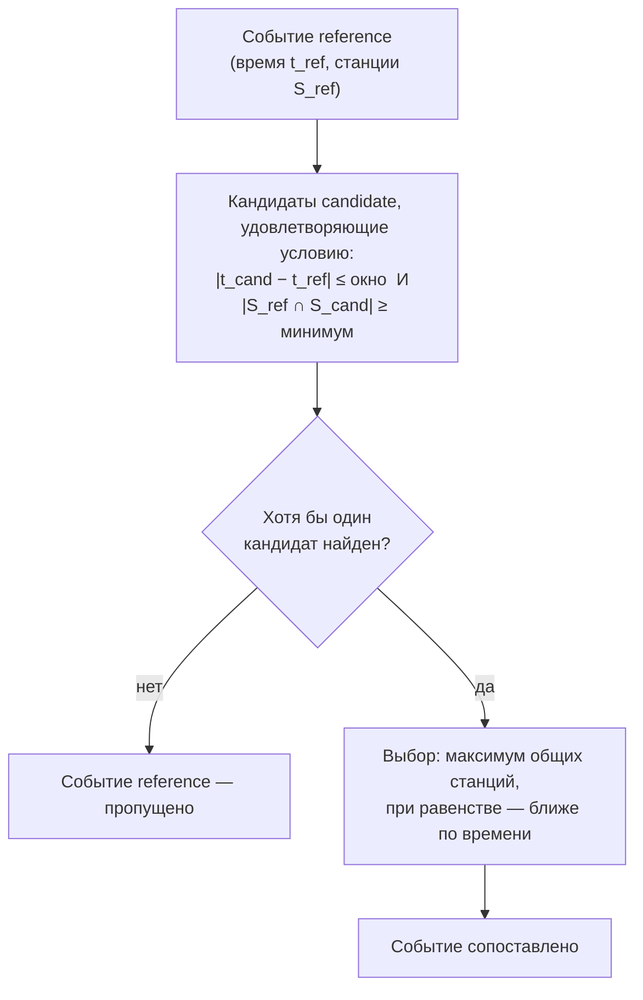

Формально кандидат допускается к рассмотрению, если

$$
\big|t_{\text{cand}} - t_{\text{ref}}\big| \le W \qquad\wedge\qquad \big|S_{\text{ref}} \cap S_{\text{cand}}\big| \ge n_{\min},
$$

где $W$ — временное окно допуска, $n_{\min}$ — минимум общих станций. Основная оценка использует `--match-mode stations --min-shared 4 --window 60`; отдельно повторяется проверка с `--window 10`. Значение `--min-shared 4` задаётся явно: программный default равен 1. Среди допустимых кандидатов выбирается максимум общих станций, затем минимум абсолютного сдвига времени; при полном равенстве остаётся первый кандидат в порядке входного файла.

P и S одной станции дают одну общую станцию; станция только с S также может войти в пересечение. Сравниваются коды станций без учёта сети. Совпадение времени отдельных вступлений, названий фаз и флагов Def не проверяется. Поэтому найденное событие по этому критерию не означает, что все его P/S определены правильно.

Сопоставление не эксклюзивно: один и тот же кандидат может быть признан «лучшим совпадением» сразу для нескольких разных эталонных событий, если они расположены близко по времени — это стоит учитывать при интерпретации результата сравнения на плотных по времени последовательностях событий (афтершоковые серии).

По результатам сравнения формируется список найденных и пропущенных событий эталонного бюллетеня, с расхождением по времени и составом станций для найденных. Также рассчитываются среднее и максимальное расхождение по времени и среднее число общих станций. Число совпадений при неэксклюзивном сопоставлении не обязательно равно числу разных найденных кандидатов.

### Какие показатели различаются

Полнота относительно эталона определяется как

$$
\mathrm{Recall}=
\frac{N_{\text{сопоставленных событий эталона}}}
{N_{\text{событий эталона после отбора}}}.
$$

Она отвечает на вопрос, какая часть выбранного эталонного бюллетеня найдена по указанному правилу. Доля истинных событий среди всей автоматической выдачи — другой показатель, для которого нужна разметка этой выдачи. Отсутствие совпадения с эталоном само по себе не устанавливает ложность события.

Расхождение времени вычисляется между временем эталона и экспортной S–P-оценкой. Проверка при ±10 с строже по времени, но также не заменяет проверку отдельных вступлений.

Ошибка эпицентра — расстояние по сфере между нашими и эталонными координатами в километрах; она оценивается только у сопоставленных событий с координатами с обеих сторон. Для глубины различаются подписанная разность $H_{\text{наша}}-H_{\text{эталон}}$ и её абсолютная величина. При сравнении скоростных моделей число определённых глубин и ошибка на одной общей выборке допустимых глубин учитываются раздельно, как в §9.

### Диагностика локации

`--location-error` не меняет сопоставление: он добавляет отчёт для совпавших событий с координатами в обоих бюллетенях. Ошибка эпицентра — расстояние по сфере в километрах; сводка содержит медиану, максимум и число ошибок ≤10 км. Для глубины выводятся подписанная разность `H_candidate−H_reference`, её медиана и медиана абсолютной разности.

Этот отчёт сам не исключает неопределённые глубины 0 или ≥700 км и не отбирает решения по RMS или неопределённости глубины. При сравнении моделей отдельно учитываются число событий с координатами, число определённых глубин и ошибка глубины на одной общей выборке допустимых решений. Увеличение числа определённых глубин не означает повышения их точности. Предварительное сравнение IASP91 и региональных моделей с указанием выборок приведено в §9.

### Дополнительное сопоставление по координатам

При `--match-mode location` для пары с координатами используются окно времени и расстояние между эпицентрами ≤`--max-dist-km` (default 50 км), без требования общих станций. При отсутствии координат действует `--no-coords-match`: время и станции (`stations`) либо только время (`time`). Среди подходящих кандидатов приоритет имеют совпадения по координатам, затем выбирается ближайший эпицентр и ближайшее время; для fallback — ближайшее время.

Флаг `--loc-good-only` разрешает сравнение по координатам кандидата только при `Err depth > --loc-min-err-depth` и `RMS < --loc-max-rms`; остальные кандидаты обрабатываются как не имеющие координат, а не удаляются. Это отдельный диагностический критерий. Его строгие неравенства и default RMS 2 с отличаются от условий экспортного `--locator-mode filter`. Результаты разных режимов сопоставления нельзя объединять в одну оценку recall.

### Сводка достигнутых результатов

| Проверка | Выборка и конфигурация | Результат |
|---|---|---|
| Двухпоисковая ассоциация, Q1 2025 | контрольные окна около всех 112 событий эталона | **86/112 при ±60 с; 82/112 при ±10 с** |
| Двухпоисковая ассоциация, май 2024 | контрольные окна около событий эталона | **41/46** по основному критерию |
| Региональное уточнение LOCSAT | прежний ассоциатор v2, Q1; 83 события с координатами | медианная ошибка эпицентра **6.74→5.80 км**; определённых глубин **70→73** |
| Точность глубины | та же проверка, 66 общих определённых глубин | медианная абсолютная ошибка **5.97→7.06 км** |
| Статистический отсев | модель Q1, история семь суток; прежняя конфигурация выдачи | май **493→259**, апрель **8 991→5 003**, Q1 **4 080→1 990**; найденные эталонные события сохранены |
| Диагностика вступлений по невязкам | решения IASP91, май/апрель 2024 и Q1 2025 | AUC **0.83–0.91 для P**, **0.71–0.83 для S** |

Двухпоисковая схема проверена на контрольных окнах около всех эталонных событий. Аналогичная полнота ожидается при полном прогоне; размер полной выдачи и сквозной результат после регионального уточнения и отсева предстоит измерить.

Сетевая ассоциация собирает события из разновременных станционных вступлений и сохраняет основную часть эталонных совпадений при ужесточении окна до ±10 с. Региональные разрезы уменьшают ошибку эпицентра, а статистический отсев сокращает число событий для дальнейшего разбора с сохранением найденных событий эталона в проверенных выборках. Невязки добавляют возможность адресно выделять вступления, требующие проверки.

Разработка связывает эти задачи в последовательную обработку: качество вступлений учитывается при оценке времени и отсеве, согласованность S–P проверяется при выборе магнитудной группы, а рассчитанная ML сохраняется при последующей локации и экспорте. Наблюдения, магнитуды, доступные гипоцентры и невязки связаны с исходными событиями. Это позволяет разбирать причины расхождений и проверять изменения метода на одних и тех же наблюдениях.

### Сопоставление магнитуд

Собственная ML рассчитывается по амплитудам и расстояниям (§7), без использования энергетического класса K. Для её сравнения с бюллетенем применяется пересчёт опубликованного K:

$$
M_K=\frac{K-4}{1.8}.
$$

Источник применения этого соотношения — [Зверева А. С., 2024, §4.3, с. 98, формула (4.16)](https://ifz.ru/documents/Dissovet/2024/Zvereva/Disser%20Zvereva.pdf#page=98). Коэффициенты в нашем конвейере не подбирались. Полученная величина не является прямым определением ML. K здесь — энергетический класс, опубликованный в исходном бюллетене. В используемых файлах K есть у 707/707 событий 2024 года и 171/171 события Q1 2025; MPVA опубликована у 408 и 112 событий соответственно.

Отдельно проверено преобразование

$$
M_L^{\text{ref}}=1.15\,MPVA-1.60,
$$

приведённое [Коноваловым и Сычевым (2014), формула (13)](https://doi.org/10.1134/S0742046314060050) для Северного Сахалина. Оба преобразования сравнивались с нашей ML на одних и тех же событиях с доступными K, MPVA и ML: сохранённые бюллетени после отсева, MPVA ≥ 1.5, не менее четырёх общих станций, окно ±60 с.

| Период | Пар | Преобразование эталона | Медиана ML−Mref | Медиана абсолютного расхождения | Среднее абсолютное расхождение | Расхождение ≤0.5 |
|---|---:|---|---:|---:|---:|---:|
| Май 2024 | 41 | (K−4)/1.8 | +0.111 | 0.189 | 0.210 | 38/41 |
| Май 2024 | 41 | 1.15·MPVA−1.60 | −0.125 | 0.225 | 0.240 | 37/41 |
| Апрель 2024 | 18 | (K−4)/1.8 | +0.133 | 0.183 | 0.211 | 18/18 |
| Апрель 2024 | 18 | 1.15·MPVA−1.60 | −0.130 | 0.130 | 0.227 | 16/18 |
| Q1 2025, ассоциатор v2 | 86 | (K−4)/1.8 | +0.072 | 0.133 | 0.188 | 80/86 |
| Q1 2025, ассоциатор v2 | 86 | 1.15·MPVA−1.60 | −0.070 | 0.185 | 0.229 | 77/86 |

При текущем пересчёте из K расхождение не превышает 0.5 у 38 из 41 пары в мае, у всех 18 пар в апреле и у 80 из 86 пар в Q1. Этот пересчёт дал меньшее среднее абсолютное расхождение во всех трёх периодах и больше совпадений в пределах 0.5. В апреле преобразование MPVA лучше по медиане абсолютного расхождения. Устойчивого преимущества, достаточного для замены текущего пересчёта, не получено.

Эти расхождения характеризуют согласованность разных методов и шкал; они не выделяют собственную ошибку нашего определения ML. Меньшее расхождение также не удостоверяет большую точность преобразования эталона. Текущий пересчёт из K сохраняется, собственный расчёт ML и основной критерий обнаружения MPVA ≥ 1.5 не меняются.

При применении порога 1.5 к преобразованию MPVA по формуле (13) эталонные выборки этих периодов также остаются 46/20/112; recall не изменяется. События без MPVA в сравнение двух преобразований не входят. Для мая и апреля используются проверочные наборы, описанные в §10.

### Параметры командной строки и CSV-отчёт

Полный список CLI-флагов:

| Флаг | По умолчанию | Назначение |
|---|---|---|
| `--reference` / `--candidate` | **обязательны** | сравниваемые `.BUL`-файлы |
| `--window` | `60.0` с | допуск по времени |
| `--min-shared` | `1` | минимум общих станций |
| `--min-mag` / `--min-cand-mag` | нет | фильтры по магнитуде |
| `--ref-mag-type` | `mpva` | первая магнитуда эталона / `kp`: `(K−4)/1.8` |
| `--ref-year` / `--ref-month` | нет | фильтр reference по времени |
| `--match-mode` | `stations` | основной критерий по станциям / диагностический `location` |
| `--max-dist-km` | `50.0` | максимальное расстояние эпицентров для `location`, км |
| `--no-coords-match` | `stations` | fallback в `location`: станции и время / только `time` |
| `--loc-good-only` | выкл. | использовать координаты candidate только при прохождении заданных условий |
| `--loc-max-rms` / `--loc-min-err-depth` | `2.0` / `0.001` | с `--loc-good-only`: RMS строго ниже порога (с), Err depth строго выше порога (км) |
| `--show-missed` | выкл. | непустой список непойманных печатается всегда; флаг влияет только на сообщение при пустом списке |
| `--location-error` | выкл. | ошибка эпицентра/глубины для совпавших событий с координатами в обоих файлах |
| `--out-csv` | нет | CSV-версия отчёта |

`--out-csv` сохраняет строки `matched`/`missed`, идентификаторы и времена пары, сдвиг времени, число общих станций и размеры станционных множеств. Ошибки эпицентра и глубины, а также способ сопоставления в этот CSV не включаются.

---

## 14. Причины пропусков и границы применимости

### На каком этапе может потеряться событие

Отсутствие события в итоговом списке требует последовательного разбора. Оно может быть связано как с недоступностью наблюдений, так и с решениями алгоритмов на последующих этапах.

| Этап | Что проверяется при разборе пропуска |
|---|---|
| Записи и метаданные | есть ли запись нужного времени и компонент, нет ли разрывов, доступен ли подходящий инструментальный отклик |
| Детекция | обнаружены ли необходимые P/S; не отвергнуты ли слабые вступления или неполная пара фаз |
| Ассоциация | есть ли шесть согласных P разных станций; не ушли ли полезные вступления в конкурирующую гипотезу; совместимы ли S со своими P |
| Оценка ML | доступны ли амплитуды; корректны ли S–P-расстояния и выбранная группа; рассчитана ли ML и пройден ли порог 1.5 |
| Последующие условия | прошло ли событие статистический отсев; достаточно ли допустимых S–P-оценок для экспортного времени |

В разборах прежних прогонов подтверждены разные механизмы: недостаток совпавших с эталоном P во входе ассоциации, поглощение полезных альтернатив конкурирующей группой, ошибки S с искажением расстояния и состава магнитудной группы. Именно различия в обращении с альтернативными вступлениями обосновывают два независимых поиска. Эти наблюдения не задают распределение причин всех пропусков нового конвейера.

Для части детекторных пропусков причина остаётся открытой. Отсутствие обнаружения нельзя автоматически объяснять отсутствием исходной записи, а нехватку согласных вступлений — только слабостью землетрясения.

### Роль геометрии сети и излучения

Амплитуда на станции зависит от расстояния, затухания, условий регистрации и направленности излучения очага. Механизм землетрясения может давать слабый сигнал в одних направлениях и сильный в других. Если доступные станции плохо охватывают источник или на них мало различимых вступлений, событие может не набрать требуемой поддержки.

Если одна станция даёт согласную оценку времени, а более близкие — смещённые, направленность излучения остаётся одним из возможных объяснений слабой регистрации нужного сигнала. По одним временам нельзя установить ни механизм очага, ни регистрацию другого землетрясения; для этого нужны записи и геометрия наблюдений.

LOCSAT совместно определяет гипоцентр по имеющимся наблюдениям, но не восстанавливает отсутствующие или не обнаруженные вступления. Локация может уточнить интерпретацию собранной группы; она не гарантирует исправления ошибочной ассоциации.

### Условия переноса и нерешённые вопросы

- **Детектор не дообучался на этой сети.** Используются исходные веса модели, обученной на глобальном наборе STEAD. Результаты текущих проверок характеризуют перенос выбранной модели и настроек; они не задают полноту для произвольного региона или уровня шума.
- **Пороги и состав сети определяют отбор.** Минимум станций, допуски времён и порог ML задают рабочий компромисс между полнотой и случайными сочетаниями. Признаки станционной истории также зависят от режима работы сети. При изменении условий требуется проверка переноса настроек и модели отсева.
- **Станционные поправки магнитуды сейчас отключены** ($S_i = 0$) — не из-за отсутствия механизма, а из-за признанной неактуальности имеющегося набора калибровочных значений (§7).
- **Ручной верификации всей выдачи нет.** Итоговый бюллетень остаётся автоматическим. Природа событий, не сопоставленных с эталоном, и доля истинных событий во всей выдаче требуют отдельной оценки.

Рабочие настройки отличаются от CLI-defaults. Три независимые реализации ML используют разные пороги отбора; особенности прямого запуска детектора и временная SQLite-база альтернативного v2 разобраны в §§4–7. Эти условия сопровождения нужно учитывать отдельно от физических ограничений.

Предположения измерения амплитуд и расстояний, ограничения глубины и условия обучения отсева изложены в §7, §9 и §10 соответственно. Ближайшие проверки — полный прогон выбранной двухпоисковой схемы со всеми последующими этапами, перенос отсева на период, не участвовавший в выборе конфигурации, и разбор изменений глубины по региональным моделям.

---

## 15. Форматы данных между стадиями — сводная таблица

| Стык | Формат | Реальные поля |
|---|---|---|
| SDS-архив | miniSEED | `NET.STA.LOC.CHAN.TYPE.YEAR.DAY`, один канал/сутки |
| `geofile_processor.py` → `workspace/data_processors/output/geofiles/` | miniSEED, переименован | `NET.STA.LOC.CHAN.TYPE__20240401T000000Z__20240402T000000Z` |
| `metadata_processor.py` → JSON | JSON | `{STA: {network, channels:[...], coords:[lat,lon,elv]}}`; агрегатный JSON и отдельные `station_{CODE}.json` детектора готовятся раздельно |
| `detector.py::process_station_v4` (`merge`) → CSV на станцию | CSV, 19 колонок `CSV_HEADER` | `file_name, network, station, instrument_type, station_lat, station_lon, station_elv, event_start_time, event_end_time, detection_probability, detection_uncertainty, p_arrival_time, p_probability, p_uncertainty, p_snr, s_arrival_time, s_probability, s_uncertainty, s_snr` |
| `associator.py` (стейджинг) → `X_prediction_results.csv` | CSV, те же 19 колонок | подмножество строк, прошедших `_passes`/`_passes_v2`; в режиме `weight` — `detection_probability`/`p_probability`/`s_probability` переписаны на эффективные |
| `core/associator.py` → `run_associator_v3` → `associations.xml` | QuakeML BED 1.2 | объединённые гипотезы двух поисков: `event publicID="smi:local/..."`, `pick/time/value`, `waveformID` с сетью/станцией, `phaseHint` P/S. Origin на этой стадии — служебное начальное значение, не результат локации |
| Метка поискового происхождения → ML и дедупликация | согласованный контракт | принадлежность первичному или альтернативному поиску сохраняется вместе с event ID; имя XML-атрибута или отдельного файла здесь не задаётся |
| `ml_filter_v5.py` → ML-XML | QuakeML | прошедшие ML-порог события с исходными `publicID`; при `--write-ml` — ML события, `stationCount` и станционные ML |
| Окончательная дедупликация → XML для экспорта и XML для LOCSAT | QuakeML | обе ветки ограничиваются оставленными event ID; вход LOCSAT содержит только события, для которых удалось сформировать группу пиков. ML и пики сохранённых событий не пересчитываются |
| `ml_filter_v5.py` кэш | CSV | `pub_id, sta, A` (метры) |
| `validate_associator_v2.py --out-xml` (диагностика) | QuakeML BED 1.2 | отдельный результат S-P-оценки: время очага, ML и пики; не обязательный промежуточный файл основной цепочки |
| `export_bul.py` → `.BUL` | IMS1.0:SHORT | буферы Origin 136, Magnitude 38 и Phase 122 символа; конечные пробелы удаляются |
| `.BUL` → `compare_bul.py` | текст, фиксированные колонки | дата 1–10, время 12–22, станция 1–5, магнитуда 7–10; нумерация с 1, границы включены |
| `fit_traveltime.py` → эмпирическая таблица первой P | CSV | `dist_km,tp_s,n,p16,p84`: расстояние, км; медиана и квантили времени, с; число наблюдений. Размер бина задаётся параметром |
| `ml_filter_v5.py --out-xml-ptt` → вход LOCSAT | QuakeML | исходный event ID, P выбранной группы и согласные S; начальные latitude/longitude и T0 по P. При `--ptt-locsat-select ps` группа выбирается отдельно от P-only-отбора ML |
| StationXML → инвентарь LOCSAT | SC3ML | слияние по началу периода через `merge_stationxml.py --at-date`, затем `fdsnxml2inv`; действующие location codes проверяются на время пика |
| LOCSAT → `hypocenters.csv` | CSV | `event_id,engine,converged,error,t0,lat,lon,depth_km,depth_uncertainty_km,rms,n_stations_used,n_arrivals_used`; координаты в градусах, глубина/её неопределённость в км, RMS в с |
| LOCSAT → `residuals.csv` | CSV | `event_id,net,sta,phase,pick_time,residual,distance,azimuth,weight,time_used`; невязка в с, расстояние в градусах дуги, азимут в градусах; то же выбранное решение, что в гипоцентрах |
| `ml_filter_v5.py --write-ml` → XML | QuakeML + `Magnitude`/`stationMagnitude` | ML события и станций — вход для `export_bul.py --ml-from-xml` |
| `false_event_filter.py` → `export_bul.py` | QuakeML | подмножество событий с сохранением event ID, пиков и ML; дополнительные входы фильтра — staging, гипоцентры, история станций и параметры модели |
| История станций и комплект модели → отсев | накопленные суточные счётчики и фиксированные параметры | история d−7…d−1 по staging и событиям до отсева; порядок 17 признаков, веса, сдвиг, средние, масштабы и порог |
| Обогащённый экспорт → `.BUL` | IMS1.0:SHORT | S–P-время очага, ML из XML, доступные координаты LOCSAT, амплитуды из кэша и TRes выбранного решения; текущий Def — `T__`, пометка `___` при большой невязке остаётся предложением |

Основной XML, ptt-XML, кэш, гипоцентры и невязки относятся к одному запуску и связываются по исходному event ID. Для амплитуд дополнительно используется станция; для невязок — сеть, станция, фаза и время пика. Staging того же запуска не содержит event ID: его строки сопоставляются по станции и временам вступлений по правилам §6. Идентификаторы `OrigID`/`ArrID`, созданные при экспорте, не заменяют исходные ключи.

SNR хранится в дБ, неопределённость MC Dropout — в шкале вероятности модели, а не в секундах ошибки вступления. Амплитуда кэша задана в метрах; экспортная колонка амплитуды — в нанометрах. Координаты — в градусах, глубина — в километрах; расстояние поля `distance` невязок и фазового Dist — в градусах дуги.

Файлы альтернативного v2 сохраняют отдельный контракт и не являются выходом выбранного v3:

| Выход v2 | Формат | Содержимое |
|---|---|---|
| `Y2000.phs` | hypoInverse phase format | служебная гипоцентровая строка с координатами первой станции, `depth=5.0`, `mag=0.0`, затем строки фаз |
| `traceNmae_dic.json` | JSON | `{event_id: [traceID*station*event_start_time, ...]}` |

---

## 16. Как запускать пайплайн целиком

Ниже показан единый сценарий для Q1 2025. Имена каталогов — пример;
каждый запуск должен иметь собственные выходные файлы и кэш амплитуд.
Один и тот же согласованный набор станций используется в детекторе
и стейджинге; NEUR исключается. Для ассоциации требуется не менее
шести пригодных P-станций события.

Команды приведены для Bash и запускаются из корня репозитория.
Переменные обозначают подготовленные входы и выбранные выходы:

| Переменная | Смысл |
|---|---|
| `STATIONS` | коды станций через запятую, единый список для периода |
| `GEOFILES`, `STATION_JSON`, `METADATA`, `COORDS_JSON` | волновые файлы, станционные JSON, StationXML и дополнительные координаты |
| `GPU_WORKERS` | число GPU-процессов, выбранное по VRAM, CPU и RAM; не бюджет TF-потоков CPU |
| `DETECTIONS`, `STAGING` | результаты детектора и staging текущего запуска |
| `ASSOC_XML` | объединённые гипотезы двух поисков |
| `ML_XML`, `PTT_XML`, `AMPS` | результаты ML, отдельный вход LOCSAT и новый кэш амплитуд |
| `UNIQUE_XML`, `UNIQUE_PTT_XML` | обе XML-ветки после окончательной дедупликации |
| `HYPOCENTERS`, `RESIDUALS`, `FILTERED_XML` | выбранные решения LOCSAT, их невязки и XML после отсева |
| `TT_ASSOC`, `TT_ML` | отдельные таблицы первой P для ассоциации и ML |
| `INVENTORY`, `REFERENCE`, `BUL` | инвентарь LOCSAT для периода, эталонный и выходной бюллетени |

`TT_ASSOC` — IASP91 для ассоциации, z=0. `TT_ML` задаётся
отдельно: таблица ассоциатора не подставляется вместо неё
автоматически. Для выбранной настройки IASP91 нужно подготовить
совместимый с ML CSV и проверить его параметры. Точный файл
таблицы ML является обязательным входом воспроизводимого запуска.

Это последовательность команд и алгоритмических операций,
а не проверенный скрипт для копирования целиком. Для сквозного
выполнения требуется согласовать интерфейсы операций,
обозначенных ниже текстом.

**1. Подготовить данные и инвентарь.** Выполнить подготовку SDS
и StationXML по §2:

```bash
python data_processors/main.py
```

`data_processors/main.py` использует параметры
в исходном файле. Инвентарь LOCSAT подготавливается на начало
Q1 2025 (`--at-date 2025-01-01`) по правилам §9:
последняя эпоха с началом не позже этой даты; при её отсутствии —
первая последующая со сдвигом начала.
Эмпирическая таблица `fit_traveltime.py` — дополнительный вариант
§7, а не обязательный способ подготовки IASP91.

**2. Детекция, merge и MC Dropout ×5.** Для сервера
с 80 логическими процессорами бюджет 75% составляет
ceil(80×0.75)=60. Пример — 30 воркеров по два TF-потока;
это ориентир бюджета, а не предел всех потоков процесса.

```bash
python core/cpu_pipeline.py \
  --input-dir "$GEOFILES" --json-dir "$STATION_JSON" \
  --output-base-dir "$DETECTIONS" --stations "$STATIONS" \
  --date-from 2025-01-01 --date-to 2025-04-01 \
  --gap-mode merge --estimate-uncertainty --number-of-sampling 5 \
  --max-workers 30 --tf-threads-per-worker 2
```

Вместо CPU-обёртки можно использовать GPU-вариант с теми же данными, периодом и станциями:

```bash
python core/gpu_pipeline.py \
  --input-dir "$GEOFILES" --json-dir "$STATION_JSON" \
  --output-base-dir "$DETECTIONS" --stations "$STATIONS" \
  --date-from 2025-01-01 --date-to 2025-04-01 \
  --gap-mode merge --estimate-uncertainty --number-of-sampling 5 \
  --max-workers "$GPU_WORKERS"
```

Выбирается одна обёртка для запуска. Прямой `python core/detector.py` обрабатывает станции последовательно; ограничения `--tf-threads-per-worker` относятся к CPU-обёртке. Конец периода исключён.

**3. Ассоциация v3 с двумя поисками — целевой `core/associator.py`.** Выбран именно v3, в том числе пока его рабочая реализация и оркестрация ещё не перенесены в целевой `core/`. Наличие старого входа v2 не меняет выбранный алгоритм. Стадия готовит staging
из `DETECTIONS` для `STATIONS` в режиме
`--uncertainty-mode weight`, затем вызывает
`EQTransformer/utils/associator.py::run_associator_v3`.
Функция выполняет два независимых поиска по `TT_ASSOC`
за 2025-01-01 ≤t<2025-04-01, с минимумом 6 P-станций
и допуском 3.5 с, и объединяет гипотезы с удалением
полных повторов состава пиков → `ASSOC_XML`.
Режим `weight` относится к staging и не задаёт веса
голосования нового поиска. Точка входа и её результат
фиксированы; полная команда требует согласованного интерфейса
передачи таблицы и параметров двухпоискового алгоритма.

**4. ML и отдельный вход LOCSAT.** Использовать новый `AMPS`
для этого запуска ассоциатора:

```bash
python core/ml_filter_v5.py \
  --assoc-in "$ASSOC_XML" --assoc-out "$ML_XML" \
  --waveforms "$GEOFILES" --metadata-dir "$METADATA" \
  --station-coords-json "$COORDS_JSON" --cache-amp "$AMPS" \
  --tt-table "$TT_ML" --distance-source sp --ml-threshold 1.5 \
  --ml-stations p-traveltime --max-station-dist-km 800 \
  --write-ml --out-xml-ptt "$PTT_XML" --ptt-locsat-select ps
```

Промежуточный запуск `consistent` для получения кэша не требуется.
Удаление станций по `--drop-far-from-origin-km` — отдельная
опция, не обязательная часть этого примера.

**5. Окончательная дедупликация.** По ML-XML сохранить все прошедшие ML гипотезы первичного поиска,
затем последовательно добавлять альтернативные, не имеющие совпадения
на ≥4 точных парах станция/P при |ΔT0|≤10 с.
T0 для этой проверки вычисляется отдельно с настройками §8:
двухскоростная схема, sigma=1, R≥20 км, без верхней и географической отсечек.
При отсутствии T0 совпадение не устанавливается; добавленная альтернатива
участвует в следующих сравнениях.
Получить `UNIQUE_XML`; тем же набором оставленных event ID
отфильтровать `PTT_XML` → `UNIQUE_PTT_XML`.
Пики и ML оставленных событий не пересчитывать.

**6. LOCSAT и региональное уточнение.** В окружении SeisComP
выполнить baseline IASP91 по `UNIQUE_PTT_XML` и `INVENTORY`.
По baseline-координатам выбрать одну из 16 моделей,
уточнить решение и при несходимости сохранить baseline (§9).
Записать выбранные решения в `HYPOCENTERS`, а соответствующие
им невязки — в `RESIDUALS`. При отсутствии исходного решения
региональный этап не запускается; при успехе уточнения область повторно
не выбирается. В WSL все пути должны быть
доступны интерпретатору SeisComP, например через `/mnt/d/`.

**7. Отсев ложных событий.** Передать `core/false_event_filter.py`
XML `UNIQUE_XML`, выбранные гипоцентры, staging, станционные ML,
историю прошлых семи суток и фиксированные параметры модели
из §10 → `FILTERED_XML`. История участия станций берётся
до этого отсева; события сохраняют исходные ID.

**8. Экспорт.** Передать именно XML после отсева.
ML берётся из XML, амплитуды — из кэша того же запуска:

```bash
python core/export_bul.py \
  --assoc "$FILTERED_XML" --amps "$AMPS" --ml-from-xml \
  --prob-dir "$STAGING" --metadata-dir "$METADATA" \
  --output-cpu-dir "$DETECTIONS" \
  --locator-mode enrich --hypocenters "$HYPOCENTERS" \
  --year 2025 --out "$BUL"
```

Подключение `RESIDUALS` для TRes — дополнительный
контракт §11–12; имя CLI-параметра здесь не задаётся.
Невязки сопоставляются с исходными event ID и вступлениями
до перенумерации событий и фаз в BUL.

**9. Сравнение с эталоном.** Используется эталонный BUL Q1 2025:

```bash
python core/compare_bul.py \
  --reference "$REFERENCE" --candidate "$BUL" \
  --ref-year 2025 --ref-mag-type mpva --min-mag 1.5 \
  --match-mode stations --min-shared 4 --window 60 --location-error

python core/compare_bul.py \
  --reference "$REFERENCE" --candidate "$BUL" \
  --ref-year 2025 --ref-mag-type mpva --min-mag 1.5 \
  --match-mode stations --min-shared 4 --window 10
```

ML-XML и вход LOCSAT — разные ветки: ML использует P-only-отбор,
а `--ptt-locsat-select ps` отдельно выбирает группу по P и S.
Их связывают event ID, а не тождество всех пиков.
Окончательная дедупликация должна согласованно ограничить обе ветки.
Гипоцентры, невязки и амплитуды подключаются по исходным ID;
стейджинг сохраняется для вероятностей/SNR и истории.

Для буквального сквозного запуска остаются обязательными:
проверенный `TT_ML`, интерфейс `core/associator.py` для двух поисков,
окончательной дедупликации двух XML-веток, регионального выбора
с согласованными невязками, загрузки модели отсева и истории,
а также подключения residuals в экспорт.
Отсутствующие интерфейсы не заменяются вымышленными флагами.
Отдельная диагностика `validate_associator_v2.py` не является
обязательной стадией этой последовательности.

---

## 17. Источники и навигация

### Реализация описанных стадий

Документ объединяет физическое объяснение и технические контракты выбранного конвейера. Для точных аргументов вызова используются фактический parser и `--help` доступной реализации. Согласованные имена `core/` обозначают целевые компоненты; рабочие реализации в `context/scratch` до переноса сохраняют роль в выбранной схеме.

- `data_processors/main.py`, `data_processors/geofile_processor.py`, `data_processors/metadata_processor.py` — подготовка данных (§2).
- `EQTransformer/core/EqT_utils.py`, `EQTransformer/core/predictor.py`, `EQTransformer/utils/hdf5_maker.py` — модель, извлечение пиков и предобработка (§3).
- `core/detector.py`, `core/cpu_pipeline.py`, `core/gpu_pipeline.py`, `core/threads.py` — детекция и распределение ресурсов (§4).
- `core/associator.py`, `EQTransformer/utils/associator.py` — staging и выбранный v3 с двумя поисками; v2 описан как альтернатива (§5).
- `core/validate_associator_v2.py` — S–P-оценки и отдельная диагностика (§6); библиотека также используется экспортом и расчётом T0 дедупликации (§8, §12).
- `core/ml_filter_v5.py`, `core/sta_correction_estimator.py`, `core/fit_traveltime.py` — ML, калибровка поправок и дополнительный эмпирический годограф (§7).
- Целевой `core/locator.py` и `context/scratch/merge_stationxml.py` — LOCSAT и подготовка инвентаря (§9); выбранные невязки описаны в §11.
- Целевой `core/false_event_filter.py` — отсев по фиксированным признакам и истории станций (§10).
- `core/export_bul.py`, `core/compare_bul.py` — экспорт и сравнение готовых бюллетеней (§12–13).

### Подробные описания модулей

Модульные описания могут включать исторические или альтернативные режимы; их defaults не подменяют выбранный сценарий этого документа.

- [data_processors/README.md](../data_processors/README.md) — SDS, StationXML → JSON, оркестрация.
- [core/detector.md](../core/detector.md) — обработка станции, разрывы, предобработка, модель.
- [core/cpu_pipeline.md](../core/cpu_pipeline.md), [core/gpu_pipeline.md](../core/gpu_pipeline.md), [core/threads.md](../core/threads.md) — параллельная обработка и бюджет ресурсов.
- [core/associator.md](../core/associator.md) — staging и альтернативный оконный ассоциатор; выбранный v3 с двумя поисками изложен в §5.
- [core/ml_filter_v5.md](../core/ml_filter_v5.md), [core/sta_correction_estimator.md](../core/sta_correction_estimator.md) — ML, отбор станций, кэш и калибровка поправок.
- [core/locator.md](../core/locator.md) — LOCSAT, инвентарь, CSV гипоцентров и отдельный ptt-вход.
- [core/validate_associator_v2.md](../core/validate_associator_v2.md) — T0 без гипоцентра и диагностические примеры сопоставления с каталогом.
- [core/export_bul.md](../core/export_bul.md), [core/compare_bul.md](../core/compare_bul.md) — форматирование IMS1.0:SHORT и сравнение; выбранные контракты TRes/Def изложены в §11–13.
- [EQTransformer/eqt_internals.md](../EQTransformer/eqt_internals.md) — исторический разбор EQT; актуальные уточнения архитектуры, предобработки и порогов приведены в §3.
- [EQTransformer/dyagilev2023_ml_scale.md](../EQTransformer/dyagilev2023_ml_scale.md) — разбор статьи-источника ML.
- [core/README.md](../core/README.md), [workspace/README.md](../workspace/README.md) — индекс модулей и раскладка рабочих данных.

### Научные источники

- [Mousavi S. M. et al. (2020). Earthquake transformer—an attentive deep-learning model for simultaneous earthquake detection and phase picking. Nature Communications, 11, 3952](https://doi.org/10.1038/s41467-020-17591-w) — исходная модель детекции и определения вступлений.
- [Zhang M., Ellsworth W. L., Beroza G. C. (2019). Rapid Earthquake Association and Location. Seismological Research Letters, 90(6), 2276–2284](https://doi.org/10.1785/0220190052) — близкий принцип сеточной ассоциации по числу вступлений, согласованных с годографами.
- [Дягилев Р. А., Габсатарова И. П., Селиванова Е. А. (2023). Шкала локальных магнитуд ML для землетрясений в Терско-Каспийском прогибе. Российский сейсмологический журнал, 5(2), 19–31](https://doi.org/10.35540/2686-7907.2023.2.02) — источник коэффициентов формулы ML; различия измерительной процедуры объяснены в §7.
- [Kennett B. L. N., Engdahl E. R. (1991). Traveltimes for global earthquake location and phase identification. Geophysical Journal International, 105, 429–465](https://doi.org/10.1111/j.1365-246X.1991.tb06724.x) — модель IASP91.
- [Зверева А. С. (2024). Добротность литосферы и спектральные параметры очагов землетрясений Северного Кавказа. Диссертация, §4.3, с. 98, формула (4.16)](https://ifz.ru/documents/Dissovet/2024/Zvereva/Disser%20Zvereva.pdf#page=98) — источник применения пересчёта $M_K=(K-4)/1.8$.
- [Konovalov A. V., Sychev A. S. (2014). A calibration curve of local magnitude and intermagnitude relations for northern Sakhalin. Journal of Volcanology and Seismology, 8, 390–400](https://doi.org/10.1134/S0742046314060050) — отдельно проверенное преобразование MPVA, формула (13).
- Р. А. Дягилев (ФИЦ ЕГС РАН), личное сообщение — скоростное приближение $V_p=6.0$/$V_s=3.4883$ км/с (§6), не опубликованное в открытом источнике.
- IDC-3.4.1Rev1, «Formats and Protocols for Messages — IMS1.0», таблицы 41 «Origin Block» и 42 «Phase Block» — источник раскладки используемых полей бюллетеня (§12); ограничения реализованного набора полей указаны там же.
