# Метод автоматического обнаружения и оценки параметров сейсмических событий на базе форка EQTransformer

## 0. Назначение документа

Документ описывает метод автоматической обработки непрерывных записей региональной сейсмической сети Северного Кавказа — от обнаружения вступлений P- и S-волн на отдельных станциях до оценки магнитуд, определения гипоцентров и формирования бюллетеня. Изложение адресовано физикам и сейсмологам: для каждого этапа объясняются измеряемые и вычисляемые величины, физические предположения, назначение отбора данных и результаты проверки.

Обнаружение на одной станции, сетевое событие, его магнитуда и гипоцентр — разные результаты обработки. Нейросеть определяет моменты вступлений на записи; ассоциация связывает вступления разных станций с общим источником; амплитуды и расстояния используются для оценки локальной магнитуды ML; совместное решение по временам прихода даёт координаты и глубину очага.

В работе подготовлены и проверены решения для применения EQTransformer к длительным региональным записям: продолжение обработки после разрывов, расчёт в оперативной памяти с MC Dropout, двухпоисковая ассоциация, отбор станций для ML, региональное уточнение гипоцентров и статистическое сокращение выдачи. Для каждого решения прослежена связь между исходной проблемой, способом её устранения и результатом проверки. Такой подход позволяет оценивать вклад отдельных этапов и последовательно улучшать обработку всей сети.

Метод и условия его проверки изложены в самом документе, без исходного кода и параметров командной строки. Результаты проверок приводятся с указанием выборок и использованных конфигураций. Основной внешний эталон — бюллетени ФИЦ ЕГС РАН; полнота обнаружения, ошибки положения очага и согласованность магнитуд рассматриваются раздельно.

---

## 1. Общая схема конвейера

Выбранная последовательность включает девять этапов:

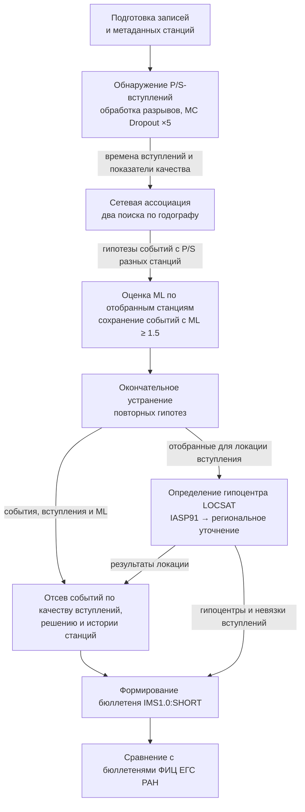

| Этап | Основные входные данные | Что определяется или отбирается |
|---|---|---|
| Подготовка | непрерывные записи и метаданные станций | записи выбранного периода, координаты и сведения о каналах и приборах |
| Детекция | записи каждой станции | времена P/S, выходные вероятности модели, их разброс и отношение сигнал/шум |
| Ассоциация | вступления разных станций и годограф | группы вступлений, совместимых с общим источником |
| Магнитуда | амплитуды смещения, P/S и координаты станций | группа станций для расчёта, ML события и прохождение порога 1.5 |
| Устранение повторов | прошедшие ML гипотезы обоих поисков | набор событий с приоритетом первичного поиска |
| Локация | отобранные вступления, координаты станций и скоростные модели | широта, долгота, глубина и время очага; невязки вступлений |
| Отсев событий | качество вступлений, станционные ML, результат локации и история станций | события, проходящие порог статистического балла |
| Бюллетень | сохранённые события, ML, амплитуды и результаты локации | итоговый список событий и фаз с доступными параметрами |
| Сравнение | автоматический и эталонный бюллетени | полнота относительно эталона и расхождения оценённых параметров |

После оценки ML сохраняются два набора данных об одних и тех же событиях: основной содержит вступления и магнитуды, отдельный — вступления, отобранные для локации. Эти группы могут различаться, поскольку оценка магнитуды и определение гипоцентра предъявляют разные требования к наблюдениям. После окончательного устранения повторов оба набора ограничиваются оставленными событиями. Для части событий группу для локации сформировать не удаётся; наличие события в основном наборе поэтому не гарантирует наличия гипоцентра.

В итоговом бюллетене сохраняется отдельная оценка времени очага по S–P; координаты и глубина добавляются из решения LOCSAT. Невязки вступлений относятся к выбранному решению LOCSAT, включая его собственное время очага. Магнитуда берётся из того расчёта, по которому событие прошло отбор.

Эталонный бюллетень используется для проверки результатов и при обучении статистического отсева. При обработке новых записей обнаружение, ассоциация, оценка параметров и применение обученного отсева выполняются без обращения к эталону.

---

## 2. Исходные данные и метаданные

### Непрерывные записи и выбор периода

Исходные записи хранятся в формате miniSEED, обычно по трём компонентам: вертикальной Z и двум горизонтальным N/E. Отсчёты представляют выход регистрирующего прибора; для измерения амплитуд в единицах физического смещения требуется учесть его отклик.

Архив организован по схеме **SDS** (SeisComP Data Structure):

```text
<SDS>/ГОД/СЕТЬ/СТАНЦИЯ/КАНАЛ.ТИП/СЕТЬ.СТАНЦИЯ.ЛОКАЦИЯ.КАНАЛ.ТИП.ГОД.ДЕНЬ_ГОДА
```

Один файл соответствует станции, каналу и суткам, но может содержать несколько фрагментов, разделённых разрывами. На подготовительном этапе файлы выбранного периода копируются в каталоги станций и получают имена с явными границами суток. Значения отсчётов и времена в заголовках записей при этом не меняются.

Период задаётся с невключённой правой границей:

$$
t_{\text{начала}} \le t_{\text{суток}} < t_{\text{конца}}.
$$

Например, период с 1 января до 1 апреля включает январь–март. Год исходного архива должен соответствовать настройке подготовки; фактическое время записи определяется по её заголовкам.

### Координаты, каналы и инструментальные отклики

Метаданные хранятся в формате **StationXML** и описывают координаты станций, каналы, инструментальные отклики и периоды их действия. Из них подготавливаются сведения о сети и координатах, сопровождающие станционные обнаружения. Координаты нужны для расчёта расстояний, проверки согласованности вступлений и определения положения очага.

Инструментальный отклик используется отдельно, при измерении амплитуды для ML: он позволяет перевести отсчёты прибора в смещение грунта. Координаты и перечень каналов не заменяют описания отклика. Для локации также подготавливается набор станционных метаданных на обрабатываемый период; для каждого вступления проверяется наличие станции в этих метаданных на момент его регистрации.

Для детекции и последующей ассоциации используется согласованный список станций. Станция NEUR исключена из выбранного набора из-за известных сдвигов времени записи.

---

## 3. Нейросетевая модель EQTransformer

### Архитектура

Модель принимает на вход окно записи фиксированной длины 60 секунд (6000 отсчётов при 100 Гц) по трём компонентам:

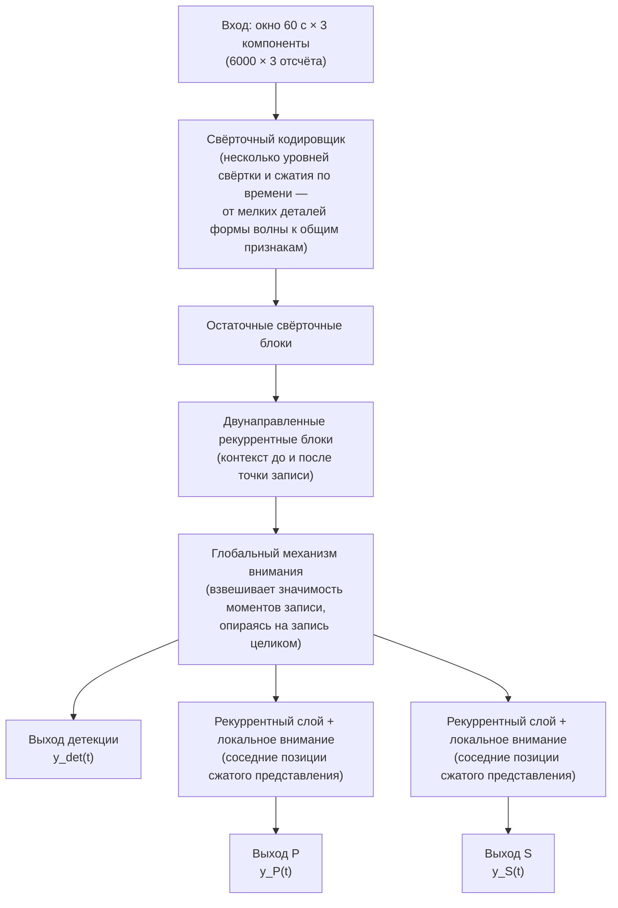

Модель формирует три вероятностные кривые той же длины, что и входное окно: $y_{\mathrm{det}}(t)$ выделяет интервал сигнала события, $y_P(t)$ и $y_S(t)$ — положения вступлений соответствующих фаз. Каждый выход принимает значения от 0 до 1. Это три связанные задачи, использующие общее представление записи.

Глобальное внимание связывает признаки разных частей окна. Ветви P и S дополнительно используют локальное внимание между соседними позициями сжатого представления записи. Оно работает до выделения моментов вступлений; отдельное окно вокруг заранее найденного кандидата не вырезается.

Исходная модель обучена на глобальном наборе сейсмических и шумовых записей STEAD ([Mousavi et al., 2020](https://doi.org/10.1038/s41467-020-17591-w)). В данном конвейере используются готовые веса без дообучения под региональную сеть.

### Предобработка записи перед подачей в модель

Сначала обрабатывается сегмент записи станции, затем из него выделяются 60-секундные окна модели:

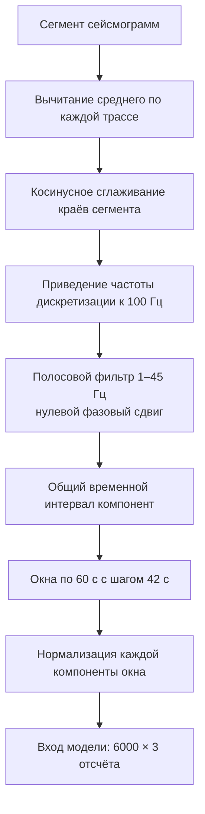

Из каждой трассы сегмента вычитается её среднее; края сглаживаются, чтобы уменьшить влияние резкого обрыва записи при последующих преобразованиях. Частота дискретизации приводится к 100 Гц методом преобразования Фурье. Затем применяется двунаправленная полосовая фильтрация 1–45 Гц без фазового сдвига.

При 100 Гц частота Найквиста равна 50 Гц, поэтому верхняя граница фильтра 45 Гц находится ниже неё. Если исходная запись имела меньшую частоту дискретизации, её приведение к 100 Гц не восстанавливает отсутствовавшие высокочастотные колебания: полезная полоса по-прежнему ограничена исходной записью.

Перед нарезкой выбирается общий временной интервал имеющихся трасс. Отсутствующая компонента входа модели заполняется нулями. Для каналов, обозначенных цифрами 1/2 вместо E/N, текущая подготовка может обнулить соответствующие горизонтальные компоненты; такой набор каналов не равнозначен штатному E/N/Z.

Каждое 60-секундное окно нормализуется отдельно по каждой компоненте $c$:

$$
s_c=\operatorname{std}_{t}(X_c(t)),\qquad
\widetilde{s}_c=
\begin{cases}
1,&s_c=0,\\
s_c,&s_c\ne0,
\end{cases}
\qquad
X_c^{\text{норм}}(t)=\frac{X_c(t)}{\widetilde{s}_c}.
$$

Среднее каждого короткого окна дополнительно не вычитается: удаление среднего выполнено ранее для всего сегмента. Деление на собственное стандартное отклонение уменьшает различия масштаба входных записей. Абсолютная амплитуда, необходимая для ML, измеряется позднее по исходной записи с учётом инструментального отклика.

### Оценка неопределённости (Monte Carlo Dropout)

Для оценки устойчивости предсказания используется Monte Carlo Dropout: одно и то же окно обрабатывается с разными случайными масками отключённых связей. В выбранной конфигурации формируются $N=5$ стохастических реализаций трёх выходных кривых:

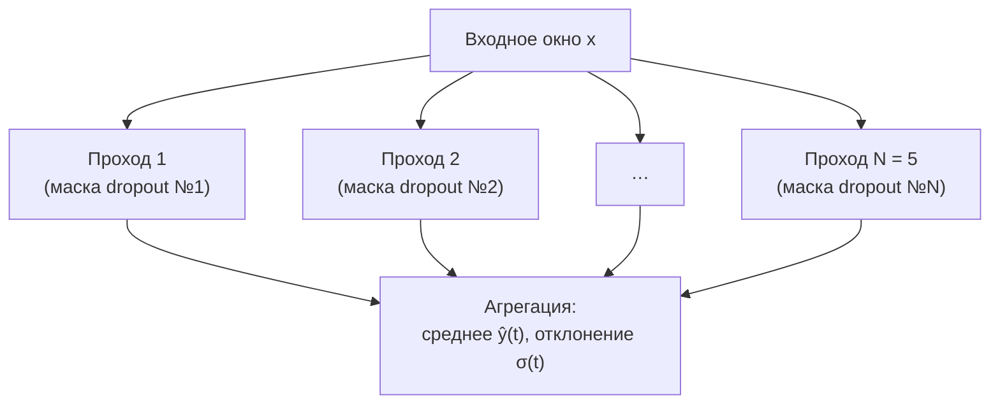

$$
\hat{y}(t) = \frac{1}{N}\sum_{i=1}^{N} y_i(t)
\qquad\qquad
\sigma(t) = \sqrt{\frac{1}{N}\sum_{i=1}^{N} \big(y_i(t) - \hat{y}(t)\big)^2}
$$

Среднее $\hat{y}(t)$ используется как итоговая выходная вероятность, а стандартное отклонение $\sigma(t)$ — как показатель её разброса между реализациями. Малый разброс означает устойчивость выхода к используемому стохастическому вычислению. Эта величина безразмерна: она не задаёт погрешность времени вступления в секундах и сама по себе не устанавливает правильность выбранной фазы.

Режим вычисления затрагивает также внутренние нормировочные слои модели, использующие статистики совместно обрабатываемых окон. Поэтому наблюдаемый разброс характеризует всю принятую процедуру, а не только случайное отключение связей. Неопределённости P/S далее учитываются при подготовке обнаружений и статистическом отсеве событий; они не являются весами голосования двухпоискового ассоциатора.

### Извлечение моментов P/S из вероятностных кривых

Три вероятностные кривые (детекция, P, S) по отдельному 60-секундному окну ещё не дают готового «списка событий» — их нужно свести к дискретным моментам:

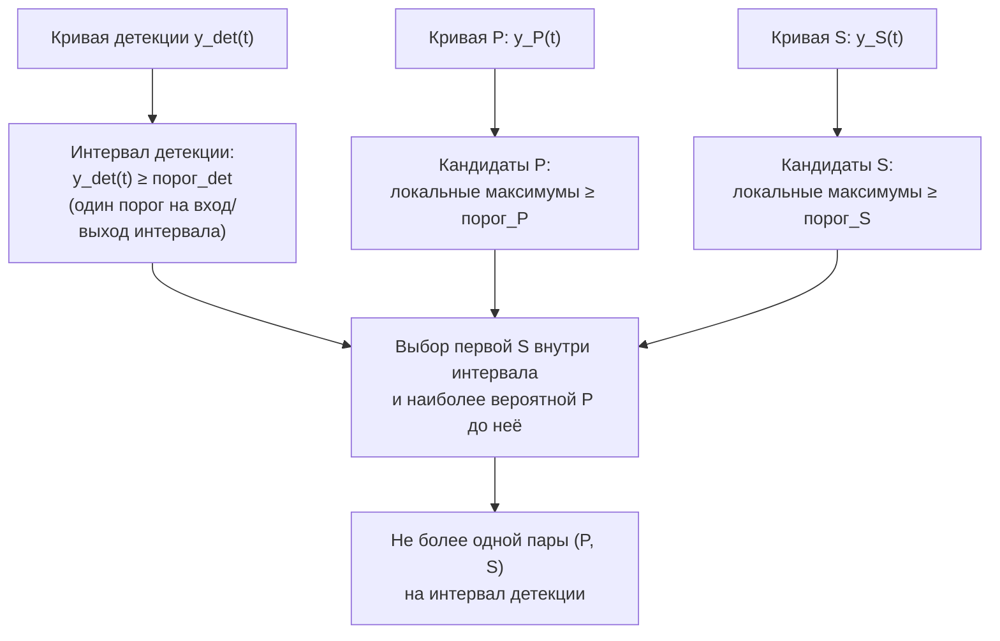

В сопоставлении участвуют только интервалы детекции длительностью не менее $0.1$ с (10 отсчётов). Выбирается первая S строго внутри интервала; P должна предшествовать ей более чем на 0.1 с и может находиться менее чем за 1 с до начала интервала детекции. Среди допустимых P берётся максимум вероятности.

В выбранной конфигурации в результат допускается пара с обеими фазами и интервалом S–P менее 45 с. При формировании списка обнаружений из интервалов одного 60-секундного окна рассматривается только первый; если он не проходит условия, остальные интервалы этого окна не проверяются. При обработке перекрывающихся окон одного сегмента подавляются обнаружения с разностью времён начала менее 2 с.

**Ключевое уточнение о физическом смысле найденного момента.** Момент, извлечённый на этом шаге, — это положение локального максимума **вероятностной кривой**, а не положение максимума амплитуды колебания на исходной записи. Метки обучающей выборки строятся вокруг **момента вступления фазы** — первого заметного отклонения записи от фонового шума при приходе P или S волны, а не вокруг момента наибольшей амплитуды колебания внутри самой фазы. Соответственно найденный моделью пик физически ближе к «моменту начала вступления», чем к «максимальному значению колебания». Это принципиально иной момент, чем тот, что используется позже, отдельно, для оценки магнитуды (раздел 7) — там намеренно измеряется именно максимум амплитуды в фиксированном окне после S-вступления, а не момент вступления. Оба момента лежат на одной и той же записи, но не совпадают друг с другом и решают разные задачи.

---

## 4. Обработка непрерывных записей

### Нарезка записи на сегменты и окна

Записи станции обрабатываются сегментами длиной 10 минут с шагом 5 минут. После последнего полного шага дополнительно рассматривается хвостовой сегмент, заканчивающийся на конце доступной записи:

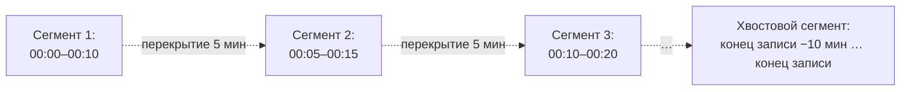

Внутри каждого сегмента после предобработки формируются окна модели по 60 с с шагом 42 с — перекрытие 18 с. Два масштаба перекрытия уменьшают влияние границ сегментов и окон на распознавание вступлений. Хвостовой сегмент расширяет охват конца записи, однако короткий остаток внутри сегмента, в который уже не помещается полное 60-секундное окно, отдельно не анализируется.

Предварительное условие обработки — не менее двух непустых трасс в сегменте. Оно проверяет число трасс, а не наличие двух разных компонент. В штатном наборе E/N/Z недостающая компонента заполняется нулями; общий интервал имеющихся трасс должен содержать хотя бы одно полное окно модели.

### Разрывы записи

Фрагменты одного канала объединяются по времени, чтобы обработка продолжалась после разрыва. Недостающие отсчёты между краями пропуска заполняются линейной интерполяцией:


Интерполяция обеспечивает техническую непрерывность массива для фильтрации и дальнейшей обработки. Она не восстанавливает сейсмические колебания внутри пропуска; наличие или отсутствие события в нём по такому заполнению определить нельзя. Ограничения на длительность интерполируемого разрыва в выбранной процедуре нет, поэтому окно модели может включать синтетически заполненный участок. При невозможности объединить фрагменты охват записи может сократиться; после объединения он также ограничивается общим временным интервалом трасс каждого сегмента.

Проверка на мае 2024 выявила конкретную причину потери наблюдений: ограничение нарезки концом первого фрагмента затрагивало 214 станцие-суток из примерно 1510 и оставляло без обработки около 10% объёма записи. Переход к объединению фрагментов устраняет эту причину ограничения охвата и позволяет анализировать наблюдённую запись после разрыва. Указанные числа характеризуют объём записи, а не долю пропущенных землетрясений.

### Пороги на выходе модели

Для каждого пройденного через модель окна извлечённые кандидаты P/S проходят через пороги вероятности:

| Порог | Действующее значение | Смысл |
|---|---|---|
| порог детекции | $0.75$ | ниже этого значения вероятностная кривая детекции не формирует интервал события |
| порог P | $0.30$ | минимальная вероятность, чтобы локальный максимум $y_P(t)$ считался кандидатом P |
| порог S | $0.20$ | минимальная вероятность, чтобы локальный максимум $y_S(t)$ считался кандидатом S |

По отношению к рекомендациям для исходной модели EQTransformer порог детекции повышен с примерно 0.5 до 0.75, порог P сохранён на уровне 0.30, а порог S понижен с примерно 0.30 до 0.20. Порог детекции ограничивает число кандидатов, а более низкий порог S допускает менее выраженные S-вступления. Это принятые рабочие настройки сети; они не являются универсальными физическими границами.

Для сохранения пары требуется

$$
0<T_S-T_P<45\text{ с}.
$$

В приближении постоянных скоростей $V_P=6.0$ и $V_S=3.4883$ км/с разность S–P переводится в расстояние как

$$
R=\frac{V_PV_S}{V_P-V_S}(T_S-T_P)\approx
8.33\text{ км/с}\cdot(T_S-T_P).
$$

При таком приближении 45 с соответствуют примерно 375 км. Это ориентир для принятого ограничения пары, а не жёсткий географический радиус обнаружения: время пробега зависит от глубины, строения среды и распространяющихся фаз.

### Отношение сигнал/шум

Для P и S оценивается изменение уровня записи после найденного вступления относительно участка перед ним. Используемый показатель SNR выражен в децибелах:

$$
\mathrm{SNR}=10\lg\!\left[
\left(\frac{Q_{95,\text{после}}}{Q_{95,\text{до}}}\right)^2
\right],
$$

где $Q_{95}$ — 95-й процентиль отсчётов, собранных по трём компонентам соответствующего участка. Номинальная длительность участков до и после пика — по 1 с; у края окна она сокращается. Это принятая мера контраста записи, а не отношение полной энергии сигнала к энергии шума.

SNR сохраняется вместе с обнаружением и используется при оценке времени очага и статистическом отсеве. Его пороговая проверка на подготовке ассоциации доступна, но в выбранных настройках выключена. Вес вероятность × SNR в дальнейшей оценке времени использует непосредственно значение в дБ.

### Результат обнаружения на станции

Для каждой станции сохраняется список обнаружений: границы интервала детекции, времена P/S, выходные вероятности модели, их разброс и SNR. В выбранном режиме обнаружение должно содержать обе фазы. Станционные списки затем используются для сборки сетевых событий; одно обнаружение на одной станции ещё не является событием итогового бюллетеня.

### Обработка больших архивов

Сегменты последовательно передаются через оперативную память, без промежуточного сохранения подготовленных окон на диск. Окна одного сегмента и их стохастические реализации обрабатываются пакетами; несколько станций могут рассчитываться параллельно на CPU или GPU. Модель загружается один раз на рабочий процесс и используется повторно.

Такая организация позволяет обрабатывать длительные записи без загрузки всего архива в память. Сохранение точности детекции при переходе к обработке в памяти подтверждено проверкой на исторических данных.

---

## 5. Сетевая ассоциация двумя поисками

Ассоциация объединяет обнаружения разных станций в гипотезы сетевых событий. Близости времён регистрации недостаточно: волны одного землетрясения приходят на станции с разными задержками. Метод ищет пробную точку источника и время очага, с которыми согласуются наблюдённые вступления после учёта времени распространения волн.

По принципу ассоциации подход близок к [REAL — Rapid Earthquake Association and Location (Zhang, Ellsworth, Beroza, 2019)](https://doi.org/10.1785/0220190052): перебираются пробные положения источника и подсчитываются вступления, совместимые с расчётными временами пробега. В нашей схеме эта идея реализована через согласованность оценок времени очага и поддержку P/S; два независимых поиска сохраняют альтернативные группы, а окончательное определение гипоцентра выполняется отдельно в LOCSAT.

### Подготовка обнаружений и учёт неопределённости

Перед поиском проверяются вероятности детекции и фаз. В выбранных настройках обнаружение сохраняется при вероятности детекции не ниже 0.75 и прохождении порога хотя бы одной фазой: 0.35 для P или 0.20 для S. Порог P на этом этапе отличается от порога 0.30 при первоначальном обнаружении. Дополнительный порог по SNR выключен.

Обнаружение сохраняется целиком: если условие выполнено за счёт S, имеющаяся P с вероятностью ниже 0.35 из него отдельно не удаляется. Для самого поиска требуется заданное время P; обнаружения только с S в сборке событий не участвуют.

После отбора выходные вероятности корректируются с учётом разброса, полученного MC Dropout:

$$
p_{\text{эфф}}=p(1-u),
$$

где $p$ — исходная вероятность детекции или фазы, $u$ — соответствующий безразмерный разброс. Поправка применяется при допустимом $0\le u\le1$; если оценка отсутствует или недопустима, сохраняется исходная вероятность. В рабочем режиме пороги проверяются до этой поправки, поэтому она не меняет состав прошедших обнаружений.

Скорректированные значения используются далее при оценке времени очага и статистическом отсеве. В самой ассоциации поддержка гипотезы определяется числом разных станций и согласованностью времён: сумма вероятностей вместо числа станций не вычисляется.

### Общий источник по годографу

Перебираются точки $g$ в области 39–47° с.ш. и 36–50° в.д. с шагом 0.1°. Для станции $i$ по её координатам определяется эпицентральное расстояние $d_i(g)$ от пробной точки в километрах. Годограф $t_P(d)$ задаёт расчётное время пробега первой P-волны до станции. Тогда каждое наблюдённое вступление даёт оценку времени очага:

$$
T_{0P,i}(g)=T_{P,i}-t_P(d_i(g)).
$$

Здесь $T_{P,i}$ — измеренное время вступления, $t_P$ — время распространения в секундах. Если точка и принятая модель среды подходят группе наблюдений, полученные $T_{0P,i}$ близки между собой. Таким образом сравниваются оценки общего времени излучения, а не сами времена прихода.

Для ассоциации используется годограф IASP91 при глубине источника 0 км. Глубина здесь фиксирована как расчётное приближение; на этом этапе она не определяется. Табличное время интерполируется по расстоянию, а за последней точкой таблицы продолжается с принятой скоростью 8 км/с.

Поддержка по S оценивается приближённо через тот же годограф:

$$
t_S(d)\approx\frac{V_P}{V_S}t_P(d),\qquad
\frac{V_P}{V_S}\approx1.72,
$$

$$
T_{0S,i}(g)=T_{S,i}-\frac{V_P}{V_S}t_P(d_i(g)).
$$

Отдельная таблица времён S в этой проверке не используется. Оценки времени по P и S помогают выбирать согласованную группу; окончательное определение гипоцентра выполняется позднее в LOCSAT.

### Выбор согласованной группы

В каждом узле сетки оценки времени очага собираются в интервалы шириной 7 с. Подсчёт повторяется со сдвигом границ на 3.5 с, чтобы уменьшить зависимость результата от положения границы интервала. Одна станция учитывается не более одного раза по P и одного раза по S, даже если на ней есть несколько обнаружений.

Для принятия гипотезы необходимы не менее шести разных P-станций. Среди допустимых гипотез выбирается наибольшая суммарная поддержка:

$$
n_P\ge6,\qquad B=n_P+n_S\longrightarrow\max,
$$

где $n_P$ и $n_S$ — числа станций, поддерживающих пробную точку и интервал времени соответствующей фазой. S повышает балл, но не заменяет требование шести P-станций.

Допуск ±3.5 с учитывает ошибки определения вступлений и отклонения реальных времён пробега от принятого годографа. Более широкий допуск облегчает объединение случайных или принадлежащих разным событиям вступлений; слишком узкий может разделить наблюдения одного источника на недостаточные группы.

После выбора точки и центра интервала от каждой станции берётся одна P: та, чья оценка времени очага ближе к центру, в пределах ±3.5 с. Наибольшая вероятность пика не является правилом выбора. Затем до двух раз уточняются точка и время: выбирается узел с минимальным разбросом оценок по собранным P, центр заменяется их средним и группа собирается заново. Уточнение принимается при сохранении числа станций или его увеличении и выполнении условия поддержки.

После принятия гипотезы часть обнаружений исключается из дальнейшего поиска. Процедура повторяется на оставшихся данных. Поэтому способ исключения влияет на то, какие следующие события удастся собрать.

### Зачем нужны два поиска

Первичный поиск после принятия события исключает все обнаружения, чьи P согласуются с его точкой и временем в пределах допуска. Вместе с повторами одного вступления так может исчезнуть другая полезная P той же станции.

Альтернативный поиск сохраняет больше вариантов и строже проверяет использование S:

| Действие | Первичный поиск | Альтернативный поиск |
|---|---|---|
| Исключение обнаружений после принятия гипотезы | все P, согласные с её точкой и временем | выбранная P и близкие копии той же станции с разностью времён не более 0.15 с |
| Поддержка по S | согласие S с пробной точкой и общим интервалом времени | дополнительно требуется согласие S со своей P из того же обнаружения |
| Исходные данные | полный подготовленный набор | тот же полный набор, независимо от результата первичного поиска |

Дополнительное условие второго поиска:

$$
\left|T_{0S,i}(g)-T_{0P,i}(g)\right|\le7\text{ с}.
$$

Оно проверяет, может ли данная пара P/S указывать на общее время излучения в пробной точке. При этом S по-прежнему должна поддерживать рассматриваемый интервал времени. Второй поиск не является обработкой остатка первого: он заново рассматривает исходные обнаружения, используя другой способ их исключения.

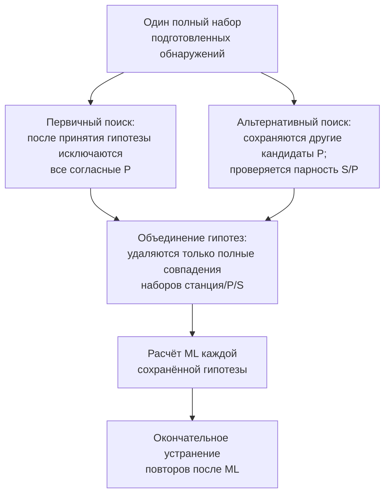

До расчёта ML удаляются только полностью одинаковые наборы станций и времён P/S. Похожие, но различающиеся гипотезы сохраняются: другой выбор вступлений может изменить расстояния, состав станций для магнитуды и прохождение порога ML. Окончательное устранение повторов выполняется после ML с приоритетом первичного поиска.

### Результат и проверка

Результат ассоциации — гипотезы событий с выбранными P разных станций и имеющимися S из соответствующих обнаружений. Проверка S при голосовании не удаляет автоматически несогласную S из результата; отбор вступлений для LOCSAT выполняется отдельно. Найденные при поиске точка и время служат для группировки наблюдений и не подменяют окончательного решения гипоцентра.

Рабочий результат двухпоисковой схемы после ML и экспорта для I квартала 2025 года — **86 из 112** событий эталона при окне ±60 с и **82 из 112** при ±10 с. Критерий — MPVA эталона ≥1.5 и не менее четырёх общих станций; совпадение времён отдельных фаз этим критерием не требуется. Для мая 2024 найдено **41 из 46** событий.

Проверка двухпоискового варианта выполнена в контрольных окнах около всех эталонных событий. Аналогичный результат полного прогона ожидается; эти числа не задают размер полной автоматической выдачи.

---

## 6. Расстояние и время очага по S–P

### Роль оценки в конвейере

Разность времён P- и S-вступлений позволяет оценить расстояние от станции до очага без предварительного знания его координат. В выбранном конвейере такая оценка используется при расчёте ML и проверке согласованности станций. Отдельная S–P-оценка времени очага применяется при окончательном устранении повторов и формировании бюллетеня. LOCSAT совместно определяет положение, глубину и собственное время очага по сети.

### Формула расстояния и времени очага

Для пары P/S одного источника в приближении однородной среды с постоянными скоростями $V_P>V_S$:

$$
T_P=T_0+\frac{R}{V_P},\qquad
T_S=T_0+\frac{R}{V_S}.
$$

Вычитая времена прихода, исключаем неизвестное время очага:

$$
\Delta T=T_S-T_P
=R\left(\frac{1}{V_S}-\frac{1}{V_P}\right),
$$

откуда

$$
R=\frac{V_PV_S}{V_P-V_S}\,\Delta T.
$$

Здесь $\Delta T$ измеряется в секундах, скорости — в км/с, расстояние $R$ — в километрах. Это приближённое расстояние «очаг—станция», гипоцентральное по смыслу, а не эпицентральное расстояние по поверхности. В реальной неоднородной среде времена пробега зависят от глубины и траекторий волн; постоянные скорости заменяют это строение расчётным приближением.

Время очага восстанавливается двумя эквивалентными способами:

$$
T_0=T_P-\frac{R}{V_P}=T_S-\frac{R}{V_S}.
$$

Оба выражения совпадают по построению: $R$ выведено из той же пары $(T_P,T_S)$. Это тождество, а не независимая проверка правильности вступлений.

### Скоростные приближения для ML и экспортного времени

Для исходного S–P-расстояния в расчёте ML используется одна пара скоростей:

$$
V_P=6.0\text{ км/с},\qquad
V_S=3.4883\text{ км/с},\qquad
k_{Pg}=\frac{V_PV_S}{V_P-V_S}\approx8.33\text{ км/с}.
$$

Время очага для экспорта рассчитывается по двухскоростной схеме. Сначала для каждой станции определяется предварительное расстояние $R_{Pg}=k_{Pg}\Delta T$, по которому выбирается режим:

| Условие | Принятый режим | Скорости P/S, км/с | Расстояние и время очага |
|---|---|---|---|
| $R_{Pg}<150$ км | Pg/Sg | 6.0 / 3.4883 | $R=R_{Pg}$, $T_0=T_P-R/6.0$ |
| $R_{Pg}\ge150$ км | Pn/Sn | 8.0 / 4.6 | $R=k_{Pn}\Delta T$, $k_{Pn}\approx10.82$ км/с; $T_0=T_P-R/8.0$ |

Первый режим использует скорости коровых волн, второй — более быстрых волн верхней мантии. Это условное разделение для расчёта: порог проверяется по предварительному $R_{Pg}$, до пересчёта расстояния. Схема не определяет траекторию луча или реальную границу смены фаз для конкретного очага.

Поэтому расстояние, рассчитанное для экспортного времени, может отличаться от исходного расстояния ML. Годограф ассоциации и модели LOCSAT задаются отдельно и используют другие способы учёта распространения волн.

### Чувствительность к ошибкам вступлений

Для фиксированной пары скоростей, без переключения режима,

$$
T_0=\frac{V_PT_P-V_ST_S}{V_P-V_S},
$$

поэтому вклад ошибок времени P и S составляет

$$
\delta T_0=
\frac{V_P}{V_P-V_S}\,\delta T_P-
\frac{V_S}{V_P-V_S}\,\delta T_S.
$$

Для коровой пары коэффициенты приблизительно равны $2.4$ и $1.4$: ошибка P и ошибка S могут усиливаться при восстановлении времени очага и влияют на него с разными знаками. Ошибка расстояния при тех же скоростях равна

$$
\delta R=k_{Pg}(\delta T_S-\delta T_P).
$$

Если S ошибочно поставлена слишком близко к P, разность времён и расстояние занижаются; это влияет и на магнитуду. Приведённые выражения описывают вклад ошибок вступлений при заданных скоростях. Отклонение реальной среды от принятой модели — дополнительный источник расхождений между станциями.

### Отбор станционных оценок

В оценке времени участвуют только станции с обеими фазами, положительным S–P и допустимым расчётным расстоянием. Нижняя граница рабочего отбора — $R\ge20$ км; верхняя граница S–P-расстояния для экспортного времени не задана. При малой разности S–P одна и та же ошибка вступлений составляет большую долю вычисленного расстояния; нижняя отсечка ограничивает использование таких оценок.

Обозначим исходную группу пригодных станций через $A$. Индивидуальные времена $T_{0,i}$ расходятся из-за ошибок вступлений, неверного объединения фаз и различий реальных скоростей. Для ограничения выбросов рассчитываются

$$
m=\operatorname{median}_{i\in A}(T_{0,i}),\qquad
\sigma=\operatorname{std}_{\text{совокупности}}\{T_{0,i}:i\in A\},
$$

$$
I=\{i\in A:\ |T_{0,i}-m|\le\lambda\sigma\}.
$$

Стандартное отклонение вычисляется по всей исходной группе с делением дисперсии на число её элементов. Центром отсечения служит медиана. Рабочий множитель для экспортного времени — $\lambda=1.0$; он не связан с коэффициентом $k$ перевода S–P в расстояние.

При нулевом разбросе группа сохраняется. Если после отсечения осталось менее трёх станций, отсечение отменяется и возвращается исходная группа: $I=A$. Это сохраняет возможность расчёта, но не означает, что расхождения устранены. При исходном числе пригодных станций менее трёх экспортного времени нет.

Этот отбор применяется к оценкам времени очага. Сам по себе он не удаляет соответствующие строки фаз из бюллетеня и не изменяет состав вступлений, ранее использованных LOCSAT.

### Итоговое время очага

В основном сценарии используется среднее с весами, учитывающими выходную вероятность P и SNR этой фазы. Пусть $K$ — станции из $I$, у которых доступны положительные $p_i$ и $\mathrm{SNR}_i$. Тогда при $|K|\ge3$:

$$
T_0^{\text{probsnr}}=
\frac{\displaystyle\sum_{i\in K}p_i\,\mathrm{SNR}_i\,T_{0,i}}
{\displaystyle\sum_{i\in K}p_i\,\mathrm{SNR}_i}.
$$

$p_i$ уже содержит поправку на неопределённость, выполненную при подготовке обнаружений; повторно она не применяется. SNR используется непосредственно в децибелах, без перевода в линейное отношение. Станции без доступного положительного веса не входят в эту взвешенную группу.

Назначение такого веса — уменьшить вклад станций с менее выраженным P-вступлением и меньшей выходной вероятностью модели. Это эмпирическое правило, а не вес, выведенный из измеренной дисперсии ошибок времени. Само его использование не задаёт погрешность итогового $T_0$.

Если трёх пригодных весов нет, при наличии не менее трёх станций в $I$ используется время станции с минимальной разностью S–P:

$$
T_0^{\min}=T_{0,j},\qquad
j=\arg\min_{i\in I}\Delta T_i.
$$

Выбирается минимальное S–P, а не минимальное значение $T_{0,i}$. Этот резервный результат берётся по одной станции, хотя возможность экспорта по-прежнему требует группы как минимум из трёх пригодных станционных оценок. Перехода к обычному среднему при недостатке весов в выбранном экспорте нет.

### Дополнительные оценки для диагностики

Для сопоставления способов агрегации доступны ещё четыре оценки. Здесь $A$ — группа до статистического отсечения, $I$ — возвращённая после него группа, $J$ — станции из $I$ с доступной положительной вероятностью P:

$$
T_0^{\text{raw}}=\frac{1}{|A|}\sum_{i\in A}T_{0,i},
\qquad
T_0^{\text{mean}}=\frac{1}{|I|}\sum_{i\in I}T_{0,i},
$$

$$
T_0^{\text{wmean}}=
\frac{\displaystyle\sum_{i\in I}T_{0,i}/\Delta T_i^2}
{\displaystyle\sum_{i\in I}1/\Delta T_i^2},
\qquad
T_0^{\text{probw}}=
\frac{\displaystyle\sum_{i\in J}p_iT_{0,i}}
{\displaystyle\sum_{i\in J}p_i}.
$$

Первая — среднее до отсечения; вторая — среднее после него; третья увеличивает вклад малых S–P; четвёртая учитывает только вероятность P. Для последних трёх требуется не менее трёх станций в соответствующей группе. Близость станции сама по себе не гарантирует точности вступления; эти варианты оставлены для диагностики и не подставляются вместо выбранного правила экспорта.

### Связь с локацией и проверкой качества

Время, найденное при ассоциации, помогает собрать группу вступлений. S–P-время описанного расчёта используется в окончательной дедупликации и экспорте. LOCSAT определяет своё время совместно с координатами и глубиной. Эти оценки имеют разные предположения и могут различаться. Для дедупликации и экспорта ограничения отбора станций задаются отдельно, поэтому их итоговые S–P-времена также могут отличаться.

В выбранном бюллетене добавление координат LOCSAT сохраняет экспортное S–P-время. Даже при наличии гипоцентра событие без пригодного экспортного времени не записывается. Невязки вступлений при этом относятся к собственному времени выбранного решения LOCSAT.

S–P-расчёт не требует эталонного каталога. Сравнение его диагностических вариантов — отдельная проверка; основной результат конвейера оценивается по итоговым бюллетеням ФИЦ ЕГС РАН с условием близости времени и не менее четырёх общих станций.

---

## 7. Локальная магнитуда и отбор станций

### Формула и область исходной калибровки

Используется региональная формула локальной магнитуды $ML$ для Терско-Каспийского прогиба ([Дягилев, Габсатарова, Селиванова, 2023](https://doi.org/10.35540/2686-7907.2023.2.02)). Исходная выборка включала 64 землетрясения, записанные 58 станциями на расстояниях 25–526 км. В конвейере принят вариант (5б), полученный по 749 измерениям амплитуд и расстояний:

$$
ML_i=\lg A_i+a\lg R_i+bR_i+c+S_i,
$$

$$
a=1.024,\qquad b=0.001648\text{ км}^{-1},\qquad c=-1.889.
$$

Для станции $i$ амплитуда $A_i$ выражается в нанометрах, расстояние $R_i$ — в километрах, поправка $S_i$ — в единицах магнитуды. В выбранном расчёте $S_i=0$.

Физический смысл членов формулы:

| Член | Физический смысл |
|---|---|
| $\lg A_i$ | логарифмическая мера амплитуды: при неизменных остальных условиях её десятикратный рост даёт увеличение ML на единицу |
| $a\lg R_i$ | поправка на геометрическое расхождение волн |
| $bR_i$ | поправка на неупругое поглощение при распространении |
| $c$ | свободный член калибровки, задающий привязку шкалы |
| $S_i$ | локальная станционная поправка |

Коэффициенты поправки на расстояние определены по региональным наблюдениям и отражают условия распространения в исходной выборке. При переносе на другие части сети следует учитывать различия строения среды.

В статье использовались амплитуды симулированных записей Wood–Anderson и гипоцентральные расстояния из локации. В нашем расчёте применяются описанная ниже процедура измерения смещения и приближённые расстояния S–P с возможным уточнением по точке перебора. Использование коэффициентов статьи не означает полного воспроизведения её измерительной процедуры. Скорости $V_P=6.0$ и $V_S=3.4883$ км/с получены отдельно от научного консультанта Р. А. Дягилева; статья не задаёт эту скоростную модель.

### Измерение амплитуды

Амплитуда измеряется по исходной записи, с сохранением её физического масштаба. Нормализованные окна, поданные нейросети, для этого не используются.

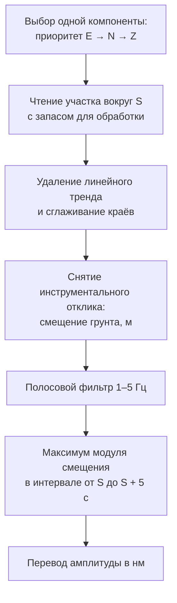

Компонента выбирается по наличию файлов станции в порядке E, затем N, затем Z. Приоритет задаётся для станции целиком: если выбрана E, отсутствие её записи для отдельного события не вызывает автоматического перехода к N или Z. Измеряется амплитуда одной компоненты.

Для обработки читается участок, охватывающий измерительные интервалы событий, с дополнительным запасом 60 с с обеих сторон. После удаления линейного тренда, сглаживания краёв, перевода в смещение и фильтрации выделяется интервал $[T_S,T_S+5\text{ с}]$:

$$
A_i=10^9\max_{T_S\le t\le T_S+5\text{ с}}|u_i(t)|,
$$

где $u_i(t)$ — обработанное смещение в метрах, $A_i$ — амплитуда в нанометрах. Момент S задаёт начало измерительного интервала; внутри него ищется максимум колебания, а не вступление фазы.

Полосовая фильтрация 1–5 Гц задаёт используемую полосу измерения. Отдельная симуляция отклика Wood–Anderson не выполняется, поэтому этот фильтр не следует называть её эквивалентом.

Если указанная в записи частота дискретизации отличается от 50, 80, 100 и 200 Гц, перед обработкой она эвристически заменяется на 100 Гц при значении выше 75 Гц, иначе — на 50 Гц. Отсчёты при этом не пересэмплируются. Корректность временной шкалы, снятия отклика и полосы измерения требует, чтобы принятое значение соответствовало реальной дискретизации записи.

При отсутствии отклика прибора, подходящей записи или пригодного измерительного участка станционная амплитуда не вычисляется. В амплитудном расчёте используется первый прочитанный фрагмент записи; объединение всех её разрозненных частей здесь не выполняется. Измеренные амплитуды должны соответствовать тем же событиям и вступлениям, для которых рассчитывается ML.

### Станционная поправка $S$

Механизм поправки на локальные грунтовые условия реализован (одна и та же по силе волна на разных станциях записывается по-разному из-за характеристик грунта под сейсмометром — мягкие осадочные породы способны усиливать колебания сильнее, чем скальное основание). Механизм остаётся доступным и может быть подключён при появлении актуальной калибровки, но сейчас сознательно не используется.

### Зачем нужен отбор станций

Даже после ассоциации в гипотезе могут оставаться вступления другого события или ошибочная S сразу за P. Малое S–P занижает расстояние, а вместе с ним — поправку на затухание и станционную ML. Согласие нескольких ошибочных S–P-оценок также может создать ложное большинство при отборе только по времени очага.

Поэтому в выбранном режиме, называемом p-traveltime, начальная группа для ML определяется по P-вступлениям и годографу первой P. S участвует в уточнении точки и последующей проверке расстояний. Это позволяет сначала искать согласованный источник по P, а затем проверять, поддерживается ли он S-наблюдениями.

Предварительно из отбора исключаются станции с известными координатами дальше 800 км от опорной точки региона в районе Сочи. Это расстояние до опорной точки сети, а не до оцениваемого очага. Станции без координат этим географическим условием не исключаются.

### Группа по P и подтверждение по S–P

Используются вступления рассматриваемого события, координаты станций и отдельно заданный годограф первой P. Координаты события из эталона не нужны. Таблица годографа для этого отбора и постоянные скорости для исходного расстояния S–P выполняют разные задачи.

1. В области 39–47° с.ш. × 36–50° в.д. с шагом 0.1° для каждой точки вычисляются оценки $T_{0P,i}=T_{P,i}-t_P(d_i)$. Выбираются точка и опорная станция, около оценки времени которой в пределах ±2.5 с находится наибольшее число станций. Требуется не менее четырёх станций; при равенстве их числа выбирается меньшая сумма отклонений от опорного времени.
2. При фиксированном составе группы уточняется точка с учётом P и согласных S. Время пробега S приближённо принимается равным $1.72t_P$. S включается в уточнение, если её оценка времени очага близка к среднему по P: допуск составляет 8 с на первом проходе и 3 с на втором.
3. Для проверки расстояний принимается фиксированная глубина $h_0=15$ км и рассчитывается

   $$
   R_{\text{точки},i}=\sqrt{d_i^2+h_0^2},
   $$

   где $d_i$ — эпицентральное расстояние до уточнённой точки. Эта глубина — параметр приближения, а не результат определения глубины события.
4. На станциях выбранной группы проверяется согласие исходного расстояния $R_{SP,i}$ с расстоянием от точки:

   $$
   |R_{SP,i}-R_{\text{точки},i}|
   \le\max(30\text{ км},\,0.3R_{\text{точки},i}).
   $$

   Подтверждение требует не менее двух таких станций. Оно проверяется до наличия пригодной амплитуды и окончательных отсечек ML.

Если группа подтверждена, согласные $R_{SP}$ сохраняются. Для остальных станций группы расстояние может заменяться на $R_{\text{точки}}$, если оно не превышает 600 км. Таким образом, отбор по годографу не означает замены всех S–P-расстояний расстояниями от найденной точки.

Для исходного набора амплитуд рассматриваются станции с положительным S–P и исходным $R_{SP}\le600$ км. Позднейшая замена расстояния не добавляет амплитуд для станций, отсутствовавших в этом наборе.

### Резервные способы расчёта

Если группу найти не удалось или двух подтверждающих станций нет, ML рассчитывается по станциям с согласованными односкоростными S–P-временами очага. Если по ним ML получить нельзя, используются все допустимые станции события.

Если точка подтверждена, но по выбранной группе ML не вычисляется, выполняется непосредственный переход ко всем допустимым станциям. Минимальное число амплитудных измерений и остальные ограничения сохраняются при каждом таком расчёте.

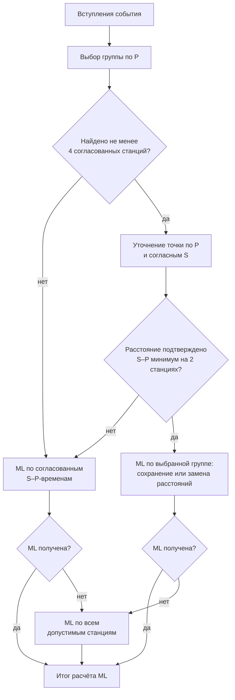

Итоговая оценка поэтому может быть получена по резервному набору, даже если включён отбор по P. Если ни один допустимый набор не даёт ML, оценка отсутствует.

### Рабочие ограничения и агрегация

Для станционных оценок используются расстояния не меньше 20 км, доступные положительные амплитуды в пределах $0.005\le A_i\le10^6$ нм и описанная выше верхняя граница расстояний 600 км. Это рабочие отсечки расчёта: амплитуда за их пределами не объявляется физически невозможной, а диапазон 20–600 км не следует отождествлять с фактическим диапазоном исходной калибровочной выборки.

Если осталось меньше четырёх допустимых измерений, ML по данному набору не определяется. Далее применяется статистический отбор:

$$
M_{\text{med}}=\operatorname{median}(ML_1,\dots,ML_N),\qquad
\sigma=\operatorname{std}(ML_1,\dots,ML_N),
$$

$$
|ML_i-M_{\text{med}}|\le1.5\sigma.
$$

Стандартное отклонение рассчитывается по всей исходной группе с делением дисперсии на $N$. Медиана задаёт устойчивый к единичным выбросам центр отсечения. Если после него осталось меньше четырёх измерений, статистическое отсечение отменяется: используются все измерения, прошедшие предыдущие ограничения.

Итоговая ML — арифметическое среднее учтённых станционных оценок:

$$
ML_{\text{события}}=\frac{1}{M}\sum_{i\in\text{учтённые}}ML_i,
$$

где $M$ — число измерений в среднем. Отбор уменьшает влияние отдельных расхождений, но не предполагает автоматически симметричного распределения оставшихся оценок. Это отдельная процедура от статистического отбора S–P-времён: здесь сравниваются магнитуды и применяется множитель 1.5.

Для дальнейшей обработки сохраняются события с $ML\ge1.5$. В выбранном конвейере события без рассчитанной ML этот этап не проходят. Станционные оценки, вошедшие в среднее, сохраняются вместе с ML события; при экспорте используется эта же магнитуда.

### Отдельный набор вступлений для LOCSAT

Для локации среди прошедших ML событий группа выбирается отдельно: при выборе точки учитываются число согласных P и поддержка S на этих же станциях. Для начальной поддержки S используется допуск 4 с относительно опорного времени по P, затем выполняется общее уточнение точки. Поэтому группа для LOCSAT может отличаться от группы, по которой рассчитана ML.

В локацию передаются P выбранной группы и только те S, чьи S–P-расстояния согласуются с расстояниями от точки по критерию 30 км/30%. При подготовке этого набора отдельного требования двух подтверждающих S нет. Найденная точка и среднее время по P задают начальное приближение для LOCSAT. Если группу сформировать не удалось, событие может остаться в основном наборе с ML, но не получить входных данных для локации.

### Интерпретация ML

Расстояние S–P и расстояние из локации оценивают одну по физическому смыслу величину «очаг—станция», но с разными предположениями и ошибками. В выбранной последовательности ML рассчитывается до LOCSAT; последующее уточнение гипоцентра не меняет уже принятую магнитуду.

Результат зависит от измерительного окна, компоненты, инструментального отклика, выбранного расстояния и состава станций. При проверке согласованности с магнитудами бюллетеня необходимо учитывать также различия шкал и способов их определения.

---

## 8. Окончательное устранение повторных гипотез

### Почему после расчёта магнитуды

Два поиска могут собрать разные группы вступлений одного события. До ML удаляются только гипотезы с полностью одинаковыми наборами станций и времён P/S. Приблизительно похожие варианты сохраняются, поскольку различия вступлений меняют расстояния, выбор станций и итоговую магнитуду: одна гипотеза может пройти порог ML, а другая — нет.

Окончательное устранение повторов выполняется среди гипотез, уже прошедших ML. Правило использует принадлежность гипотезы первичному или альтернативному поиску; она должна сохраняться при отборе по магнитуде.

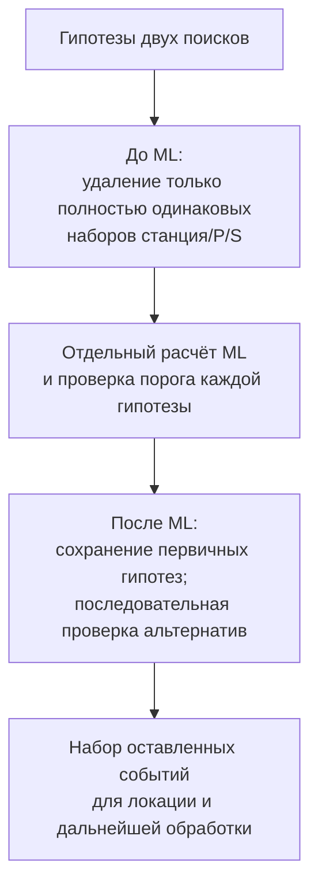

### Критерий совпадения

Для каждой гипотезы составляется набор наблюдений

$$
Q=\{(\text{код станции},T_P)\}.
$$

Альтернатива $A$ считается повтором уже сохранённой гипотезы $B$, только если одновременно выполняются условия

$$
|Q_A\cap Q_B|\ge4,\qquad
|T_{0,A}^{SP}-T_{0,B}^{SP}|\le10\text{ с}.
$$

Первое условие требует не менее четырёх одинаковых P-вступлений: совпадают и коды станций, и точные времена P. Четырёх общих названий станций недостаточно. Второе условие проверяет близость оценок времени очага. S непосредственно в наборе $Q$ не сравнивается, но влияет на S–P-оценку времени.

Для этой проверки $T_0^{SP}$ рассчитывается отдельно по двухскоростной схеме Pg/Sg–Pn/Sn из раздела 6: нижняя граница расстояния 20 км, множитель статистического отсечения $\lambda=1$, без верхней границы расстояния и без дополнительного географического отсева станций. Используются подготовленные вероятности P с поправкой на неопределённость и SNR; выбор взвешенного времени или времени станции с минимальным S–P выполняется по описанному там правилу.

Это время для сравнения гипотез. Оно не заменяется временем ассоциации или LOCSAT и может отличаться от итогового экспортного времени при других ограничениях отбора станций. Если хотя бы для одной гипотезы время вычислить не удалось, условие близости времени не выполняется и альтернатива по этому правилу не удаляется.

### Приоритет первичного поиска и порядок проверки

1. Сохраняются все гипотезы первичного поиска, прошедшие ML.
2. Каждая альтернатива сравнивается со всем текущим списком сохранённых. Если найдена гипотеза, удовлетворяющая обоим условиям совпадения, альтернатива пропускается.
3. Если совпадения нет, альтернатива добавляется в список и сама участвует в проверке следующих альтернатив.

Таким образом, приоритет заранее отдан первичному поиску. Между совпадающими вариантами не выбирается большая ML, меньшая невязка или большая близость к эталонному событию. Эталонный бюллетень при устранении повторов не используется.

Правило предназначено для добавления неповторяющихся альтернатив к первичному результату. Первичные гипотезы между собой на этом этапе попарно не очищаются; одного совпадения по времени также недостаточно, чтобы удалить близкое событие.

### Что сохраняется для следующих этапов

Оставленные события сохраняют свои идентификаторы, вступления и рассчитанные магнитуды. Состав вступлений совпавших гипотез не объединяется, ML оставленного события не пересчитывается.

Основной набор событий и отдельный набор вступлений для LOCSAT ограничиваются списком оставленных идентификаторов. Вход локатора может содержать только часть этих событий, для которых ранее удалось сформировать подходящую группу наблюдений. Это сохраняет связь результатов локации с магнитудами и вступлениями того же события.

---

## 9. Определение гипоцентра и региональное уточнение

### Что определяется по временам прихода

Локатор **LOCSAT** в составе SeisComP совместно определяет широту, долготу, глубину и время очага. Он использует выбранные P- и S-вступления, координаты станций и таблицы времён пробега для принятой скоростной модели.

Для фазы $q$ на станции $i$ связь наблюдения с параметрами очага можно записать как

$$
T_{q,i}^{\text{набл}}=
T_0+\tau_{q,i}(\varphi,\lambda,H;\mathcal M)+r_{q,i},
\qquad q\in\{P,S\},
$$

где $\varphi$, $\lambda$ — широта и долгота очага, $H$ — глубина в километрах, $\mathcal M$ — модель среды, $\tau_{q,i}$ — расчётное время пробега в секундах, $r_{q,i}$ — невязка «наблюдённое минус расчётное». Координаты станций известны; искомые параметры очага меняются совместно, чтобы согласовать расчётные времена с наблюдениями.

В отличие от отдельной S–P-пары, сеть ограничивает положение источника по различиям времён прихода на станциях. Таблицы годографов учитывают зависимость времени пробега от положения и глубины источника в принятом разрезе. Точка перебора, полученная при отборе станций, и среднее время по P задают начальное приближение. Начальная глубина исходного расчёта — 5 км; она является стартовым значением и уточняется в ходе локации.

Вход содержит P выбранной для локации группы и согласные S. Используется подготовленный для периода набор станционных метаданных. Вступления станций, для которых на их время нет действующей записи в подготовленных метаданных, пропускаются. Предварительно требуется не менее четырёх входных вступлений P+S — это число фаз, а не разных станций. После проверки метаданных наблюдений может остаться меньше.

### Зачем уточнять исходное решение

Реальная среда неоднородна: скорости и глубины границ различаются между частями региона. Если расчётное время распространения систематически отличается от наблюдённого, локатор может частично компенсировать это изменением положения, глубины или времени очага.

Для каждого события, переданного в локатор, сначала рассчитывается исходное решение по IASP91 — глобальной модели, задающей скорости как функции глубины. Затем по его эпицентру выбирается региональный разрез, и локация повторяется с теми же входными вступлениями и метаданными станций. Так сравнение двух решений отражает смену модели распространения при сохранённых наблюдениях.

В выбранной конфигурации используются 16 горизонтально-слоистых региональных моделей НИИ. Каждая задаёт вертикальное распределение скоростей; в региональной части для расчёта S принято $V_P/V_S=1.72$. Для LOCSAT строятся отдельные таблицы P и S, учитывающие глубину источника; это другой набор годографов, чем таблицы первой P для ассоциации и отбора станций ML. Схематически разрез устроен так:

| Интервал глубин | Используемая модель |
|---|---|
| От поверхности до нижней границы заданного регионального разреза | региональная зависимость $V_P(H)$; $V_S(H)=V_P(H)/1.72$ |
| Глубже последнего уровня региональной модели | продолжение по IASP91 |

Конкретные глубины границ и скорости различаются между моделями. Назначение разреза событию выбирает одну модель для расчёта его времён пробега; переключение между разрезами вдоль каждого луча не выполняется. Поэтому географический выбор региональной модели остаётся приближением к боковой неоднородности среды.

### Выбор модели по исходному эпицентру

Модель назначается только по широте и долготе полученного решения IASP91. Для перекрывающихся областей действует заранее установленный приоритет: локальные области проверяются раньше охватывающих их широких. В проверенной конфигурации порядок следующий:

MDL8 → MDLkra → MDLDOM → MDLSPIT → MDLelis → MDLNVN → MDLkasp → MDLAZ → MDLGRO → MDLDAG → MDLck → MDL7 → MDL6 → MDL1 → MDL3 → MDL5.

Используется первая подходящая область. MDLgni и MDLTIF не включены, поскольку области их применения не установлены. Если ни одна область не подходит, сохраняется IASP91. Ошибка относительно эталона и величина невязки не используются для выбора разреза.

Географическая схема представляет рабочее приближение по исходным картам и описаниям. Границы и приоритеты были зафиксированы до проверки на Q1. Они относятся к конкретному региону и конфигурации; единой обязательной карты для всех применений метода нет.

### Уточнение и сохранение исходного решения

Региональная локация начинается с широты, долготы, глубины и времени исходного решения IASP91. Если исходное решение не получено, региональный этап не запускается. Если региональное уточнение не даёт решения, сохраняется исходное решение IASP91 целиком.

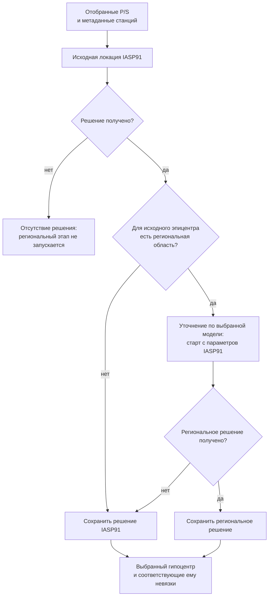

При успешном уточнении сохраняется региональное решение. Если его эпицентр оказался за границей первоначально назначенной области, модель повторно не выбирается. Это фиксированная двухступенчатая процедура, а не последовательность переключений до получения наиболее выгодного результата.

Сам этап локации не удаляет события по RMS или глубине. Если гипоцентр не получен, это сохраняется как результат попытки; последующий статистический отсев и условия экспорта рассматриваются отдельно. Гипоцентр и невязки вступлений должны относиться к одному выбранному решению — региональному либо сохранённому исходному.

### Почему глубина требует отдельной проверки

Изменение времени очага сдвигает расчётные приходы всех фаз. Изменение глубины также меняет времена пробега; при ограниченной геометрии сети эти эффекты могут частично компенсироваться. Особенно важны разнообразие расстояний и направлений на станции, наличие близких наблюдений и качество P/S-вступлений.

Полученное решение и малая сводная невязка RMS характеризуют согласование наблюдений с принятой моделью. Они не устанавливают сами по себе точность глубины: ошибки модели или вступлений могут частично перейти в параметры очага.

Для приведённой ниже оценки глубина считается определённой при полученном решении и

$$
0<H<700\text{ км}.
$$

Значения $H=0$ или $H\ge700$ км относятся к неопределённым глубинам в этой проверке. Это условие оценки, а не геологическая граница применимости метода. Краевая глубина не вызывает автоматического возврата к IASP91 и сама по себе не означает ошибочности эпицентра. Нулевая формальная неопределённость при краевом решении также не означает точно установленную глубину.

### Результаты регионального уточнения

Эффект схемы проверен на сохранённой выборке I квартала 2025 года с прежним оконным ассоциатором v2. Для сравнения использованы одни и те же события и входные вступления в вариантах IASP91 и регионального уточнения. События сопоставлялись с бюллетенем ФИЦ ЕГС РАН при MPVA≥1.5, не менее четырёх общих станций и окне ±60 с.

Ошибки в таблице — расхождения с эталонными координатами и глубинами. Ошибка эпицентра оценивается на 83 общих событиях с координатами. Ошибка глубины — медиана абсолютных расхождений на 66 событиях, где глубина определена и у эталона, и в обоих сравниваемых решениях.

| Показатель | IASP91 | После регионального уточнения |
|---|---:|---:|
| Медианная ошибка эпицентра | 6.74 км | **5.80 км — меньше на 14%** |
| Определённых глубин среди 83 событий | 70 | **73** |
| Медианная ошибка глубины на 66 общих определённых решениях | **5.97 км** | 7.06 км |
| Событий с координатами | 83 | **83** |

Региональная схема уменьшила медианную ошибку эпицентра и увеличила число определённых глубин при сохранении числа событий с координатами. Увеличение 70→73 — итоговый баланс определённых глубин; качество вновь появившихся решений требует отдельного разбора.

На общей выборке из 66 определённых глубин ошибка выросла с 5.97 до 7.06 км. Это ухудшение относится к тем же событиям и не объясняется добавлением ранее неопределённых глубин. Таким образом, получение большего числа глубин и повышение их точности — самостоятельные задачи.

Для выбранного двухпоискового конвейера ожидается перенос положительного эффекта по эпицентру и числу определённых глубин. Величину этого эффекта предстоит подтвердить отдельно; улучшение точности глубины по приведённой проверке не получено.

---

## 10. Статистический отсев событий

### Зачем нужен дополнительный отбор

Согласованность времён прихода и прохождение порога ML существенно ограничивают набор гипотез, но случайное сочетание вступлений может пройти эти проверки. Участие нескольких постоянно активных станций также способно создавать повторяющиеся ложные ассоциации. Поэтому после ML, окончательного устранения повторов и локации применяется дополнительный статистический отбор.

Он использует качество вступлений, согласованность станционных магнитуд, результат LOCSAT и предшествующую активность станций. Порог ML ≥ 1.5 сохраняется. Для оставленных событий отбор не меняет вступления, идентификаторы, ML и результаты локации.

### Какие свойства события оцениваются

Выбранная модель содержит 17 признаков: 12 характеризуют вступления и решение, ещё 5 — историю станций.

| Группа | Признаки | Что они характеризуют |
|---|---|---|
| Число наблюдений — 1 | число станций с P | поддержку гипотезы разными станциями |
| Качество вступлений — 7 | медианы вероятности детекции, вероятностей P и S, неопределённостей P и S, SNR P и S | уверенность модели, устойчивость её ответов при MC Dropout и выраженность сигнала относительно фона |
| Согласованность P/S и амплитуд — 2 | доля станций с S−P < 2 с среди имеющих обе фазы; стандартное отклонение станционных ML | частоту очень близких P/S и согласованность оценок магнитуды по разным станциям |
| Результат локации — 2 | наличие полученного решения LOCSAT; число станций среди вступлений возвращённого решения | наличие решения и состав представленных в нём наблюдений |
| История станций — 5 | три показателя относительной частоты P и два показателя участия станций в событиях | насколько событие опирается на станции, часто выдававшие P или участвовавшие в ассоциациях в предшествующие дни |

Каждый показатель используется в сочетании с остальными. Например, малое S−P возможно у близкого землетрясения, а повышенная активность станции может иметь сейсмическую причину; отдельного запрета на такие наблюдения нет. Разброс станционных ML отражает согласованность амплитуд с принятой поправкой за расстояние, но зависит также от условий регистрации и ошибок расстояния.

Вероятности, неопределённости и SNR берутся из сохранённых результатов станционной обработки для соответствующих вступлений. Счётчик станций LOCSAT не проверяет веса и признаки использования времени: присутствие станции в возвращённом решении не гарантирует участия её вступлений в определении гипоцентра. Если записи о гипоцентре нет, признаки наличия решения и числа станций равны нулю. Это информация для общего балла, а не самостоятельное условие удаления события.

Время суток, координаты события и абсолютная ML в признаки не входят. RMS и отдельные невязки фаз также не входят в выбранные 17 признаков.

### Как учитывается предшествующая активность станций

Для события дня $d$ используются только семь предшествующих суток:

$$
d-7,\ldots,d-1.
$$

День события определяется по самой ранней P. Текущий день исключён: все сведения об истории доступны до обрабатываемого события.

Для каждой станции оцениваются две величины. Первая — среднее число P за сутки с пиками внутри окна, отнесённое к медиане этой частоты по станциям с доступной историей. Вторая — число событий входной выдачи с P данной станции за окно. Участие подсчитывается до статистического отсева, поэтому история не зависит от его предыдущих решений.

Из относительной частоты P получаются три признака события: медиана и максимум её натурального логарифма по станциям с P и доступной историей, а также доля этих станций с частотой выше двух медиан сети. Для участия в событиях используются медиана и максимум величины $\ln((N_s+0.5)/M)$, где $N_s$ — счётчик станции, $M$ — медиана положительных станционных счётчиков сети. Эти два показателя рассчитываются по всем станциям события с P.

При короткой истории используются имеющиеся предшествующие дни. Отсутствие истории отличается от наблюдаемого нулевого счётчика: если данных для признака нет, он остаётся пропущенным. Для последовательной обработки периодов сохраняются суточные счётчики прошлых дней либо данные для их восстановления. Семь суток — длина используемой истории, а не задержка выдачи результата.

### Балл и фиксированный порог

Используется логистическая регрессия. После предусмотренных преобразований признаков рассчитываются

$$
z_i=\frac{x_i-\mu_i}{\sigma_i},
\qquad
s=b+\sum_{i=1}^{17}w_i z_i.
$$

Здесь $x_i$ — значение признака, $\mu_i$ и $\sigma_i$ — среднее и масштаб на обучающей выборке, $w_i$ — вес, $b$ — общий сдвиг. Число станций с P и медианы SNR предварительно логарифмируются с ограничением снизу 0.1; для SNR используется сохранённое значение в дБ. Это эмпирическое преобразование признака, а не перевод дБ в линейное отношение амплитуд.

Средние и масштабы определяются на обучающем I квартале 2025 года и затем фиксируются вместе с весами и порогом. Масштаб равен стандартному отклонению с малой добавкой $10^{-9}$ для устойчивости деления. Пропущенный признак после стандартизации заменяется нулём, то есть средним обучающей выборки. По новому периоду стандартизация не пересчитывается.

Событие сохраняется при $s\ge\tau$, где $\tau$ — выбранный порог. Сигмоида переводит балл в выход логистической модели, однако решение принимается непосредственно по $s$. Этот балл и его сигмоида не являются проверенной физической вероятностью истинности события.

### Обучение, выбор порога и применение

Веса обучаются на I квартале 2025 года с регуляризацией, ограничивающей их величину. Для обучающей метки ищется событие эталона с наибольшим числом станций, на которых наша P совпала с его P в пределах ±3 с. При двух и более таких станциях метка положительная, при отсутствии совпадений — отрицательная; случай одной станции исключается из подгонки весов. Это рабочая разметка по доступному эталону: отсутствие совпадения само по себе не устанавливает ложность события.

Порог выбирается отдельно, по основному критерию сравнения бюллетеней. Защищаются лучшие совпадения с событиями ФИЦ ЕГС РАН при MPVA ≥ 1.5 и не менее четырёх общих станций, объединённые для окон ±60 и ±10 с. Здесь не требуется совпадение отдельных P в пределах ±3 с. Порог равен минимальному баллу защищаемого события обучающего Q1, без дополнительного запаса; сохранение этих совпадений на обучении обеспечено его построением.

При применении готовой модели эталонный бюллетень не нужен. Достаточны вступления с показателями качества, станционные ML, результат локации, предшествующая история и фиксированные параметры модели. Отбор удаляет события целиком, не пересчитывая параметры оставленных.

### Результаты проверки

Для модели, обученной на Q1 с историей семь суток, получены следующие результаты:

| Период | Выдача до → после | Сокращение | Найденные события эталона по основному критерию |
|---|---:|---:|---|
| Май 2024 | 493 → 259 | 47% | сохранены |
| Апрель 2024 | 8 991 → 5 003 | 44% | сохранены |
| I квартал 2025 — обучение | 4 080 → 1 990 | 51% | сохранены |

Майская выборка содержит 20 суток записи. Апрельская получена прежним детектором без MC Dropout. Май и апрель не участвовали в подгонке весов, стандартизации и порога; на них проверялся перенос модели Q1 → 2024. При этом сравнение вариантов истории на этих периодах использовалось для выбора семи суток, поэтому они не являются полностью отложенной проверкой всей конфигурации.

Проверка показывает возможность существенно сократить число событий для последующего разбора при сохранении найденных эталонных событий. Проценты в таблице характеризуют сокращение выдачи; они не измеряют долю удалённых ложных событий, поскольку эталон не содержит полной разметки всей автоматической выдачи.

Эти размеры выдачи получены до перехода на двухпоисковую ассоциацию и региональное уточнение LOCSAT. Эффект отсева в выбранном объединённом конвейере оценивается отдельно.

---

## 11. Невязки времён вступлений

### Что показывает невязка

Для каждой фазы, связанной с решением LOCSAT, невязка сравнивает наблюдённое время прихода с расчётным:

$$
r_{q,i}=T_{q,i}^{\text{набл}}-
\left[T_0^{\text{LOC}}+\tau_{q,i}(\varphi,\lambda,H;\mathcal M)\right],
\qquad q\in\{P,S\}.
$$

Невязка измеряется в секундах. Положительное значение означает приход позже расчётного, отрицательное — раньше. При наличии временных поправок сохраняется значение, возвращённое локатором с их учётом.

Невязка характеризует согласование вступления с конкретными координатами, глубиной, временем очага и моделью среды. Большое значение может быть связано с ошибкой вступления, неподходящей моделью или ошибкой положения очага. Малое значение также не гарантирует правильности фазы: при совместной локации часть ошибки вступления может компенсироваться сдвигом очага и его времени.

После регионального уточнения или возврата к IASP91 невязки должны соответствовать тому же выбранному решению, что и гипоцентр. Вместе с ними сохраняется признак использования времени вступления в локации. Само наличие невязки не означает, что это время участвовало в определении решения.

### Как проверялась диагностическая ценность

Предварительная проверка выполнена для решений IASP91 на мае и апреле 2024 года и I квартале 2025 года. Нашему вступлению сопоставлялся ближайший ручной пик той же фазы на той же станции в пределах ±10 с. Принадлежность одному событию при таком сопоставлении не требовалась.

В этой проверке «верными» считались вступления с расхождением не более 0.5 с для P и 1 с для S, «ошибочными» — с расхождением более 2 с. Промежуточные и не сопоставленные вступления исключались из расчёта AUC.

Медианы абсолютных невязок и доли вступлений с невязкой >2 с рассчитаны по объединённой выборке трёх периодов; диапазоны AUC отражают результаты отдельных периодов.

| Показатель | P | S |
|---|---:|---:|
| Медиана абсолютной невязки у «верных» вступлений | 0.36 с | 0.43 с |
| Медиана абсолютной невязки у «ошибочных» вступлений | 1.75 с | 1.42 с |
| AUC по периодам | 0.83–0.91 | 0.71–0.83 |
| Доля «ошибочных» вступлений с абсолютной невязкой >2 с | 41% | 30% |
| Доля «верных» вступлений с абсолютной невязкой >2 с | 0.8% | 2.9% |

AUC оценивает, насколько большая абсолютная невязка отличает две размеченные группы: 0.5 соответствует случайному ранжированию, 1 — полному разделению. Полученные значения подтверждают полезность невязки как диагностического показателя. Порог 2 с выделяет часть спорных вступлений, затрагивая небольшую долю совпавших с ручными; значительная часть ошибок остаётся ниже порога.

Результаты относятся к указанной разметке и решениям IASP91. Качество этой диагностики для двухпоисковой ассоциации с региональным уточнением требует отдельной проверки.

### TRes и флаги участия фазы

В бюллетене для невязки предусмотрена колонка **TRes**. Она сохраняет смысл невязки LOCSAT, даже когда в заголовке события записано другое, S–P-время очага. Отсутствующая невязка оставляется пустой и не заменяется нулём.

Колонка **Def** содержит три отдельных флага: участия времени, азимута и медленности в определении решения. Обозначение `T__` указывает определяющее время без определяющих азимута и медленности. В текущем экспортёре оно проставляется всем выводимым фазам и не воспроизводит индивидуальный признак использования времени из LOCSAT. Поэтому `T` само по себе не подтверждает участие конкретного вступления в локации.

Предлагаемая пометка при $|TRes|>2$ с — замена `T__` на `___`. Она обозначает вступление для дополнительного разбора, не устанавливая физическую ошибочность фазы. Это предложение по представлению результата: пометка не удаляет вступление и не запускает повторную локацию.

---

## 12. Формирование итогового бюллетеня

Итоговый бюллетень формируется в формате **IMS1.0:SHORT** по событиям, сохранённым после статистического отсева. Сравнение с эталоном на этом этапе не выполняется. Выбранная схема объединяет сохранённые ML и вступления с координатами LOCSAT, амплитудами и доступными невязками; происхождение этих величин различается.

### Отсев нерегиональных станций

Во входных данных вперемешку с региональной сетью присутствуют отдельные опорные станции, расположенные на значительном удалении (за пределами разумной дальности для регионального события). Перед экспортной оценкой T0 такие станции отсеиваются по расстоянию до принятой опорной точки региона в окрестности Сочи, вычисленному по формуле большого круга (haversine):

$$
d = 2r \arcsin\!\left(\sqrt{\sin^2\!\frac{\varphi_2-\varphi_1}{2} + \cos\varphi_1\cos\varphi_2\,\sin^2\!\frac{\lambda_2-\lambda_1}{2}}\right)
$$

где $\varphi$, $\lambda$ — широта и долгота станции и опорной точки, $r$ — радиус Земли. Станция исключается из расчёта события, если $d > 800$ км. Расстояние считается по географическим координатам, а не по названию или принадлежности к сети — это исключает случайное совпадение по формальному признаку (например, по коду сети) там, где станция физически находится близко, но названа нетипично.

Станции без найденных координат не отбрасываются по предположению об их удалённости. Географический отсев выполняется до экспортной оценки времени; он не заменяет отбор станций для ML или локации.

### Происхождение публикуемых величин

| Величина | Источник и смысл |
|---|---|
| Время очага в заголовке | отдельная двухскоростная S–P-оценка экспорта |
| Широта, долгота, глубина | выбранное решение LOCSAT: региональное либо сохранённое IASP91 |
| RMS и формальная неопределённость глубины | характеристики того же решения LOCSAT |
| ML события и станционные ML | сохранённые значения основного расчёта магнитуды, по которому выполнен отбор ML ≥ 1.5 |
| Амплитуды | измерения того же запуска, что и ML; в строках S-фаз, в нанометрах |
| Времена P/S и SNR | сохранённые вступления и соответствующие показатели станционной обработки |
| TRes | доступная невязка соответствующего вступления для выбранного решения LOCSAT |
| Dist и EvAz в строке фазы | эпицентральное расстояние в градусах дуги и азимут очаг → станция, рассчитанные по координатам LOCSAT |

ML при экспорте не заменяется независимым пересчётом с другим отбором станций. Сохранённые магнитуды и амплитуды дополняют друг друга; для их соединения используются исходные идентификаторы событий и станции. Смешение результатов разных запусков может оставить событие без соответствующей амплитуды.

Координаты и доступные характеристики LOCSAT добавляются без нового отсева по RMS или глубине. Событие без решения локатора может оставаться в бюллетене с незаполненными координатами, если выполнены остальные условия экспорта. Заполненные координаты и глубина передают результат расчёта, а не удостоверяют его точность.

### Почему время очага остаётся S–P-оценкой

Для итогового времени используются станционные оценки по S–P, описанные в §6, с двухскоростной схемой Pg/Sg–Pn/Sn и статистическим отбором. Если в полученной подвыборке не менее трёх станций имеют положительные вероятность P и SNR P, время усредняется с весами «вероятность P × SNR P». Иначе, при наличии не менее трёх допустимых S–P-оценок, берётся время станции с минимальным S−P. Отдельного перехода к невзвешенному среднему нет.

Если статистический отбор оставил меньше трёх станций, используются исходные допустимые оценки. Если и их меньше трёх, экспортное время не определяется и событие не выводится, даже при наличии решения LOCSAT.

Таким образом, строка очага сочетает S–P-время с координатами и характеристиками LOCSAT. Это особенность выбранного представления, которую нужно учитывать при разборе бюллетеня: **TRes относится к времени и координатам решения LOCSAT, а не к S–P-времени заголовка**. Подстановка времени в заголовок не вызывает пересчёта невязок.

### Какие вступления и счётчики выводятся

В бюллетень поступают P/S основного набора сохранённых событий; их состав может быть шире группы, использованной LOCSAT. Статистический отбор станционных S–P-времён влияет на итоговое время, но сам по себе не удаляет строки фаз. Выводятся сохранённые P/S после географического отсева станций.

Число фаз **Ndef** подсчитывается после географического отсева, до статистического отбора S–P-оценок. Число станций **Nsta** относится к итоговой S–P-подвыборке. Эти поля не являются счётчиками наблюдений LOCSAT и не устанавливают, сколько времён участвовало в локации.

Поля минимального и максимального расстояний в строке очага также происходят из S–P-оценок, переведённых в градусы по 111.195 км/градус. Они отличаются по происхождению от эпицентрального Dist в строках фаз. Обозначения Pg/Pn и Sg/Sn назначаются по двухскоростной S–P-схеме станции; LOCSAT их при экспорте не переименовывает.

Невязки присоединяются по исходному событию и соответствующему вступлению — станции, фазе и времени — до перенумерации бюллетеня. Для фазы, не имеющей соответствующей невязки выбранного решения, TRes остаётся пустым.

### Название региона и структура файла

Название региона берётся из метаданных станции с минимальным S−P в итоговой подвыборке; это административное описание станции, а не определение области по эпицентру LOCSAT. Если название недоступно, используется общее обозначение Северного Кавказа.

Компактная структура бюллетеня:

```
DATA_TYPE BULLETIN IMS1.0:SHORT
NORTH CAUCASUS REGION Bulletin (EQTransformer, automatic, for review)

EVENT <номер> <регион>
  строка очага      — S–P-время; доступные координаты, глубина и RMS LOCSAT
  строка магнитуды  — сохранённая ML, если доступна
  строки фаз       — станция, фаза, время, доступные Dist/EvAz/TRes,
                     SNR, амплитуда и станционная ML
...
STOP
```

События упорядочиваются по экспортному времени и получают последовательные номера; фазовые строки нумеруются отдельно. Эти номера не заменяют исходные идентификаторы при соединении результатов обработки.

Бюллетень обозначен как автоматический, предназначенный для проверки. Недоступные поля остаются пустыми: например, из отсутствия невязки, координат или формальной неопределённости нельзя заключать, что соответствующая величина равна нулю.

---

## 13. Сравнение с эталоном и достигнутые результаты

Основной эталон — бюллетени ФИЦ ЕГС РАН. Для оценки обнаружения выбираются события с опубликованной MPVA ≥ 1.5; автоматическая выдача уже прошла собственный порог ML ≥ 1.5. MPVA и ML — разные величины, поэтому равенство числовых порогов не делает выборки физически эквивалентными. Сопоставляются готовые бюллетени по времени очага и составу станций.

### Алгоритм сопоставления

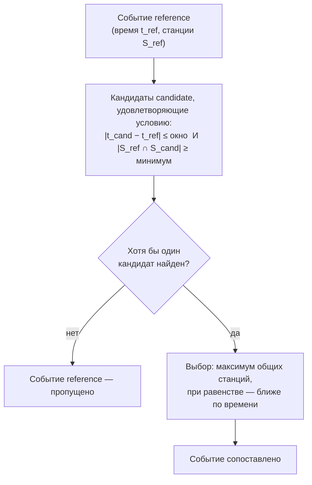

Формально кандидат допускается к рассмотрению, если

$$
\big|t_{\text{cand}} - t_{\text{ref}}\big| \le W \qquad\wedge\qquad \big|S_{\text{ref}} \cap S_{\text{cand}}\big| \ge n_{\min},
$$

где $W$ — временное окно допуска, $n_{\min}$ — минимум общих станций. Основная оценка использует $W=60$ с и $n_{\min}=4$; отдельно повторяется проверка с $W=10$ с при тех же четырёх общих станциях.

P и S одной станции дают одну общую станцию; станция только с S также может войти в пересечение. Сравниваются коды станций без учёта сети. Совпадение времени отдельных вступлений, названий фаз и флагов Def не проверяется. Поэтому найденное событие по этому критерию не означает, что все его P/S определены правильно.

Сопоставление не эксклюзивно: один и тот же кандидат может быть признан «лучшим совпадением» сразу для нескольких разных эталонных событий, если они расположены близко по времени — это стоит учитывать при интерпретации результата сравнения на плотных по времени последовательностях событий (афтершоковые серии).

По результатам сравнения формируется список найденных и пропущенных событий эталонного бюллетеня, с расхождением по времени и составом станций для найденных.

### Какие показатели различаются

Полнота относительно эталона определяется как

$$
\mathrm{Recall}=
\frac{N_{\text{сопоставленных событий эталона}}}
{N_{\text{событий эталона после отбора}}}.
$$

Она отвечает на вопрос, какая часть выбранного эталонного бюллетеня найдена по указанному правилу. Доля истинных событий среди всей автоматической выдачи — другой показатель, для которого нужна разметка этой выдачи. Отсутствие совпадения с эталоном само по себе не устанавливает ложность события.

Расхождение времени вычисляется между временем эталона и экспортной S–P-оценкой. Проверка при ±10 с строже по времени, но также не заменяет проверку отдельных вступлений.

Ошибка эпицентра — расстояние по сфере между нашими и эталонными координатами в километрах; она оценивается только у сопоставленных событий с координатами с обеих сторон. Для глубины различаются подписанная разность $H_{\text{наша}}-H_{\text{эталон}}$ и её абсолютная величина. При сравнении скоростных моделей число определённых глубин и ошибка на одной общей выборке допустимых глубин учитываются раздельно, как в §9.

### Сводка достигнутых результатов

| Проверка | Выборка и конфигурация | Результат |
|---|---|---|
| Двухпоисковая ассоциация, Q1 2025 | контрольные окна около всех 112 событий эталона | **86/112 при ±60 с; 82/112 при ±10 с** |
| Двухпоисковая ассоциация, май 2024 | контрольные окна около событий эталона | **41/46** по основному критерию |
| Региональное уточнение LOCSAT | прежний ассоциатор v2, Q1; 83 события с координатами | медианная ошибка эпицентра **6.74→5.80 км**; определённых глубин **70→73** |
| Точность глубины | та же проверка, 66 общих определённых глубин | медианная абсолютная ошибка **5.97→7.06 км** |
| Статистический отсев | модель Q1, история семь суток; прежняя конфигурация выдачи | май **493→259**, апрель **8 991→5 003**, Q1 **4 080→1 990**; найденные эталонные события сохранены |
| Диагностика вступлений по невязкам | решения IASP91, май/апрель 2024 и Q1 2025 | AUC **0.83–0.91 для P**, **0.71–0.83 для S** |

Двухпоисковая схема проверена на контрольных окнах около всех эталонных событий. Аналогичная полнота ожидается при полном прогоне; размер полной выдачи и сквозной результат после регионального уточнения и отсева предстоит измерить.

Сетевая ассоциация собирает события из разновременных станционных вступлений и сохраняет основную часть эталонных совпадений при ужесточении окна до ±10 с. Региональные разрезы уменьшают ошибку эпицентра, а статистический отсев сокращает число событий для дальнейшего разбора с сохранением найденных событий эталона в проверенных выборках. Невязки добавляют возможность адресно выделять вступления, требующие проверки.

Разработка связывает эти задачи в последовательную обработку: качество вступлений учитывается при оценке времени и отсеве, согласованность S–P проверяется при выборе магнитудной группы, а рассчитанная ML сохраняется при последующей локации и экспорте. Наблюдения, магнитуды, доступные гипоцентры и невязки связаны с исходными событиями. Это позволяет разбирать причины расхождений и проверять изменения метода на одних и тех же наблюдениях.

### Сопоставление магнитуд

Собственная ML рассчитывается по амплитудам и расстояниям (§7), без использования энергетического класса K. Для её сравнения с бюллетенем применяется пересчёт опубликованного K:

$$
M_K=\frac{K-4}{1.8}.
$$

Источник применения этого соотношения — [Зверева А. С., 2024, §4.3, с. 98, формула (4.16)](https://ifz.ru/documents/Dissovet/2024/Zvereva/Disser%20Zvereva.pdf#page=98). Коэффициенты в нашем конвейере не подбирались. Полученная величина не является прямым определением ML. K здесь — энергетический класс, опубликованный в исходном бюллетене.

Отдельно проверено преобразование

$$
M_L^{\text{ref}}=1.15\,MPVA-1.60,
$$

приведённое [Коноваловым и Сычевым (2014), формула (13)](https://doi.org/10.1134/S0742046314060050) для Северного Сахалина. Оба преобразования сравнивались с нашей ML на одних и тех же событиях с доступными K, MPVA и ML: сохранённые бюллетени после отсева, MPVA ≥ 1.5, не менее четырёх общих станций, окно ±60 с.

| Период | Пар | Преобразование эталона | Медиана абсолютного расхождения | Среднее абсолютное расхождение | Расхождение ≤0.5 |
|---|---:|---|---:|---:|---:|
| Май 2024 | 41 | $(K-4)/1.8$ | 0.189 | 0.210 | 38/41 |
| Май 2024 | 41 | $1.15\,MPVA-1.60$ | 0.225 | 0.240 | 37/41 |
| Апрель 2024 | 18 | $(K-4)/1.8$ | 0.183 | 0.211 | 18/18 |
| Апрель 2024 | 18 | $1.15\,MPVA-1.60$ | 0.130 | 0.227 | 16/18 |
| Q1 2025, ассоциатор v2 | 86 | $(K-4)/1.8$ | 0.133 | 0.188 | 80/86 |
| Q1 2025, ассоциатор v2 | 86 | $1.15\,MPVA-1.60$ | 0.185 | 0.229 | 77/86 |

При текущем пересчёте из K расхождение не превышает 0.5 у 38 из 41 пары в мае, у всех 18 пар в апреле и у 80 из 86 пар в Q1. Этот пересчёт дал меньшее среднее абсолютное расхождение во всех трёх периодах и больше совпадений в пределах 0.5. В апреле преобразование MPVA лучше по медиане абсолютного расхождения. Устойчивого преимущества, достаточного для замены текущего пересчёта, не получено.

Эти расхождения характеризуют согласованность разных методов и шкал; они не выделяют собственную ошибку нашего определения ML. Меньшее расхождение также не удостоверяет большую точность преобразования эталона. Текущий пересчёт из K сохраняется, собственный расчёт ML и основной критерий обнаружения MPVA ≥ 1.5 не меняются.

---

## 14. Причины пропусков и границы применимости

### На каком этапе может потеряться событие

Отсутствие события в итоговом списке требует последовательного разбора. Оно может быть связано как с недоступностью наблюдений, так и с решениями алгоритмов на последующих этапах.

| Этап | Что проверяется при разборе пропуска |
|---|---|
| Записи и метаданные | есть ли запись нужного времени и компонент, нет ли разрывов, доступен ли подходящий инструментальный отклик |
| Детекция | обнаружены ли необходимые P/S; не отвергнуты ли слабые вступления или неполная пара фаз |
| Ассоциация | есть ли шесть согласных P разных станций; не ушли ли полезные вступления в конкурирующую гипотезу; совместимы ли S со своими P |
| Оценка ML | доступны ли амплитуды; корректны ли S–P-расстояния и выбранная группа; рассчитана ли ML и пройден ли порог 1.5 |
| Последующие условия | прошло ли событие статистический отсев; достаточно ли допустимых S–P-оценок для экспортного времени |

В разборах прежних прогонов подтверждены разные механизмы: недостаток совпавших с эталоном P во входе ассоциации, поглощение полезных альтернатив конкурирующей группой, ошибки S с искажением расстояния и состава магнитудной группы. Именно различия в обращении с альтернативными вступлениями обосновывают два независимых поиска. Эти наблюдения не задают распределение причин всех пропусков нового конвейера.

Для части детекторных пропусков причина остаётся открытой. Отсутствие обнаружения нельзя автоматически объяснять отсутствием исходной записи, а нехватку согласных вступлений — только слабостью землетрясения.

### Роль геометрии сети и излучения

Амплитуда на станции зависит от расстояния, затухания, условий регистрации и направленности излучения очага. Механизм землетрясения может давать слабый сигнал в одних направлениях и сильный в других. Если доступные станции плохо охватывают источник или на них мало различимых вступлений, событие может не набрать требуемой поддержки.

Если одна станция даёт согласную оценку времени, а более близкие — смещённые, направленность излучения остаётся одним из возможных объяснений слабой регистрации нужного сигнала. По одним временам нельзя установить ни механизм очага, ни регистрацию другого землетрясения; для этого нужны записи и геометрия наблюдений.

LOCSAT совместно определяет гипоцентр по имеющимся наблюдениям, но не восстанавливает отсутствующие или не обнаруженные вступления. Локация может уточнить интерпретацию собранной группы; она не гарантирует исправления ошибочной ассоциации.

### Условия переноса и нерешённые вопросы

- **Детектор не дообучался на этой сети.** Используются исходные веса модели, обученной на глобальном наборе STEAD. Результаты текущих проверок характеризуют перенос выбранной модели и настроек; они не задают полноту для произвольного региона или уровня шума.
- **Пороги и состав сети определяют отбор.** Минимум станций, допуски времён и порог ML задают рабочий компромисс между полнотой и случайными сочетаниями. Признаки станционной истории также зависят от режима работы сети. При изменении условий требуется проверка переноса настроек и модели отсева.
- **Станционные поправки магнитуды сейчас отключены** ($S_i = 0$) — не из-за отсутствия механизма, а из-за признанной неактуальности имеющегося набора калибровочных значений (§7).
- **Ручной верификации всей выдачи нет.** Итоговый бюллетень остаётся автоматическим. Природа событий, не сопоставленных с эталоном, и доля истинных событий во всей выдаче требуют отдельной оценки.

Предположения измерения амплитуд и расстояний, ограничения глубины и условия обучения отсева изложены в §7, §9 и §10 соответственно. Ближайшие проверки — полный прогон выбранной двухпоисковой схемы со всеми последующими этапами, перенос отсева на период, не участвовавший в выборе конфигурации, и разбор изменений глубины по региональным моделям.

---

## Научные источники

- [Mousavi S. M. et al. (2020). Earthquake transformer—an attentive deep-learning model for simultaneous earthquake detection and phase picking. Nature Communications, 11, 3952](https://doi.org/10.1038/s41467-020-17591-w) — исходная модель детекции и определения вступлений.
- [Zhang M., Ellsworth W. L., Beroza G. C. (2019). Rapid Earthquake Association and Location. Seismological Research Letters, 90(6), 2276–2284](https://doi.org/10.1785/0220190052) — близкий принцип сеточной ассоциации по числу вступлений, согласованных с годографами.
- [Дягилев Р. А., Габсатарова И. П., Селиванова Е. А. (2023). Шкала локальных магнитуд ML для землетрясений в Терско-Каспийском прогибе. Российский сейсмологический журнал, 5(2), 19–31](https://doi.org/10.35540/2686-7907.2023.2.02) — источник коэффициентов формулы ML; различия измерительной процедуры объяснены в §7.
- [Kennett B. L. N., Engdahl E. R. (1991). Traveltimes for global earthquake location and phase identification. Geophysical Journal International, 105, 429–465](https://doi.org/10.1111/j.1365-246X.1991.tb06724.x) — модель IASP91.
- [Зверева А. С. (2024). Добротность литосферы и спектральные параметры очагов землетрясений Северного Кавказа. Диссертация, §4.3, с. 98, формула (4.16)](https://ifz.ru/documents/Dissovet/2024/Zvereva/Disser%20Zvereva.pdf#page=98) — источник применения пересчёта $M_K=(K-4)/1.8$.
- [Konovalov A. V., Sychev A. S. (2014). A calibration curve of local magnitude and intermagnitude relations for northern Sakhalin. Journal of Volcanology and Seismology, 8, 390–400](https://doi.org/10.1134/S0742046314060050) — отдельно проверенное преобразование MPVA, формула (13).
