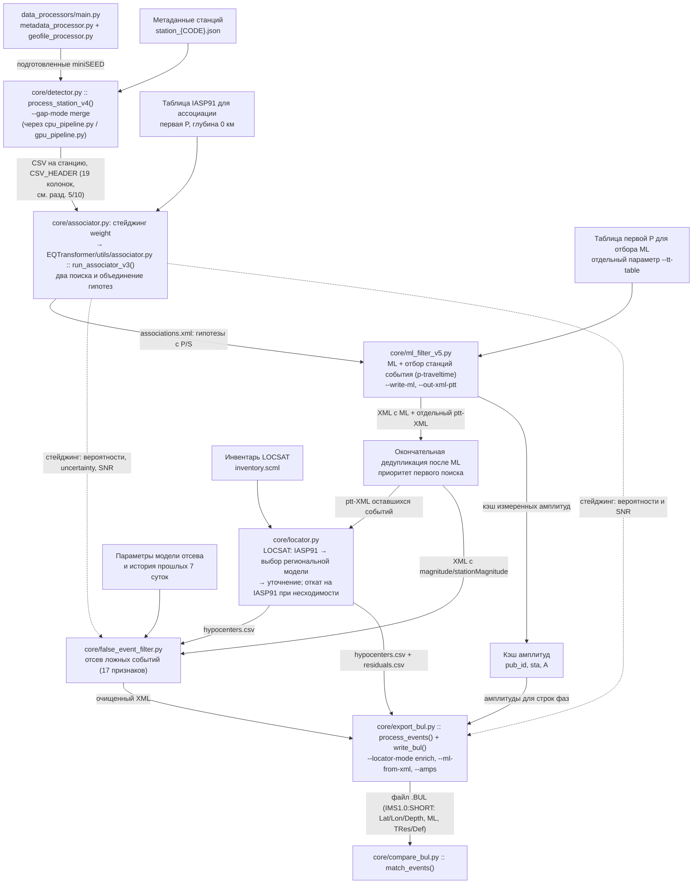
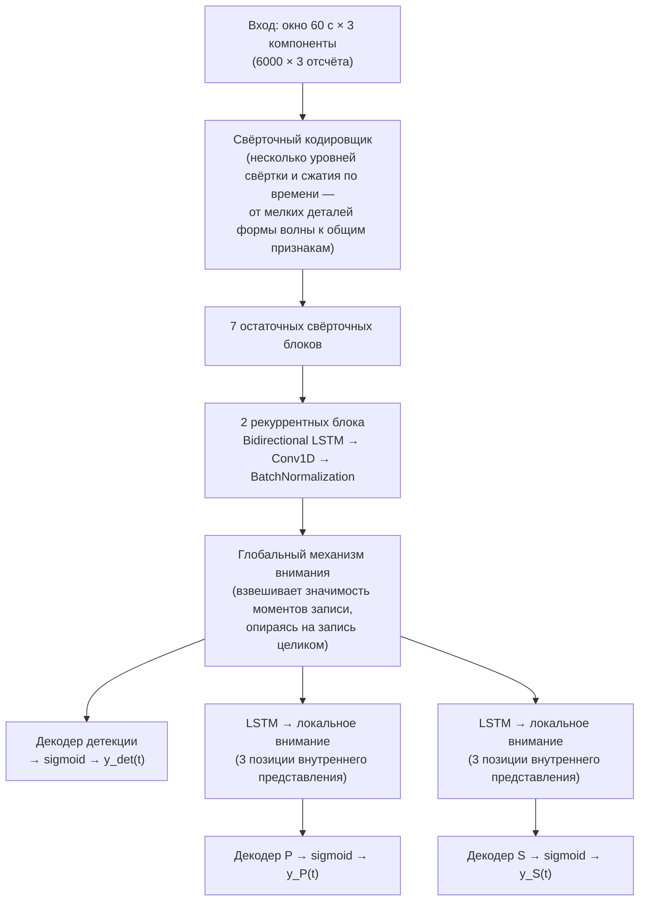
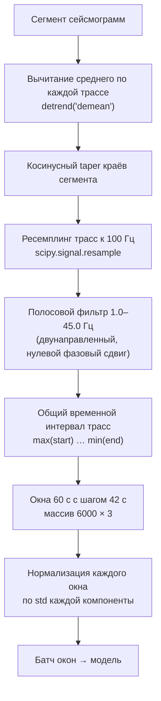
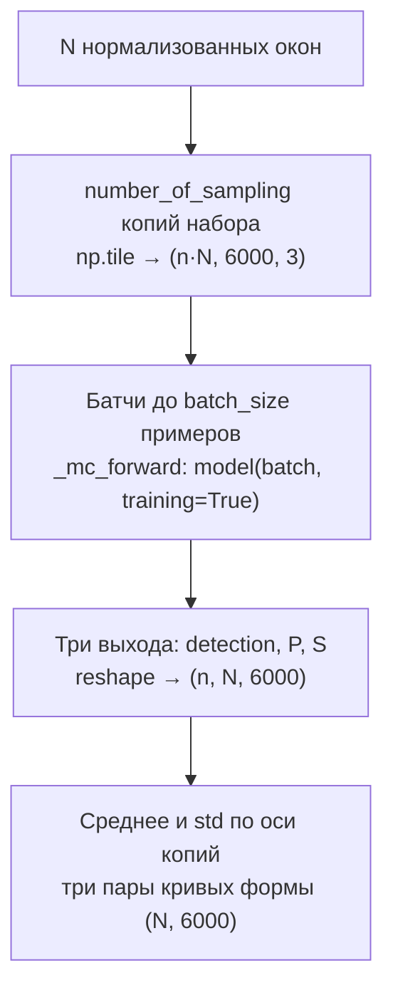
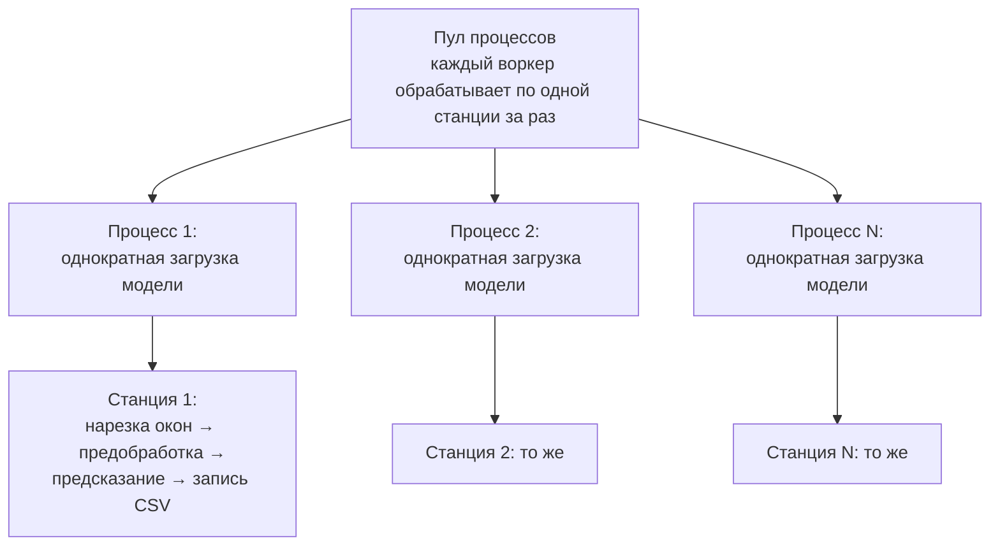
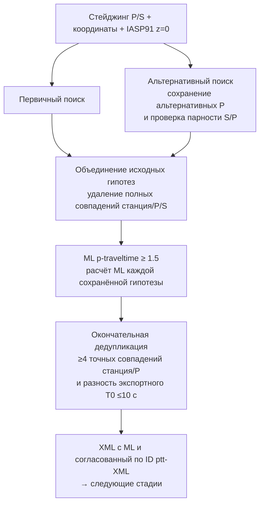
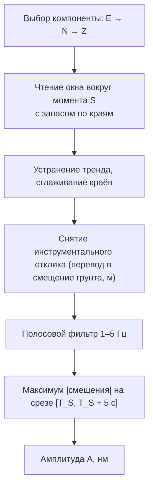
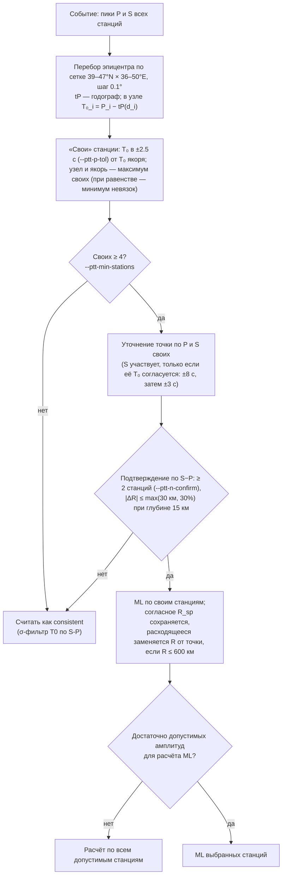
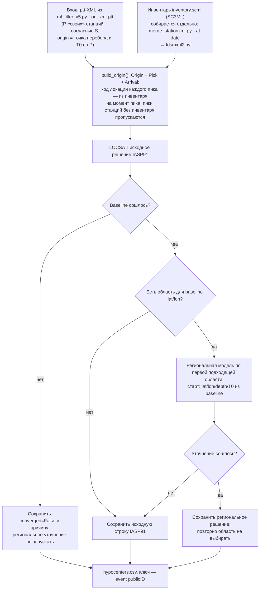
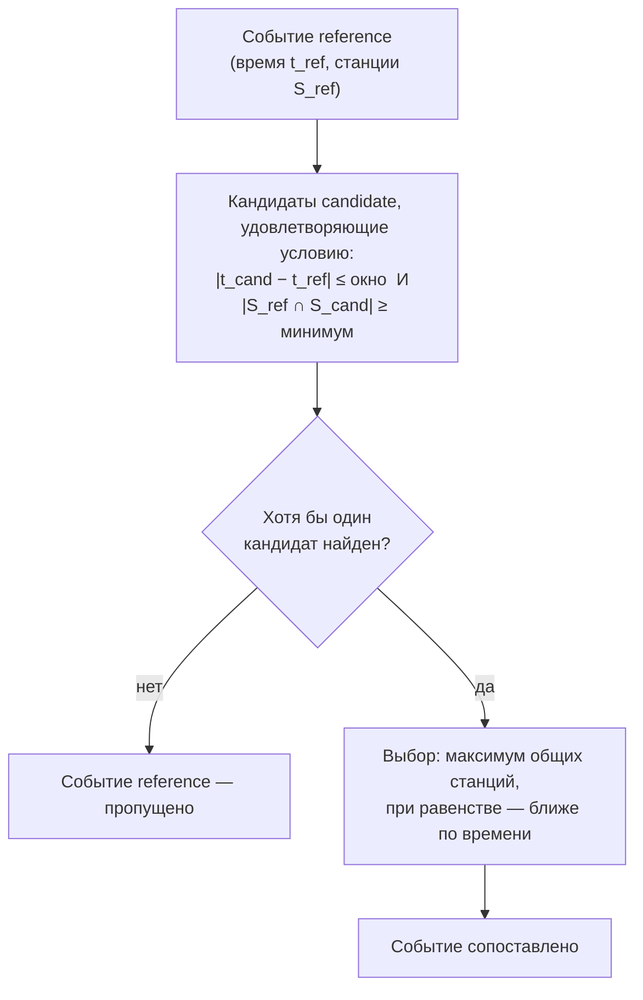

# Техническое описание пайплайна автоматического обнаружения сейсмических событий (форк EQTransformer)

## 0. Назначение документа и границы

Документ адресован разработчикам, сопровождающим или расширяющим этот пайплайн — людям, уверенно читающим код, но не обязательно разбирающимся в сейсмологии. Он покрывает: архитектуру кода (какой модуль что вызывает и в каком порядке), реальные форматы файлов и полей на каждом стыке конвейера, конфигурацию и CLI-флаги там, где они есть, и особенности реализации, важные для эксплуатации и поддержки — включая известные несоответствия докстрингов реальному поведению, гонки при параллельной записи и места, где независимые реализации одной и той же формулы дают не идентичный результат.

Документ **не** ставит задачей глубокую физическую интерпретацию метода (вывод формул из физики распространения волн, обоснование скоростных моделей и т. п.) — акцент сделан на архитектуре кода и форматах данных; необходимый минимум физики, без которого пороги и формулы ниже не будут понятны, изложен прямо здесь же (разд. 2).

Качество пайплайна оценивается сверкой с официальными бюллетенями ГС РАН: `core/export_bul.py` пишет бюллетень в формате IMS1.0:SHORT, `core/compare_bul.py` сопоставляет его с эталонным `.BUL` (совпадение по времени очага и общим станциям). Этот документ посвящён архитектуре и конфигурации: приведены параметры калибровки, пороги и константы; отдельные результаты сверки упоминаются только там, где они обосновывают выбор значения.

Документ описывает выбранный конвейер: подготовка данных → детекция → ассоциация двумя поисками → ML p-traveltime → окончательная дедупликация → LOCSAT с региональным уточнением → отсев ложных событий → экспорт → сравнение. Рабочие настройки этого конвейера могут отличаться от значений CLI по умолчанию; ниже они указываются отдельно.

---

## 1. Общая схема пайплайна

Ниже показаны девять последовательных шагов и основные артефакты между ними. Дедупликация после ML выделена как отдельная операция; вспомогательные входы показаны боковыми связями.



Ассоциатор объединяет результаты двух поисков, удаляя до ML только полностью одинаковые наборы станция/P/S. После ML выполняется окончательная дедупликация: гипотезы считаются дублями при наличии не менее четырёх одинаковых пар «станция, время P» и разности экспортных оценок T0 не более 10 с. Приоритет имеет первый поиск. Для оставшихся событий сохраняются исходные publicID; ptt-XML ограничивается тем же набором идентификаторов.

Далее данные идут двумя ветками. XML с magnitude/stationMagnitude сохраняет пики и ML для отсева и экспорта. Отдельный ptt-XML содержит отобранные P и согласные S для LOCSAT; он может включать не все события, прошедшие ML. Гипоцентры связываются с основным XML по event publicID. Невязки фаз передаются в экспорт отдельно.

`main.py` подготавливает miniSEED и агрегированный JSON метаданных. Файлы `station_{CODE}.json`, необходимые детектору, подготавливаются отдельно (разд. 3). Для LOCSAT также нужен отдельный инвентарь с эпохами каналов, соответствующими обрабатываемому периоду.

`core/validate_associator_v2.py` используется как диагностическая утилита и библиотека функций S-P для экспорта (разд. 7); отдельный запуск валидатора не является обязательным шагом основной цепочки.

Таблицы ассоциации, отбора станций ML и локации задаются для каждого потребителя отдельно. Ассоциация использует IASP91 при глубине 0 км; LOCSAT начинает с IASP91 и затем уточняет решение по региональной модели, выбранной по координатам первоначального решения. `core/fit_traveltime.py` строит дополнительный вариант таблицы первой P по архиву бюллетеней (разд. 8а); этот подготовительный шаг не обязателен для основного сценария.

Расширенная таблица форматов на стыках (полные поля — см. разд. 10, сводная таблица):

| Стык | Формат | Ключевые поля |
|---|---|---|
| SDS-архив → `data_processors/geofile_processor.py` | miniSEED, `NET.STA.LOC.CHAN.TYPE.YEAR.DAY` | суточные файлы, один канал |
| `geofile_processor.py` → `detector.py` | miniSEED, переименованные в `..._\_\_start\_\_end` | те же данные, явные ISO-таймстемпы в имени файла, `workspace/data_processors/output/geofiles/` |
| `metadata_processor.py` → подготовка JSON для детектора | JSON `{STA: {network, channels, coords:[lat,lon,elv]}}` | `main.py` пишет агрегированный `station_list_RU.json`; ожидаемые детектором `station_{CODE}.json` подготавливаются отдельно. Ассоциатор получает координаты из CSV детектора, а не из станционных JSON — см. §3 |
| `detector.py::process_station_v4` → `associator.py` | CSV, `CSV_HEADER` (19 колонок) | `event_start_time/end_time`, `p_arrival_time`/`s_arrival_time` + вероятности/SNR/uncertainty |
| `associator.py` (стейджинг) → `run_associator_v3` | CSV `X_prediction_results.csv`, те же 19 колонок (отфильтрованное подмножество строк, в режиме `weight` — с переписанными вероятностями) | — |
| `run_associator_v3` → `ml_filter_v5.py` | QuakeML `associations.xml`: `Event`, `Origin`, `Pick(phase_hint=P\|S)` | `publicID`, времена и коды станций; origin содержит время первой P и координаты первой станции как плейсхолдеры, а не решение локации |
| таблицы первой P → ассоциация / отбор ML | CSV, отдельный путь для каждого потребителя | расстояние, время первой P и число наблюдений; формат загрузчика ML: первые три колонки `dist_km,tp_s,n`. Источник и назначение таблицы задаются отдельно |
| `ml_filter_v5.py` → окончательная дедупликация | основной XML с ML и отдельный ptt-XML | основной XML: `Magnitude`/`stationMagnitude`; ptt-XML: отобранные P и согласные S, стартовая точка и T0 по P |
| окончательная дедупликация → `locator.py` | ptt-XML оставшихся событий | исходные event publicID; только события, для которых сформирован вход локатора |
| окончательная дедупликация → `false_event_filter.py` | основной XML оставшихся событий | пики, ML события и станций |
| `locator.py` → `false_event_filter.py` / `export_bul.py` | CSV `hypocenters.csv` | `event_id, lat, lon, depth_km, rms, n_stations_used, converged` |
| `locator.py` → `export_bul.py` | CSV `residuals.csv` | невязки отдельных фаз; связь с событием и пиком |
| стейджинг и история → `false_event_filter.py` | CSV детекций и история прошлых 7 суток | вероятности, неопределённости, SNR и признаки шумности станций; параметры обученной модели |
| кэш амплитуд → `export_bul.py --amps` | CSV `pub_id,sta,A` | амплитуды в метрах; ML берётся из XML при `--ml-from-xml` |
| `false_event_filter.py` → `export_bul.py` | QuakeML, отфильтрованный по баллу достоверности | — |
| `export_bul.py` → `compare_bul.py` | `.BUL` (IMS1.0:SHORT, фиксированные колонки) | дата 1–10, время 12–22, станция 1–5; нумерация с 1, границы включены |

---

## 2. Минимальный доменный ликбез

Землетрясение излучает продольные **P** и поперечные **S** объёмные волны. P распространяются быстрее S. Сейсмическая станция регистрирует колебания грунта, обычно по трём компонентам: вертикальной и двум горизонтальным, условно Z/N/E. Исходная запись содержит отсчёты прибора; переход к физическому смещению для измерения амплитуды требует снятия инструментального отклика. Фактический набор компонент и непрерывность записи зависят от доступных данных.

Для фаз одного события разность времён прихода $\Delta T = T_S - T_P$ позволяет приближённо оценить расстояние до очага. В модели с постоянными скоростями $V_P>V_S$:

$$
\Delta T = R\left(\frac{1}{V_S}-\frac{1}{V_P}\right),
\qquad
R = \frac{V_PV_S}{V_P-V_S}\,\Delta T.
$$

Здесь $R$ — расстояние от очага до станции в принятом приближении, а не эпицентральное расстояние по поверхности. В ML используется пара $V_P=6.0$ и $V_S=3.4883$ км/с; для оценки T0 валидатор и экспорт также предусматривают разделение Pg/Sg и Pn/Sn (разд. 7). Постоянные скорости — расчётное приближение: реальное время пробега зависит от глубины, строения среды и выбранной фазы. Поэтому ассоциация и LOCSAT используют таблицы годографов. Ограничение пары P/S в 45 с — параметр детектора (разд. 5); его перевод в километры зависит от принятой модели.

Амплитуда колебаний несёт информацию о силе события, но также зависит от расстояния, распространения волн и условий под станцией. При расчёте ML измеряется амплитуда физического смещения после снятия отклика прибора и фильтрации; затем учитывается расстояние до очага (разд. 8).

---

## 3. Подготовка данных (`data_processors/`)

### Оркестрация: `main.py`

`data_processors/main.py` координирует подготовку метаданных и волновых файлов. Запуск — `python data_processors/main.py`; настроенные пути вычисляются от корня репозитория через `_ROOT` и не зависят от текущей рабочей директории. CLI у скрипта нет: пути заданы в начале `main.py`. Схема текущих путей:

```text
metadata_xml_folder_path     = workspace/data_processors/input/metadata
json_stationlist_output_path = workspace/data_processors/output/station_list_RU.json
geofile_input_directory      = workspace/data_processors/input/raw
geofile_output_directory     = workspace/data_processors/output/geofiles
```

**Шаг 1 (метаданные)** запускается, если существует `metadata_xml_folder_path`. Существование выходного JSON не является условием запуска: переменная `json_stationlist_exist` вычисляется, но в проверке не используется. `combine_inventories_to_json()` открывает выходной файл в режиме `'w'`: создаёт его или перезаписывает существующий. Родительскую директорию эта функция не создаёт.

**Агрегированный и станционные JSON.** Этот шаг пишет один файл `{STA1: {...}, STA2: {...}, ...}`. Детектор через `_build_stations()` формирует путь `--json-dir/station_{CODE}.json` для каждой выбранной станции; такие файлы подготавливаются отдельно, `main.py` их не создаёт. Внутри JSON должен присутствовать ключ станции из заголовка miniSEED. Текущая предобработка читает по этому ключу `network` и `coords`; наличие других станций в том же словаре само по себе не мешает чтению, но агрегированный файл не подставляется автоматически вместо ожидаемых имён файлов.

`core/associator.py` JSON метаданных не открывает и флага `--json-dir` не имеет: координаты станций поступают в ассоциацию через CSV детектора.

**Шаг 2 (сейсмические файлы)** запускается, если существуют входная и выходная директории. `get_directories()` передаёт в `geofile_processor()` все подпапки первого уровня входной директории как станции. Поэтому вход должен указывать на уровень, непосредственно содержащий каталоги станций, например `<SDS>/2024/RU/`; корень многолетнего SDS-архива этому условию не соответствует. Внутри каталогов станций обход рекурсивный.

Если условие запуска не выполнено, скрипт печатает соответствующие булевы признаки (`XML`, `JSON`, `INPUT`, `OUTPUT`) и пропускает шаг. Это не общий перехват ошибок: исключения при чтении XML или копировании файлов могут прервать выполнение.

### `geofile_processor.py`

Модуль копирует файлы и меняет их имена; содержимое miniSEED и времена в заголовках трасс не преобразуются. Для стандартного имени SDS удаляются две последние точечные части (`YEAR.DAY`) и добавляются вычисленные границы суток:

```text
NET.STA.LOC.CHAN.TYPE.YEAR.DAY
→ NET.STA.LOC.CHAN.TYPE__start__end

RU.SOC.U4.BHE.D.2024.092
→ RU.SOC.U4.BHE.D__20240401T000000Z__20240402T000000Z
```

В високосном 2024 году день 092 — 1 апреля. Поле типа `D` сохраняется. Полученное имя соответствует regex обоих режимов детектора; код локации в нём может быть пустым или содержать до двух букв/цифр верхнего регистра.

Фильтр применяется к вычисленной дате начала суток:

$$
\text{дата\_начала} \le t < \text{дата\_конца}
$$

Диапазон дат — константы вверху файла, не параметр функции:

```python
date_from = datetime(2024, 4, 1)
date_to   = datetime(2024, 6, 1)   # не включается
```

Для каждой станции создаётся выходной каталог (`os.makedirs(..., exist_ok=True)`), а исходный каталог обходится рекурсивно через `os.walk`. Номер дня берётся из последней точечной части имени (`file_name.split('.')[-1]`). Полная структура SDS-имени, его год и тип данных отдельно не проверяются: для первичного отбора достаточно числового суффикса в диапазоне `1–365`.

Дата вычисляется как 1 января `date_from.year` плюс `DAY−1` суток. Затем проверяется попадание в `[date_from, date_to)`. Отсюда два ограничения:

- День 366 пропускается даже в високосном году: 31 декабря 2024 года этот код не копирует.
- Год исходного файла игнорируется. Например, суффикс `2025.092` при текущем `date_from.year=2024` также даст дату 1 апреля 2024 года. При этом времена внутри miniSEED останутся прежними. Поэтому год входного архива необходимо согласовать с `date_from.year`; изменение одного `date_to` не делает обработку многолетней.

Прошедшие отбор файлы копируются через `shutil.copy2` в плоскую папку станции. Вложенная структура не сохраняется; совпадающие выходные имена могут перезаписывать друг друга. Даты в имени обозначают вычисленные границы суток, а фактический диапазон записи детектор получает из заголовков трасс.

Для станций сети `N0` следует отдельно проверить согласованность кодов: в имеющихся метаданных используется `N0` с цифрой ноль, а в части SDS-архива — `NO` с буквой O. Этот модуль сохраняет префикс исходного имени и сетевой код в miniSEED, автоматического преобразования `NO` ↔ `N0` здесь нет.

### `metadata_processor.py`

Выходной JSON объединяет станции из просмотренных XML-файлов; ключ — код станции. Пример записи:

```json
{
  "SOC": {
    "network": "RU",
    "channels": ["BHE", "BHN", "BHZ"],
    "coords": [43.57, 39.763, 54.0]
  }
}
```

`coords` содержит широту и долготу в градусах и высоту станции в метрах. `channels` содержит коды каналов. В текущем `preprocessorV7_mem` компоненты выбираются по каналам фактически прочитанных трасс, а не по этому списку JSON.

`read_inventory_file(file_path)` строит `{station_code: {...}}` из одного XML со следующими особенностями, важными для эксплуатации:

- код станции берётся как `network.stations[0].code` — то есть ключ определяется **первой** станцией сети в этом XML, даже если в сети (в этом конкретном файле) их несколько;
- `coords` перезаписываются на каждой итерации внутреннего цикла по станциям сети — в результат попадают координаты **последней** станции цикла, не обязательно той, чей код стал ключом;
- список каналов фильтруется условием `channel.start_date >= last_date`, где `last_date` — start_date **последнего по порядку в XML** канала (а не максимум по всем каналам, цикл просто перезаписывает переменную) — при непредсказуемом порядке каналов в файле результат зависит от их фактического порядка.

Из-за этих трёх особенностей модуль рассчитан на XML с ровно одной станцией на сеть (типичный экспорт FDSN station-service по станции) — на многостанционных XML координаты и каналы разных станций могут перемешаться под одним ключом.

`combine_inventories_to_json(xml_folder_path, json_output_path)` обходит имена с окончанием `.xml` в одной папке (`os.listdir`, без рекурсии и сортировки). Для новой станции данные добавляются целиком; для уже встреченной `channels` дополняется через `extend` без дедупликации, а `coords` и `network` остаются от первого встреченного файла. При нескольких версиях метаданных результат поэтому зависит от порядка обхода. Станции разных сетей с одинаковым кодом также получают один ключ.

Результат пишется через `json.dump(..., indent=4)`. При `FileNotFoundError` во время открытия выходного файла печатается сообщение об ошибке, но следом всё равно выводится «Данные успешно сохранены». Эта строка сама по себе не подтверждает создание JSON.

Связь с последующими стадиями: станционный JSON → `preprocessorV7_mem` → атрибуты сети и координат → CSV детектора → ассоциация. Для снятия инструментального отклика и построения инвентаря LOCSAT нужны исходные StationXML: JSON со списком каналов и координатами их не заменяет.

---

## 4. Нейросетевая модель EQTransformer

### Архитектура



В рабочем запуске модель загружается из `ModelsAndSampleData/EqT_original_model.h5` (переопределяется через `--model-path`), а не создаётся вызовом `cred2()`. Поэтому число блоков проверяется по сохранённой конфигурации H5:

| Часть модели | Конфигурация рабочего H5 |
|---|---|
| Вход | `(batch, 6000, 3)` |
| Кодировщик | 7 пар Conv1D + MaxPooling1D; длина временного представления уменьшается до 47 позиций |
| Свёрточная часть | 7 остаточных блоков, по 2 Conv1D в каждом |
| Рекуррентная часть | 2 блока Bidirectional LSTM с 16 units в каждом направлении, затем Conv1D с ядром 1 и BatchNormalization |
| Глобальное внимание | `attentionD0` → `attentionD`, оба с `attention_width=None` |
| Ветви P и S | по одному LSTM с 16 units и `SeqSelfAttention(attention_width=3)` |
| Три декодера | по 7 ступеней увеличения разрешения со свёртками; Cropping1D согласует длину |
| Выходы | `detector`, `picker_P`, `picker_S`, каждый `(batch, 6000, 1)`, sigmoid |

`cred2` и его помощники описывают способ построения этой архитектуры, но текущие значения конструктора не тождественны сохранённой модели. В частности, `cnn_blocks=5` задаёт число итераций цикла, который дополнительно создаёт блоки при `cb>2`, а `BiLSTM_blocks=3` не соответствует двум блокам рабочего H5.

При `attention_width=3` и `history_only=False` локальное внимание использует позиции `i−1`, `i`, `i+1` с обрезкой на краях. Это позиции сжатого представления перед декодером, а не ±3 исходных отсчёта и не окно, предварительно вырезанное вокруг найденного P/S. Ветви получают контекст общего кодировщика и глобального внимания.

Исходная модель EQTransformer обучалась на STEAD — глобальном наборе сейсмических и шумовых записей ([Mousavi et al., 2020](https://doi.org/10.1038/s41467-020-17591-w)). В данном конвейере локальное дообучение не выполняется. Изменение параметров LSTM при загрузке описано отдельно в разд. 5.

Основные файлы: `EQTransformer/core/EqT_utils.py` — конструктор `cred2`, пользовательские слои и `picker`; `EQTransformer/core/predictor.py` — `predictor_mem_non_hdf_load_model_v6` и writer результатов; `EQTransformer/utils/hdf5_maker.py` — `preprocessorV7_mem`. `core/detector.py::worker_v4` связывает предобработку и предиктор.

### Предобработка окна перед подачей в модель

`preprocessorV7_mem` сначала обрабатывает поступивший сегмент, затем нарезает его на окна модели:



Taper задаётся как `max_percentage=0.001`, `max_length=2` с. Для трасс с частотой, отличной от 100 Гц, вычисляется `new_npts=round(npts·100/fs)`, вызывается FFT-ресемплинг `scipy.signal.resample`, затем `sampling_rate` устанавливается в `100.0`. В текущем теле функции `st.resample()` не вызывается, несмотря на старое описание в докстринге.

Фильтр применяется уже при 100 Гц: `bandpass`, 1–45 Гц, `corners=2`, `zerophase=True`. Его верхняя граница ниже нового Найквиста 50 Гц; повышение частоты исходной записи при этом не восстанавливает отсутствовавшие в ней высокочастотные данные.

После фильтрации трассы обрезаются к общему интервалу. Окна строятся только пока в этом интервале помещаются 60 с; `overlap=0.3` из `worker_v4` даёт шаг 42 с. Данные каждой компоненты приводятся к 6000 отсчётам: лишние отбрасываются, недостающие дополняются нулями.

Колонки входа соответствуют E, N, Z. Код также сопоставляет каналы с окончаниями `1`/`2` колонкам E/N, но последующая проверка наличия буквенных E/N может обнулить эти колонки. Поэтому поддержку набора `1/2/Z` нельзя считать эквивалентной E/N/Z.

Предиктор собирает массив `X` формы `(N,6000,3)` и нормализует каждое окно по временной оси независимо для каждой компоненты:

$$
s_{n,c}=\operatorname{std}_{t}(X_{n,t,c}),\qquad
\widetilde{s}_{n,c}=
\begin{cases}
1,&s_{n,c}=0,\\
s_{n,c},&s_{n,c}\ne0,
\end{cases}
\qquad
X^{\text{норм}}_{n,t,c}=\frac{X_{n,t,c}}{\widetilde{s}_{n,c}}.
$$

Здесь `std` вычисляется как `X.std(axis=1, keepdims=True)`. Среднее по каждому 60-секундному окну дополнительно не вычитается. Это отличается от `DataGeneratorPrediction.normalize(mode='std')`, где перед делением вычитается среднее окна. Предварительный `demean` всего сегмента не делает эти операции тождественными.

### Оценка неопределённости (MC Dropout)



$$
\hat{y}(t) = \frac{1}{N}\sum_{i=1}^{N} y_i(t)
\qquad\qquad
\sigma(t) = \sqrt{\frac{1}{N}\sum_{i=1}^{N} \big(y_i(t) - \hat{y}(t)\big)^2}
$$

В формулах выше N — число стохастических реализаций (`number_of_sampling`); в схеме N обозначает число входных окон. Рабочая настройка конвейера — `--estimate-uncertainty --number-of-sampling 5`. Параметры передаются через обработку станции до предиктора; в режиме merge используется `process_station_v4`.

`_mc_forward` обёрнута в `tf.function` и вызывает `model(batch, training=True)`. Все копии сначала объединяются, затем обрабатываются батчами: при 13 окнах, 5 копиях и `batch_size=32` это 65 примеров и три вызова — 32, 32 и 1 пример. Затем отдельно для detection, P и S вычисляются среднее и стандартное отклонение по оси копий.

`training=True` действует на всю модель, включая незамороженные BatchNormalization-слои. В рабочем H5 они имеют `trainable=True`, а загрузчик их не замораживает: используются статистики текущего батча и обновляются скользящие статистики. Поэтому такую реализацию нельзя описывать как изменение только dropout или гарантированно эквивалентный перенос последовательных проходов в батчи. Влияние этой особенности на качество здесь не измерялось ([Keras 2.10, BatchNormalization](https://github.com/keras-team/keras/blob/v2.10.0/keras/layers/normalization/batch_normalization.py)).

При `estimate_uncertainty=False` выполняется `model.predict()`, а массивы std заполняются нулями; в CSV отсутствие оценки записывается как NaN. Это не гарантия детерминированности: у SpatialDropout1D в сохранённом графе H5 явно задан `training=True`, поэтому эти слои активны и без общего training-режима.

Полученная uncertainty — разброс вероятностных кривых модели. Она не выражена в секундах и не является непосредственно погрешностью времени вступления.

### Извлечение пиков (`EqT_utils.py::picker`)

`picker()` получает три средние вероятностные кривые и соответствующие std. Он ищет максимумы вероятности вступления, а не амплитуды сейсмограммы:

1. `trigger_onset(yh1, detection_threshold, detection_threshold)` выделяет интервалы детекции с одинаковым порогом включения и выключения. Обрабатываются интервалы с `end−begin≥10` отсчётов.
2. `_detect_peaks(..., mph=порог, mpd=1)` находит локальные максимумы P/S с вероятностью не ниже порога. Первый и последний отсчёты не считаются пиками; у плоского максимума используется восходящий край.
3. Для каждого интервала выбирается первая S строго внутри его границ.
4. При наличии S кандидаты P должны удовлетворять `P>begin−100` и `P<S−10`; без S — `P>begin−100` и `P<end`. При 100 Гц это допускает P менее чем за 1 с до начала детекции и требует разрыва P–S более 0.1 с. Из кандидатов выбирается P с наибольшей вероятностью; при равенстве остаётся первый.

`picker()` может вернуть несколько интервалов на окно, не более одной P и одной S на интервал. Но вызываемый `_gen_writer_mem_non_hdf_v10` рассматривает только первый элемент `matches`. Если он не проходит дальнейшие условия, остальные интервалы этого окна не проверяются.

В рабочем режиме `keepPS=True` writer требует обе фазы и строгий интервал `S−P<45` с. При `keepPS=False` достаточно одной фазы; `allowonlyS=False` дополнительно исключает S без P. Writer также подавляет результат, если начало детекции отличается менее чем на 2 с от уже сохранённого начала; эта память общая для окон одного вызова предиктора на сегмент.

Вероятность и uncertainty детекции усредняются по её интервалу, а для P/S берутся в отсчёте выбранного пика. `picker` округляет их до трёх знаков, writer — до двух перед записью CSV.

### Пороги: наши значения vs официальные рекомендации

В [официальном README](https://github.com/smousavi05/EQTransformer#tutorials) рекомендации различаются для original и conservative:

| Модель | Рекомендуемые пороги (README оригинала) |
|---|---|
| `EqT_original_model.h5` («original») | детекция ≈ 0.5, P/S ≈ 0.3 |
| «conservative» | P/S ≈ 0.03; отдельное значение детекции в этой рекомендации не указано |

Рабочие значения проекта — `detection_threshold=0.75`, `P_threshold=0.3`, `S_threshold=0.2`. Они являются дефолтами CLI детектора и обеих обёрток и передаются аргументами до `worker_v4` и предиктора; изменить их можно через `--detection-threshold`, `--p-threshold`, `--s-threshold`.

Относительно рекомендации original порог детекции выше, P совпадает, S ниже. Поэтому весь набор нельзя назвать просто «более строгим».

---

## 5. Модуль детекции: `core/detector.py`, `core/cpu_pipeline.py`, `core/gpu_pipeline.py`

### Нарезка на сегменты


Сплиттер просматривает файлы непосредственно в каталоге станции. Ожидаемое имя — `NET.STA.LOC.CHAN.TYPE__start__end` (разд. 3). Группировка выполняется по `{STA}_{start}` из имени: сеть, локация и канал в ключ не входят. Все файлы группы читаются в один `Stream`; один файл может дать несколько объектов `Trace`, например отдельные куски одного канала.

Первичная проверка `len(st_all)≥2` считает трассы, а не разные компоненты. То же относится к проверке выдаваемого сегмента: требуется не менее двух трасс с непустыми данными. Наличие именно E/N/Z этими условиями не гарантируется.

Диапазон `[date_from,date_to)` проверяется по `st_all[0].stats.starttime`, до merge. Запись не обрезается по границам запрошенного периода: принятая группа может продолжаться после `date_to`, а группа с началом до `date_from` пропускается целиком. Для штатных суточных файлов поэтому задаются границы целых суток.

Полные сегменты имеют длительность 600 с и шаг 300 с. После цикла при `t<end_time` дополнительно берётся `[end_time−600,end_time]`. Эта проверка не исключает повтор последнего полного сегмента: на непрерывной записи длительностью ровно 1200 с получаются начала 0, 300, 600 и повторно 600 с. Для короткой группы хвостовой запрос может начинаться раньше доступных данных; `slice()` вернёт только имеющуюся запись.

Повторная обработка хвоста прежде всего увеличивает объём вычислений. Возникшие повторные детекции далее проходят отбор и дедупликацию при ассоциации, а повторные гипотезы событий — окончательную дедупликацию после ML (разд. 6). Поэтому повтор окна не означает появления второго события в бюллетене. Полная неизменность результата при повторной обработке с MC Dropout не гарантируется.

### Разрывы записи: `--gap-mode {first-trace, merge}`

Суточный файл станции не всегда непрерывен: запись может прерываться на секунды или часы. У сплиттера два режима обработки таких файлов:

| `--gap-mode` | Реализация | Поведение |
|---|---|---|
| `first-trace` | `process_station_v3` → `geofile_splitter_multi_chanels_v3` | границы нарезки берутся только из первой трассы; запись за её концом не попадает в сегменты |
| `merge` (по умолчанию) | `process_station_v4` → `geofile_splitter_multi_chanels_v4` | куски склеиваются, границы нарезки берутся по объединённому Stream; пропуски заполняются интерполяцией |

В рабочем режиме вызывается `st_all.merge(method=1, fill_value='interpolate')`: склейка идёт по идентификатору трассы, включающему сеть, станцию, локацию и канал. После успешного merge начало равно минимальному starttime, конец — максимальному endtime среди оставшихся трасс.

Ограничения на длительность интерполируемого пропуска в этом вызове нет. Сегменты могут проходить через синтетически заполненные участки; непрерывные куски не обрабатываются независимо. Интерполяция заполняет разрыв, но не восстанавливает зарегистрированный сейсмический сигнал.

Прямая линия используется как техническое заполнение отсутствующих отсчётов между краями разрыва: она позволяет продолжить фильтрацию и обработку записи после пропуска. Это не восстановленный сигнал и не предположение об отсутствии события в пропущенном интервале.

Если merge выбрасывает исключение, границы берутся из сохранённой перед вызовом ссылки `tr0`. Копия исходного Stream не создаётся и не восстанавливается, поэтому эту ветку нельзя описывать как гарантированный возврат к неизменённым исходным данным.

После нарезки `preprocessorV7_mem` снова ограничивает каждый сегмент общим пересечением времён его трасс (разд. 4). Таким образом, широкий диапазон `min(start)…max(end)` у сплиттера не гарантирует, что весь он дойдёт до модели.

Пограничные случаи:

| Случай | Следствие |
|---|---|
| Две компоненты вместо трёх | сегмент может пройти сплиттер; отсутствующая компонента модели заполняется нулями |
| Один канал, разбитый на несколько кусков | первичная проверка числа Trace может пройти; после успешной склейки останется одна трасса и сегменты не пройдут проверку `len(segment)≥2` |
| Общий интервал короче 60 с | предобработка не сформирует ни одного окна модели |
| Длинный пропуск между кусками одного канала | при успешном merge заполняется интерполяцией без отдельного ограничения длины |
| Несовместимые частоты кусков одного идентификатора | merge может завершиться исключением; используется описанная выше ветка с `tr0` |
| Разные начала/концы компонент | предобработка сокращает сегмент до общего пересечения |

Обе версии сплиттера — генераторы: они читают одну группу файлов и отдают её сегменты последовательно. `slice()` может разделять массивы с исходными трассами, поэтому `st_all` остаётся жив до завершения обработки группы; `del segment` не освобождает всю связанную память. Дополнительно RAM занимают модель, подготовленные окна, MC-копии и результаты, поэтому «одна группа + один сегмент» не является полным пределом памяти процесса.

В проверке старого режима на мае 2024 затронуты 214 станцие-суток из примерно 1510; оценка около 10% относится к объёму необработанной записи, а не к доле затронутых станцие-суток. По отдельным станциям доля потерянной записи достигала PXTR 70%, URKR 59%, UNCR 49%, DBC 37%, DRN 31%.

### Пороги на выходе модели

| Порог | Действующее значение | Смысл |
|---|---|---|
| порог детекции | $0.75$ | ниже этого значения интервал детекции не формируется |
| порог P | $0.30$ | минимальная вероятность для кандидата P |
| порог S | $0.20$ | минимальная вероятность для кандидата S |

$$
\Delta T < 45\text{ с},\qquad
R \approx k\Delta T,\qquad
k=\frac{V_PV_S}{V_P-V_S}\approx8.33\text{ км/с}.
$$

При постоянных скоростях из разд. 4–7 это даёт ориентир около 375 км. Это не жёсткий географический радиус детектора. `--sp-limit` измеряется в секундах: writer сравнивает разность индексов S/P с `spLimit·100`. Подпись «км» в help прямого `detector.py` не соответствует реализации.

Все перечисленные параметры передаются аргументами по цепочке CLI → обработка станции → `preproc_sequential_v5` → `worker_v4` → предиктор:

| CLI-флаг | Параметр предиктора | По умолчанию |
|---|---|---|
| `--detection-threshold` | `detection_threshold` | 0.75 |
| `--p-threshold` | `P_threshold` | 0.30 |
| `--s-threshold` | `S_threshold` | 0.20 |
| `--keep-ps` / `--no-keep-ps` | `keepPS` | True |
| `--allow-only-s` | `allowonlyS` | False |
| `--sp-limit` | `spLimit` | 45 с |
| `--batch-size` | `batch_size` | 32 |

Эти флаги доступны и при прямом запуске, и в обеих обёртках. Условия выбора и записи пиков описаны в разд. 4.

### Точка входа по станции: `process_station_v4`

Рабочая цепочка: `process_station_v4` → `geofile_splitter_multi_chanels_v4` → `preproc_sequential_v5` → `worker_v4` → `preprocessorV7_mem` и `predictor_mem_non_hdf_load_model_v6`. Режим `first-trace` выбирает `process_station_v3` и splitter v3; последующая обработка общая. Выбор функции выполняется в точке запуска, а не внутри `process_station_v3`.

При прямом запуске `python core/detector.py --stations ...` станции обрабатываются последовательно одной загруженной моделью. `--gap-mode` одинаково действует здесь и в CPU/GPU-обёртках.

Рабочая настройка неопределённости — `--estimate-uncertainty --number-of-sampling 5`. У прямого детектора и CPU-обёртки CLI по умолчанию выключает оценку uncertainty и задаёт 10 копий; у GPU-обёртки она включена и задано 5 копий. Поэтому рабочие параметры следует указывать явно.

### Загрузка модели и cuDNN-патч

`load_model_cudnn_v2` выполняет `load_model(..., compile=False)` с пользовательскими слоями → `_patch_lstm_inplace` → `compile()`. Патч проходит по LSTM, включая оба направления Bidirectional, и присваивает `lstm.cell.recurrent_dropout=0.0`, `lstm.cell.implementation=2`. Обученные матрицы весов этим кодом не заменяются, но режим recurrent dropout меняется.

В рабочей GPU-конфигурации LSTM выполняются через ускоренные cuDNN-ядра. Рекуррентная часть рабочей модели содержит шесть LSTM-ячеек: по две в каждом из двух Bidirectional-блоков и по одной в ветвях P и S. CPU-обёртка скрывает GPU и использует тот же загрузчик для CPU-выполнения.

### Отношение сигнал/шум и результат: CSV на станцию

Для каждой найденной пары P/S дополнительно считается SNR — используется дальше на стейджинге (разд. 6) и как один из весов при агрегации T0 (разд. 7).

SNR записывается в децибелах. `_get_snr` вычисляет
`10·log10((Q95_after/Q95_before)²)`, где Q95 — 95-й процентиль
отсчётов всех трёх компонент в окне после или до пика.
Номинальная длина каждого окна — 100 отсчётов (1 с при 100 Гц);
возле границ записи окно сокращается.

Пороги стейджинга и вес `p·SNR` используют непосредственно
значение в дБ, без перевода в линейное отношение. В модели
отсева логарифмируется медиана этих значений после ограничения
снизу величиной 0.1 (разд. 8в).

Полный `CSV_HEADER` (19 колонок):

```
file_name, network, station, instrument_type,
station_lat, station_lon, station_elv,
event_start_time, event_end_time,
detection_probability, detection_uncertainty,
p_arrival_time, p_probability, p_uncertainty, p_snr,
s_arrival_time, s_probability, s_uncertainty, s_snr
```

`preproc_sequential_v5` открывает `output_csv` в режиме `'w'`, сразу пишет этот заголовок, затем на каждый сегмент вызывает `worker_v4`, сразу пишет вернувшиеся строки и делает `flush()` — детекции появляются в файле по ходу обработки, не только в конце. Каждые 50 сегментов — `gc.collect()`.

`worker_v4` перехватывает ошибки сегмента и возвращает статус вместе с пустым результатом; сплиттер также перехватывает ошибки отдельных чтений и групп. Поэтому итоговый статус станции `success` означает отсутствие исключения, дошедшего до внешней обёртки, и не доказывает успешную обработку каждого сегмента.

Лог сегментов пишется в конце обработки станции в режиме `'w'`, по умолчанию в общий `workspace/detector/output/processing_log.csv`. Последовательный запуск перезаписывает его для каждой станции; параллельные воркеры пишут конкурентно без синхронизации. Этот файл нельзя использовать как полный журнал всех станций. `--log-file` есть у прямого `detector.py`; CPU/GPU-обёртки отдельного флага для него не предоставляют. Основные CSV разделены по станциям.

### `cpu_pipeline.py` / `gpu_pipeline.py`: пул процессов



Обе обёртки используют `ProcessPoolExecutor`. Инициализатор каждого воркера настраивает устройство, загружает `core/detector.py` через `importlib` и один раз создаёт модель в глобальной `_model`. Задача `run_station` выбирает v4/v3 по `gap_mode` и обрабатывает одну станцию этой моделью. После завершения воркер может получить следующую станцию; модель между процессами не сериализуется.

Исключения вызова обработки станции возвращаются как `(station_name, "error", traceback)`. Ошибки инициализации процесса или самого пула этим обработчиком не покрываются.

Различия и текущие значения по умолчанию:

| | `cpu_pipeline.py` | `gpu_pipeline.py` |
|---|---|---|
| Устройство | GPU скрыт через `set_visible_devices([], 'GPU')` | при наличии GPU запрашивается `memory_growth` |
| `--max-workers` | 4 | 6 |
| TF-параллелизм | `--tf-threads-per-worker`, default 3; значение задаётся и inter-op, и intra-op | явных ограничений TF-потоков в обёртке нет |
| Оценка uncertainty | выключена, 10 копий | включена, 5 копий |
| Основные ресурсы для выбора числа воркеров | CPU и RAM | VRAM, CPU и RAM |

Число процессов автоматически под ресурсы не подбирается. В CPU-версии только `--tf-threads-per-worker 0` включает расчёт `max(1, os.cpu_count() // max_workers)`. Он использует все логические CPU и не учитывает процент из `threads.py`.

Для ручного расчёта используется `core/threads.py`:

$$
B=\left\lceil C\frac{p}{100}\right\rceil,
$$

где C — `os.cpu_count()` (логические CPU), p — выбранная доля, B — ориентировочный бюджет. Скрипт сейчас вызывает функцию с 80%; он не импортируется обёртками и не передаёт им параметры автоматически.

Для сервера с двумя Xeon, суммарно 40 физическими/80 логическими CPU и RAM 128 ГБ бюджет 75% равен 60. Пример настройки — `--max-workers 30 --tf-threads-per-worker 2`. Текущие 80% калькулятора дали бы 64, а не 60.

Произведение 30×2 — ориентир распределения вычислений, а не строгий предел всех потоков: inter-op и intra-op управляют разными видами параллелизма TensorFlow, дополнительно существуют потоки предобработки и библиотек. Число воркеров ограничивается также памятью на отдельные модели и MC-массивы.

В GPU-версии каждый процесс хранит собственную модель и рабочие массивы. `memory_growth` разрешает постепенное выделение VRAM, но не делит её поровну и не задаёт лимит на воркер; увеличение числа процессов не гарантирует ускорения.

---

## 6. Модуль ассоциации (`core/associator.py`)

### Шаг 1 — стейджинг: фильтрация и (опционально) взвешивание детекций

$$
H_\phi =
(T_\phi\text{ задано})\;\wedge\;
(q_\phi\ge q_{\phi,\min})\;\wedge\;
(SNR_\phi\ge SNR_{\phi,\min}\text{, если порог}>0),
\qquad \phi\in\{P,S\}.
$$

$$
q_D\ge q_{D,\min}\;\wedge\;
\begin{cases}
H_P\wedge H_S,&\texttt{keep\_ps=True},\\
H_P\vee H_S,&\texttt{keep\_ps=False}.
\end{cases}
$$

Здесь q — вероятность, используемая для проверки порога. `_passes` использует исходные значения, `_passes_v2` — эффективные `p·(1−u)` для detection, P и S. `_eff_prob` применяет поправку только при числовом u в диапазоне [0,1]; при отсутствующей или недопустимой uncertainty возвращается исходная вероятность.

Текущие пороги стейджинга: detection 0.75, P 0.35, S 0.20; проверки SNR выключены (`--p-snr-thr 0`, `--s-snr-thr 0`). По умолчанию достаточно одной прошедшей фазы (`--no-keep-ps`). Это отдельные пороги ассоциации: P=0.35 здесь отличается от P=0.30 на выходе детектора.

Режим задаётся `--uncertainty-mode`; рабочий сценарий использует `weight`:

| `UNCERTAINTY_MODE` | Какой фильтр (`prepare_station`) | Что записывается в `X_prediction_results.csv` |
|---|---|---|
| `'none'` | `_passes` (сырая вероятность) | вероятности как есть |
| `'filter'` | `_passes_v2` (эффективная вероятность) | вероятности как есть |
| `'weight'` | `_passes` (сырая вероятность — порог не меняется) | вероятности **переписываются** `_apply_weight()` на эффективные ($p \to p\cdot(1-u)$ для `detection_probability`, `p_probability`, `s_probability`, округление до 4 знаков) |

`prepare_station` читает `{source_dir}/{ST}/{st.lower()}.csv` и пишет `{input_dir}/{ST}/X_prediction_results.csv`, сохраняя набор колонок. Отбор выполняется по строке целиком: если строка прошла, отдельная P или S, не прошедшая свой порог, из неё не удаляется. В режиме `weight` вероятности detection/P/S переписываются на эффективные с округлением до четырёх знаков, времена и uncertainty сохраняются.

Перед подготовкой удаляются каталоги станций, отсутствующих в текущем `--stations`. Но если станция остаётся в списке, а её исходный CSV отсутствует, выводится предупреждение; старый staging этой станции не удаляется. Поэтому повторное использование каталога требует проверки фактического состава входов.

### Шаг 2 — сборка событий: перебор очага по годографу (`run_associator_v3`)

`run_associator_v3` объединяет два независимых поиска по одному стейджингу. Каждый ищет пробную точку эпицентра и T0, с которыми согласуются времена вступлений разных станций. Входы — времена P/S, координаты станций из CSV и таблица первой P; эталонный бюллетень при сборке не используется.

Рабочая таблица ассоциации — IASP91 при глубине 0 км (`tt_p_iasp91_z0.csv`). Она задаётся отдельно от таблицы отбора станций ML и таблиц LOCSAT. Время P интерполируется по эпицентральному расстоянию; за последней точкой таблицы продолжается со скоростью 8 км/с. Для S используется приближение `tS=(VP/VS)·tP`, где `VP/VS≈1.72`, а не отдельная таблица S.

Загрузчик стейджинга оставляет строки с разбираемым временем P; строки только с S в поиск не входят. Факт прохождения строки по S на этапе стейджинга поэтому не гарантирует её участие без P.

В голосовании используются времена и число разных станций. Вероятности detection/P/S не являются весами этого счёта: режим `weight` меняет содержимое CSV, но не превращает голосование нового метода в сумму вероятностей.



### Общая логика двух поисков

Сетка — 39–47° с.ш. × 36–50° в.д., шаг 0.1°: 81×141=11 421 узел. Для каждого узла g и станции i вычисляются:

$$
T_{0P,i}(g)=T_{P,i}-t_P(d_i(g)),\qquad
T_{0S,i}(g)=T_{S,i}-\frac{V_P}{V_S}t_P(d_i(g)).
$$

1. Ось T0 делится на корзины шириной `2·tol=7` с; расчёт повторяется со сдвигом корзин 3.5 с. Станция даёт не более одного голоса P и одного голоса S в каждой корзине, даже если имеет несколько пиков.
2. Рассматриваются корзины с не менее чем шестью станциями по P. Из них выбирается максимум `nP+nS`: S повышает балл, но в выбранной конфигурации не заменяет требование шести P-станций.
3. В выбранном узле от каждой станции берётся P с оценкой T0, ближайшей к центру корзины, в пределах ±3.5 с. Это выбор по времени, а не по максимальной вероятности.
4. До двух раз уточняется узел: выбирается минимум дисперсии T0 по собранным P, центр заменяется их средним, пики собираются повторно. Уточнение принимается, если число станций не уменьшается и условия поддержки сохраняются.
5. Принятая гипотеза исключает часть детекций из дальнейшего поиска. Затем процедура повторяется на оставшихся.

Обработка идёт кусками T0 по 300 с. При начале куска c пики P рассматриваются от `c−1` до `c+300+260` с; голосование T0 продолжается до `c+300+130` с с ограничением концом периода. Входной стейджинг также читается с запасом 130 с после конца периода. Эти запасы уменьшают влияние границ кусков, но не являются доказательством отсутствия любых граничных потерь.

### Отличие альтернативного поиска

Первичный поиск после принятия гипотезы исключает все детекции, чьи P согласуются с её узлом и T0 в пределах допуска. Вместе с повторами это может убрать полезную альтернативную P той же станции.

Альтернативный поиск:

- исключает только выбранную детекцию и близкие копии той же станции с `|ΔP|≤0.15` с, сохраняя остальные P;
- допускает S к голосованию только при совместимости с P из той же строки:

$$
\left|T_{0S,i}(g)-T_{0P,i}(g)\right|\le2\,tol=7\text{ с}.
$$

Оба поиска начинаются с полного исходного стейджинга: второй не продолжает список оставшихся пиков первого.

Проверка S влияет на поддержку узла. Она не очищает автоматически S в выходной гипотезе: writer сохраняет имеющуюся S выбранной строки, даже если она не участвовала в поддержке. Последующий отбор S для LOCSAT выполняется отдельно при подготовке ptt-XML.

### Два уровня дедупликации

**До ML.** Сначала сохраняются гипотезы первого поиска. Из второго добавляются гипотезы, у которых полный отсортированный набор `(станция, время P, время S)` не совпадает с уже сохранённым. Новые добавленные наборы сразу учитываются при сравнении следующих альтернатив. Приблизительно похожие гипотезы сохраняются: различие P/S может изменить состав станций, расстояния и итоговую ML, поэтому одна гипотеза может пройти порог 1.5, а другая — нет.

Для окончательной дедупликации должна сохраняться принадлежность каждой гипотезы первому или второму поиску, связанная с её event publicID. Эта связь передаётся через ML-фильтрацию и определяет приоритет при удалении дублей.

**После ML.** Сохраняется результат первого поиска, прошедший ML; альтернативы проверяются последовательно. Дубль требует одновременно:

$$
\left|Q_A\cap Q_B\right|\ge4,\qquad
\left|T_{0,A}^{exp}-T_{0,B}^{exp}\right|\le10\text{ с},
\quad
Q=\{(\text{станция},T_P)\}.
$$

Времена P должны совпасть точно; это не просто четыре одинаковых названия станций. S в этом правиле не сравнивается.

Для проверки дублей T0 отдельно вычисляется через `export_bul.py::process_events`: двухскоростная S-P-схема, множитель σ=1, минимальное расстояние 20 км, без верхнего ограничения расстояния и дополнительного географического отсева станций. Используются вероятности и SNR из стейджинга; поле Origin исходного XML эту оценку не заменяет. При изменении настроек итогового экспорта его T0 может отличаться от оценки, использованной при дедупликации.

Альтернатива добавляется, если не найдена совпадающая сохранённая гипотеза. После добавления она сама участвует в проверке следующих альтернатив. При отсутствии вычисленного T0 условие близости времени не выполняется и гипотеза по этому правилу не удаляется. Правило не является полной попарной очисткой исходного набора первого поиска.

Дедупликация не использует эталон, ошибку координат или RMS для выбора победителя. Для оставшихся событий сохраняются publicID и magnitude/stationMagnitude; ptt-XML ограничивается теми же оставшимися ID перед LOCSAT.

Рабочий результат двух поисков на Q1 — 86/112 по основному критерию и 82/112 при ±10 с; на мае — 41/46. Размеры выдачи других конфигураций не являются размером этой объединённой выдачи.

### Действующий альтернативный вариант: скользящее окно (`run_associator_v2`)

`run_associator_v2` сохранён и работоспособен, но в выбранный основной конвейер этого документа не входит. Ниже кратко описаны его алгоритм и особенности; подробности — в `core/associator.md`.

`run_associator_v2` сохраняется как вариант совместимости: окно 50 с по времени P с шагом 25 с, одна детекция с максимальной detection probability на станцию, затем объединение соседних кандидатов и `_coherent_subset`.

Кандидаты объединяются при разности начальных P не более шага и наличии не менее `max(2,pair_n−1)` общих станций. Проверка согласованности требует для каждой пары:

$$
|T_P(A)-T_P(B)|\le d(A,B)/6.0+\tau.
$$

При нарушениях последовательно удаляется станция с наибольшим числом нарушений, при равенстве — с меньшей detection probability; событие остаётся только при достаточном числе станций.

Только к этому варианту относятся временная SQLite-база `phase_dataset` в текущей рабочей директории, параметры `moving_window`/`coherence_tolerance` и ограничение `consider_combination=False`. База удаляется перед запуском, поэтому два v2-прогона из одной рабочей директории конфликтуют. Эти особенности не описывают поиск v3 по годографу.

### Выходные файлы

- **`associations.xml`** — основной вход ML: QuakeML с Event/publicID и Pick для выбранной P и имеющейся S каждой станции. Времена вступлений копируются из детекций.
- **Origin исходного XML** содержит время первой P и координаты соответствующей первой станции как плейсхолдеры. Найденная при голосовании точка не записывается этим writer как физическое решение локации. Стартовый origin ptt-XML формируется позднее в ML; гипоцентр определяется LOCSAT.
- **`Y2000.phs`** и **`traceNmae_dic.json`** — дополнительные форматы совместимости прежнего v2. Они не нужны для основной цепочки QuakeML → ML → LOCSAT → BUL.

### Связь со следующими стадиями

Стейджинг сохраняется как отдельный источник вероятностей, uncertainty и SNR для оценки T0, отсева ложных событий и экспорта. QuakeML хранит времена и принадлежность пиков событию; он не заменяет staging CSV. После объединения гипотез выполняются ML, окончательная дедупликация и согласование набора ID основного XML и ptt-XML. Отдельные команды будущего интерфейса объединения здесь не задаются.

---

## 7. Оценка времени очага и расстояния (S-P): `core/validate_associator_v2.py`, переиспользование в `export_bul.py`

Модуль содержит функции оценки расстояния и времени очага по парам P/S. В основном конвейере их использует экспорт бюллетеня. Самостоятельный запуск `validate_associator_v2.py` сравнивает эти оценки с `catalog.xlsx` и остаётся диагностической утилитой; итоговое качество оценивается через `export_bul.py` → `compare_bul.py` по бюллетеням ГС РАН.

### Формула расстояния и времени очага

$$
\Delta T = T_S - T_P \qquad
R = \frac{V_p V_s}{V_p - V_s}\,\Delta T \qquad
T_0 = T_P - \frac{R}{V_p} = T_S - \frac{R}{V_s}
$$

$$
V_p = 6.0 \text{ км/с}, \quad V_s = 3.4883 \text{ км/с}, \quad k = \frac{V_p V_s}{V_p - V_s} \approx 8.33 \text{ км/с}
$$

Это приближение с постоянными скоростями: ΔT измеряется в секундах, R — в километрах. R не является вычисленным по координатам эпицентральным расстоянием. Равенство двух обратных оценок T0 получается из той же пары P/S по построению и не доказывает правильность вступлений.

`estimate_origin_times` использует одну пару скоростей. `estimate_origin_times_v2` сначала вычисляет `R_pg=k_pg·ΔT`, затем выбирает режим:

| Условие | Скорости, км/с | Расстояние и T0 |
|---|---|---|
| `R_pg<150` км | Pg/Sg: 6.0 / 3.4883 | `R=R_pg`, `T0=TP−R/6.0` |
| `R_pg≥150` км | Pn/Sn: 8.0 / 4.6 | `R=k_pn·ΔT`, `k_pn≈10.82` км/с, `T0=TP−R/8.0` |

Порог переключения проверяется по предварительному R_pg, а не по пересчитанному R. Это расчётная двухскоростная схема, а не полноценная трассировка лучей.

В самостоятельном валидаторе двухскоростная схема включается `--dual-vel`; по умолчанию работает односкоростная. Экспорт всегда вызывает `estimate_origin_times_v2`. Обе функции учитывают только станции с P и S, положительным ΔT и расстоянием в пределах `--r-min`/`--r-max` (по умолчанию R≥20 км, верхней границы нет). Эти станции образуют исходную выборку A для оценки T0.

### σ-фильтр и шесть оценок T0 события

$$
m=\operatorname{median}_{i\in A}(T_{0,i}),\qquad
\sigma=\operatorname{std}_{pop}\{T_{0,i}:i\in A\},\qquad
I=\{i\in A:|T_{0,i}-m|\le\lambda\sigma\}.
$$

λ — значение `--sigma`; оно не связано с коэффициентом k перевода S-P в расстояние. `sigma_filter` использует population standard deviation (`statistics.pstdev`). При менее чем двух исходных станциях или σ=0 набор сохраняется. Если после отсечения осталось менее трёх станций, фильтр отменяется: I=A, список выбросов пуст.

Флаг `[!N]` ставится по размеру возвращённого набора I. Поэтому отмена отсечения сама по себе не создаёт флаг: например, возврат четырёх исходных станций даёт `n_flag=False`. Если исходных пригодных станций меньше трёх, `ot`, `ot_mean`, `ot_wmean`, `ot_probw`, `ot_probsnr` остаются None; диагностическое `ot_raw` всё ещё вычисляется.

`validate()` рассчитывает шесть оценок. Ниже J — станции из I с положительной `p_probability`, K — станции из I с положительными `p_probability` и `p_snr`:

$$
T_0^{\min}=T_{0,j},\quad j=\arg\min_{i\in I}\Delta T_i
\qquad\texttt{ot}
$$

$$
T_0^{raw}=\frac{1}{|A|}\sum_{i\in A}T_{0,i}
\qquad\texttt{ot\_raw}
$$

$$
T_0^{mean}=\frac{1}{|I|}\sum_{i\in I}T_{0,i}
\qquad\texttt{ot\_mean}
$$

$$
T_0^{wmean}=
\frac{\sum_{i\in I}T_{0,i}/\Delta T_i^2}{\sum_{i\in I}1/\Delta T_i^2}
\qquad\texttt{ot\_wmean}
$$

$$
T_0^{probw}=
\frac{\sum_{i\in J}p_iT_{0,i}}{\sum_{i\in J}p_i}
\qquad\texttt{ot\_probw}
$$

$$
T_0^{probsnr}=
\frac{\sum_{i\in K}p_i\,SNR_i\,T_{0,i}}{\sum_{i\in K}p_i\,SNR_i}
\qquad\texttt{ot\_probsnr}
$$

`ot` выбирает станцию с минимальным S-P, а не минимальное значение T0. `event_origin_time()` реализует тот же принцип. `ot_raw` усредняет пригодные S-P-станции до σ-фильтра, а не все станции исходного XML.

Для `ot_probw` требуется |J|≥3, для `ot_probsnr` — |K|≥3. Станции с отсутствующим весом не подменяются нулевыми или равными весами: они исключаются из соответствующей взвешиваемой подвыборки. Поэтому эти две оценки могут использовать разные станции.

В коде средние вычисляются через временные смещения относительно опорного T0. Для веса `1/ΔT²` используется сохранённое ΔT, округлённое до 0.01 с; сама станционная оценка T0 вычисляется до этого округления.

### Вероятности, SNR и выбор оценки

`load_pick_probabilities` читает `--prob-dir/{STA}/X_prediction_results.csv`. Ключ — код станции и timestamp времени P, округлённый до миллисекунд. Из строки берутся `p_probability` и `p_snr`; при повторении ключа остаётся последняя прочитанная запись.

Если staging был подготовлен в режиме `weight`, p_i уже содержит поправку на uncertainty. Валидатор не применяет её повторно и не использует отдельный вес `1/p_uncertainty²`.

Действующие CLI-дефолты — `--sigma 1.0`, `--match-by min`, `--window 60`. Старые подписи default в help для sigma/window им не соответствуют. Вариант `--sigma 2.0 --match-by psnr` сохраняется для диагностики, но не является универсальной настройкой всех потребителей: экспорт и окончательная дедупликация используют свои переданные параметры, а экспорт по умолчанию также берёт sigma=1.0.

Повышение sigma смягчает отсечение; веса вероятности/SNR меняют вклад станций.

Без `--prob-dir` или достаточного числа совпавших положительных весов соответствующая взвешенная оценка остаётся None. Для матчинга доступны `--match-by min|mean|psnr`: выбираются `ot`, `ot_mean`, `ot_probsnr` соответственно; fallback — выбранная оценка → `ot_mean` → `ot`. `ot_raw`, `ot_wmean` и `ot_probw` выводятся для сравнения, но отдельными вариантами `--match-by` не являются.

### Источник расстояния для ML: `--distance-source {sp,locator}`

Это действующий альтернативный режим диагностического расчёта ML. По умолчанию `sp` расстояние берётся из S-P. При `locator` читается готовый `hypocenters.csv`; координаты самим валидатором не определяются.

Если у события нет сошедшегося решения, для него используется S-P. Если решение есть, расстояния строятся по координатам станций: `epicentral` — расстояние по поверхности, `hypocentral` — `sqrt(epicentral²+depth²)`; при отсутствующей глубине код использует epicentral. Станция без координат в словарь расстояний не попадает, отдельного fallback на S-P для неё нет.

Этот флаг меняет только расстояние в расчёте ML. Все описанные оценки T0, σ-фильтр и матчинг остаются основанными на S-P. Событие без пригодных S-P-пар не попадает в processed даже при наличии решения LOCSAT. T0 локатора хранится отдельно и этим режимом не подставляется вместо S-P T0.

### Очищенный вход для локатора: `--out-xml-inliers`

`--out-xml-inliers` — сохранённый альтернативный диагностический способ подготовки входа LOCSAT. В выбранном основном конвейере используется `ml_filter_v5.py --out-xml-ptt` после окончательной дедупликации.

`write_quakeml_inliers` берёт набор I, возвращённый σ-фильтром, и пишет P/S этих станций при их числе не менее `--inliers-min-stations` (default 4). После отмены σ-отсечения I может быть всем исходным набором — слово inliers не гарантирует, что выбросы действительно удалены.

Event publicID сохраняется. Стартовые координаты — координаты станции с минимальным S-P, время — `ot_mean` с fallback на `ot`; это не гипоцентр. При отсутствии T0 или координат выбранной станции событие в этот дополнительный файл не пишется. Основной XML от этого не меняется.

Файл формируется из processed независимо от совпадения с каталогом; `--year`/`--month` и `--min-stations` не ограничивают этот writer. Его собственный порог задаёт `--inliers-min-stations`. CLI при этом всё равно читает каталог и выполняет диагностику.

### Матчинг с эталонным каталогом и режимы вывода

Для каждого события `catalog.xlsx` выбирается ближайшая по времени ассоциация среди тех, у которых доступен T0, разность времени не превышает `--window` и выполнен `--min-stations`. Недостаточная ближайшая ассоциация не мешает выбрать другую, более далёкую по времени, но подходящую.

`--min-stations-mode xml` считает все станции исходного события, включая станции без пригодной пары P/S; `sigma` — размер возвращённого набора I с учётом fallback фильтра. Сопоставление не эксклюзивно: одна ассоциация может совпасть с несколькими каталожными событиями. При пропуске отдельно сохраняется ближайший кандидат для диагностики.

`--min-mag` фильтрует поле Ms каталога и не задаёт порог ML нашей выдачи. Эти результаты не заменяют сравнение с ГС РАН по времени и общим станциям.

Полный список CLI-флагов:

| Флаг | По умолчанию | Назначение |
|---|---|---|
| `--assoc` | `workspace/magnitude/output/associations_ml.xml` | входной XML |
| `--catalog` | `catalog.xlsx` | эталонный каталог |
| `--window` | `60` с | допуск сравнения T0 |
| `--vp` / `--vs` | `6.0` / `3.4883` км/с | скорости коровой модели |
| `--sigma` | `1.0` | множитель σ для отброса станций-выбросов |
| `--year` / `--month` / `--min-mag` | нет | фильтры каталога |
| `--r-min` / `--r-max` | `20.0` / нет | границы R для включения станции |
| `--dual-vel` | выкл. | включить двухскоростную оценку T0 вместо односкоростной |
| `--amps` | `workspace/magnitude/output/amps_filter_cache.csv` | CSV амплитуд для ML |
| `--no-amps` | выкл. | не считать ML |
| `--sta-corrections` | нет | CSV станционных поправок `station,S` |
| `--prob-dir` | нет | папка `assoc_input` для `ot_probw`/`ot_probsnr` |
| `--match-by` | `min` | `min` / `mean` / `psnr` — оценка T0 для сравнения |
| `--min-stations` / `--min-stations-mode` | `1` / `xml` | минимум станций и способ подсчёта (`xml`/`sigma`) |
| `--show-picks` / `--show-all-picks` / `--show-flagged` / `--show-all` | выкл. | режимы вывода |
| `--out-csv` / `--out-xml` | нет | экспорт результата |
| `--distance-source` | `sp` | `sp`/`locator` — источник $R$ для ML (см. выше) |
| `--hypocenters` | `workspace/locator/output/hypocenters.csv` | выход `core/locator.py`, только при `locator` |
| `--metadata-dir` | `workspace/data_processors/input/metadata` | StationXML для расстояний locator и стартовых координат out-xml-inliers |
| `--locator-distance-metric` | `hypocentral` | `hypocentral`/`epicentral` — какая дистанция считается за $R$ |
| `--out-xml-inliers` / `--inliers-min-stations` | выкл. / `4` | очищенный XML (σ-инлайеры) — вход для локатора |

`--out-xml` пересобирает диагностический QuakeML из processed с ограничениями по периоду и числу станций, независимо от совпадения с каталогом. Выбор времени фиксирован: `ot_probsnr` → `ot` → `ot_mean`, независимо от `--match-by`. Origin содержит только время, без координат; записываются исходные P/S события, а не только σ-inliers.

Event publicID сохраняется, идентификаторы Origin/Pick создаются заново. При рассчитанной диагностической ML записывается Magnitude; исходные stationMagnitude этим writer не переносятся. Поэтому этот экспорт не заменяет основной XML с ML события и станций.

### Переиспользование в `export_bul.py`

`export_bul.py` импортирует модуль как `v2` и переиспользует функции загрузки, `estimate_origin_times_v2`, `sigma_filter` и `compute_ml`. Сам `validate()` при экспорте не вызывается.

В `process_events` после предварительного отбора станций всегда применяется двухскоростная S-P-схема. Итоговый T0 — `ot_probsnr`, если есть не менее трёх пригодных положительных весов, иначе `ot` станции с минимальным S-P. Fallback на среднее здесь отсутствует; без доступного T0 событие в экспортный processed не попадает.

Подключение LOCSAT через `--locator-mode enrich` дополняет решение координатами, но сохраняет этот экспортный T0. Время очага, полученное LOCSAT, остаётся отдельным полем его CSV. Подробности экспорта — в разд. 9.

---

## 8. Магнитуда (`core/ml_filter_v5.py`)

### Формула

$$
ML_i = \lg A_i + a\lg R_i + bR_i + c + S_i, \qquad
a = 1.024,\; b = 0.001648\text{ км}^{-1},\; c = -1.889
$$

Источник — Дягилев, Габсатарова, Селиванова (2023), уравнение (5б): вариант по 749 измерениям. Альтернативный вариант (4б) по 571 измерению имеет коэффициенты `0.964`/`0.001847`/`−1.791`; приведённое авторами расхождение до 0.04 ML относится к диапазону расстояний исследованной выборки 25–526 км. Скоростная модель `Vp=6.0`/`Vs=3.4883` км/с — **не из этой статьи**, получена отдельно от научного консультанта (Р.А. Дягилев, ФИЦ ЕГС РАН), в статье своей скоростной модели нет вообще (там `R` — уже готовое гипоцентральное расстояние из локации). Подстановка вместо него расстояния, оценённого методом S-P (разд. 7), — осознанная замена одного входа формулы на физически иной, но сопоставимый по смыслу, не буквальное повторение условий исходной калибровки.

В формуле $A_i$ выражается в нанометрах, $R_i$ — в километрах, $S_i$ — в единицах магнитуды. Код измеряет максимум смещения после снятия инструментального отклика и полосовой фильтрации; отдельную симуляцию прибора Wood–Anderson он не выполняет. Поэтому совпадение коэффициентов формулы не означает полного повторения измерительной процедуры исходной статьи.

### Измерение амплитуды



Реализация: `build_waveform_index` строит индекс файлов по станции **один раз на станцию** по приоритету компонент E > N > Z — если для станции есть файлы E, компоненты N/Z для неё вообще не читаются ни для одного события (не fallback под конкретное событие). Перед чтением MSEED события кластеризуются по времени (`_split_triples_by_time`, `MAX_GROUP_SPAN_SEC=300` с) — события в пределах 5 минут читаются одним вызовом `obspy_read()`. Окно чтения — `[min(S) − 60, max(S) + 5 + 60]` с (запас `READ_MARGIN_SEC=60` с нужен как контекст для `remove_response`/`detrend`/`taper`); реальный измерительный интервал `[S, S+5]` вырезается после снятия ответа. `remove_response(output='DISP', pre_filt=(0.5, 1.0, nyq·0.85, nyq·0.95), water_level=60)`; Если записанная частота дискретизации не входит в `{50, 80, 100, 200}` Гц, код заменяет её на 100 Гц при исходном значении > 75 Гц, иначе — на 50 Гц. Меняется атрибут трассы, без ресэмплинга отсчётов; это эвристика исправления метаданных, а не определение фактической частоты станции. Если `remove_response` падает исключением — амплитуда для всех событий кластера пишется как `None`, не прерывает прогон.

Используется первая трасса прочитанного Stream (`st[0]`); объединения всех его частей в этом измерителе нет. При отсутствии StationXML амплитуда не вычисляется. Ошибка снятия отклика или полосовой фильтрации даёт `None` для событий кластера, а отсутствие подходящего файла или измерительного среза также оставляет станцию без амплитуды.

### Кэширование амплитуд

CSV `pub_id,sta,A` (метры), путь по умолчанию `workspace/magnitude/output/amps_filter_cache.csv`. При повторном запуске кэш подгружается целиком, MSEED не перечитывается — вычисление ML и фильтрация XML занимают секунды; пересборка — `--rebuild-cache`. Кэш специфичен для набора событий во входном XML: при смене `--assoc-in` на XML с другими событиями кэш нужно пересобрать (новые `pub_id` получат `A=None`). Смена `--ml-threshold`/`--sta-corrections`/`--exclude-stations` пересборки не требует — это только постобработка уже закэшированных сырых амплитуд. Кэш не привязан к параметрам фильтрации (`--no-bandpass`) — при смене этого флага между запусками с тем же `--cache-amp` кэш применяется как есть, пересборка не форсируется автоматически.

Ключ кэша — пара `(pub_id, sta)`. Новые UUID после повторной ассоциации требуют нового кэша либо `--rebuild-cache`: отсутствующие пары автоматически не досчитываются. Пересборка нужна также при изменении форм волн, StationXML, приоритета компонент, измерительного окна, запаса/группировки чтения или параметров полосового фильтра. Эти параметры в CSV не сохраняются и при загрузке не проверяются.

При построении кэша измеряются только станции, попавшие в исходный словарь расстояний `r_dict` и имеющие S. Последующая замена расстояния в p-traveltime не добавляет измерений для станций, которых в этом словаре не было.

### Многоступенчатая фильтрация ML события

$$
M_{\text{med}} = \operatorname{median}(ML_1, \dots, ML_N), \qquad
\sigma = \operatorname{std}(ML_1, \dots, ML_N)
$$

$$
\big|ML_i - M_{\text{med}}\big| \le 1.5\,\sigma \;\Longrightarrow\; \text{станция учитывается}
$$

До статистики исключаются явно заданные станции, отсутствующие или неположительные амплитуды, `R < 20` км, `A < 0.005` нм и `A > 10^6` нм. Верхняя граница `R <= 600` км применяется при построении исходного словаря расстояний; в p-traveltime ею ограничивается и заменяющее расстояние от точки перебора. Граничные значения допускаются. Эти отсечки не гарантируют, что оставшиеся измерения относятся к реальному событию.

Если допустимых измерений меньше `N_MIN_STA=4`, ML по этому набору не вычисляется. Используется стандартное отклонение всей совокупности (`np.std`, `ddof=0`) и порог `ML_OUTLIER_SIGMA=1.5` относительно медианы. Если после отсечения осталось меньше четырёх измерений, статистическое отсечение отменяется и берутся все измерения, прошедшие предыдущие проверки. Итоговая ML — их арифметическое среднее.

Параллелизация: станции (не события) делятся round-robin на `--workers` (по умолчанию 4) потоков (`ThreadPoolExecutor`) — каждый поток работает только со своим набором станций, нет конкуренции за файлы; внутри потока события уже сгруппированы по файлу и кластеризованы по времени. После каждой группы станций — `gc.collect()`.

### Отбор станций события для ML: `--ml-stations {all, consistent, p-traveltime}`

**Проблема.** Ассоциатор подмешивает в событие пики чужих далёких станций (их P случайно совпали по времени), а на части своих станций модель ставит S сразу за P. У такой станции $\Delta T$ маленькая, $R$ по S-P занижается в 10–30 раз, ML станции сильно занижена — и тянет вниз ML события, вплоть до отсечения реальных событий M3–4.5 порогом. σ-фильтр T0 сам считается по S-P, поэтому «согласованным большинством» при этом оказываются именно чужие станции.

**Три режима:**

| `--ml-stations` | Что считается | Когда |
|---|---|---|
| `all` | ML по всем станциям события | дефолт; историческое поведение |
| `consistent` | ML по станциям с согласованным S-P T0; если по ним не удалось получить ML, расчёт по всем допустимым станциям | доступная альтернатива и fallback внутри p-traveltime |
| `p-traveltime` | отбор «своих» станций перебором по годографу P, с подтверждением очага S-волнами | рабочий режим конвейера |

`p-traveltime` использует пики события, координаты станций и таблицу первой P (`--tt-table`), без координат события из эталонного бюллетеня. Источник таблицы и источник расстояния для формулы ML — разные настройки. Эмпирическая таблица из `core/fit_traveltime.py` остаётся доступным вариантом (разд. 8а).



Для ML начальная группа «своих» выбирается функцией `locate()` по P: максимум станций с согласованным T0, при равенстве — минимум суммы отклонений от T0 якоря. Затем при фиксированном составе группы `_refine()` уточняет точку по P и согласным S: два прохода с допусками 8 и 3 с. Таким образом, S не выбирает начальную группу для ML, но участвует в уточнении её точки.

Для каждой своей станции из исходного `r_dict` вычисляется $R_{\text{точки}}=\sqrt{d_{\text{эпиц}}^2+15^2}$ км. Если $|R_{sp}-R_{\text{точки}}|\le\max(30\text{ км},0.3R_{\text{точки}})$, сохраняется $R_{sp}$ и станция засчитывается в подтверждение. Иначе расстояние заменяется на $R_{\text{точки}}$, если оно не превышает 600 км. Подтверждение требует двух согласных станций и проверяется до наличия амплитуд и ML-отсечек.

При отсутствии точки или недостаточном подтверждении выполняется `consistent`, который при невозможности получить ML возвращается к `all`. Если точка подтверждена, но по своим станциям ML не получилась, выполняется непосредственный откат к `all`. Поэтому итоговая ML режима p-traveltime не всегда рассчитана только по найденной группе.

Подтверждение S обязательно в выбранной конфигурации (`--ptt-n-confirm 2`): эксперименты без него резко увеличивали выдачу. CLI позволяет менять это число; код не запрещает поставить ноль.

В основной последовательности ML предшествует LOCSAT, поэтому исходные расстояния берутся по S-P (`--distance-source sp`). Доступный альтернативный режим `locator` читает заранее рассчитанные гипоцентры с теми же event ID; при отсутствии сошедшегося решения событие возвращается к S-P. При сошедшемся решении пустой словарь расстояний не вызывает дополнительного fallback. Совмещение `locator` с p-traveltime передаёт в его проверку уже расстояния локатора, поэтому такую проверку нельзя называть независимым подтверждением по S-P.

**Сопутствующие флаги:**
- `--max-station-dist-km` (для кавказской сети — `800`) — исключить станции дальше этого расстояния от опорной точки (`--ref-lat/--ref-lon`, Сочи) **до** отбора, иначе чужие дальние станции становятся «большинством». Координаты — из `--station-coords-json`, недостающие — из StationXML `--metadata-dir`; станции без координат не отсекаются вслепую, печатаются списком.
- `--out-xml-ptt <путь>` — отдельный вход для `core/locator.py` среди событий, прошедших ML. По умолчанию `locate_ps()` выбирает узел и якорь по сумме числа согласных P и числа согласных S у этих же станций; допуск S к T0 якоря — 4 с (`--ptt-select-s-tol`). Состав группы по-прежнему задаётся P, затем выполняется общее уточнение `_refine()`. Поэтому группа и точка ptt-XML могут отличаться от использованных для ML. Режим `--ptt-locsat-select p` выбирает начальную группу как в ML.
- В ptt-XML записываются P выбранной группы и только S, согласные с расстоянием от её точки по критерию 30 км/30%. Отдельного требования двух подтверждающих S этот writer не проверяет. Начальные координаты — точка перебора, T0 — среднее `P − tP(d)` по группе. Если точка не найдена, событие в ptt-XML не записывается, хотя может остаться в основном ML-XML. Event publicID сохраняется; магнитуды в ptt-XML не переносятся. После ML окончательная дедупликация согласует основной XML и ptt-XML по сохранённым ID.
- `--write-ml` — записать в основной выходной XML `<magnitude>` события и `<stationMagnitude>` станций, вошедших в среднее и оставшихся среди пиков события. Значения сохраняются с тремя знаками после запятой. Экспорт с `--ml-from-xml` использует эту ML, а `--amps` дополнительно даёт амплитуды из кэша; нового расчёта ML по всем станциям для основного сценария не требуется.
- `--drop-far-from-origin-km N` — убрать из выходного XML пики станций дальше N км от очага перебора (ML уже посчитана, не меняется). По умолчанию выключено. В майской проверке при N=400 км доля станций эталонного бюллетеня среди станций найденных событий выросла примерно с 73 до 87%; число найденных эталонных событий сохранилось. Автоматическая выдача сократилась: после удаления дальних станций часть событий перестала иметь достаточно станций для экспортной оценки T0.

### Три независимые реализации одной формулы

Формула реализована независимо в трёх модулях. У `core/ml_filter_v5.py` множитель σ равен 1.5, у `core/validate_associator_v2.py::compute_ml` — 1.0, у `core/sta_correction_estimator.py` — 2.0. Различаются и другие условия: например, у инструмента калибровки нижние границы по умолчанию составляют 30 км и 0.01 нм, а поведение при малом числе станций отличается от основного ML-фильтра. Поэтому одинаковые исходные события не гарантируют одинаковой ML. В выбранном конвейере магнитуда берётся из основного ML-XML; альтернативные реализации сохраняются для своих диагностических и калибровочных задач.

### Станционная поправка `S`

Формула принимает поправку `S_i` (`--sta-corrections`, CSV `station,S` или `station,correction`) — прибавляется к `ML_i` ещё на шаге вычисления, то есть до σ-фильтра. Механизм подключаем и работоспособен, но по умолчанию `S=0`. Отдельный `core/sta_correction_estimator.py` позволяет рассчитывать поправки по подтверждённым событиям каталога. Он остаётся доступным инструментом калибровки, но в выбранную последовательность не входит; основной расчёт использует `S=0`. Старые поправки из статьи не подключаются автоматически.

### Диагностика и CLI

```bash
python core/ml_filter_v5.py --info
python core/ml_filter_v5.py --ml-threshold 1.0
python core/ml_filter_v5.py --ml-threshold 1.0 --sta-corrections sta_corrections_dyagilev2023.csv
python core/ml_filter_v5.py --rebuild-cache
python core/ml_filter_v5.py --diag-pubid smi:local/abc123
```

| Флаг | По умолчанию | Назначение |
|---|---|---|
| `--assoc-in` | `workspace/associator/output/associations.xml` | входной XML |
| `--assoc-out` | рядом с `--assoc-in`, `associations_ml<tag>.xml` | выходной XML |
| `--waveforms` | `workspace/data_processors/output/geofiles` | папка с переименованными формами волн |
| `--cache-amp` | `workspace/magnitude/output/amps_filter_cache.csv` | CSV-кэш амплитуд |
| `--metadata-dir` | `workspace/data_processors/input/metadata` | StationXML для `remove_response` |
| `--win-sec` / `--read-margin-sec` | `5` / `60` | измерительное окно после S и запас чтения, с |
| `--max-group-span-sec` | `300` | максимальный разброс S-времён внутри кластера чтения, с |
| `--bp-freqmin` / `--bp-freqmax` | `1` / `5` | полоса фильтра, Гц |
| `--comp-priority` | `E,N,Z` | приоритет компоненты при построении индекса |
| `--r-min-km` / `--r-max-km` | `20` / `600` | границы расстояний, км |
| `--a-nm-min` / `--a-max-nm` | `0.005` / `1e6` | границы амплитуды, нм |
| `--n-min-sta` / `--ml-outlier-sigma` | `4` / `1.5` | минимум измерений и множитель σ для ML |
| `--tt-min-n` | `20` | минимум пар в используемом бине таблицы |
| `--ptt-select-s-tol` | `4` | допуск S к T0 якоря при выборе группы ptt-XML, с |
| `--no-bandpass` | выкл. | отключить фильтр 1–5 Гц |
| `--sta-corrections` | нет | CSV поправок |
| `--ml-threshold` | `1.0` | оставить события с ML ≥ порога |
| `--keep-no-ml` | выкл. | не удалять события без оценки ML |
| `--info` | выкл. | только статистика, XML не пишется |
| `--rebuild-cache` | выкл. | пересчитать амплитуды заново |
| `--workers` | `4` | потоков извлечения амплитуд |
| `--vp` / `--vs` | `6.0` / `3.4883` | скорости S-P |
| `--distance-source` | `sp` | `sp`/`locator` — источник $R$ для ML (реальная дистанция из `--hypocenters`, с fallback на S-P по событию) |
| `--hypocenters` | `workspace/locator/output/hypocenters.csv` | выход `core/locator.py`, только при `locator` |
| `--locator-distance-metric` | `hypocentral` | `hypocentral`/`epicentral` — какая дистанция считается за $R$ |
| `--exclude-stations` | нет | исключить станции из агрегации (видны в диагностике) |
| `--ml-stations` | `all` | `all` / `consistent` / `p-traveltime` — отбор станций события для ML (см. подраздел выше) |
| `--consistency-sigma` | `1.0` | с `consistent`: множитель σ T0-фильтра |
| `--max-station-dist-km` | выкл. | исключить станции дальше N км от опорной точки из ML и T0-фильтра (кавказская сеть — `800`) |
| `--ref-lat` / `--ref-lon` | `43.6` / `40.0` (Сочи) | опорная точка для `--max-station-dist-km` |
| `--station-coords-json` | `workspace/data_processors/output/json2/station_list_2.json` | координаты станций для отбора; недостающие — из `--metadata-dir` |
| `--tt-table` | `core/data/tt_p_ncau2024.csv` | годограф первой P (`core/fit_traveltime.py`) для `p-traveltime` |
| `--ptt-grid` | `39,47,36,50,0.1` | сетка перебора: lat_min, lat_max, lon_min, lon_max, шаг (°) |
| `--ptt-p-tol` / `--ptt-min-stations` | `2.5` / `4` | допуск T0 по P для «своих», с / минимум своих станций |
| `--ptt-s-tol` | `8,3` | допуски T0 по S при уточнении точки, с (проходы) |
| `--ptt-n-confirm` | `2` | минимум своих станций с подтверждающим S−P |
| `--ptt-r-tol-km` / `--ptt-r-tol-frac` | `30` / `0.3` | согласие R_sp с R от точки: \|ΔR\| ≤ max(км, доля·R) |
| `--ptt-depth-km` | `15` | фиксированная глубина для R от точки |
| `--out-xml-ptt` | нет | дополнительно записать вход для `core/locator.py` по «своим» станциям |
| `--ptt-locsat-select` | `ps` | выбор точки для ptt-XML: `ps` — по P + согласным S, `p` — только по P |
| `--write-ml` | выкл. | записать ML события и станций (`<magnitude>`/`<stationMagnitude>`) в выходной XML — для `export_bul --ml-from-xml` |
| `--drop-far-from-origin-km` | выкл. | убрать из выходного XML пики станций дальше N км от очага перебора |
| `--diag-pubid` | нет | построчная диагностика по одному событию |

`filter_xml` (копия дерева через `copy.deepcopy`): событие без оценки ML удаляется, если не передан `--keep-no-ml`; `ML >= --ml-threshold` — остаётся, иначе удаляется. Имя выходного файла без `--assoc-out`: `associations_ml<tag>.xml`, `tag = f"{thr:.1f}"` с заменой `-`→`m`, `.`→`p` (порог `1.5` → `associations_ml1p5.xml`).

Встроенного флага `--validate` нет. Самостоятельный запуск `core/validate_associator_v2.py` доступен для диагностики S-P-оценок, но не является обязательным шагом конвейера. Итоговая проверка качества выполняется после экспорта через `core/compare_bul.py` по бюллетеню ГС РАН.

---

## 8а. Построение регионального годографа (`core/fit_traveltime.py`)

Эмпирический годограф — дополнительный вариант таблицы первой P для ассоциации и отбора станций p-traveltime. Построение этой таблицы не является обязательным шагом выбранного конвейера. Таблицы ассоциатора, ML-отбора и LOCSAT задаются своим потребителям отдельно: выбор IASP91 для одного шага не переключает остальные.

`core/fit_traveltime.py` извлекает из бюллетеня первую P-фазу станции, вычисляет `tP = P − T0` и эпицентральное расстояние по координатам события и станции. По умолчанию используются пары с `0 < d <= 900` км и `0 < tP < 150` с; май исключается из построения (`--exclude-months 5`).

В бинах шириной 10 км вычисляются медиана, 16-й и 84-й процентили tP. Бин записывается при наличии не менее пяти пар (`--min-n 5`). Выходной CSV: `dist_km,tp_s,n,p16,p84`; расстояние — середина бина, км, времена — секунды.

Поставляемая `core/data/tt_p_ncau2024.csv` построена по NCAU 2024 без мая и остаётся штатным default `ml_filter_v5.py`. Потребитель дополнительно оставляет бины с `n >= --tt-min-n` (20), линейно интерполирует tP, ближе первого бина продолжает таблицу к `(0,0)`, дальше последнего — со скоростью 8 км/с. Это поведение загрузчика таблицы; оно не определяет источник R в формуле ML.

## 8б. Локация гипоцентра (`core/locator.py`)

Определение гипоцентра (широта, долгота, глубина, уточнённое время очага) через классический локатор годографов **LOCSAT** (SeisComP). Вход — ptt-XML после ML и окончательной дедупликации; связь с основным XML сохраняется по event publicID. Сначала рассчитывается исходное решение IASP91 (baseline), затем — региональное уточнение по модели, выбранной по координатам baseline.

Локатор сохраняет сырые метрики и не удаляет события по RMS или неопределённости глубины. Выбор региональной модели и откат при несходимости определяют, какое решение попадёт в итоговый CSV; фильтрация событий по качеству — отдельная задача потребителей (`export_bul.py --locator-mode`, разд. 9).



Ключевые моменты реализации:
- **Отдельный интерпретатор.** `seiscomp` недоступен в conda `eqt3`; реальный прогон — `seiscomp exec seiscomp-python core/locator.py ...` (из установки SeisComP, WSL). Импорт `seiscomp.*` отложен внутрь функций — `--help` и разбор XML работают под любым python.
- **Инвентарь** (`--inventory`, по умолчанию `workspace/locator/input/inventory.scml`) собирается отдельно: слияние per-station StationXML → `merge_stationxml.py --at-date <начало периода>` → `seiscomp exec fdsnxml2inv`. Для каждого канала сохраняется последняя эпоха с началом не позже указанной даты, её endDate снимается. Если такой эпохи нет, берётся первая последующая и её начало сдвигается на начало периода. Это упрощённый инвентарь координат для локатора, а не точная история инструментальных откликов. Простое снятие endDate у всех ревизий создаёт пересекающиеся эпохи и может привести к потере каналов при преобразовании (TRKR).
- **Коды локации и отсутствующие станции.** Для каждого пика проверяется действующая на его время локация станции: интервал `[start, end)`. Если действуют несколько кодов, предпочитается пустой, иначе — первый непустой в сортировке. Пики без действующей локации пропускаются со счётчиком; событие рассчитывается по оставшимся пикам. Это предотвращает потерю всего события из-за отсутствующей станции или неверного пустого location code.
- **`--min-arrivals` (default 4)** — предварительная проверка числа входных P+S, а не числа станций и не качества результата. Она выполняется до пропуска пиков по инвентарю: событие с меньшим числом вступлений получает `converged=False` без вызова LOCSAT. Четыре вступления сами по себе не гарантируют достаточной геометрии или сходимости; после проверки инвентаря их может остаться меньше.
- **Разбор входа.** События без читаемого origin (время, широта, долгота) или без читаемых пиков пропускаются при загрузке XML. Одна строка CSV на событие гарантируется для загруженного списка, а не для произвольного повреждённого XML.
- **Несошедшееся событие — не ошибка.** Fallback на фиксированную глубину проверялся и отвергнут: сходится почти всегда, но даёт уверенные ошибки 100–600 км при малых RMS.
- **`--engine nonlinloc` не реализован до конца** — плагин не подключён в дефолтной установке SeisComP (`Create()` возвращает `None`); не падает, ни одно событие не сходится.

Формат `hypocenters.csv`:

| Колонка | Тип | Значение |
|---|---|---|
| `event_id` | str | `publicID` события — тот же ключ, что в XML |
| `engine` | str | `LOCSAT` / `NonLinLoc` |
| `converged` | bool | `relocate()` вернул решение; это не гарантия его физической точности |
| `error` | str/пусто | причина отсутствия решения |
| `t0` | str/пусто | время очага после локации |
| `lat`, `lon` | float/пусто | гипоцентр, градусы |
| `depth_km` | float/пусто | глубина, км |
| `depth_uncertainty_km` | float/пусто | неопределённость глубины из LOCSAT; ноль не означает достоверную нулевую ошибку, особенно при краевой глубине |
| `rms` | float/пусто | стандартная ошибка решения, с |
| `n_stations_used`, `n_arrivals_used` | int | число уникальных станций найденных Pick и число Arrival в возвращённом Origin; код не проверяет их итоговые веса или признаки использования. Если Pick не найдены, число станций заменяется числом Arrival |

| Флаг | По умолчанию | Назначение |
|---|---|---|
| `--assoc` | `workspace/associator/output/associations.xml` | входной XML (на практике — ptt-XML из `ml_filter_v5.py --out-xml-ptt`) |
| `--inventory` | `workspace/locator/input/inventory.scml` | SC3ML-инвентарь |
| `--out` | `workspace/locator/output/hypocenters.csv` | выходной CSV |
| `--engine` | `locsat` | `locsat` \| `nonlinloc` (nonlinloc не реализован, см. выше) |
| `--depth-km` | `5.0` | начальная глубина |
| `--min-arrivals` | `4` | не пытаться локировать события с меньшим числом входных P+S, до проверки инвентаря |

### Выбор региональной модели

Используются 16 горизонтально-слоистых моделей НИИ. Региональные таблицы P/S построены с Vp/Vs = 1.72; ниже последней заданной глубины каждой модели сохраняется IASP91. Это отдельный набор моделей, который не следует смешивать с ранее проверенной единой эффективной моделью коры.

Модель назначается только по широте и долготе сошедшегося baseline IASP91. Проверяется первая подходящая область в фиксированном порядке:

`MDL8 → MDLkra → MDLDOM → MDLSPIT → MDLelis → MDLNVN → MDLkasp → MDLAZ → MDLGRO → MDLDAG → MDLck → MDL7 → MDL6 → MDL1 → MDL3 → MDL5`.

Локальные области имеют приоритет перед перекрывающими их широкими областями. MDLgni и MDLTIF отключены: их области применения не установлены. Вне всех включённых областей сохраняется IASP91. Координаты станций, RMS и ошибка относительно эталонного бюллетеня не используются для выбора модели события.

Карта областей — рабочее приближение по исходной карте и описаниям, а не подтверждённые геологические полигоны. Границы и приоритеты зафиксированы до проверки на Q1; их уточнение требует отдельной версии схемы.

Региональный расчёт начинается с lat/lon/depth/T0 baseline и использует те же входные пики и инвентарь. Если baseline не сошлось, региональное уточнение не запускается. Если региональное уточнение не сошлось, в итог возвращается исходная строка IASP91 целиком. При успешном уточнении сохраняется региональное решение; переход его координат в другую область только регистрируется, без нового выбора модели и повторной итерации.

Для LOCSAT каждой модели используется свой каталог таблиц, задаваемый `SEISCOMP_LOCSAT_TABLE_DIR`, с региональными `iasp91.P` и `iasp91.S` под именами штатного профиля. Расчёты разных моделей разделены по процессам. Таблицы находятся в файловой системе WSL; это отдельный механизм от CSV-годографов ассоциатора и ML-отбора.

### Глубина, сходимость и результаты проверки

В оценке региональной схемы глубина считается определённой при сошедшемся решении и `0 < H < 700` км. Значения H=0 или H≥700 км трактуются как неопределённая глубина. Они не запускают автоматический откат на IASP91 и не доказывают ошибочность эпицентра. Низкий RMS также не гарантирует верной глубины.

Предварительная проверка выполнена на сохранённом наборе Q1 2025 с ассоциациями v2: для каждого события региональная модель выбиралась по координатам исходного решения IASP91. Рабочий конвейер использует выбранный ассоциатор v3.

| Что оцениваем | Только IASP91 | После выбора региональной модели |
|---|---:|---:|
| Ошибка положения эпицентра, медиана | 6.74 км | **5.80 км — медианная ошибка меньше на 14%** |
| Событий с определённой глубиной из 83 | 70 | **73 — на 3 больше** |
| Ошибка глубины на 66 общих определённых решениях | **5.97 км** | 7.06 км — хуже |
| Событий с координатами | 83 | **83 — без потерь** |

Предварительная проверка индивидуального выбора региональной модели показала уменьшение медианной ошибки эпицентра и увеличение числа событий с определённой глубиной. При применении этой схемы в конвейере v3 ожидается улучшение по тем же двум показателям. Величину эффекта необходимо подтвердить отдельной оценкой v3; улучшение точности самой глубины пока не подтверждено.

## 8в. Отсев ложных событий (`core/false_event_filter.py`)

После ML и LOCSAT, перед экспортом, события проходят отдельный отсев по признакам пиков и решения. Порог ML 1.5 при этом сохраняется. Задача фильтра — сократить выдачу, сохранив найденные события эталона.

**Метод.** Каждому событию ставится балл — взвешенная сумма 17 стандартизованных признаков (логистическая регрессия, один нейрон):

$$s = b + \sum_{i=1}^{17} w_i z_i, \qquad z_i = \frac{x_i - \mu_i}{\sigma_i}$$

Сигмоида преобразует балл в выход логистической модели; отсев выполняется непосредственно по баллу: событие сохраняется при \(s \ge \tau\). Этот выход не следует трактовать как проверенную физическую вероятность истинности события.

**Признаки пиков и решения (12):**

- число станций с P — натуральный логарифм;
- медианы вероятности детекции, вероятностей P и S;
- медианы неопределённостей P и S (MC Dropout);
- медианы SNR P и S — натуральные логарифмы;
- доля пар P/S с S−P < 2 с среди станций с обеими фазами;
- стандартное отклонение станционных ML (`pstdev`), если значений больше одного;
- признак сходимости LOCSAT (0/1) и число станций, использованных в решении.

Перед логарифмированием числа станций и SNR значения ограничиваются снизу величиной 0.1. Вероятности, неопределённости и SNR берутся из стейджинга по станции и времени соответствующего пика. При отсутствии записи гипоцентра сходимость и число использованных станций равны нулю.

**«Шумность» станций (5).** Для события дня \(d\), определяемого по самой ранней P, используется история только за \(d-7,\ldots,d-1\); текущий день исключён. Для каждой станции рассчитываются:

- среднее число P в сутки **с пиками** внутри окна, делённое на медиану этой частоты по станциям с доступной историей;
- число событий входной выдачи с P этой станции за окно, нормированное на медиану положительных станционных счётчиков.

Из первой величины получаются три признака события: медиана и максимум её логарифма по станциям с P и доступной историей, а также доля этих станций с частотой выше двух медиан сети. Из второй — медиана и максимум \(\ln((N_s+0.5)/M)\) по всем станциям события с P, где \(N_s\) — станционный счётчик, \(M\) — медиана положительных счётчиков сети.

История участия строится по входной выдаче до этого отсева. При короткой истории используются имеющиеся предшествующие дни; если истории для признака нет, значение остаётся пропущенным. Для последовательных запусков нужны накопленные суточные счётчики либо исходная история, позволяющая их восстановить.

**Стандартизация и пропуски.** Среднее \(\mu_i\) и масштаб \(\sigma_i=\operatorname{std}(x_i)+10^{-9}\) рассчитываются на обучающем Q1 и затем фиксируются. Пропущенное значение после стандартизации заменяется нулём — средним обучающего набора. Средние и масштабы не пересчитываются по проверочному периоду. Отсутствие истории отличается от наблюдаемого нулевого счётчика.

**Обучение и выбор порога — разные операции.** Модель обучена на I кв. 2025 с L2-регуляризацией. Для метки обучения подсчитывается максимальное число станций, на которых наша P совпала с P одного события эталона в пределах ±3 с (`own_p`). Положительная метка — `own_p ≥ 2`, отрицательная — `own_p = 0`; события с `own_p = 1` исключаются из подгонки весов.

Порог выбирается отдельно по метке `prot_cmp`: защищаются лучшие совпадения `compare_bul` с событиями эталона MPVA ≥ 1.5 при ≥ 4 общих станциях, объединённые для окон ±60 и ±10 с. Здесь не требуется совпадение P в пределах ±3 с. Принятый порог — минимальный балл защищаемого события обучающего Q1, без дополнительного запаса. Поэтому сохранение этих событий на обучении обеспечено построением порога.

**Входы и выход.** Шаг использует XML после ML и окончательной дедупликации с P/S и станционными ML, CSV гипоцентров после LOCSAT, стейджинг с вероятностями/неопределённостями/SNR и историю станций. Вместе с весами и сдвигом в `core/data/` должны храниться порядок признаков, параметры стандартизации и порог. На выходе — XML сохранённых событий с прежними идентификаторами и содержимым; фильтр не пересчитывает ML и локацию. Эталонный бюллетень при применении модели не нужен.

**Проверка выбранной модели.** Май и апрель 2024 не участвовали в подгонке весов, стандартизации и порога; на них проверен перенос модели Q1 → 2024. Окно истории 7 суток выбрано при сравнении вариантов на этих периодах, поэтому они не являются полностью отложенной проверкой выбора всей конфигурации:

Майская выборка содержит 20 суток записи; апрельская получена
прежним прогоном детектора без MC Dropout.

| Период | Выдача до → после | Сокращение | События эталонного бюллетеня |
|---|---|---|---|
| Май 2024 | 493 → 259 | −47% | без потерь |
| Апрель 2024 | 8 991 → 5 003 | −44% | без потерь |
| 2025 I кв. (обучение) | 4 080 → 1 990 | −51% | без потерь |

Размеры выдачи в таблице относятся к проверенной конфигурации до перехода на двухпоисковый ассоциатор и региональное уточнение LOCSAT.

Время суток, координаты события и абсолютная ML в признаки не входят; используется только разброс станционных ML. Дополнительный классификатор правдоподобия S-пика в выбранные 17 признаков не включён.

## 8г. Невязки времён вступлений (TRes)

Для вступлений, связанных с решением LOCSAT, сохраняется **невязка времени прихода** (`arrival.timeResidual`), в секундах: наблюдённое время минус расчётное по решению локатора. Положительная невязка означает, что пик зарегистрирован позже расчётного прихода. При наличии временной поправки используется значение невязки, возвращённое локатором.

Невязки передаются в `residuals.csv` рядом с `hypocenters.csv`. Строка содержит `event_id`, `net`, `sta`, `phase`, `pick_time`, `residual`, `distance`, `azimuth`, `weight`, `time_used`. Расстояние задано в градусах дуги, азимут — в градусах. Наличие строки не следует автоматически приравнивать к использованию времени в инверсии: это отражает отдельное поле `time_used`. Недоступная невязка остаётся пустой.

Невязка относится к конкретному решению: его координатам, глубине, времени очага и модели среды. При региональном уточнении или откате на IASP91 гипоцентр и невязки должны соответствовать одному выбранному решению. Подстановка в бюллетень прежнего S-P-времени очага не означает пересчёта невязок относительно этого времени.

Предварительная проверка на мае и апреле 2024 и I кв. 2025 выполнена для решений IASP91. Каждому пику сопоставлялся ближайший ручной пик той же фазы на той же станции в пределах ±10 с, без требования принадлежности одному событию. Для этой проверки «верными» считались пики с расхождением ≤0.5 с для P и ≤1 с для S, «ошибочными» — с расхождением >2 с; промежуточные и не сопоставленные пики в расчёт AUC не входили.

На этой выборке медиана |невязки| у верных пиков — 0.36 с (P) и 0.43 с (S), у ошибочных — 1.75 с и 1.42 с; AUC по периодам — 0.83–0.91 (P), 0.71–0.83 (S). Порог |TRes| >2 с выявляет 41% ошибочных P и 30% ошибочных S, затрагивая 0.8% верных P и 2.9% верных S. Эти показатели характеризуют указанную выборку и не являются измерением качества невязок нового ассоциатора с региональным уточнением.

В бюллетене доступная невязка выводится в колонке TRes. Предлагаемый порог пометки — |TRes| >2 с: `T__` заменяется на `___` в колонке **Def**. Это отметка для проверки согласованности вступления с решением, а не доказательство ошибки определения фазы. Пометка не удаляет пик и не запускает повторную локацию. Если невязки нет, поле TRes остаётся пустым; отсутствие невязки не равнозначно нулю.

## 9. Экспорт и сравнение бюллетеня (`core/export_bul.py`, `core/compare_bul.py`)

### Отсев нерегиональных станций и определение региона

$$
d = 2r \arcsin\!\left(\sqrt{\sin^2\!\frac{\varphi_2-\varphi_1}{2} + \cos\varphi_1\cos\varphi_2\,\sin^2\!\frac{\lambda_2-\lambda_1}{2}}\right)
$$

`filter_far_stations` убирает станции дальше `--max-station-dist-km` (по умолчанию 800 км) от опорной точки (по умолчанию Сочи, `CAUCASUS_REF_LAT/LON`) — расстояние по координатам станции (haversine), не по названию/сети, до расчёта T0/ML; станции без найденных координат не отбрасываются вслепую. `load_station_coords` берёт координаты сначала из `--metadata-dir` (StationXML), для отсутствующих там — fallback из первой строки CSV детектора в `--output-cpu-dir` (`station_lat`/`station_lon`). `--max-station-dist-km 0` (или отрицательное) отключает фильтр целиком.

Регион в шапке события — `load_station_regions`, поле `Site/Name` StationXML **ближайшей станции**, часть строки после первой запятой; `REGION_ALIASES` нормализует типовые варианты написания, `STATION_REGION_OVERRIDES` — точечная правка одной опечатки в конкретном файле метаданных; если региона не нашлось — `DEFAULT_REGION` («NORTH CAUCASUS REGION»).

### Обработка события (`process_events`)

Экспорт выполняет собственную S-P-оценку времени очага без сравнения с каталогом: `filter_far_stations` → `estimate_origin_times_v2` → `sigma_filter` → T0 = `ot_probsnr` с откатом на `ot` ближайшей по S−P станции. Для взвешенной оценки нужны как минимум три станции с положительными вероятностью P и SNR P. Если σ-фильтр оставляет меньше трёх станций, он возвращает исходные оценки; если и их меньше трёх, экспортного T0 нет и событие пропускается. Наличие гипоцентра LOCSAT этот пропуск не отменяет.

Если загружены амплитуды, `process_events` также рассчитывает ML средствами `validate_associator_v2.py`; затем `--ml-from-xml` заменяет ML события и станций значениями входного XML. Далее подключаются гипоцентры, при необходимости применяется режим `filter`, ограничения года/месяца и минимума станций.

`Ndef` берётся из числа P/S-пиков после удаления дальних станций, до σ-фильтра; `Nsta` — число станций в итоговой S-P-подвыборке. Это не счётчики фаз и станций LOCSAT. σ-фильтр влияет на T0, но сам по себе не удаляет строки фаз из бюллетеня: выводятся сохранённые P/S всех станций после географического отсева.

События сортируются по экспортному T0 и получают последовательные числовые `OrigID`; `ArrID` последовательно нумерует строки фаз всего файла. Исходный QuakeML `publicID` используется для подключения ML, амплитуд и гипоцентров, но не записывается как `OrigID`.

### Формат IMS1.0:SHORT: раскладка колонок

Экспорт использует фиксированные поля IMS1.0:SHORT. В комментариях форматирования указан источник — спецификация IDC-3.4.1Rev1, таблицы Origin Block и Phase Block. Для добавленных полей гипоцентра позиции сверялись по реальному бюллетеню ГС РАН и примеру ISC: извлечённая текстовая версия PDF не давала надёжной привязки всех позиций к названиям полей. Реализован используемый набор полей, а не все возможности формата.

Ключевые позиции (нумерация с 1, границы включены):

| Блок | Поля и колонки |
|---|---|
| Origin | RMS 31–35; широта 37–44; долгота 46–54; глубина 72–76; неопределённость глубины 78–82 |
| Origin | Ndef 84–87; Nsta 89–92; mdist 98–103; Mdist 105–110; OrigID 129–136 |
| Phase | Dist 7–12; EvAz 14–18; фаза 20–27; время 29–40; TRes 42–46; Def 74–76 |
| Phase | SNR 78–82; амплитуда 84–92; тип магнитуды 104–108; значение 110–113; ArrID 115–122 |

`_put(chars, start, end, value, align)` размещает значение в заданных колонках. Размеры буферов: `ORIGIN_LEN=136`, `MAG_LEN=38`, `PHASE_LEN=122`; завершающие пробелы при записи удаляются. Для RMS, глубины и её неопределённости `_fmt_fit` уменьшает число десятичных знаков, чтобы значение помещалось в поле.

**Def** — три отдельных флага time/azimuth/slowness defining. Исходное значение `T__` обозначает определяющее время, без определяющих азимута и медленности; предлагаемая пометка по большой невязке — `___`. Это не общий трёхсимвольный код «достоверности» фазы.

В текущем экспортёре `T__` проставляется всем выводимым пикам и не отражает индивидуальный признак `time_used` из LOCSAT. Поэтому наличие `T` само по себе не подтверждает участие пика в определении гипоцентра. Пометка `___` по порогу невязки остаётся предложением, описанным в §8г.

Захардкоженные поля: `AUTHOR = "EQT"`; `analysis type = 'a'` (automatic); `event type = 'uk'` (unknown — не верифицировано вручную); `pick type = 'a'`; short-period motion и onset quality — всегда `'_'` (null, не определяются моделью). Это не временные заглушки, а корректное отражение текущего уровня пайплайна (нет ручной верификации). При отсутствии подключённого сошедшегося решения координаты пустые и `location method = 'o'`. При наличии решения заполняются доступные Lat/Lon/Depth, RMS и неопределённость глубины; метод меняется на `'i'`, если заполнено хотя бы одно из полей Lat/Lon/Depth. Само включение `enrich` или `filter` не гарантирует наличия координат.

Структура файла (`write_bul`), с явным заголовком в начале файла:

```
DATA_TYPE BULLETIN IMS1.0:SHORT
NORTH CAUCASUS REGION Bulletin (EQTransformer, automatic, for review)

EVENT <orig_id> <регион>
<ORIGIN_HEADER>
<строка гипоцентра (с Lat/Lon/Depth при --locator-mode enrich/filter, иначе без координат)>

<MAG_HEADER>              (только если ML посчитан)
<строка магнитуды>

<PICK_HEADER>
<строки фаз: станции упорядочены по времени P, при её отсутствии — S;
 внутри каждой станции сначала P, затем S>
...
STOP
```

### Координаты и магнитуда в бюллетене: `--locator-mode`, `--ml-from-xml`

**`--locator-mode {off, enrich, filter}` (default `off`)** — откуда Lat/Lon/Depth в строке гипоцентра:

| Режим | Поведение |
|---|---|
| `off` | прежнее поведение: только T0 по S-P, координаты пустые |
| `enrich` | по совпадению `event_id` CSV и `publicID` XML добавляет поля сошедшегося решения; экспортный T0 по S-P сохраняется. Событие без решения остаётся без координат |
| `filter` | выполняет `enrich` и удаляет события с сошедшимся решением, не прошедшим заданные проверки качества. События без решения сохраняются |

В режиме `filter` решение отклоняется, если неопределённость глубины отсутствует или меньше `--locator-min-depth-uncertainty-km` (default 0.001 км). Если явно задан `--locator-max-rms`, дополнительно отклоняются решения с отсутствующим RMS или RMS выше этого порога; равенство порогу допустимо. По умолчанию порог RMS отсутствует (`None`), проверки `rms < 2 с` нет.

В основном сценарии используется `enrich`: он не выполняет эти проверки и может записывать в том числе граничные и неточные решения. Ни CSV, ни отсутствие сошедшегося решения сами по себе не меняют состав событий, уже прошедших расчёт экспортного T0. Время очага LOCSAT остаётся отдельным полем `t0` в CSV; фильтрация по году/месяцу и порядок событий в BUL используют S-P-время экспорта.

При наличии сошедшегося решения и координат станции в строках фаз заполняются Dist — эпицентральное расстояние в градусах дуги, и EvAz — азимут очаг → станция от севера по часовой стрелке. Поля mdist/Mdist строки Origin при этом продолжают вычисляться из S-P-расстояний, делённых на 111.195 км/градус; их источник отличается от Dist строк фаз.

**`--ml-from-xml`** берёт ML события, число станций и станционные ML из элементов типа `ML` во входном XML. Это сохраняет магнитуду, по которой выполнялся ML-отбор. При отсутствии ML события в XML магнитуда остаётся пустой: отката к пересчитанному значению при этом флаге нет.

**`--amps` дополняет `--ml-from-xml`:** кэш заполняет колонку амплитуды в строках S-фаз (метры переводятся в нанометры), а XML задаёт ML. С `--no-amps` амплитуды не загружаются, но ML из XML по-прежнему выводится. Без `--ml-from-xml` загруженные амплитуды используются и для пересчёта ML средствами валидатора; результат может отличаться от ML основного фильтра из-за другого отбора станций и порогов.

Пики P/S и их времена берутся из экспортного XML. Названия Pg/Pn и Sg/Sn определяются S-P-режимом станции, а не переименовываются по результату LOCSAT. Станционные ML и амплитуды записываются в строки S-фаз.

**TRes и Def.** В строку фазы переносится доступная невязка соответствующего вступления из `residuals.csv` (разд. 8г). Сопоставление должно учитывать исходный ID события, станцию, фазу и время пика; совпадения только имени станции недостаточно. Невязки относятся к выбранному решению LOCSAT, а не к S-P-времени в строке Origin. Если соответствующей невязки нет, TRes остаётся пустым. Предлагаемая пометка `___` при |TRes| >2 с не удаляет строку фазы и не меняет решение локатора.

Полный список CLI-флагов `export_bul.py`:

| Флаг | По умолчанию | Назначение |
|---|---|---|
| `--assoc` | `v2.DEFAULT_ASSOC` | входной XML |
| `--amps` / `--no-amps` | `v2.DEFAULT_AMPS` / выкл. | кэш амплитуд / не загружать амплитуды; ML из XML от этого не отключается |
| `--locator-mode` | `off` | `off`/`enrich`/`filter` — координаты из `hypocenters.csv` (см. выше) |
| `--hypocenters` | `workspace/locator/output/hypocenters.csv` | выход `core/locator.py` |
| `--locator-max-rms` | нет | только `filter`: максимальный допустимый RMS, с |
| `--locator-min-depth-uncertainty-km` | `0.001` | только `filter`: минимальная допустимая неопределённость глубины, км |
| `--ml-from-xml` | выкл. | ML из `<magnitude>`/`<stationMagnitude>` XML (`ml_filter_v5.py --write-ml`) вместо пересчёта |
| `--sta-corrections` | нет | CSV поправок |
| `--prob-dir` | `workspace/associator/input` | источник `p_probability`/`p_snr`/`s_snr` |
| `--metadata-dir` | `workspace/data_processors/input/metadata` | StationXML для регионов/координат |
| `--output-cpu-dir` | `workspace/detector/output` | fallback-источник координат |
| `--max-station-dist-km` | `800.0` | порог отсева дальних станций |
| `--ref-lat` / `--ref-lon` | `43.6` / `40.0` | опорная точка географического отсева |
| `--vp` / `--vs` / `--sigma` | `v2.DEFAULT_*` | параметры S-P и σ-фильтра |
| `--r-min` / `--r-max` | `20.0` / нет | границы R |
| `--year` / `--month` | нет | фильтр по T0 |
| `--min-stations` / `--min-stations-mode` | `1` / `xml` | минимум станций для включения в бюллетень |
| `--out` | **обязателен** | путь к выходному `.BUL` |

### `compare_bul.py`: разбор `.BUL` и сопоставление

Читает готовые `.BUL` (`--reference`, `--candidate`) напрямую, без обращения к XML/CSV пайплайна. `parse_bul` распознаёт начало события по `EVENT`, а блоки времени, магнитуды и фаз — по заголовкам. Поля извлекаются из фиксированных колонок: дата 1–10, время 12–22, магнитуда 7–10, код станции 1–5 (нумерация с 1, границы включены). По умолчанию используется первое прочитанное значение магнитуды; тип шкалы по строке не проверяется. В используемых эталонных файлах это MPVA.

Станции собираются в множество: P и S одной станции дают одну общую станцию. Сопоставление не проверяет совпадение времени отдельных P/S, названий фаз или флагов Def. Станция, у которой есть только S, также может войти в пересечение. Сеть при сравнении не учитывается — ключом служит код станции.

Основной критерий оценки: эталон ГС РАН с MPVA ≥1.5, `--match-mode stations`, ≥4 общих станций и окно ±60 с; отдельно рассчитывается результат при ±10 с. Параметр `--min-shared 4` нужно задавать явно: программный default равен 1.



$$
\big|t_{\text{cand}} - t_{\text{ref}}\big| \le W \qquad\wedge\qquad \big|S_{\text{ref}} \cap S_{\text{cand}}\big| \ge n_{\min}
$$

Для каждого события эталона выбирается кандидат с максимальным числом общих станций, затем с минимальным абсолютным сдвигом времени; при полном равенстве остаётся первый в порядке входного файла.

Recall — число сопоставленных событий эталона, делённое на число событий эталона после фильтров. Он характеризует полноту относительно выбранного бюллетеня и критерия совпадения. Отсутствие кандидата в эталоне не доказывает его ложность; этот расчёт не даёт precision автоматической выдачи.

Перед сравнением при `--ref-mag-type kp` магнитуда эталона заменяется значением `(K−4)/1.8` из энергетического класса. Затем применяются заданные фильтры: год/месяц эталона, его минимальная магнитуда, минимальная магнитуда кандидата. При пороге магнитуды события без её значения отбрасываются. Фильтр года/месяца относится только к эталону; период кандидатной выдачи должен быть подготовлен отдельно.

Для основного критерия сохраняется `--ref-mag-type mpva` (default). MPVA эталона и ML кандидата — разные величины: одинаковый числовой порог не делает выборки эквивалентными. Порог ML 1.5 применяется на стадии ML-отбора; `--min-mag 1.5` задаёт выборку эталона.

### Сопоставление магнитуд

Для сопоставления нашей ML с бюллетенями Северного Кавказа
ФИЦ ЕГС РАН используется магнитуда M, пересчитанная
из опубликованного энергетического класса K:

$$M_K=\frac{K-4}{1.8}.$$

Такой пересчёт приведён у
[А. С. Зверевой (2024), §4.3, с. 98, формула (4.16)](https://ifz.ru/documents/Dissovet/2024/Zvereva/Disser%20Zvereva.pdf#page=98).
Коэффициенты этого соотношения в нашем конвейере не подбирались.
Полученная M не является прямым определением ML:
расхождение с нашей ML включает различия методов и шкал.

В используемых бюллетенях K присутствует у всех событий:
707/707 за 2024 год и 171/171 за Q1 2025.
MPVA опубликована соответственно у 408 и 112 событий.

Дополнительно проверено преобразование MPVA по формуле (13)
[Коновалова и Сычева, 2014](https://doi.org/10.1134/S0742046314060050):

$$M_L^{ref}=1.15\,MPVA-1.60.$$

Эта зависимость получена для Северного Сахалина.
Оба преобразования сопоставлены с нашей ML на одних и тех же
событиях с доступными K, MPVA и ML. Использованы сохранённые
бюллетени после отсева ложных событий, окно ±60 с
и не менее четырёх общих станций.
Для мая и апреля использованы проверочные наборы, описанные в §8в.

| Период | Пар | Преобразование эталона | Медиана ML−Mref | Медиана абсолютного расхождения | Среднее абсолютное расхождение | Расхождение ≤0.5 |
|---|---:|---|---:|---:|---:|---:|
| Май 2024 | 41 | (K−4)/1.8 | +0.111 | 0.189 | 0.210 | 38/41 |
| Май 2024 | 41 | 1.15·MPVA−1.60 | −0.125 | 0.225 | 0.240 | 37/41 |
| Апрель 2024 | 18 | (K−4)/1.8 | +0.133 | 0.183 | 0.211 | 18/18 |
| Апрель 2024 | 18 | 1.15·MPVA−1.60 | −0.130 | 0.130 | 0.227 | 16/18 |
| Q1 2025, ассоциатор v2 | 86 | (K−4)/1.8 | +0.072 | 0.133 | 0.188 | 80/86 |
| Q1 2025, ассоциатор v2 | 86 | 1.15·MPVA−1.60 | −0.070 | 0.185 | 0.229 | 77/86 |

Преобразование из K имеет меньшее среднее абсолютное расхождение
во всех трёх периодах и большую долю расхождений в пределах 0.5.
В апреле преобразование MPVA лучше по медиане абсолютного
расхождения. Эти результаты характеризуют согласованность
магнитудных оценок и не позволяют выделить собственную ошибку
нашего расчёта ML. Меньшее расхождение само по себе не доказывает
большую точность преобразования эталона.

Текущее преобразование из K сохраняется до появления
подтверждённых оснований для его замены. Расчёт нашей ML
по амплитудам и расстояниям от этого преобразования не зависит.

Основной критерий обнаружения MPVA≥1.5 не меняется.
При применении порога 1.5 к преобразованию по формуле (13)
эталонные выборки этих периодов также остаются 46/20/112;
recall не изменяется. События без MPVA в сравнение двух
преобразований не входят.

Сопоставление **не эксклюзивно**: один candidate может быть выбран для нескольких событий reference. Поэтому число совпадений не обязательно равно числу разных найденных кандидатов.

Парсер полагается на заголовки и фиксированные колонки; нарушение раскладки может дать пропуски или неверные значения без явной ошибки. События candidate без распознанного T0 не участвуют в сопоставлении. События reference без T0 считаются пропущенными, если ранее не удалены фильтром года/месяца. Время события и координаты читаются разными функциями: `parse_bul_origins` берёт первый Origin, а повторный заголовок Origin в `parse_bul` перезаписывает T0. Для файлов с несколькими Origin-блоками на событие согласованность этих полей требует отдельной проверки.

**Оценка локации.** `--location-error` не меняет сопоставление: он добавляет отчёт для совпавших событий с координатами в обоих бюллетенях. Ошибка эпицентра — расстояние по сфере в километрах; сводка содержит медиану, максимум и число ошибок ≤10 км. Для глубины выводятся подписанная разность `H_candidate−H_reference`, её медиана и медиана абсолютной разности.

Этот отчёт сам не исключает неопределённые глубины 0 или ≥700 км и не отбирает решения по RMS или неопределённости глубины. При сравнении моделей отдельно учитываются число событий с координатами, число определённых глубин и ошибка глубины на одной общей выборке допустимых решений. Увеличение числа определённых глубин не означает повышения их точности. Предварительное сравнение IASP91 и региональных моделей с указанием выборок приведено в §8б.

**Дополнительный режим по координатам.** При `--match-mode location` для пары с координатами используются окно времени и расстояние между эпицентрами ≤`--max-dist-km` (default 50 км), без требования общих станций. При отсутствии координат действует `--no-coords-match`: время и станции (`stations`) либо только время (`time`). Среди подходящих кандидатов приоритет имеют совпадения по координатам, затем выбирается ближайший эпицентр и ближайшее время; для fallback — ближайшее время.

Флаг `--loc-good-only` разрешает сравнение по координатам кандидата только при `Err depth > --loc-min-err-depth` и `RMS < --loc-max-rms`; остальные кандидаты обрабатываются как не имеющие координат, а не удаляются. Это отдельный диагностический критерий. Его строгие неравенства и default RMS 2 с отличаются от условий экспортного `--locator-mode filter`. Результаты разных режимов сопоставления нельзя объединять в одну оценку recall.

**Рабочий результат двухпоискового ассоциатора.** Для Q1 2025 по основному критерию найдено 86 из 112 событий эталона; при окне ±10 с — 82 из 112. Эти числа не задают размер полной автоматической выдачи и не подменяют отдельную оценку координат или эффекта отсева ложных событий.

Полный список CLI-флагов:

| Флаг | По умолчанию | Назначение |
|---|---|---|
| `--reference` / `--candidate` | **обязательны** | сравниваемые `.BUL`-файлы |
| `--window` | `60.0` с | допуск по времени |
| `--min-shared` | `1` | минимум общих станций |
| `--min-mag` / `--min-cand-mag` | нет | фильтры по магнитуде |
| `--ref-mag-type` | `mpva` | первая магнитуда эталона / `kp`: `(K−4)/1.8` |
| `--ref-year` / `--ref-month` | нет | фильтр reference по времени |
| `--match-mode` | `stations` | основной критерий по станциям / диагностический `location` |
| `--max-dist-km` | `50.0` | максимальное расстояние эпицентров для `location`, км |
| `--no-coords-match` | `stations` | fallback в `location`: станции и время / только `time` |
| `--loc-good-only` | выкл. | использовать координаты candidate только при прохождении заданных условий |
| `--loc-max-rms` / `--loc-min-err-depth` | `2.0` / `0.001` | с `--loc-good-only`: RMS строго ниже порога (с), Err depth строго выше порога (км) |
| `--show-missed` | выкл. | влияет только на сообщение при пустом списке непойманных |
| `--location-error` | выкл. | ошибка эпицентра/глубины для совпавших событий с координатами в обоих файлах |
| `--out-csv` | нет | CSV-версия отчёта |

`--out-csv` сохраняет строки `matched`/`missed`, идентификаторы и времена пары, сдвиг времени, число общих станций и размеры станционных множеств. Ошибки эпицентра и глубины, а также способ сопоставления в этот CSV не включаются.

---

## 10. Форматы данных между стадиями — сводная таблица

| Стык | Формат | Реальные поля |
|---|---|---|
| SDS-архив | miniSEED | `NET.STA.LOC.CHAN.TYPE.YEAR.DAY`, один канал/сутки |
| `geofile_processor.py` → `workspace/data_processors/output/geofiles/` | miniSEED, переименован | `NET.STA.LOC.CHAN.TYPE__20240401T000000Z__20240402T000000Z` |
| `metadata_processor.py` → JSON | JSON | `{STA: {network, channels:[...], coords:[lat,lon,elv]}}` |
| `detector.py::process_station_v4` (`merge`) → CSV на станцию | CSV, 19 колонок `CSV_HEADER` | `file_name, network, station, instrument_type, station_lat, station_lon, station_elv, event_start_time, event_end_time, detection_probability, detection_uncertainty, p_arrival_time, p_probability, p_uncertainty, p_snr, s_arrival_time, s_probability, s_uncertainty, s_snr` |
| `associator.py` (стейджинг) → `X_prediction_results.csv` | CSV, те же 19 колонок | подмножество строк, прошедших `_passes`/`_passes_v2`; в режиме `weight` — `detection_probability`/`p_probability`/`s_probability` переписаны на эффективные |
| `core/associator.py` → `run_associator_v3` → `associations.xml` | QuakeML BED 1.2 | объединённые гипотезы двух поисков: `event publicID="smi:local/..."`, `pick/time/value`, `waveformID` с сетью/станцией, `phaseHint` P/S. Origin на этой стадии — служебное начальное значение, не результат локации |
| `ml_filter_v5.py` → ML-XML | QuakeML | прошедшие ML-порог события с исходными `publicID`; при `--write-ml` — ML события, `stationCount` и станционные ML |
| Окончательная дедупликация → XML для экспорта и XML для LOCSAT | QuakeML | обе ветки ограничиваются оставленными event ID; вход LOCSAT содержит только события, для которых удалось сформировать группу пиков. ML и пики сохранённых событий не пересчитываются |
| `ml_filter_v5.py` кэш | CSV | `pub_id, sta, A` (метры) |
| `validate_associator_v2.py --out-xml` (диагностика) | QuakeML BED 1.2 | отдельный результат S-P-оценки: время очага, ML и пики; не обязательный промежуточный файл основной цепочки |
| `export_bul.py` → `.BUL` | IMS1.0:SHORT | буферы Origin 136, Magnitude 38 и Phase 122 символа; конечные пробелы удаляются |
| `.BUL` → `compare_bul.py` | текст, фиксированные колонки | дата 1–10, время 12–22, станция 1–5, магнитуда 7–10; нумерация с 1, границы включены |
| `fit_traveltime.py` → эмпирическая таблица первой P | CSV | `dist_km,tp_s,n,p16,p84`: расстояние, км; медиана и квантили времени, с; число наблюдений. Размер бина задаётся параметром |
| `ml_filter_v5.py --out-xml-ptt` → вход LOCSAT | QuakeML | исходный event ID, P выбранной группы и согласные S; начальные latitude/longitude и T0 по P. При `--ptt-locsat-select ps` группа выбирается отдельно от P-only-отбора ML |
| LOCSAT → `hypocenters.csv` | CSV | `event_id,engine,converged,error,t0,lat,lon,depth_km,depth_uncertainty_km,rms,n_stations_used,n_arrivals_used`; координаты в градусах, глубина/её неопределённость в км, RMS в с |
| LOCSAT → `residuals.csv` | CSV | `event_id,net,sta,phase,pick_time,residual,distance,azimuth,weight,time_used`; невязка в с, расстояние в градусах дуги, азимут в градусах; то же выбранное решение, что в гипоцентрах |
| `ml_filter_v5.py --write-ml` → XML | QuakeML + `Magnitude`/`stationMagnitude` | ML события и станций — вход для `export_bul.py --ml-from-xml` |
| `false_event_filter.py` → `export_bul.py` | QuakeML | подмножество событий с сохранением event ID, пиков и ML; дополнительные входы фильтра — staging, гипоцентры, история станций и параметры модели |
| Обогащённый экспорт → `.BUL` | IMS1.0:SHORT | S-P-время очага, ML из XML, доступные координаты LOCSAT, амплитуды из кэша; TRes из соответствующих невязок и предлагаемая пометка Def при \|TRes\| >2 с |

---

## 11. Как запускать пайплайн целиком

Ниже показан единый сценарий для Q1 2025. Имена каталогов — пример;
каждый запуск должен иметь собственные выходные файлы и кэш амплитуд.
Один и тот же согласованный набор станций используется в детекторе
и стейджинге; NEUR исключается. Для ассоциации требуется не менее
шести пригодных P-станций события.

Команды приведены для Bash и запускаются из корня репозитория.
Переменные обозначают подготовленные входы и выбранные выходы:

| Переменная | Смысл |
|---|---|
| `STATIONS` | коды станций через запятую, единый список для периода |
| `GEOFILES`, `STATION_JSON`, `METADATA`, `COORDS_JSON` | волновые файлы, станционные JSON, StationXML и дополнительные координаты |
| `DETECTIONS`, `STAGING` | результаты детектора и staging текущего запуска |
| `ASSOC_XML` | объединённые гипотезы двух поисков |
| `ML_XML`, `PTT_XML`, `AMPS` | результаты ML, отдельный вход LOCSAT и новый кэш амплитуд |
| `UNIQUE_XML`, `UNIQUE_PTT_XML` | обе XML-ветки после окончательной дедупликации |
| `HYPOCENTERS`, `RESIDUALS`, `FILTERED_XML` | выбранные решения LOCSAT, их невязки и XML после отсева |
| `TT_ASSOC`, `TT_ML` | отдельные таблицы первой P для ассоциации и ML |
| `INVENTORY`, `REFERENCE`, `BUL` | инвентарь LOCSAT для периода, эталонный и выходной бюллетени |

`TT_ASSOC` — IASP91 для ассоциации, z=0. `TT_ML` задаётся
отдельно: таблица ассоциатора не подставляется вместо неё
автоматически. Для выбранной настройки IASP91 нужно подготовить
совместимый с ML CSV и проверить его параметры. Точный файл
таблицы ML является обязательным входом воспроизводимого запуска.

Это последовательность команд и алгоритмических операций,
а не проверенный скрипт для копирования целиком. Для сквозного
выполнения требуется согласовать интерфейсы операций,
обозначенных ниже текстом.

**1. Подготовить данные и инвентарь.** Выполнить подготовку SDS
и StationXML по §3. `data_processors/main.py` использует параметры
в исходном файле. Инвентарь LOCSAT должен соответствовать эпохам
Q1 2025; при объединении метаданных выбираются эпохи,
действующие на начало периода (`--at-date 2025-01-01`).
Эмпирическая таблица `fit_traveltime.py` — дополнительный вариант
§8а, а не обязательный способ подготовки IASP91.

**2. Детекция, merge и MC Dropout ×5.** Для сервера
с 80 логическими процессорами бюджет 75% составляет
ceil(80×0.75)=60. Пример — 30 воркеров по два TF-потока;
это ориентир бюджета, а не предел всех потоков процесса.

```bash
python core/cpu_pipeline.py \
  --input-dir "$GEOFILES" --json-dir "$STATION_JSON" \
  --output-base-dir "$DETECTIONS" --stations "$STATIONS" \
  --date-from 2025-01-01 --date-to 2025-04-01 \
  --gap-mode merge --estimate-uncertainty --number-of-sampling 5 \
  --max-workers 30 --tf-threads-per-worker 2
```

**3. Ассоциация — `core/associator.py`.** Модуль готовит staging
из `DETECTIONS` для `STATIONS` в режиме
`--uncertainty-mode weight`, затем вызывает
`EQTransformer/utils/associator.py::run_associator_v3`.
Функция выполняет два независимых поиска по `TT_ASSOC`
за 2025-01-01 ≤t<2025-04-01, с минимумом 6 P-станций
и допуском 3.5 с, и объединяет гипотезы с удалением
полных повторов состава пиков → `ASSOC_XML`.
Режим `weight` относится к staging и не задаёт веса
голосования нового поиска. Точка входа и её результат
фиксированы; полная команда требует согласованного интерфейса
передачи таблицы и параметров двухпоискового алгоритма.

**4. ML и отдельный вход LOCSAT.** Использовать новый `AMPS`
для этого запуска ассоциатора:

```bash
python core/ml_filter_v5.py \
  --assoc-in "$ASSOC_XML" --assoc-out "$ML_XML" \
  --waveforms "$GEOFILES" --metadata-dir "$METADATA" \
  --station-coords-json "$COORDS_JSON" --cache-amp "$AMPS" \
  --tt-table "$TT_ML" --ml-threshold 1.5 \
  --ml-stations p-traveltime --max-station-dist-km 800 \
  --write-ml --out-xml-ptt "$PTT_XML" --ptt-locsat-select ps
```

Промежуточный запуск `consistent` для получения кэша не требуется.
Удаление станций по `--drop-far-from-origin-km` — отдельная
опция, не обязательная часть этого примера.

**5. Окончательная дедупликация.** По ML-XML оставить первичную
гипотезу, затем добавлять альтернативные, не имеющие совпадения
на ≥4 точных парах станция/P при |ΔT0 экспорта|≤10 с.
Получить `UNIQUE_XML`; тем же набором оставленных event ID
отфильтровать `PTT_XML` → `UNIQUE_PTT_XML`.
Пики и ML оставленных событий не пересчитывать.

**6. LOCSAT и региональное уточнение.** В окружении SeisComP
выполнить baseline IASP91 по `UNIQUE_PTT_XML` и `INVENTORY`.
По baseline-координатам выбрать одну из 16 моделей,
уточнить решение и при несходимости сохранить baseline (§8б).
Записать выбранные решения в `HYPOCENTERS`, а соответствующие
им невязки — в `RESIDUALS`. В WSL все пути должны быть
доступны интерпретатору SeisComP, например через `/mnt/d/`.

**7. Отсев ложных событий.** Передать `core/false_event_filter.py`
XML `UNIQUE_XML`, выбранные гипоцентры, staging, станционные ML,
историю прошлых семи суток и фиксированные параметры модели
из §8в → `FILTERED_XML`. История участия станций берётся
до этого отсева; события сохраняют исходные ID.

**8. Экспорт.** Передать именно XML после отсева.
ML берётся из XML, амплитуды — из кэша того же запуска:

```bash
python core/export_bul.py \
  --assoc "$FILTERED_XML" --amps "$AMPS" --ml-from-xml \
  --prob-dir "$STAGING" --metadata-dir "$METADATA" \
  --output-cpu-dir "$DETECTIONS" \
  --locator-mode enrich --hypocenters "$HYPOCENTERS" \
  --year 2025 --out "$BUL"
```

Подключение `RESIDUALS` для TRes/Def — дополнительный
контракт §8г/§9; имя CLI-параметра здесь не задаётся.
Невязки сопоставляются с исходными event ID и вступлениями
до перенумерации событий и фаз в BUL.

**9. Сравнение с эталоном.** Используется эталонный BUL Q1 2025:

```bash
python core/compare_bul.py \
  --reference "$REFERENCE" --candidate "$BUL" \
  --ref-year 2025 --ref-mag-type mpva --min-mag 1.5 \
  --match-mode stations --min-shared 4 --window 60 --location-error

python core/compare_bul.py \
  --reference "$REFERENCE" --candidate "$BUL" \
  --ref-year 2025 --ref-mag-type mpva --min-mag 1.5 \
  --match-mode stations --min-shared 4 --window 10
```

ML-XML и вход LOCSAT — разные ветки: ML использует P-only-отбор,
а `--ptt-locsat-select ps` отдельно выбирает группу по P и S.
Их связывают event ID, а не тождество всех пиков.
Окончательная дедупликация должна согласованно ограничить обе ветки.
Гипоцентры, невязки и амплитуды подключаются по исходным ID;
стейджинг сохраняется для вероятностей/SNR и истории.

Для буквального сквозного запуска остаются обязательными:
проверенный `TT_ML`, интерфейс `core/associator.py` для двух поисков,
окончательной дедупликации двух XML-веток, регионального выбора
с согласованными невязками, загрузки модели отсева и истории,
а также подключения residuals в экспорт.
Отсутствующие интерфейсы не заменяются вымышленными флагами.
Отдельная диагностика `validate_associator_v2.py` не является
обязательной стадией этой последовательности.

---

## 12. Ссылки на полные описания модулей

Этот документ описывает выбранный конвейер.
Подробности отдельных модулей приведены ниже; точные аргументы
CLI проверяются по исходному parser и `--help`.
Исторические режимы в модульных описаниях не следует
автоматически считать настройками основного сценария.

- `data_processors/README.md` — SDS, StationXML → JSON, `main.py`
- `core/detector.md` — обработка станции, разрывы, предобработка и загрузка модели
- `core/cpu_pipeline.md` / `core/gpu_pipeline.md` — параллельная обработка
- `core/associator.md` — стейджинг и альтернативный оконный ассоциатор; основной `run_associator_v3` с двумя поисками описан в §6
- `core/ml_filter_v5.md` — фильтрация по локальной магнитуде, отбор станций (`--ml-stations`), кэш амплитуд
- `core/locator.md` — LOCSAT-локация, инвентарь, формат `hypocenters.csv`, вход `--out-xml-ptt`
- `core/fit_traveltime.py` — построение эмпирической таблицы первой P; см. §8а
- Отсев `core/false_event_filter.py` — алгоритм, входы и параметры модели описаны в §8в
- `core/validate_associator_v2.md` — оценка T0 без гипоцентра, recall vs каталог, разобранные диагностические примеры
- `core/export_bul.md` — форматирование IMS1.0:SHORT, координаты и ML; контракт TRes/Def описан в §8г и §9
- `core/compare_bul.md` — сравнение с официальным бюллетенем
- `EQTransformer/eqt_internals.md` — исторический разбор реализации EQT и её сопоставление с официальной документацией; актуальные уточнения архитектуры, предобработки и порогов приведены в §4 настоящего документа
- `EQTransformer/dyagilev2023_ml_scale.md` — разбор статьи-источника формулы ML
- `core/README.md` — краткий индекс всех модулей `core/`
